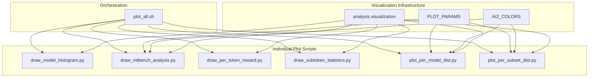
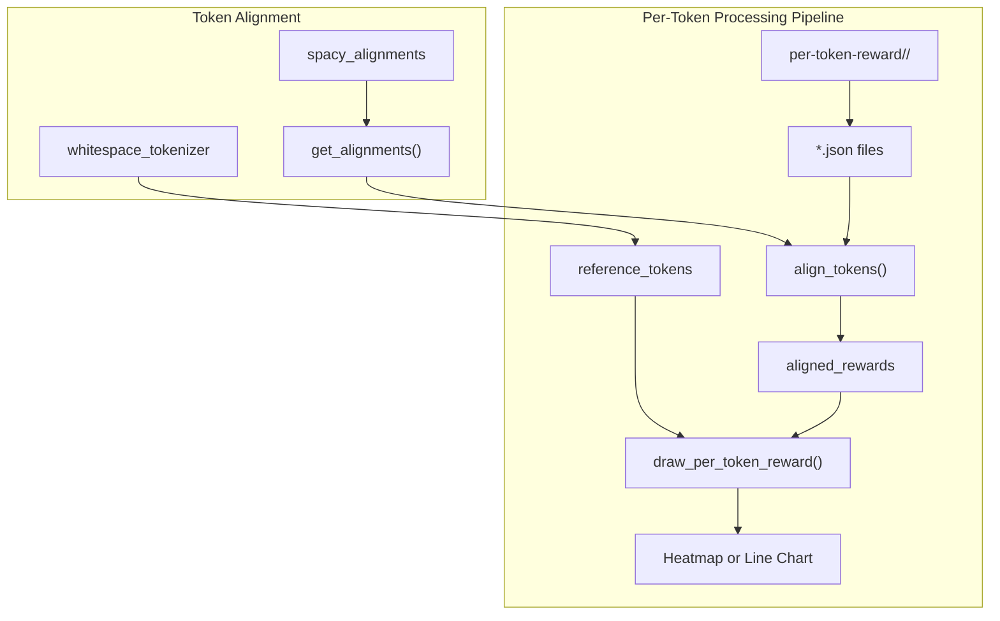
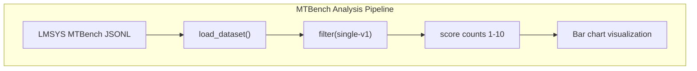
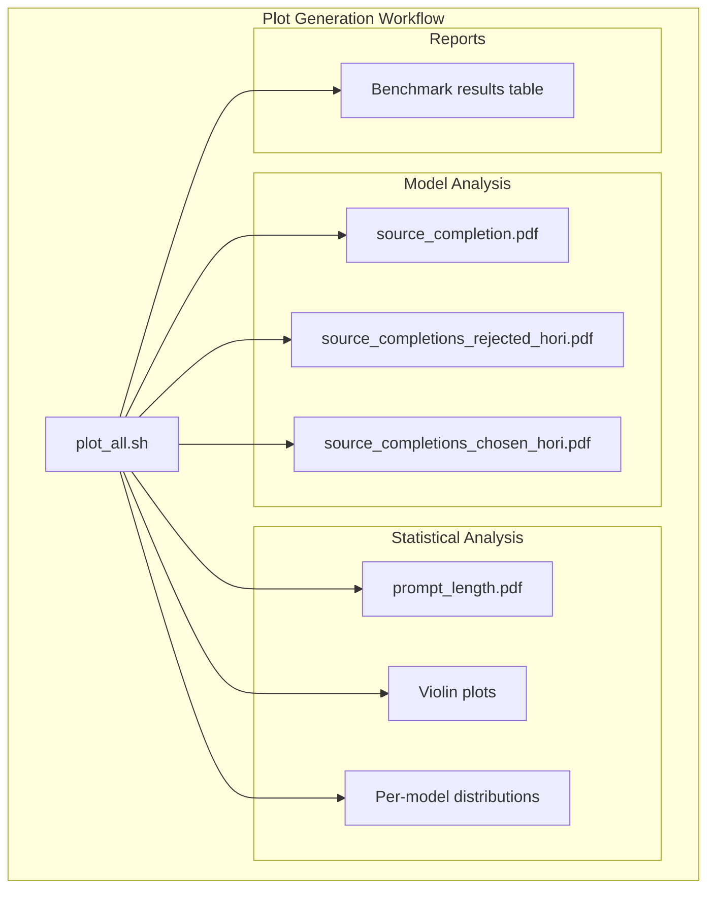

<!-- source: DeepWiki mcp.deepwiki.com · repo microsoft/LMOps · extra page Visualization and Plotting · fetched 2026-10-26 -->

# Visualization and Plotting

Relevant source files

The following files were used as context for generating this wiki page:

- [RRM-evaluation/analysis/draw_model_histogram.py](RRM-evaluation/analysis/draw_model_histogram.py)
- [RRM-evaluation/analysis/draw_mtbench_analysis.py](RRM-evaluation/analysis/draw_mtbench_analysis.py)
- [RRM-evaluation/analysis/draw_per_token_reward.py](RRM-evaluation/analysis/draw_per_token_reward.py)
- [RRM-evaluation/analysis/draw_subtoken_statistics.py](RRM-evaluation/analysis/draw_subtoken_statistics.py)
- [RRM-evaluation/analysis/plot_all.sh](RRM-evaluation/analysis/plot_all.sh)
- [RRM-evaluation/analysis/plot_per_model_dist.py](RRM-evaluation/analysis/plot_per_model_dist.py)
- [RRM-evaluation/analysis/plot_per_subset_dist.py](RRM-evaluation/analysis/plot_per_subset_dist.py)

This document covers the visualization and plotting capabilities within the RRM-evaluation system. These tools generate comprehensive visual analyses of reward model performance, including histograms, distribution plots, per-token reward visualizations, and statistical summaries. The visualization system processes evaluation results from multiple sources and creates publication-ready figures in PDF format.

For data processing and conversion functionality, see [Data Processing and Conversion](#3.2.1). For statistical analysis and reporting, see [Statistical Analysis and Reporting](#3.2.3).

## Core Visualization Infrastructure

The visualization system is built around a centralized `analysis.visualization` module that provides common plotting functions, color schemes, and styling parameters. All plotting scripts import shared components like `AI2_COLORS` and `PLOT_PARAMS` to ensure consistent visual styling across all generated figures.

Sources: [RRM-evaluation/analysis/draw_model_histogram.py:20](), [RRM-evaluation/analysis/draw_mtbench_analysis.py:19](), [RRM-evaluation/analysis/draw_per_token_reward.py:26](), [RRM-evaluation/analysis/draw_subtoken_statistics.py:18](), [RRM-evaluation/analysis/plot_per_model_dist.py:25-26](), [RRM-evaluation/analysis/plot_per_subset_dist.py:26-27](), [RRM-evaluation/analysis/plot_all.sh:1-13]()

## Model Distribution Visualization

The `draw_model_histogram.py` script creates histograms showing the distribution of models used as sources for chosen and rejected completions in the evaluation dataset. This visualization helps understand the composition and bias of the evaluation data.

| Parameter | Type | Default | Description |
|-----------|------|---------|-------------|
| `output_path` | Path | Required | Filepath to save the generated figure |
| `dataset_name` | str | `"allenai/reward-bench"` | HuggingFace dataset name |
| `keys` | List[str] | `["chosen_model","rejected_model"]` | Columns to include in histogram |
| `figsize` | List[int] | `[14, 8]` | Figure dimensions |
| `normalize` | bool | `False` | Normalize values by total completions |
| `log_scale` | bool | `False` | Use logarithmic y-axis |
| `top_n` | int | `None` | Limit to top-n models |

The script calls `draw_model_source_histogram()` and `print_model_statistics()` functions from the visualization module to generate both visual and textual summaries of model usage patterns.

Sources: [RRM-evaluation/analysis/draw_model_histogram.py:23-65](), [RRM-evaluation/analysis/draw_model_histogram.py:70-79]()

## Per-Token Reward Visualization

The `draw_per_token_reward.py` script creates detailed visualizations of how reward scores vary across individual tokens within text sequences. This enables fine-grained analysis of where reward models assign higher or lower scores within responses.

The script implements token alignment using the `spacy-alignments` library to ensure consistent tokenization across different reward models. The `align_tokens()` function [RRM-evaluation/analysis/draw_per_token_reward.py:63-76]() maps reward scores from model-specific tokenizations to a common reference tokenization.

Sources: [RRM-evaluation/analysis/draw_per_token_reward.py:15-16](), [RRM-evaluation/analysis/draw_per_token_reward.py:63-76](), [RRM-evaluation/analysis/draw_per_token_reward.py:94-115]()

## Distribution Analysis Plots

### Per-Model Distribution Analysis

The `plot_per_model_dist.py` script generates whisker plots showing score distributions for individual reward models. It downloads evaluation results from HuggingFace repositories and creates separate visualizations for different model types.

| Model Type | Description | Plot Configuration |
|------------|-------------|-------------------|
| Seq. Classifier | Sequence classification models | 3 columns, 12×12 figure |
| DPO | Direct Preference Optimization models | 3 columns, 16×12 figure |

The script uses the `generate_whisker_plot()` function [RRM-evaluation/analysis/plot_per_model_dist.py:107-200]() to create histograms comparing chosen vs rejected score distributions for each model.

Sources: [RRM-evaluation/analysis/plot_per_model_dist.py:51-105](), [RRM-evaluation/analysis/plot_per_model_dist.py:107-200]()

### Per-Subset Distribution Analysis

The `plot_per_subset_dist.py` script creates violin plots showing how model accuracies are distributed across different evaluation subsets. This helps identify which subsets are more challenging and how consistent model performance is within each category.

The `generate_whisker_plot()` function [RRM-evaluation/analysis/plot_per_subset_dist.py:75-177]() implements violin plots with custom quartile and whisker calculations using the `adjacent_values()` helper function [RRM-evaluation/analysis/plot_per_subset_dist.py:110-114]().

Sources: [RRM-evaluation/analysis/plot_per_subset_dist.py:53-72](), [RRM-evaluation/analysis/plot_per_subset_dist.py:75-177]()

## Specialized Analysis Scripts

### MTBench Score Analysis

The `draw_mtbench_analysis.py` script creates bar charts analyzing MTBench evaluation scores. It loads data directly from the LMSYS MTBench repository and filters for single-turn evaluations.

Sources: [RRM-evaluation/analysis/draw_mtbench_analysis.py:24-44]()

### Subtoken Statistics

The `draw_subtoken_statistics.py` script generates statistical visualizations of token length distributions across different evaluation subsets using specified tokenizers.

| Parameter | Type | Default | Description |
|-----------|------|---------|-------------|
| `tokenizer_name` | str | `"oobabooga/llama-tokenizer"` | HuggingFace tokenizer |
| `dataset_name` | str | `"allenai/reward-bench"` | HuggingFace dataset |
| `render_latex` | bool | `False` | Generate LaTeX output |

Sources: [RRM-evaluation/analysis/draw_subtoken_statistics.py:22-64]()

## Orchestration and Workflow

The `plot_all.sh` script provides automated orchestration of the entire visualization pipeline. It executes plotting scripts in a specific sequence to generate a comprehensive set of analysis figures.

The workflow generates the following visualization categories:

1. **Model source histograms** - Distribution of completion sources with logarithmic scaling
2. **Subtoken statistics** - Token length analysis across evaluation subsets  
3. **Distribution plots** - Violin plots for subset score distributions
4. **Per-model analysis** - Individual model performance distributions
5. **Benchmark tables** - LaTeX-formatted result summaries

Sources: [RRM-evaluation/analysis/plot_all.sh:1-13]()

## Output Formats and Integration

All visualization scripts generate PDF output files suitable for publication and research documentation. The plots integrate with the broader evaluation infrastructure by consuming results from HuggingFace repositories and local evaluation outputs.

The visualization system supports multiple output formats including:
- **PDF figures** for publication-quality plots
- **LaTeX tables** for research papers  
- **PNG images** for web display
- **Statistical summaries** in text format

Sources: [RRM-evaluation/analysis/draw_mtbench_analysis.py:43](), [RRM-evaluation/analysis/plot_per_model_dist.py:198](), [RRM-evaluation/analysis/plot_per_subset_dist.py:175]()

---

