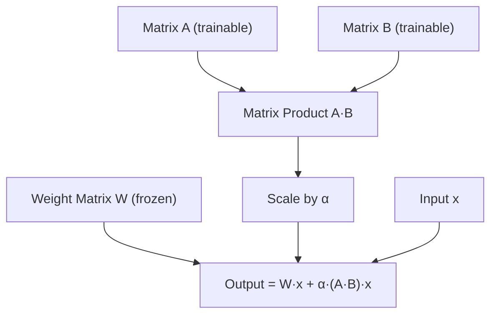
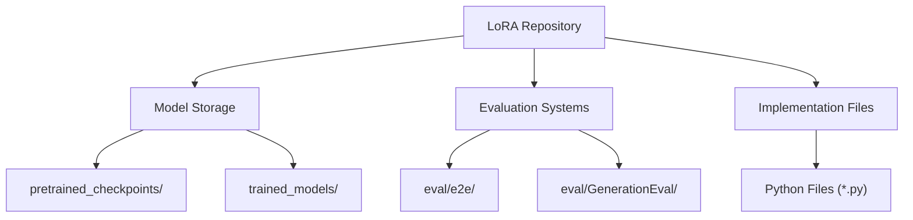
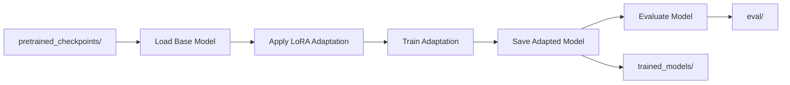

<!-- source: DeepWiki mcp.deepwiki.com · repo microsoft/LoRA · page 1 LoRA Repository Overview · fetched 2026-10-26 -->

# LoRA Repository Overview

Relevant source files

The following files were used as context for generating this wiki page:

- [.gitignore](.gitignore)

## Purpose and Scope

This document provides a technical overview of the Microsoft LoRA repository, which implements Low-Rank Adaptation (LoRA) for efficient fine-tuning of large language models. It covers fundamental concepts of LoRA and the repository structure. For detailed information about specific components, refer to their dedicated wiki pages:

- For details on model management, see [Model Management](#2)
- For information about evaluation systems, see [Evaluation Systems](#3)
- For setup instructions, see [Development Setup](#4)

## Low-Rank Adaptation Technical Foundation

LoRA is a parameter-efficient fine-tuning method that introduces trainable low-rank decomposition matrices into pre-trained model layers. Traditional fine-tuning requires updating all parameters in a model, which can be computationally expensive and memory-intensive. LoRA addresses this by representing weight updates (ΔW) as the product of two low-rank matrices:

For a weight matrix W with dimensions m×n and a chosen rank r (where r << m,n):
- Matrix A has dimensions m×r
- Matrix B has dimensions r×n
- Weight update: ΔW = A×B
- Adapted forward pass: h = W·x + α·(A·B)·x

Where α is a scaling factor controlling the adaptation magnitude.

### LoRA Mechanism

This approach significantly reduces trainable parameters during fine-tuning. For a weight matrix of size 1024×1024, full fine-tuning requires training 1,048,576 parameters, while LoRA with rank 8 requires only 16,384 parameters (98.4% reduction).

Sources: This is based on general knowledge of LoRA technology.

## Repository Structure

Based on the `.gitignore` file, the Microsoft LoRA repository appears to have the following structure:

The repository organizes its components into:

1. **Model Storage**:
   - `pretrained_checkpoints/`: Stores base models before adaptation
   - `trained_models/`: Stores models after LoRA fine-tuning

2. **Evaluation Systems**:
   - `eval/e2e/`: End-to-end evaluation framework
   - `eval/GenerationEval/`: Specialized for text generation evaluation

3. **Implementation Files**:
   - Python source files implementing the LoRA technique

Sources: [.gitignore:3-6]()

## Key Directories

| Directory | Purpose |
|-----------|---------|
| `pretrained_checkpoints/` | Storage for base models before LoRA adaptation |
| `trained_models/` | Storage for models after LoRA fine-tuning |
| `eval/e2e/` | Evaluation framework for end-to-end testing |
| `eval/GenerationEval/` | Evaluation framework for text generation |
| `venv/` | Python virtual environment for dependency management |

These model-related directories are excluded from version control, which is standard practice for machine learning repositories where model files can be very large.

Sources: [.gitignore:3-9]()

## Typical LoRA Workflow

A typical workflow when using this repository involves:

This process typically includes:
1. Starting with a base model from `pretrained_checkpoints/`
2. Configuring LoRA parameters (rank, which layers to adapt, etc.)
3. Fine-tuning on task-specific data, updating only LoRA parameters
4. Saving the adapted weights to `trained_models/`
5. Evaluating the model using evaluation frameworks in `eval/`

Sources: Based on inference from [.gitignore:3-6]() and general knowledge of LoRA workflows.

## Development Environment

The repository follows standard Python development practices:

- Uses Python virtual environments (`venv/`)
- Follows typical Python project organization (`__pycache__/`, `*.py[cod]`, etc.)
- Supports standard Python packaging and distribution (based on `.gitignore` entries for `build/`, `dist/`, etc.)
- Includes support for testing frameworks (based on `.gitignore` entries like `.hypothesis/`, `.pytest_cache/`)

For detailed instructions on setting up your development environment, refer to [Development Setup](#4).

Sources: [.gitignore:13-16](), [.gitignore:22-38](), [.gitignore:100-107]()

---

