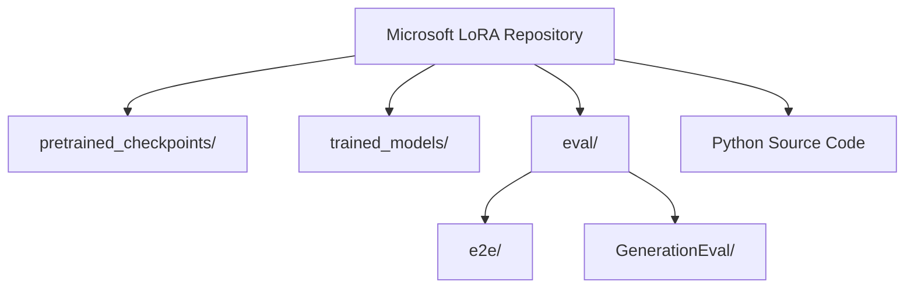
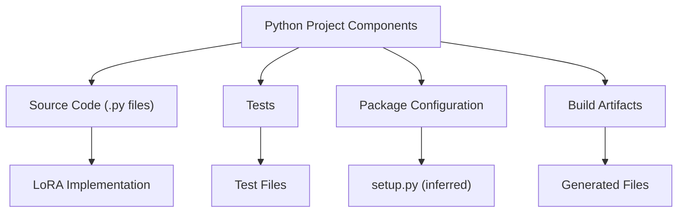
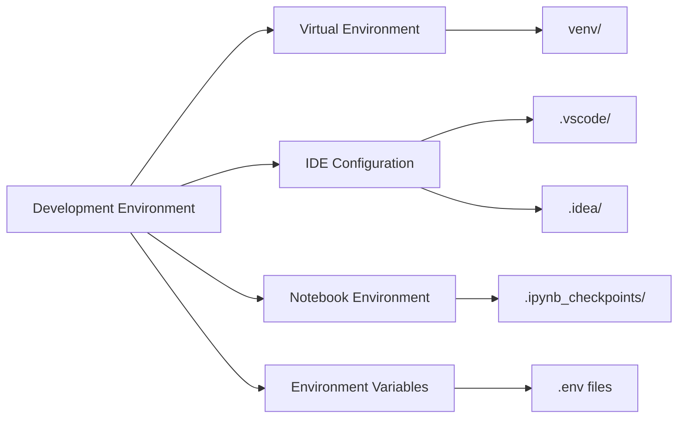
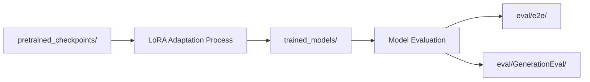
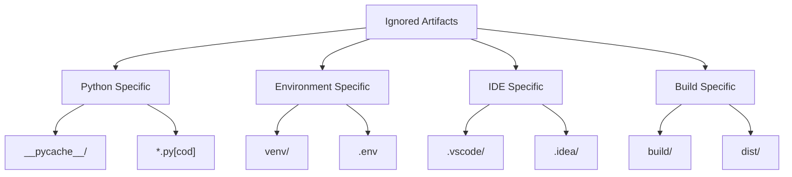

<!-- source: DeepWiki mcp.deepwiki.com · repo microsoft/LoRA · page 1.1 Project Structure · fetched 2026-10-26 -->

# Project Structure

Relevant source files

The following files were used as context for generating this wiki page:

- [.gitignore](.gitignore)

This document describes the directory organization and file structure of the Microsoft LoRA repository. The information presented is based on the analysis of repository configuration files, particularly the `.gitignore` file. For specific details about model management, see [Model Management](#2), and for evaluation systems, see [Evaluation Systems](#3).

## High-Level Directory Structure

The Microsoft LoRA repository is organized to support the workflow of applying Low-Rank Adaptation to large language models, with dedicated directories for model storage, training results, and evaluation.

Sources: [.gitignore:3-9]()

## Primary Directories

The repository is structured around these main directories, each serving a specific purpose in the LoRA workflow:

| Directory | Purpose |
|-----------|---------|
| `pretrained_checkpoints/` | Stores original model weights before adaptation |
| `trained_models/` | Contains fine-tuned models after LoRA adaptation |
| `eval/e2e/` | Houses the end-to-end evaluation framework |
| `eval/GenerationEval/` | Contains specialized text generation evaluation tools |

Sources: [.gitignore:3-6]()

## Python Project Organization

As a Python-based project, the Microsoft LoRA repository follows standard Python project conventions for code organization:

Sources: [.gitignore:13-126]()

The repository contains typical Python project elements and artifacts:

- Python source files (`.py`)
- Python bytecode files (`.pyc`, `.pyo`)
- Package build directories (`build/`, `dist/`)
- Test and coverage directories (`.coverage`, `htmlcov/`)
- Documentation build directories (`docs/_build/`)

Sources: [.gitignore:14-124]()

## Development Environment

The repository supports standard development workflows with these environment components:

Sources: [.gitignore:84-109, 127]()

## LoRA Workflow Architecture

The directory structure supports a typical LoRA adaptation workflow, as illustrated below:

Sources: [.gitignore:3-6]()

## Additional Components

The repository also includes supplementary files and directories:

| Component | Description |
|-----------|-------------|
| `SCRATCH*` prefixed files | Temporary or experimental files |
| `toy*.py` | Example or test scripts |
| `.nupkg`, `Packages/` | Package management files |
| `post/` | Possible post-processing scripts |

Sources: [.gitignore:2, 128-134]()

## Ignored Development Artifacts

The repository configuration excludes various development artifacts from version control:

Sources: [.gitignore:13-127]()

This structure ensures a clean repository that focuses on essential code while excluding generated artifacts and environment-specific configurations.

---

