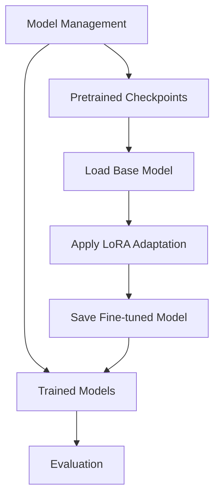
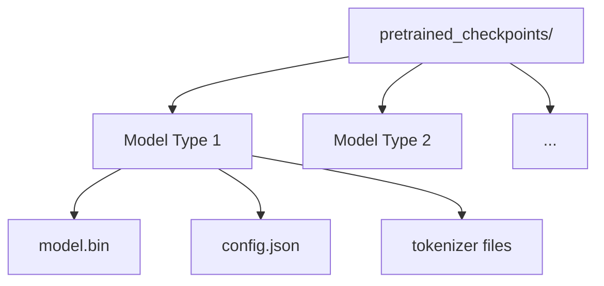
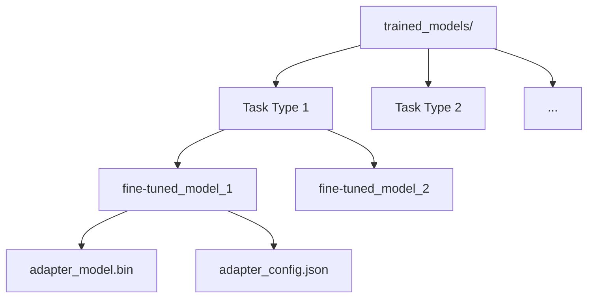
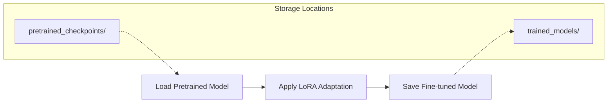
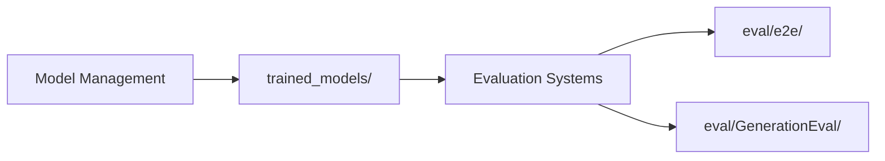
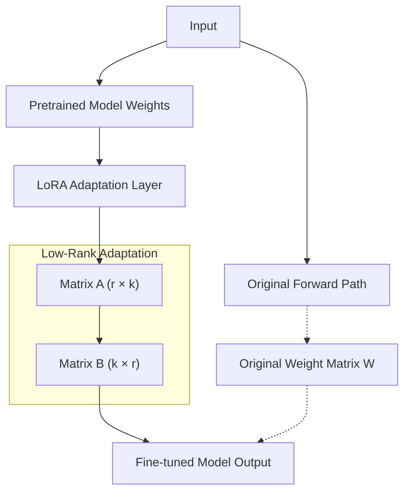

<!-- source: DeepWiki mcp.deepwiki.com · repo microsoft/LoRA · page 2 Model Management · fetched 2026-10-26 -->

# Model Management

Relevant source files

The following files were used as context for generating this wiki page:

- [.gitignore](.gitignore)

This document explains how the Microsoft LoRA repository manages model artifacts throughout different stages of the LoRA fine-tuning process. It covers the organization and handling of both pretrained model checkpoints (base models) and LoRA-adapted trained models. For information about evaluating these models after training, see [Evaluation Systems](#3).

## Overview

The Model Management system in the LoRA repository handles two primary types of model artifacts:

1. **Pretrained Checkpoints**: Original base models before LoRA adaptation
2. **Trained Models**: Fine-tuned models after LoRA adaptation has been applied

These components are managed through dedicated directories in the repository structure which are excluded from version control due to their large size.

Sources: `.gitignore:3-4`, `.gitignore:8-9`

The following table summarizes the key directories in the Model Management system:

| Directory | Purpose | Content |
|-----------|---------|---------|
| `pretrained_checkpoints/` | Stores base models before adaptation | Model weights, configuration files, tokenizer files |
| `trained_models/` | Stores fine-tuned models after LoRA adaptation | Adapter model weights, configuration files |

Sources: `.gitignore:3-4`, `.gitignore:8-9`

## Pretrained Checkpoints

The `pretrained_checkpoints/` directory stores the base models that serve as the starting point for LoRA adaptation. These are typically large language models that have already been trained on vast datasets. Due to their size, these files are excluded from version control as indicated in the `.gitignore` file.

### Directory Structure

The pretrained_checkpoints directory contains various base models organized by model type:

Sources: `.gitignore:3`, `.gitignore:9`

## Trained Models

The `trained_models/` directory contains the results of applying LoRA adaptation to base models. These are fine-tuned models that incorporate the low-rank adaptation matrices alongside or applied to the original model weights. Like the pretrained checkpoints, these files are also excluded from version control.

### Directory Structure

The trained_models directory organizes fine-tuned models by task type or other categorization:

Sources: `.gitignore:4`, `.gitignore:8`

## Model Management Process

The LoRA approach to fine-tuning involves a specific workflow for managing models:

1. **Loading a pretrained checkpoint**: A base model is retrieved from the `pretrained_checkpoints/` directory
2. **Applying LoRA adaptation**: Low-rank matrices are trained to adapt the model while keeping original weights frozen
3. **Saving the fine-tuned model**: The resulting adapted model (or just the adapter matrices) is saved to the `trained_models/` directory

Sources: `.gitignore:3-4`, `.gitignore:8-9`

## Integration with Evaluation

After models are trained and saved, they can be evaluated using the evaluation systems provided in the repository:

The evaluation systems access the trained models from the `trained_models/` directory to assess their performance on specific tasks. For more details on the evaluation process, see [Evaluation Systems](#3), [End-to-End Evaluation](#3.1), and [Generation Evaluation](#3.2).

Sources: `.gitignore:4-6`, `.gitignore:8`

## LoRA Model Structure

The LoRA technique introduces low-rank adaptation matrices to the model architecture. These matrices are significantly smaller than the full model weights, making fine-tuning more efficient.

In LoRA adaptation, the original pretrained weights remain frozen, while only the low-rank adaptation matrices are trained. The output combines both the original path and the adaptation path. This approach significantly reduces the number of trainable parameters (from millions or billions to just thousands) and the computational resources required for fine-tuning.

Sources: (Based on general knowledge of LoRA technology)

---

