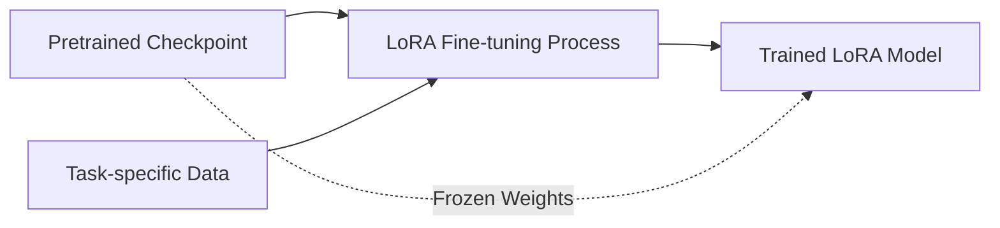
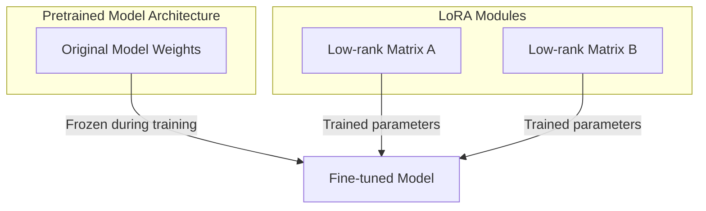

<!-- source: DeepWiki mcp.deepwiki.com · repo microsoft/LoRA · page 2.1 Pretrained Checkpoints · fetched 2026-10-26 -->

# Pretrained Checkpoints

<details>
<summary>Relevant source files</summary>

The following files were used as context for generating this wiki page:

- [.gitignore](.gitignore)

</details>


This document describes the purpose and organization of the `pretrained_checkpoints` directory in the Microsoft LoRA repository. This directory serves as a storage location for base model weights that will be used for Low-Rank Adaptation (LoRA) fine-tuning. For information about models after LoRA fine-tuning has been applied, see [Trained Models](#2.2).

## Purpose

The `pretrained_checkpoints` directory stores the original, pretrained neural network model weights that serve as the foundation for LoRA fine-tuning. These are typically large language models that have already been trained on vast datasets. In the LoRA methodology, these pretrained weights remain largely frozen during the adaptation process, while small, trainable low-rank matrices are added to efficiently adapt the model to specific tasks.

## Repository Structure

The `pretrained_checkpoints` directory is located at the root level of the repository. It is explicitly listed in the `.gitignore` file, indicating that these large model files are not tracked in version control:

```
/pretrained_checkpoints
```

This is standard practice for machine learning repositories, as model checkpoint files are typically very large (often several gigabytes) and would significantly bloat the repository size.

Sources: [.gitignore:3](), [.gitignore:9]()

## Role in LoRA Workflow

### LoRA Process Flow



Sources: [.gitignore:3](), [.gitignore:9]()

### LoRA Adaptation Mechanism



Sources: [.gitignore:3](), [.gitignore:9]()

## Advantages of Using Pretrained Checkpoints with LoRA

The combination of pretrained checkpoints and LoRA adaptation offers several benefits:

| Benefit | Description |
|---------|-------------|
| Parameter Efficiency | Only a small fraction of parameters (the low-rank matrices) need to be trained |
| Memory Efficiency | Fine-tuning requires significantly less memory than full model fine-tuning |
| Storage Efficiency | Multiple task adaptations can share the same pretrained checkpoint |
| Training Speed | Fewer trainable parameters result in faster fine-tuning |
| Performance Preservation | Original model capabilities are retained while adding task-specific adaptations |

## Working with Pretrained Checkpoints

While specific implementation details depend on the codebase, the general workflow for using pretrained checkpoints with LoRA typically involves:

1. Obtaining compatible pretrained model weights from a source like Hugging Face or other model repositories
2. Placing these weights in the `pretrained_checkpoints` directory
3. Referencing these checkpoints when initializing the LoRA fine-tuning process
4. Keeping the original weights frozen while training only the LoRA parameters
5. Storing the resulting fine-tuned model in the `trained_models` directory

## Model Compatibility

When selecting pretrained checkpoints for use with LoRA, it's important to ensure compatibility with the specific LoRA implementation. Different model architectures (e.g., BERT, GPT, T5) might require specific considerations in how the LoRA adaptation is applied.

Sources: [.gitignore:3](), [.gitignore:9]()

---

