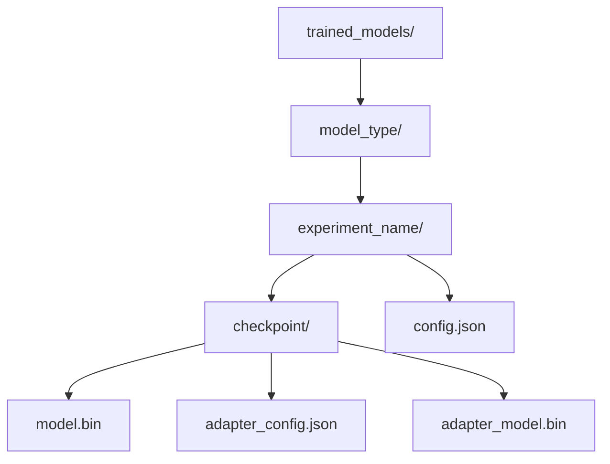
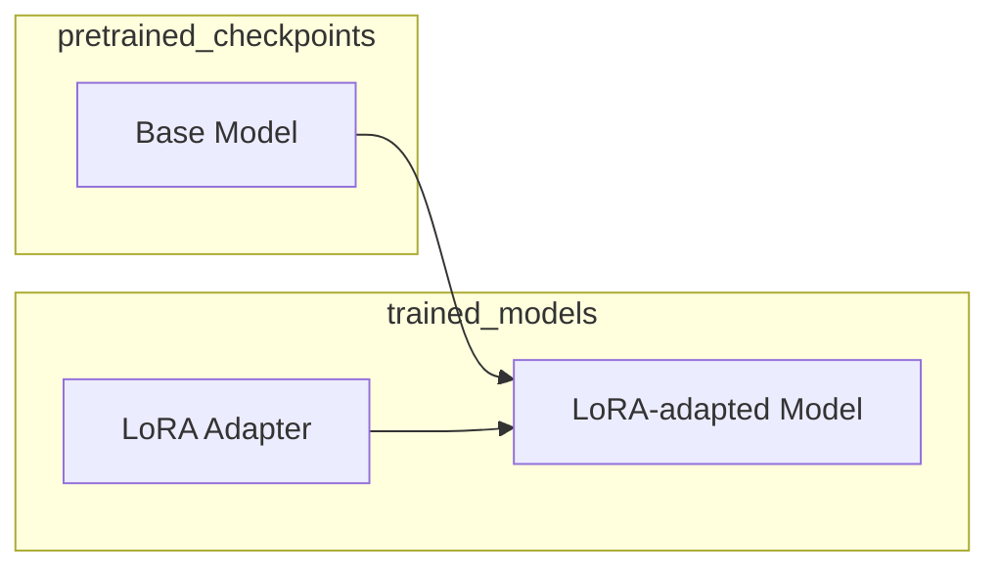
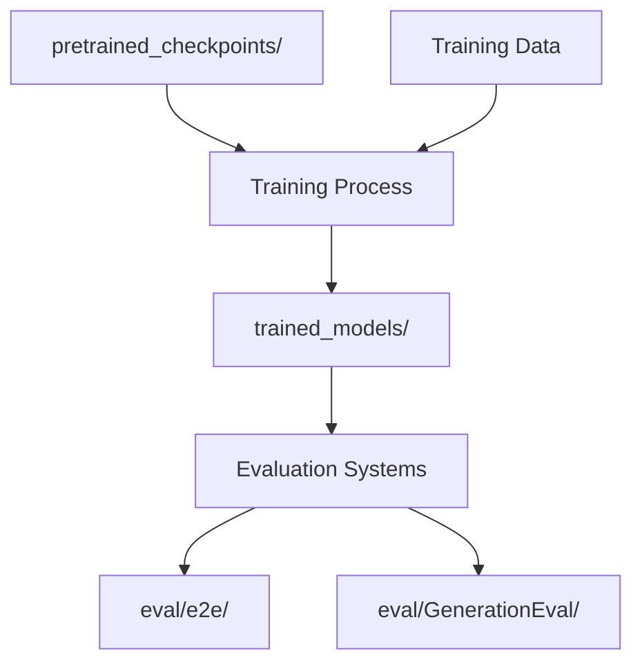

<!-- source: DeepWiki mcp.deepwiki.com · repo microsoft/LoRA · page 2.2 Trained Models · fetched 2026-10-26 -->

# Trained Models

Relevant source files

The following files were used as context for generating this wiki page:

- [.gitignore](.gitignore)

This document describes the structure and usage of the `trained_models` directory in the Microsoft LoRA repository. This directory serves as a storage location for models that have been fine-tuned using the LoRA (Low-Rank Adaptation) technique. For information about the original models before adaptation, see [Pretrained Checkpoints](#2.1).

## Purpose and Scope

The `trained_models` directory contains the results of applying LoRA fine-tuning to pretrained language models. These models represent the output artifacts of training runs and are typically used for inference, evaluation, or as starting points for further adaptation.

Sources: [.gitignore:4,8]()

## Directory Structure

The organization of the `trained_models` directory follows a conventional structure for managing multiple model variations and experiments:

Title: Trained Models Directory Structure

The directory is excluded from version control (as shown in the `.gitignore` file), which is standard practice for large binary files such as model weights. This suggests that researchers and developers are expected to generate these files locally during their experiments or download them from an external model repository.

Sources: [.gitignore:4,8]()

## Model Composition

LoRA trained models consist of two primary components that work together:

Title: LoRA Model Component Relationship

The key advantage of LoRA is that the adapter weights are typically much smaller than the full model weights, making them easier to store, share, and deploy. This architecture allows for efficient fine-tuning while preserving most of the pretrained model's capabilities.

Sources: [.gitignore:3-4]()

## Storage Format

Trained models in the LoRA repository typically include:

1. **Configuration Files**:
   - `config.json` - Contains model architecture configuration
   - `adapter_config.json` - Specifies LoRA-specific parameters (rank, alpha values, which layers were adapted)

2. **Model Weights**:
   - `model.bin` or similar - Contains model weights or references to the base model
   - `adapter_model.bin` - Contains the lightweight LoRA adapter matrices

## Integration with Repository Workflow

The `trained_models` directory is a critical component in the overall LoRA workflow:

Title: LoRA Repository Workflow

After models are trained, they can be evaluated using the evaluation systems in the repository. The `eval/e2e/` directory likely contains end-to-end evaluation pipelines, while `eval/GenerationEval/` focuses on assessing text generation capabilities.

Sources: [.gitignore:3-6]()

## Usage Considerations

When working with the `trained_models` directory:

| Consideration | Description |
|---------------|-------------|
| Storage Requirements | LoRA adapters are significantly smaller than full models (typically <100MB vs. many GB) |
| Naming Conventions | Use descriptive names for experiment directories to track different training runs |
| Metadata | Include training hyperparameters, dataset information, and evaluation metrics with saved models |
| Versioning | Consider using timestamps or version numbers in directory names for tracking model iterations |
| Cleanup | Regularly archive or remove underperforming models to manage disk space |

## Best Practices for Model Management

1. **Documentation**: Maintain records of which adapter was trained on what data and for what purpose
2. **Reproducibility**: Store training arguments, random seeds, and dataset information alongside model weights
3. **Performance Tracking**: Keep evaluation metrics with each model for easy comparison
4. **Modular Usage**: Design systems to easily swap different LoRA adapters on the same base model for comparison

Sources: [.gitignore:4,8]()

---

