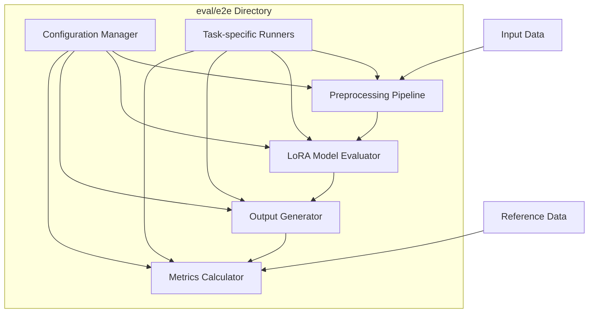
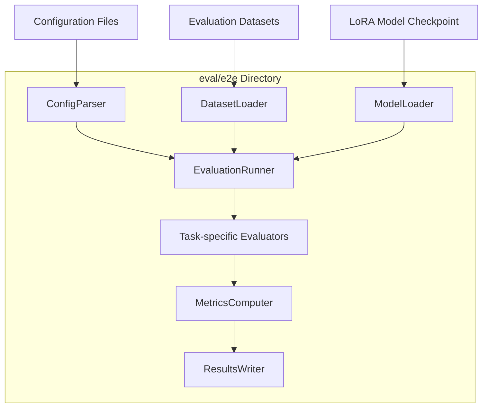
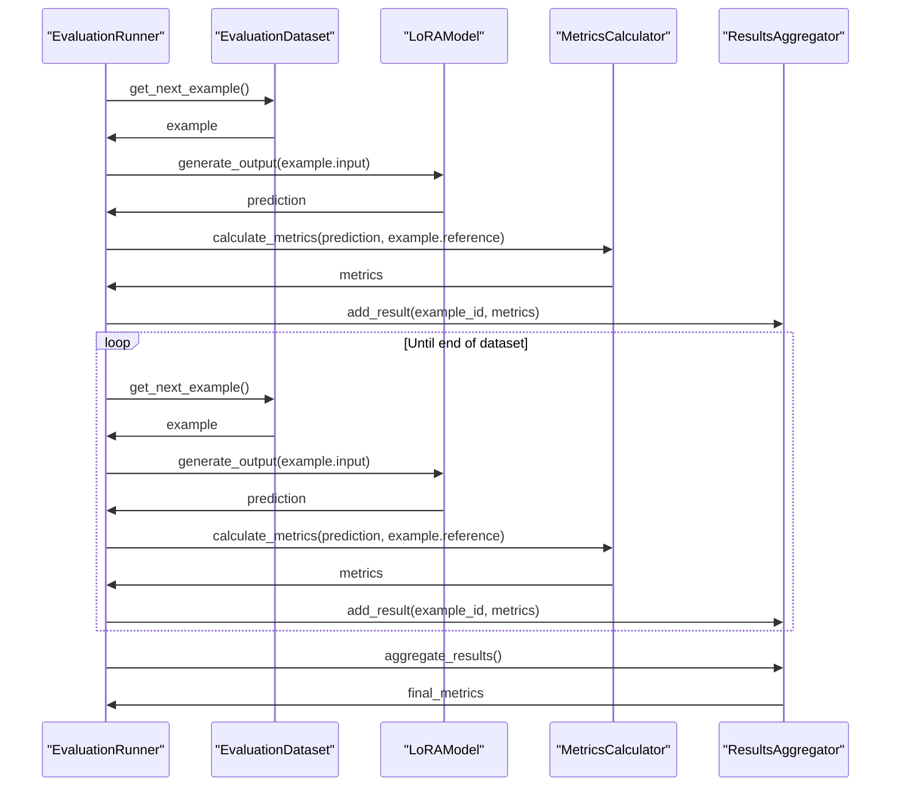
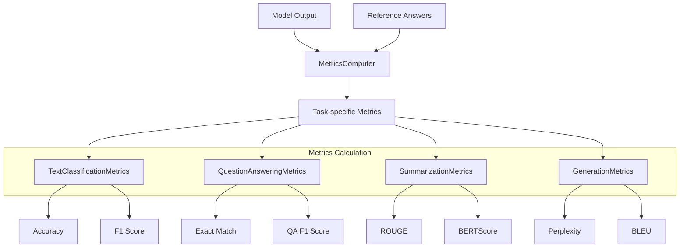
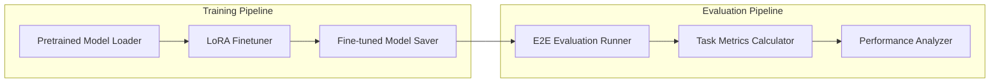

<!-- source: DeepWiki mcp.deepwiki.com · repo microsoft/LoRA · page 3.1 End-to-End Evaluation · fetched 2026-10-26 -->

# End-to-End Evaluation

<details>
<summary>Relevant source files</summary>

The following files were used as context for generating this wiki page:

- [.gitignore](.gitignore)

</details>


## Purpose and Scope

This document describes the end-to-end evaluation system in the Microsoft LoRA repository, responsible for comprehensive assessment of models fine-tuned using the Low-Rank Adaptation technique. The system evaluates complete task pipelines from input to output, providing holistic performance metrics across various NLP tasks. For information about specific text generation evaluation mechanisms, see [Generation Evaluation](#3.2).

## Overview of the End-to-End Evaluation System

The end-to-end evaluation system, located in the `eval/e2e` directory, provides a framework for testing LoRA-fine-tuned models on complete tasks that replicate real-world usage scenarios. Unlike isolated component evaluations, this system tests the entire pipeline from data ingestion through model inference to final output assessment.

### Evaluation Architecture



Sources: `.gitignore:5`

## Evaluation Workflow

The end-to-end evaluation process follows a structured workflow from configuration to results reporting.

### Evaluation Pipeline Components



Sources: `.gitignore:5`

### Execution Process



Sources: `.gitignore:5`

## Key System Components

### 1. Configuration Management

The system likely uses configuration files to define:
- Model parameters (paths to LoRA-fine-tuned models)
- Dataset specifications
- Task-specific settings
- Evaluation metrics
- Output formats and locations

### 2. Dataset Handling

The evaluation system manages:
- Loading task-specific datasets
- Input preprocessing and formatting
- Reference answer preparation
- Batching and sampling strategies

### 3. Model Inference

Core functionality includes:
- Loading LoRA-fine-tuned models from `trained_models` directory
- Setting up inference parameters (batch size, beam width, etc.)
- Efficiently running inference on evaluation inputs
- Processing model outputs for metric calculation

### 4. Metrics Calculation and Reporting



Sources: `.gitignore:5`

## Supported Evaluation Tasks

The end-to-end evaluation system likely supports multiple NLP tasks to comprehensively assess model capabilities:

| Task Type | Description | Typical Metrics | Example Usage |
|-----------|-------------|-----------------|---------------|
| Text Classification | Categorizing text into predefined classes | Accuracy, F1, Precision, Recall | Topic classification, sentiment analysis |
| Question Answering | Generating answers to questions | Exact Match, F1, ROUGE | Factual QA, reading comprehension |
| Summarization | Creating concise summaries of longer texts | ROUGE, BERTScore | Document summarization, headline generation |
| Text Generation | Creating coherent and relevant text | Perplexity, BLEU | Story completion, dialog response |
| Translation | Converting text between languages | BLEU, METEOR | Cross-lingual translation |

## Integration with Training Pipeline

The end-to-end evaluation system is designed to work seamlessly with the LoRA fine-tuning pipeline:



Sources: `.gitignore:5`

## Usage Examples

### Typical Evaluation Command

A typical command to run the end-to-end evaluation might look like:

```
python -m eval.e2e.run_eval --model_path trained_models/my_lora_model --task question_answering --dataset squad_v2 --output_dir results/qa_eval
```

### Configuration Example

A configuration file might contain:

```
model:
  path: trained_models/my_lora_model
  adapter_name: lora_adapter
  device: cuda
dataset:
  name: squad_v2
  split: validation
  max_samples: 1000
evaluation:
  batch_size: 16
  metrics: [exact_match, f1]
  output_dir: results/qa_eval
```

## Interpreting Evaluation Results

The end-to-end evaluation results typically provide:

1. Task-specific metrics for overall performance assessment
2. Per-category or per-example breakdowns to identify strengths/weaknesses
3. Comparative analysis against baseline models
4. Diagnostic information for error analysis
5. Aggregated statistics for use in model selection and iteration

## Conclusion

The end-to-end evaluation system forms a critical component of the LoRA framework, providing comprehensive assessment of fine-tuned models across diverse tasks. By evaluating complete pipelines rather than isolated components, it offers insight into real-world model performance and helps guide further improvements to the fine-tuning process.

---

