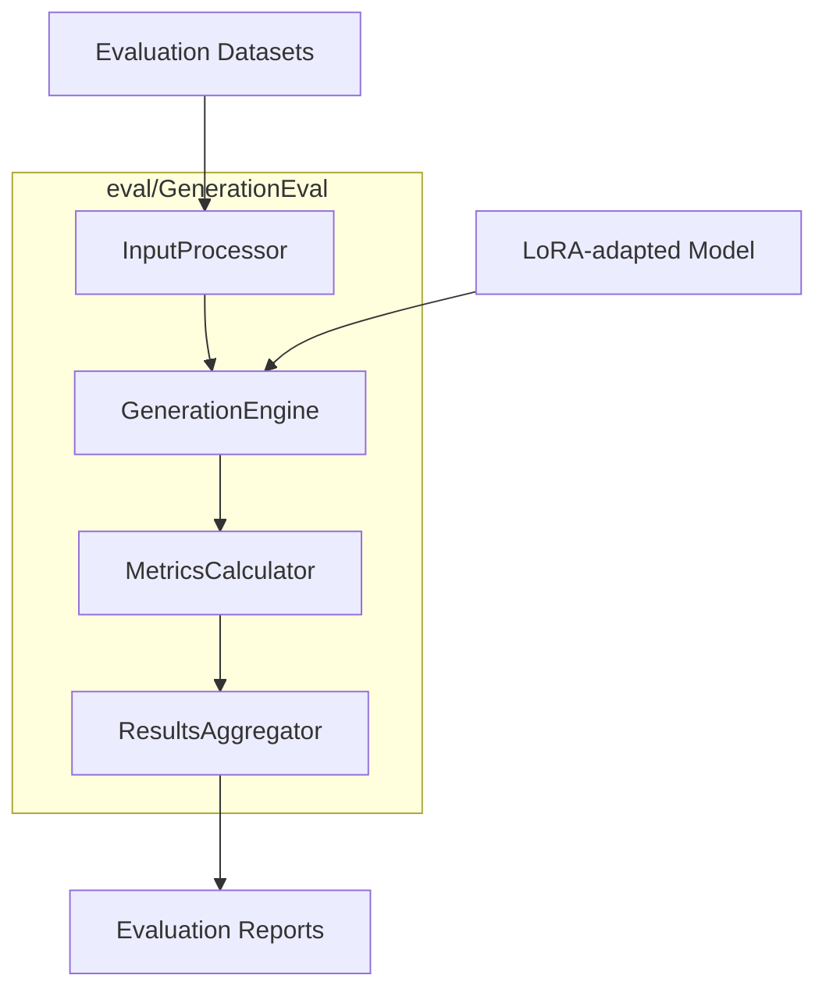
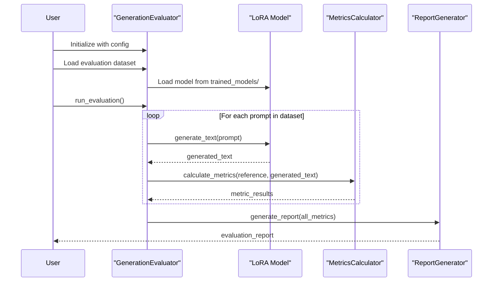
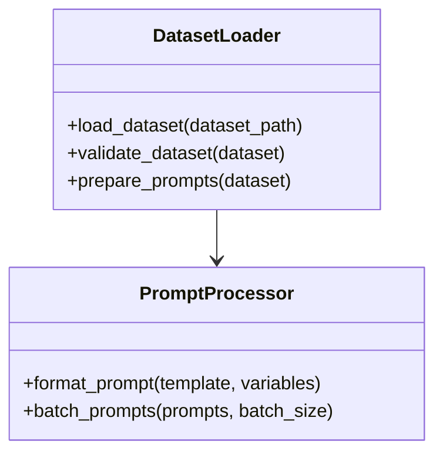
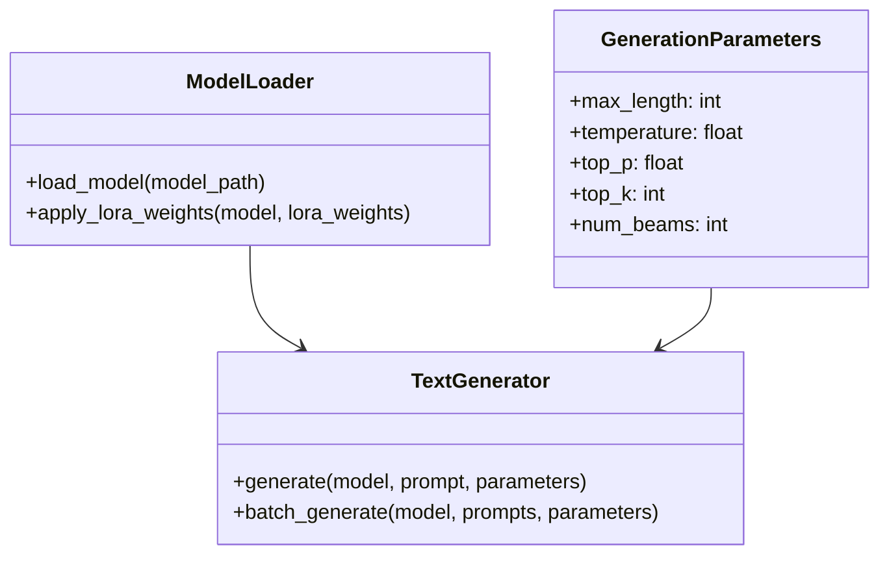
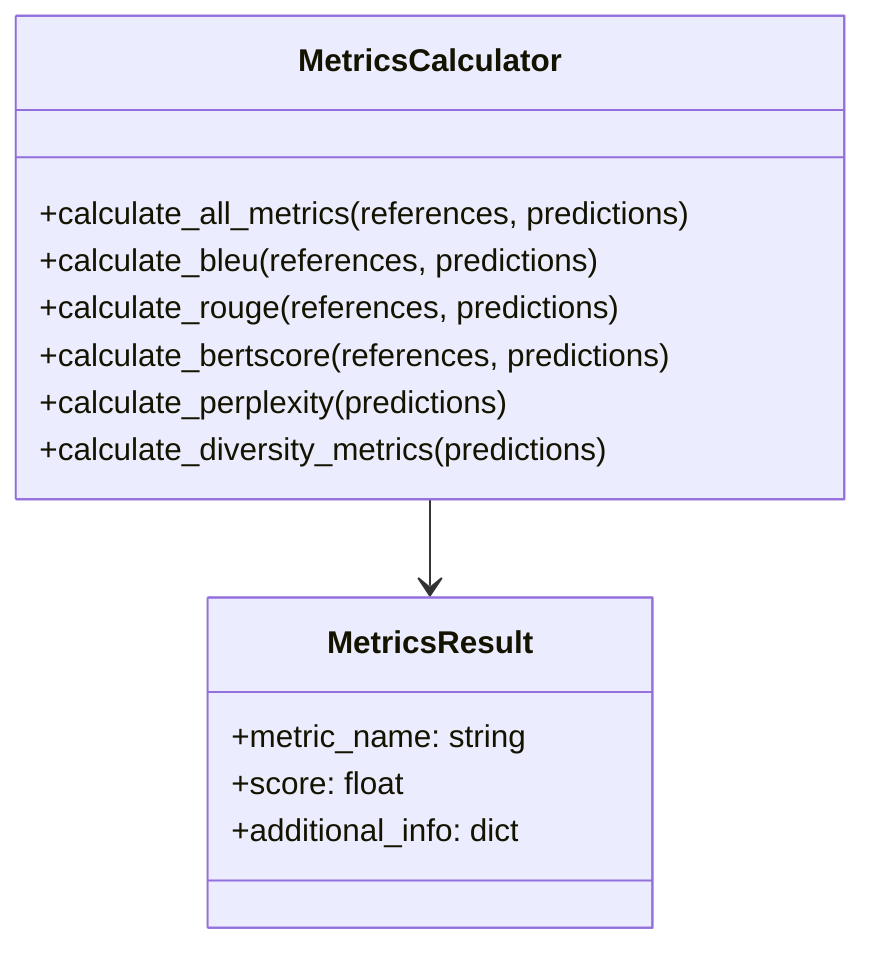
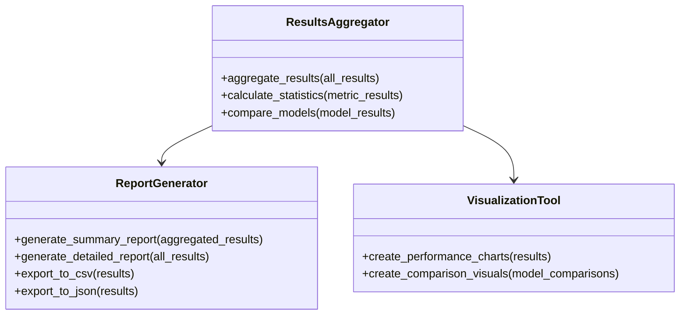
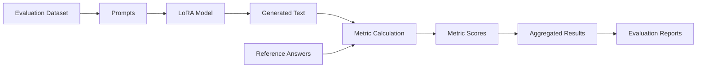
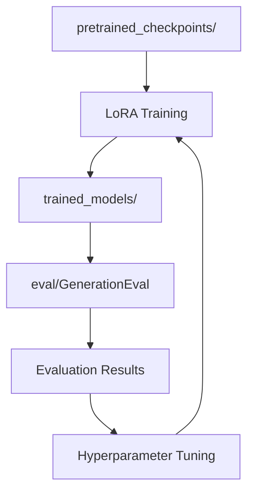

<!-- source: DeepWiki mcp.deepwiki.com · repo microsoft/LoRA · page 3.2 Generation Evaluation · fetched 2026-10-26 -->

# Generation Evaluation

<details>
<summary>Relevant source files</summary>

The following files were used as context for generating this wiki page:

- [.gitignore](.gitignore)

</details>


## Purpose and Scope

The Generation Evaluation system provides a comprehensive framework for evaluating the text generation capabilities of LoRA-adapted language models. This document covers the architecture, functionality, and usage of the evaluation system located in the `eval/GenerationEval` directory. The system focuses specifically on assessing generative performance metrics as opposed to the broader end-to-end evaluation covered in [End-to-End Evaluation](#3.1).

Sources: `.gitignore`

## System Architecture

The Generation Evaluation system is designed to evaluate how well LoRA-adapted language models perform on text generation tasks. It employs a modular architecture that separates the evaluation process into distinct components.

### Overall Architecture



Title: Generation Evaluation System Architecture

Sources: `.gitignore`

### Evaluation Workflow



Title: Generation Evaluation Workflow

Sources: `.gitignore`

## Key Components

The Generation Evaluation system consists of several key components that work together to assess model performance.

### Input Processing

The input processing component handles the preparation and validation of evaluation datasets and prompts.



Title: Input Processing Components

Sources: `.gitignore`

### Generation Engine

The Generation Engine is responsible for interfacing with the LoRA-adapted models and generating text responses based on input prompts.



Title: Generation Engine Components

Sources: `.gitignore`

## Evaluation Metrics

The Generation Evaluation system typically calculates various metrics to assess different aspects of text generation quality.

| Metric Category | Metrics | Description |
|----------------|---------|-------------|
| Fluency | Perplexity, Grammar Score | Measures how natural and grammatically correct the generated text is |
| Relevance | BLEU, ROUGE, BERTScore | Assesses how relevant and similar the generated text is to reference texts |
| Diversity | Distinct-n, Entropy | Measures lexical diversity and information content of generated text |
| Factuality | Fact Verification Score | Evaluates factual accuracy of generated content |
| Task-specific | Custom metrics | Specific metrics relevant to particular generation tasks |

### Metrics Implementation



Title: Metrics Calculation Components

Sources: `.gitignore`

## Results Aggregation and Reporting

The system aggregates individual evaluation results and produces comprehensive reports that can be used to compare model performance.



Title: Results Processing Components

Sources: `.gitignore`

## Usage Guide

### Basic Evaluation Workflow

To evaluate a LoRA-adapted model's generation capabilities:

1. Prepare an evaluation dataset in the required format
2. Configure the evaluation parameters
3. Run the evaluation script
4. Analyze the generated reports

### Example Configuration

A typical evaluation configuration might include:

```
{
  "model_path": "trained_models/my_lora_model",
  "dataset_path": "path/to/evaluation/dataset",
  "metrics": ["bleu", "rouge", "perplexity", "diversity"],
  "generation_params": {
    "max_length": 128,
    "temperature": 0.7,
    "top_p": 0.9,
    "top_k": 50,
    "num_beams": 4
  },
  "output_dir": "evaluation_results/"
}
```

## Data Flow

The following diagram illustrates the data flow through the Generation Evaluation system:



Title: Data Flow Through Generation Evaluation System

Sources: `.gitignore`

## Integration with Model Management

The Generation Evaluation system integrates with the LoRA repository's model management components:



Title: Integration with Model Management Components

Sources: `.gitignore`

## Conclusion

The Generation Evaluation system provides a comprehensive framework for assessing the text generation capabilities of LoRA-adapted language models. By calculating a variety of metrics across different dimensions of generation quality, it enables researchers and engineers to effectively measure model performance, compare different model variants, and guide further refinement of LoRA adaptations.

For information about the broader evaluation framework, including end-to-end evaluation capabilities, see [End-to-End Evaluation](#3.1).

Sources: `.gitignore`

---

