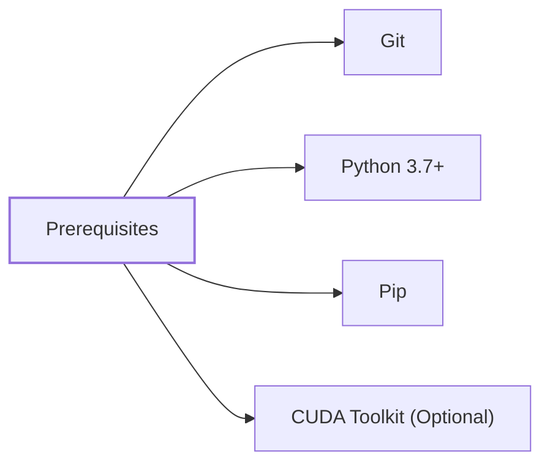
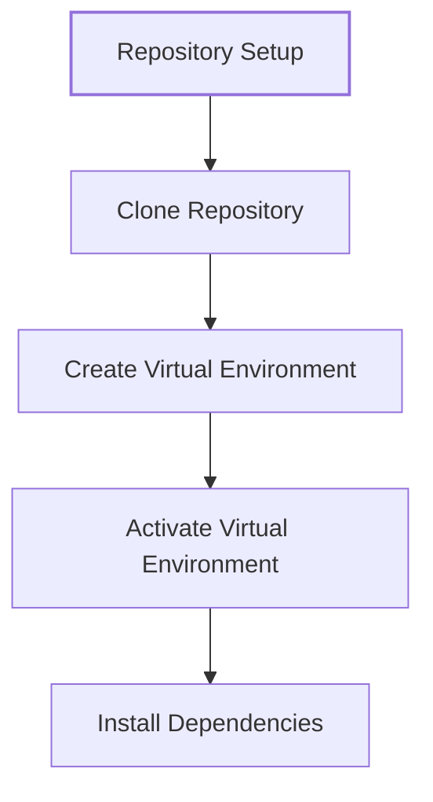
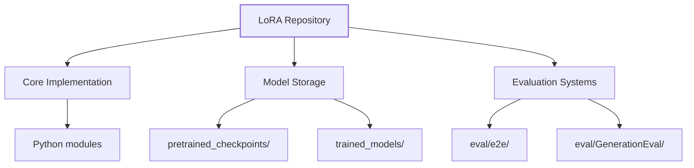
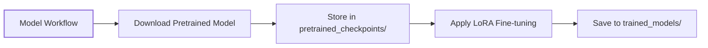
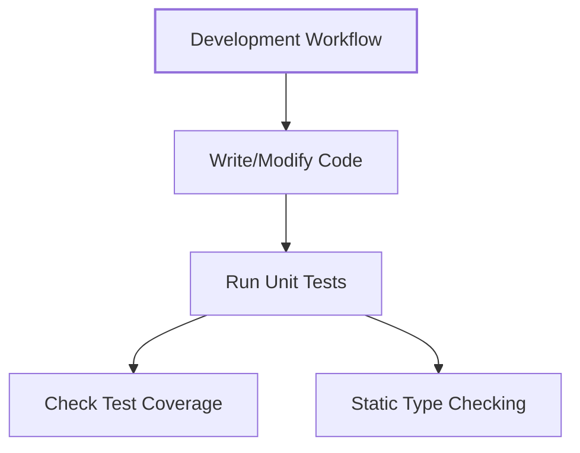
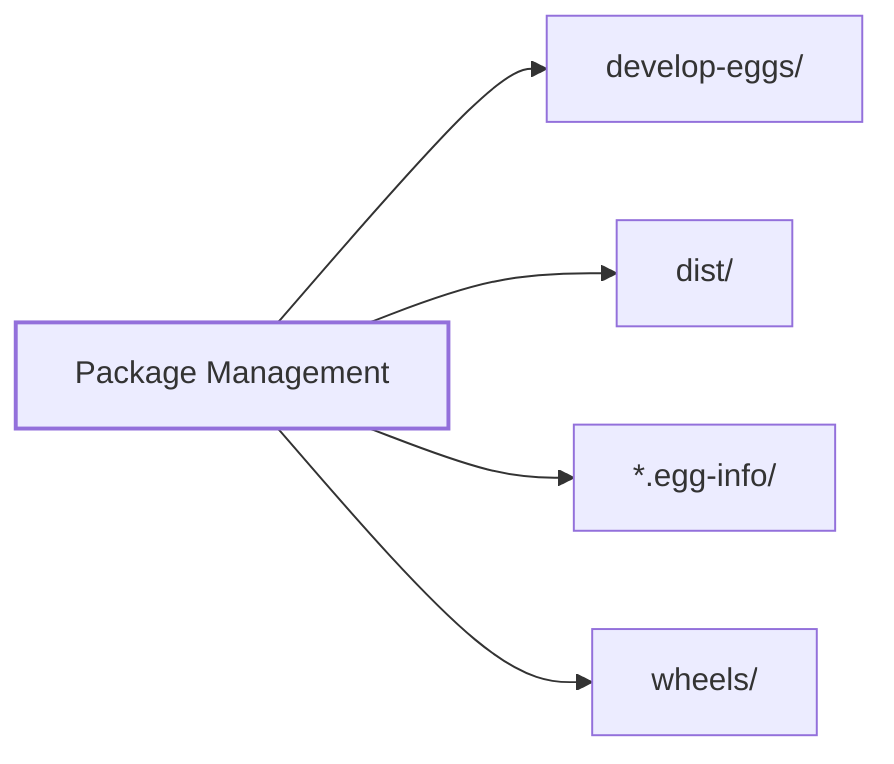
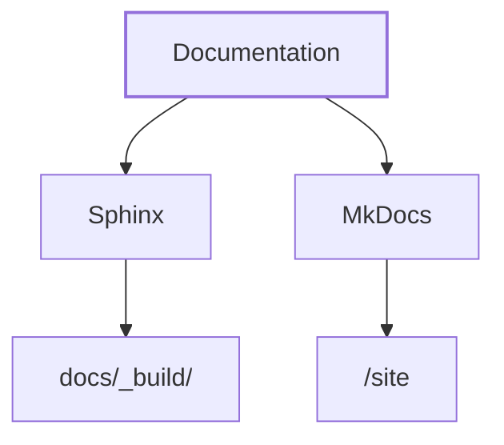

<!-- source: DeepWiki mcp.deepwiki.com · repo microsoft/LoRA · page 4 Development Setup · fetched 2026-10-26 -->

# Development Setup

<details>
<summary>Relevant source files</summary>

The following files were used as context for generating this wiki page:

- [.gitignore](.gitignore)

</details>


This document provides instructions for setting up a development environment for the Microsoft LoRA repository. It covers the necessary steps to clone the repository, configure your development environment, and prepare for working with the LoRA (Low-Rank Adaptation) framework for efficient fine-tuning of large language models.

For an overview of the LoRA repository, see [LoRA Repository Overview](#1). For information about model management, see [Model Management](#2).

## Prerequisites

Before setting up the development environment, ensure you have the following prerequisites installed:

- Git
- Python (3.7 or later recommended)
- Pip (Python package manager)
- CUDA toolkit (if using GPU acceleration)



Sources: .gitignore

## Repository Setup

### Cloning the Repository

1. Clone the repository from GitHub:

```
git clone https://github.com/microsoft/LoRA.git
cd LoRA
```

### Setting Up a Python Virtual Environment

The project uses Python virtual environments to manage dependencies. This is indicated by the presence of `venv/` in the `.gitignore` file.



To set up a virtual environment:

1. Create a virtual environment:
   ```
   python -m venv venv
   ```

2. Activate the virtual environment:
   - On Windows:
     ```
     venv\Scripts\activate
     ```
   - On macOS/Linux:
     ```
     source venv/bin/activate
     ```

3. Install dependencies:
   ```
   pip install -r requirements.txt
   ```

Sources: .gitignore:104-107

## Project Structure

The repository has a specific structure for organizing code, models, and evaluation scripts:



### Key Directories

| Directory | Purpose |
|-----------|---------|
| `pretrained_checkpoints/` | Stores pretrained model checkpoints (excluded from git) |
| `trained_models/` | Contains fine-tuned models using LoRA (excluded from git) |
| `eval/e2e/` | End-to-end evaluation scripts and utilities |
| `eval/GenerationEval/` | Text generation evaluation tools |

Sources: .gitignore:3-6

## Working with Models

The repository is designed to work with large language models, applying LoRA techniques for efficient fine-tuning. The model files are not tracked in git due to their size, as indicated by the `.gitignore` entries for `pretrained_checkpoints` and `trained_models`.



You will need to:

1. Download pretrained models separately
2. Place them in the `pretrained_checkpoints/` directory
3. After fine-tuning, models will be saved to `trained_models/`

Sources: .gitignore:3-4,8-9

## Development Practices

### Code Style and Testing

The repository appears to support standard Python testing frameworks, as suggested by the `.gitignore` entries for test coverage and pytest cache.



The presence of `.pytest_cache/` and `.coverage` in the `.gitignore` indicates that pytest is likely used for testing and coverage analysis.

For type checking, the `.mypy_cache/` entries suggest mypy is used for static type checking.

Sources: .gitignore:49-60,120-123

### IDE Integration

The repository appears to support various IDEs:

| IDE | Configuration Files |
|-----|---------------------|
| Visual Studio Code | `.vscode/` |
| PyCharm/IntelliJ | `.idea/` |
| Spyder | `.spyderproject`, `.spyproject` |

Choose the IDE that best fits your workflow. The configuration files for these IDEs are excluded from git.

Sources: .gitignore:108,127,110-112

## Package Management

The project appears to be structured as a Python package, as indicated by multiple packaging-related entries in the `.gitignore` file.



If you're developing for distribution:

1. Build the package:
   ```
   python setup.py build
   ```

2. Install in development mode:
   ```
   pip install -e .
   ```

Sources: .gitignore:22-38

## Documentation

The repository may include documentation built with either Sphinx or MkDocs:



To build documentation (if available):

- For Sphinx: `cd docs && make html`
- For MkDocs: `mkdocs build`

Sources: .gitignore:78-79,117-118

## Troubleshooting

### Common Issues

1. **Virtual Environment Issues**: If you encounter problems with the virtual environment, try removing and recreating it:
   ```
   rm -rf venv
   python -m venv venv
   ```

2. **CUDA Compatibility**: Ensure your CUDA version is compatible with the PyTorch version used in the project.

3. **Large Files**: Since model files are large and not tracked in git, ensure you have sufficient disk space.

Sources: .gitignore

## Summary

The development setup for the Microsoft LoRA repository involves:

1. Cloning the repository
2. Setting up a Python virtual environment
3. Installing dependencies
4. Understanding the project structure
5. Managing model files separately from version control
6. Following established coding practices and testing procedures

This setup enables efficient development and experimentation with the LoRA technique for fine-tuning large language models.