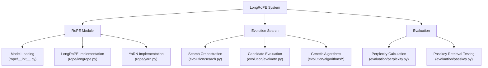
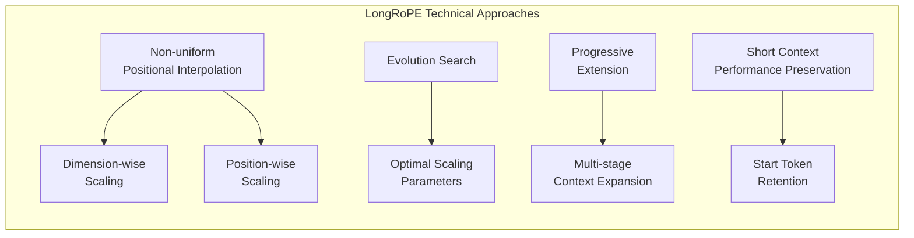
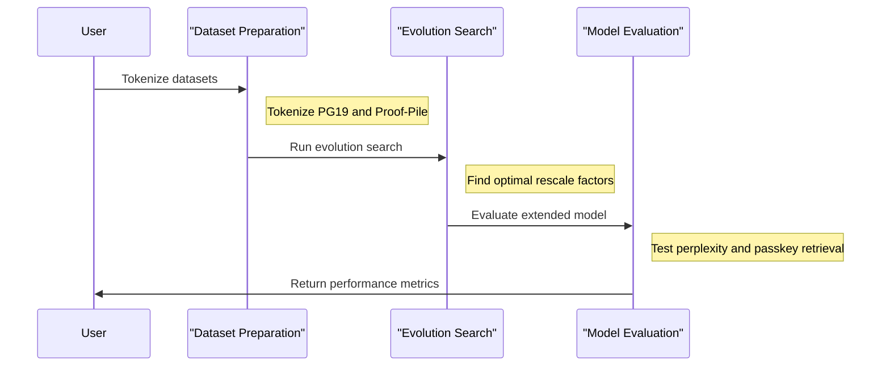
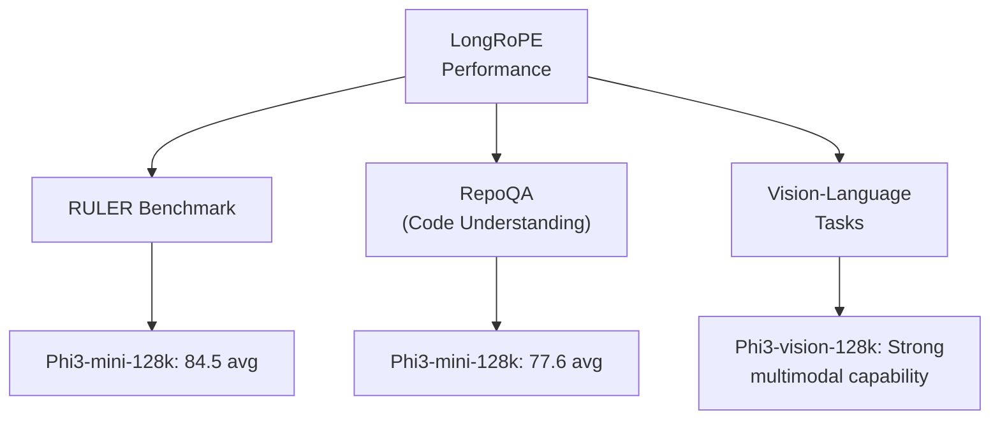

<!-- source: DeepWiki mcp.deepwiki.com · repo microsoft/LongRoPE · page 1 Overview · fetched 2026-10-26 -->

# Overview

<details>
<summary>Relevant source files</summary>

The following files were used as context for generating this wiki page:

- [README.md](README.md)
- [assets/logo.png](assets/logo.png)
- [requirements.txt](requirements.txt)

</details>


This page provides a comprehensive introduction to the LongRoPE system, which enables extending the context window of Large Language Models (LLMs) beyond 2 million tokens through non-uniform rescaling of Rotary Positional Embeddings (RoPE). For specific implementation details, see [LongRoPE Implementation](#2), for evolution search methodology, see [Evolution Search](#3), and for evaluation approaches, see [Evaluation](#4).

## Purpose and Scope

LongRoPE is an efficient approach that extends LLM context windows by applying non-uniform scaling to positional embeddings. This repository implements:

1. A flexible RoPE module for loading and modifying pre-trained models
2. Evolution-based search to find optimal rescale factors
3. Evaluation frameworks for measuring extended context performance

The current implementation focuses primarily on the evolution search component, allowing users to find optimal RoPE scaling factors for extending LLM context windows without retraining.

Sources: [README.md:1-3](), [README.md:67-74]()

## System Architecture

The LongRoPE system consists of three primary components that work together to extend LLM context windows:



### Component Relationships

The RoPE module serves as the foundation, handling the loading of pre-trained models and replacing their positional embeddings with non-uniformly scaled versions. The Evolution Search component identifies optimal rescale factors through genetic algorithms, while the Evaluation component provides metrics to assess the performance of the extended models.

Sources: [README.md:67-74]()

## Key Technologies and Approaches

LongRoPE's effectiveness is based on the following key technical approaches:



### Non-uniform RoPE Scaling

LongRoPE uses two forms of non-uniformity in positional interpolation:
1. **Varying RoPE dimensions**: Different scaling factors for different embedding dimensions
2. **Token positions**: Different scaling factors for different parts of the context window

This approach allows for more efficient extension of context windows compared to uniform scaling methods.

Sources: [README.md:67-74]()

## System Workflow

The typical workflow for using LongRoPE follows this sequence:



This workflow allows users to find optimal RoPE scaling parameters for their specific models and evaluate the performance of the extended models.

Sources: [README.md:87-110]()

## Code Organization

The LongRoPE codebase is organized into several key modules:

| Module | Purpose | Key Files |
|--------|---------|-----------|
| **rope** | Implements RoPE variants | `rope/__init__.py`, `rope/longrope.py`, `rope/yarn.py` |
| **evolution** | Implements search algorithms | `evolution/search.py`, `evolution/evaluate.py`, `evolution/algorithms/` |
| **evaluation** | Implements evaluation metrics | `evaluation/perplexity.py`, `evaluation/passkey.py` |
| **examples** | Model-specific examples | `examples/llama3/`, `examples/phi3/`, `examples/mistral/` |
| **utils** | Utility functions | `utils/tokenize_dataset.py` |

Sources: [README.md:76-110]()

## Supported Models and Performance

LongRoPE has been integrated into Microsoft Phi-3 models and can be applied to other LLMs like Llama 3 and Mistral. The Phi-3 models with LongRoPE support a 128k context window:

- Phi-3-mini-128k-instruct
- Phi-3-small-128k-instruct
- Phi-3-medium-128k-instruct
- Phi-3-vision-128k-instruct

### Performance on Long-Context Tasks

Phi-3 models with LongRoPE achieve competitive performance on long-context benchmarks:



Sources: [README.md:18-66]()

## System Requirements

To use LongRoPE, the following dependencies are required:

- Python 3.10
- PyTorch 2.1.0
- Transformers 4.41.2
- Flash Attention
- CUDA 11.7 or higher (for flash-attn)
- Additional libraries listed in requirements.txt

The system can be installed using the provided requirements file:

```bash
conda create -n longrope python==3.10
conda activate longrope
pip install -r requirements.txt
```

Sources: [README.md:79-86](), [requirements.txt:1-18]()

## Getting Started

For detailed guides on using LongRoPE with specific models, see [Using LongRoPE](#5) and its sub-pages. For key concepts behind the technology, refer to [Key Concepts](#1.2).

The typical usage pattern involves:

1. Tokenizing datasets using provided scripts
2. Running evolution search to find optimal rescale factors
3. Evaluating the extended model's performance

These steps are documented in the example scripts provided for each supported model.

Sources: [README.md:87-110]()

---

