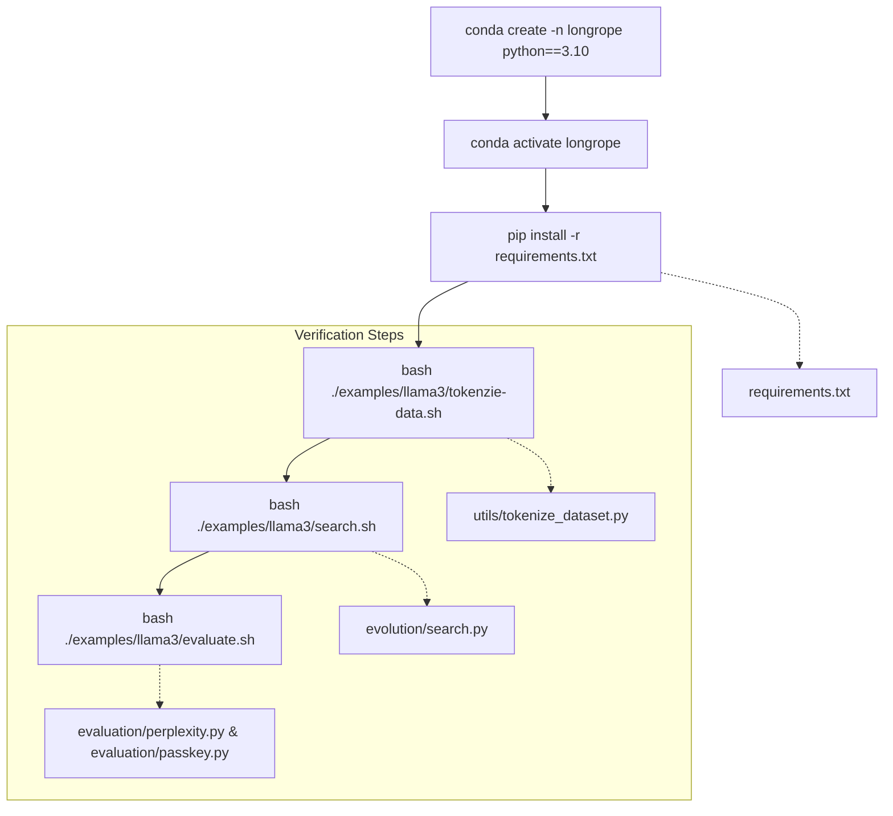
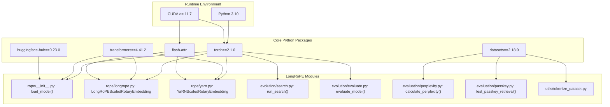
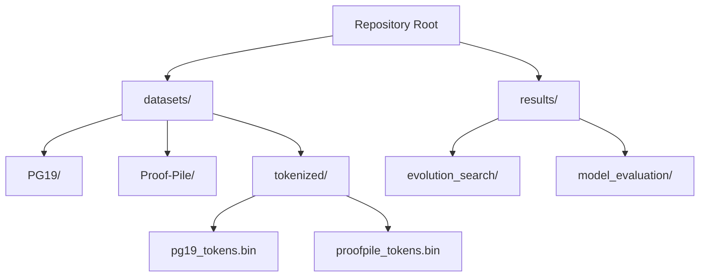

<!-- source: DeepWiki mcp.deepwiki.com · repo microsoft/LongRoPE · page 1.1 Installation and Requirements · fetched 2026-10-26 -->

# Installation and Requirements

<details>
<summary>Relevant source files</summary>

The following files were used as context for generating this wiki page:

- [.gitignore](.gitignore)
- [README.md](README.md)
- [assets/logo.png](assets/logo.png)
- [requirements.txt](requirements.txt)

</details>


This page guides you through the process of setting up your environment to use the LongRoPE system for extending the context window of Large Language Models (LLMs). For a conceptual overview of the system, see [Key Concepts](#1.2).

## Hardware Requirements

LongRoPE requires GPU acceleration for optimal performance:

- **NVIDIA GPU with CUDA support**
- **CUDA Version**: 11.7 or higher (specifically required for flash-attention)
- **RAM**: Minimum 16GB recommended (more for larger models)
- **Storage**: ~5GB for code and dependencies (excluding model weights and datasets)

Sources: [README.md:79-86]()

## Software Setup Process

### Installation Workflow

The following diagram illustrates the standard installation process for the LongRoPE system:



Sources: [README.md:79-86](), [README.md:90-110]()

### Step-by-Step Installation

1. **Create and activate a conda environment**:

```bash
conda create -n longrope python==3.10
conda activate longrope
```

2. **Install dependencies**:

```bash
# flash-attn needs cuda >= 11.7
pip install -r requirements.txt
```

Sources: [README.md:79-86]()

## Dependencies

The following table shows the key dependencies required by LongRoPE:

| Package | Version | Purpose |
|---------|---------|---------|
| torch | 2.1.0 | Deep learning framework |
| torchvision | 0.16.0 | Computer vision utilities |
| torchaudio | 2.1.0 | Audio processing |
| transformers | 4.41.2 | Hugging Face Transformers library |
| huggingface-hub | 0.23.0 | Model hub integration |
| datasets | 2.18.0 | Dataset handling |
| accelerate | - | Distributed training utilities |
| flash-attn | - | Efficient attention implementation |
| numpy, pandas | - | Data processing |
| einops | - | Tensor operations |
| tqdm, mlflow | - | Progress tracking and logging |
| tiktoken | - | Tokenization utilities |
| pytest | - | Testing framework |

Sources: [requirements.txt:1-17]()

## Component Dependency Structure

The following diagram shows how software dependencies relate to LongRoPE code components:



Sources: [README.md:67-74](), [requirements.txt:1-17]()

## Verifying Installation

To verify that your installation is working correctly, run the following tests:

### 1. Tokenize Test Datasets

This step tokenizes PG19 (for evolution search validation) and Proof-Pile (for evaluation):

```bash
bash ./examples/llama3/tokenzie-data.sh
```

### 2. Run Evolution Search

Execute an evolution search on Llama-3-8B model to extend to a 128k sequence length:

```bash
bash ./examples/llama3/search.sh
```

### 3. Evaluate Extended Model

Evaluate the long-context perplexity and passkey accuracy:

```bash
bash ./examples/llama3/evaluate.sh
```

Sources: [README.md:90-94](), [README.md:98-102](), [README.md:106-110]()

## Dataset Storage Structure

LongRoPE expects datasets to be stored in the `datasets` directory (automatically created during tokenization):



Sources: [.gitignore:1-3](), [README.md:90-94]()

## Troubleshooting

### CUDA Compatibility Issues

If you encounter CUDA-related errors:
- Verify your NVIDIA driver version supports CUDA 11.7+
- Check that `nvcc --version` returns the expected version
- Ensure PyTorch was installed with CUDA support (`torch.cuda.is_available()` should return `True`)

### Flash Attention Installation

Flash Attention may require additional setup on some systems:
- Ensure you have the required CUDA toolkit installed
- Try installing directly from source if package installation fails
- Check CUDA architecture compatibility with your GPU

### Memory Issues

If you encounter out-of-memory errors:
- Reduce batch sizes in the search configuration files
- Use a smaller model variant
- Close other GPU-intensive applications
- For multi-GPU systems, ensure proper distribution across devices

Sources: [README.md:79-86](), [requirements.txt:1-17]()

## Evolution Search Customization

The evolution search process can be customized by modifying the hyperparameters in `evolution/default_hyper_params/*.json`. Key parameters include:
- Number of iterations
- Population size
- Number of parents
- Number of mutation and crossover operations per iteration

These parameters affect convergence time and robustness of searching results.

Sources: [README.md:103-104]()

## Next Steps

After completing the installation:
- Learn about [Key Concepts](#1.2) of context window extension
- Explore [LongRoPE Implementation](#2) details
- Follow guides for [Running Evolution Search](#5.2)
- See [Model-Specific Guides](#5.4) for instructions relevant to your model

---

