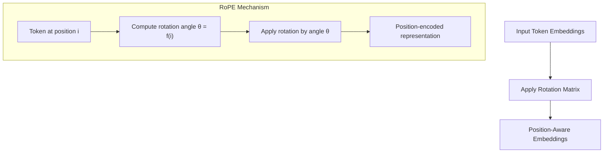
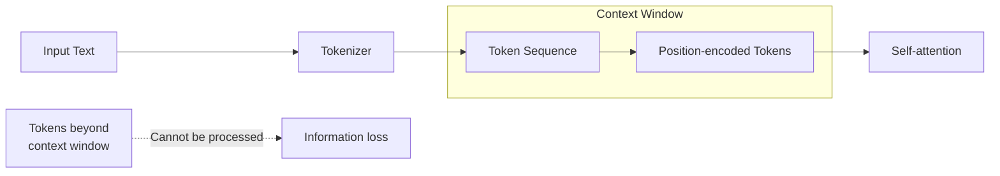
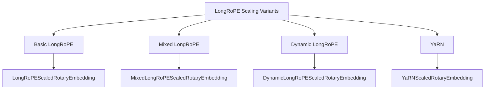
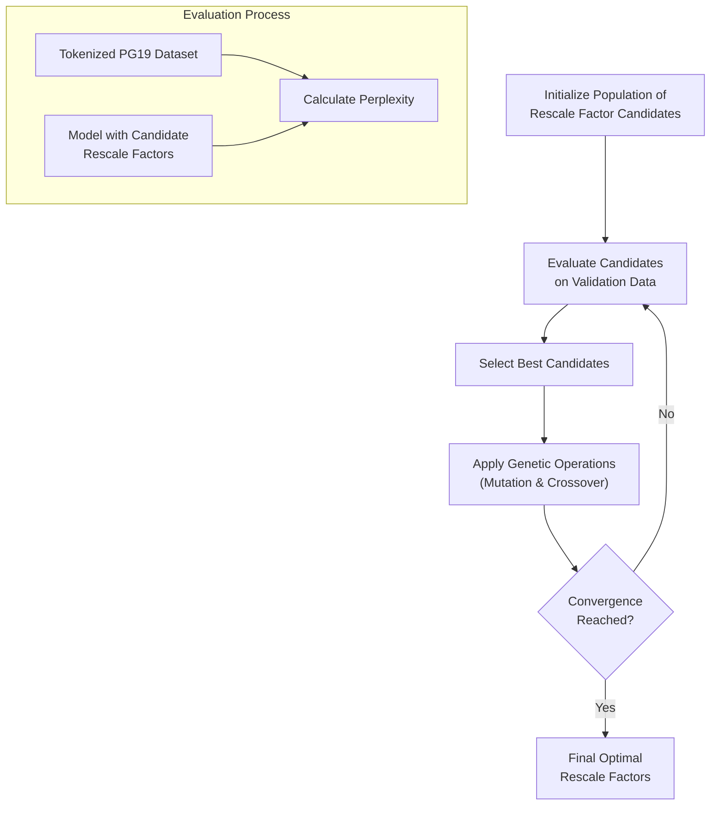
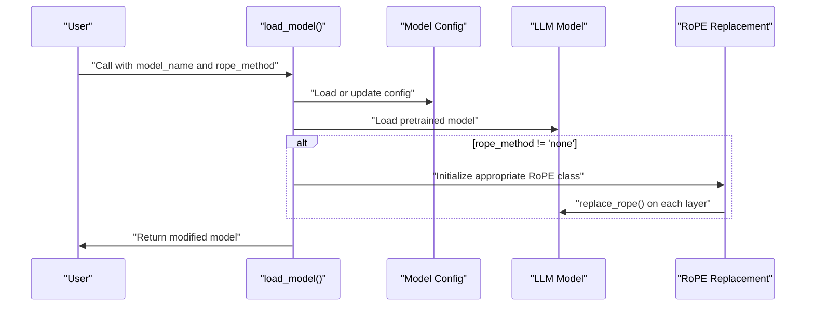
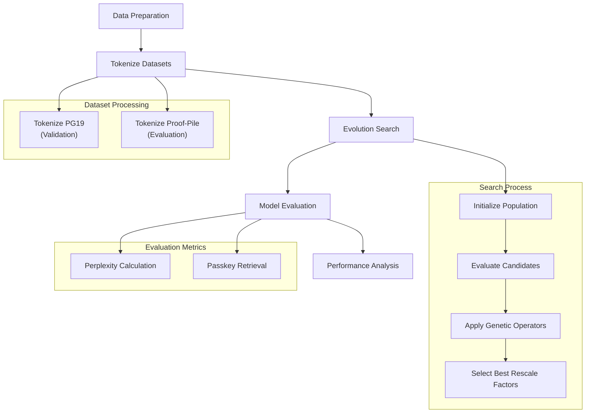

<!-- source: DeepWiki mcp.deepwiki.com · repo microsoft/LongRoPE · page 1.2 Key Concepts · fetched 2026-10-26 -->

# Key Concepts

<details>
<summary>Relevant source files</summary>

The following files were used as context for generating this wiki page:

- [README.md](README.md)
- [assets/logo.png](assets/logo.png)
- [rope/__init__.py](rope/__init__.py)

</details>


This document provides an overview of the core concepts behind LongRoPE, explaining the fundamental techniques that enable extending context windows in large language models (LLMs) beyond traditional limits. For implementation details, see [LongRoPE Implementation](#2), and for practical usage, see [Using LongRoPE](#5).

## What is RoPE?

Rotary Position Embeddings (RoPE) is a technique used in modern LLMs to encode positional information into attention mechanisms. RoPE applies a rotation to the embedding vectors, with the rotation frequency depending on the token position.



Sources: [README.md:68-69](). [rope/__init__.py:9-11]()

## Context Window Limitation

LLMs have a maximum context length they can process, determined by how they were pre-trained. This limitation stems from:

1. The fixed positional encoding scheme that doesn't generalize to unseen positions
2. Training resources and computational constraints
3. Quadratic memory and computational costs of self-attention



Sources: [README.md:67-72]()

## Non-uniform Rescaling Approach

LongRoPE extends context windows by applying non-uniform rescaling to positional embeddings across two dimensions:

1. **Varying RoPE dimensions**: Different rescaling factors for different embedding dimensions
2. **Varying token positions**: Different treatment for tokens at different positions

```mermaid
classDiagram
    class "Standard RoPE" {
        +Uniform scaling across dimensions
        +Same scaling for all positions
    }
    class "LongRoPE" {
        +Non-uniform scaling across dimensions
        +Position-specific scaling
    }
    
    "Standard RoPE" <|-- "LongRoPE"
```

Sources: [README.md:68-72](). [rope/__init__.py:10]()

## LongRoPE Implementation Variants

LongRoPE offers several implementation variants to address different use cases:



### Basic LongRoPE

The core implementation that applies dimension-specific rescaling factors to extend the context window.

### Mixed LongRoPE

Preserves the original positional embeddings for the initial tokens (to maintain short-context performance) while applying rescaling to later tokens.

### Dynamic LongRoPE

Implements a dynamic calculation of inverse frequencies based on rescale factors.

### YaRN

An alternative approach that uses different scaling rates for fast and slow dimensions.

Sources: [rope/__init__.py:10-11](). [rope/__init__.py:145-165]()

## Evolution Search for Optimal Rescaling

LongRoPE uses an evolutionary algorithm to find the optimal rescale factors for positional embeddings:



The evolution search systematically explores the space of possible rescaling factors to:
1. Maximize performance on long sequences
2. Minimize degradation on short sequences
3. Find factors that generalize across different tasks

Sources: [README.md:70](). [README.md:96-104]()

## Key Parameters and Configuration

| Parameter | Description | Impact |
|-----------|-------------|--------|
| `rescale_factors` | Dimension-specific scaling values | Determines how each dimension is scaled |
| `original_max_position_embeddings` | Original context length | Baseline for scaling calculation |
| `max_position_embeddings` | Target extended context length | Goal length after scaling |
| `start_token_idx` | Position from which to apply scaling (Mixed LongRoPE) | Preserves performance on short sequences |
| `magnitude_scaling_policy` | How magnitude is adjusted during scaling | Affects numerical stability |

Sources: [rope/__init__.py:136-152]()

## Model Integration Process



The LongRoPE system integrates with existing models by:
1. Loading the pretrained model
2. Creating the appropriate RoPE replacement based on the chosen method
3. Replacing the RoPE module in each transformer layer
4. Retaining the model's parameters while changing how positions are encoded

Sources: [rope/__init__.py:53-170]()

## Evolutionary Search and Evaluation Workflow



Sources: [README.md:88-110]()

## Real-world Impact

LongRoPE enables:
1. Processing documents with 2 million+ tokens in a single forward pass
2. Maintaining performance on short sequences while extending to long ones
3. Supporting both fine-tuning extensions and zero-shot extensions

The technique is integrated into Microsoft Phi-3 models, extending their context length to 128k tokens while maintaining strong performance across various tasks.

Sources: [README.md:18-65]()

---

