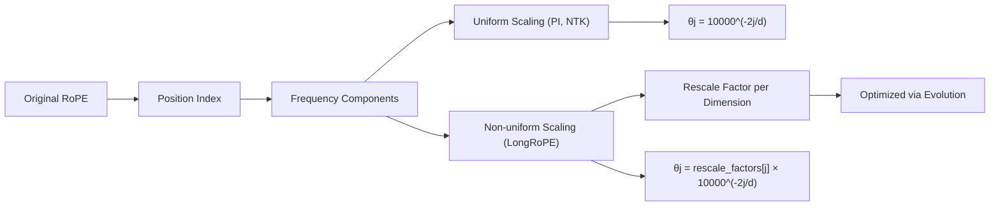
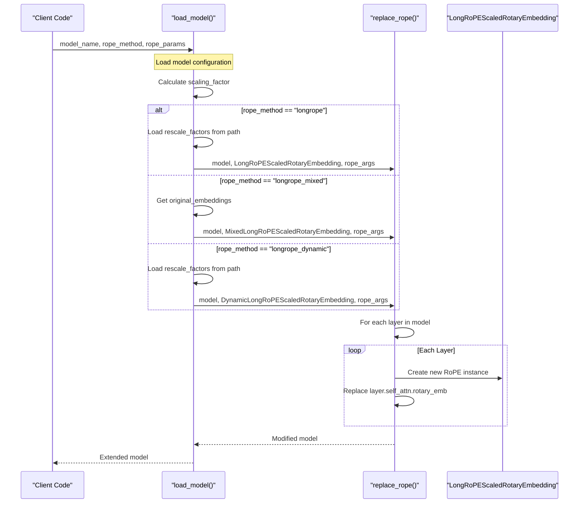
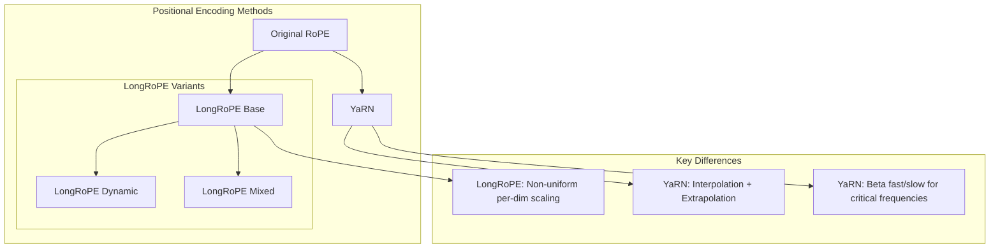

<!-- source: DeepWiki mcp.deepwiki.com · repo microsoft/LongRoPE · page 2 LongRoPE Implementation · fetched 2026-10-26 -->

# LongRoPE Implementation

<details>
<summary>Relevant source files</summary>

The following files were used as context for generating this wiki page:

- [rope/__init__.py](rope/__init__.py)
- [rope/longrope.py](rope/longrope.py)
- [rope/yarn.py](rope/yarn.py)

</details>


This document provides a detailed technical explanation of the LongRoPE implementation in the codebase, which extends the context window of Large Language Models through non-uniform rescaling of Rotary Positional Embeddings (RoPE). For information about running the evolution search to find optimal rescale factors, see [Evolution Search](#3), and for evaluation methods, see [Evaluation](#4).

## Technical Foundations

LongRoPE extends the effective context length of transformer models by applying non-uniform scaling factors to different frequency components of rotary positional embeddings. Unlike uniform scaling methods (like PI or Dynamic NTK), LongRoPE uses different rescaling factors for each frequency dimension, which can be optimized through evolutionary search to better preserve the model's ability to understand both local and global context.

### Core Concept: Non-uniform Frequency Scaling



Sources: [rope/longrope.py:7-76]()/[rope/__init__.py:18-50]()

### Magnitude Scaling Policies

LongRoPE implements different policies to scale the magnitude of positional embeddings, which helps maintain signal strength in extended contexts:

| Policy | Formula | Application |
|--------|---------|-------------|
| su | `sqrt(1 + log(scale)/log(original_max_position_embeddings))` | Default for LongRoPE |
| yarn | `0.1 * log(scale) + 1.0` | Alternative scaling approach |
| custom | Fixed value provided by user | Manual control |

Sources: [rope/longrope.py:62-70]()

## LongRoPE Class Hierarchy

```mermaid
classDiagram
    class "torch.nn.Module" {
        +forward()
    }
    
    class "LongRoPEScaledRotaryEmbedding" {
        +dim: int
        +rescale_factors: Tensor
        +mscale: float
        +_calc_inv_freq()
        +_forward_llama()
        +_forward_mistral()
    }
    
    class "DynamicLongRoPEScaledRotaryEmbedding" {
        +_calc_inv_freq()
    }
    
    class "MixedLongRoPEScaledRotaryEmbedding" {
        +start_token_idx: int
        +original_embeddings: Tuple
        +_add_original_embeddings()
    }
    
    "torch.nn.Module" <|-- "LongRoPEScaledRotaryEmbedding"
    "LongRoPEScaledRotaryEmbedding" <|-- "DynamicLongRoPEScaledRotaryEmbedding"
    "LongRoPEScaledRotaryEmbedding" <|-- "MixedLongRoPEScaledRotaryEmbedding"
```

Sources: [rope/longrope.py:8-151]()

## LongRoPE Variants

### Base Implementation

The `LongRoPEScaledRotaryEmbedding` class is the foundation of LongRoPE, which applies non-uniform scaling to frequency components:

- Accepts pre-computed rescale factors from evolution search
- Supports different model types (Llama, Mistral)
- Applies magnitude scaling to maintain signal strength
- Dynamically calculates inverse frequencies based on rescaling factors

Key implementation aspects:

```python
# Calculate inverse frequencies using rescale factors
def _calc_inv_freq(self, seq_len, device):
    rescale_factors = self.rescale_factors.to(device)
    exponent = torch.arange(0, self.dim, 2, dtype=torch.float32, device=device) / self.dim
    return 1.0 / (rescale_factors * (self.base ** exponent))
```

Sources: [rope/longrope.py:8-102]()

### Dynamic LongRoPE

The `DynamicLongRoPEScaledRotaryEmbedding` variant dynamically adjusts the scaling factors based on the current sequence length:

- Scales the rescale factors proportionally to the current context length
- Allows for adaptive behavior with varying context sizes
- Interpolates between original and target scaling factors

Sources: [rope/longrope.py:105-114]()

### Mixed LongRoPE

The `MixedLongRoPEScaledRotaryEmbedding` variant preserves original embeddings for the first N tokens:

- Maintains original RoPE embeddings for tokens up to `start_token_idx`
- Applies LongRoPE scaling to tokens after `start_token_idx`
- Helps preserve near-term reasoning while extending far-context capabilities

Sources: [rope/longrope.py:117-151]()

## Model Integration Flow



Sources: [rope/__init__.py:52-170]()

## Loading and Configuring LongRoPE

The `load_model` function serves as the entry point for applying LongRoPE to a model:

1. Loads the pre-trained model configuration
2. Calculates the scaling factor based on target and original max position embeddings
3. Loads optimization-derived rescale factors from a file
4. Creates the appropriate LongRoPE variant based on the specified method
5. Replaces the original RoPE implementation in each layer

Example configuration parameters:

| Parameter | Description | Example Value |
|-----------|-------------|---------------|
| `rope_method` | Which RoPE scaling method to use | "longrope", "longrope_mixed", "longrope_dynamic" |
| `max_position_embeddings` | Target extended context length | 16384 |
| `longrope_params_path` | Path to optimized rescale factors | "./rescale_factors.csv" |
| `longrope_scaling_policy` | Magnitude scaling approach | "su" |
| `start_token_idx` | For mixed mode, where to start scaling | 512 |

Sources: [rope/__init__.py:53-170]()

## Implementation Details 

### Forward Method Specialization

LongRoPE implements model-specific forward methods to accommodate differences in how RoPE is applied:

- `_forward_llama`: For Llama-style models, takes position_ids as input
- `_forward_mistral`: For Mistral-style models, uses sequence indices directly

Both methods:
1. Calculate inverse frequencies using rescale factors
2. Compute cosine and sine embeddings
3. Apply magnitude scaling to preserve signal strength

Sources: [rope/longrope.py:76-102]()

### Calculating Inverse Frequencies

The core of LongRoPE's non-uniform scaling is implemented in the `_calc_inv_freq` method:

```python
def _calc_inv_freq(self, seq_len, device):
    rescale_factors = self.rescale_factors.to(device)
    exponent = torch.arange(0, self.dim, 2, dtype=torch.float32, device=device) / self.dim
    return 1.0 / (rescale_factors * (self.base ** exponent))
```

This applies the dimension-specific rescale factors to the standard RoPE frequency calculation, enabling the optimization of different scaling factors for each frequency component.

Sources: [rope/longrope.py:72-75]()

## Comparison with YaRN



While LongRoPE uses evolution-optimized per-dimension rescale factors, YaRN (`YaRNScaledRotaryEmbedding`) provides an alternative approach:

| Feature | LongRoPE | YaRN |
|---------|----------|------|
| Scaling approach | Non-uniform per dimension | Interpolation/extrapolation with linear ramp |
| Parameter optimization | Evolutionary search | Fixed heuristics (beta_fast, beta_slow) |
| Critical frequency handling | Implicit in evolved parameters | Explicit with beta parameters |
| Adaptability | Through dynamic variant | Through extrapolation factor |

Sources: [rope/yarn.py:10-143]()

## Integration with Model Loading

The `load_model` function in `rope/__init__.py` provides the main interface for extending a model's context window with LongRoPE:

```python
model = load_model(
    model_name_or_path="meta-llama/Llama-3-8B",
    rope_method="longrope",
    max_position_embeddings=16384,
    rope_params={
        "longrope_params_path": "path/to/rescale_factors.csv",
        "longrope_scaling_policy": "su"
    }
)
```

This function:
1. Loads the pre-trained model configuration
2. Calculates the scaling factor based on the desired context extension
3. Selects the appropriate RoPE implementation based on `rope_method`
4. Loads the optimized rescale factors for LongRoPE variants
5. Replaces the model's original RoPE implementation with the extended version

Sources: [rope/__init__.py:53-170]()

## Model Compatibility

LongRoPE supports different model architectures through specialized forward methods:

| Model Type | Forward Method | Notes |
|------------|----------------|-------|
| Llama | `_forward_llama` | Used for Llama, Phi-3, etc. |
| Mistral | `_forward_mistral` | Used for Mistral, Mixtral |

The implementation automatically detects the model type and uses the appropriate forward method. For unrecognized model types, it defaults to the Llama implementation with a warning.

Sources: [rope/longrope.py:54-60]()

---

