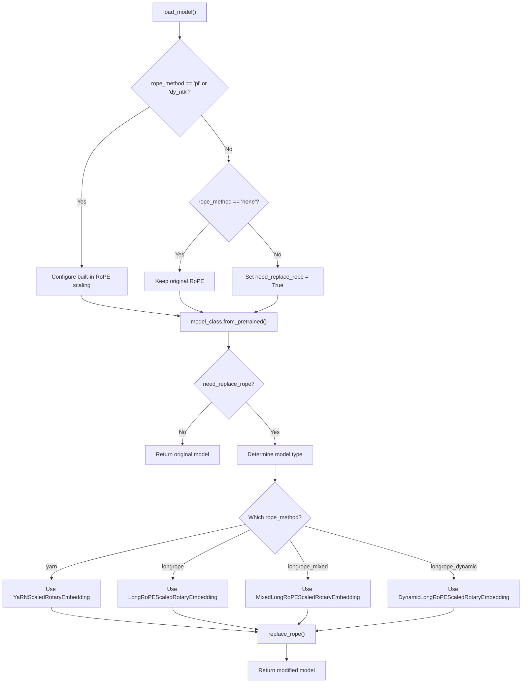
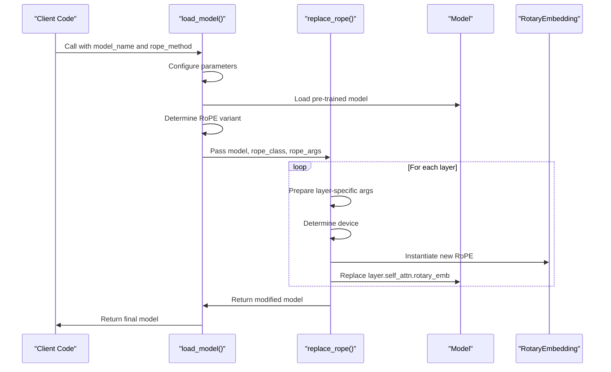
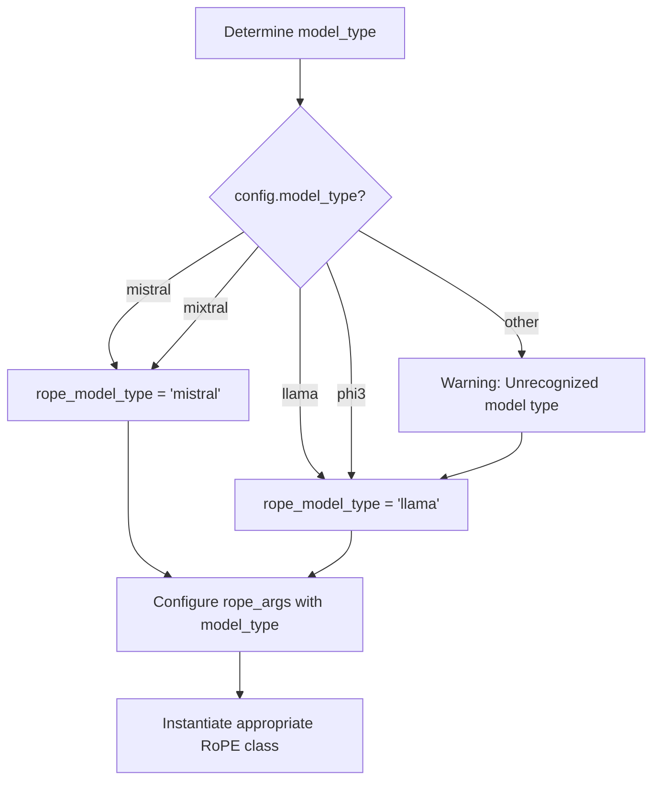

<!-- source: DeepWiki mcp.deepwiki.com · repo microsoft/LongRoPE · page 2.1 RoPE Module · fetched 2026-10-26 -->

# RoPE Module

<details>
<summary>Relevant source files</summary>

The following files were used as context for generating this wiki page:

- [rope/__init__.py](rope/__init__.py)

</details>


This document provides a technical specification of the RoPE (Rotary Positional Embedding) Module within the LongRoPE system. This module serves as the core component responsible for loading pre-trained Large Language Models (LLMs) and modifying their positional embedding mechanisms to extend context windows. For specific variants of LongRoPE implementations, see [LongRoPE Variants](#2.2). For information about the YaRN implementation alternative, see [YaRN Implementation](#2.3).

## Module Structure

The RoPE Module consists of a set of Python classes and utility functions that handle model loading and positional embedding replacement.

```mermaid
classDiagram
    class "load_model()" {
        +str model_name_or_path
        +str rope_method
        +int max_position_embeddings
        +type model_class
        +AutoConfig config
        +dict rope_params
        +int attn_sliding_window
        +bool save_memory
        +Load and configure model
        +Replace RoPE implementation
    }
    
    class "replace_rope()" {
        +AutoModelForCausalLM model
        +type rope_class
        +dict rope_args
        +Replace RoPE in each layer
    }
    
    class "LongRoPEScaledRotaryEmbedding" {
        +RoPE implementation
        +Adjustable frequency scaling
    }
    
    class "MixedLongRoPEScaledRotaryEmbedding" {
        +Mixed RoPE implementation
        +Uses original embeddings
    }
    
    class "DynamicLongRoPEScaledRotaryEmbedding" {
        +Dynamic RoPE implementation
        +Adaptive frequency calculation
    }
    
    class "YaRNScaledRotaryEmbedding" {
        +YaRN implementation
        +Different scaling approach
    }
    
    "load_model()" --> "replace_rope()" : calls
    "replace_rope()" --> "LongRoPEScaledRotaryEmbedding" : instantiates
    "replace_rope()" --> "MixedLongRoPEScaledRotaryEmbedding" : instantiates
    "replace_rope()" --> "DynamicLongRoPEScaledRotaryEmbedding" : instantiates
    "replace_rope()" --> "YaRNScaledRotaryEmbedding" : instantiates
```

**Diagram: RoPE Module Components and Relationships**

Sources: [rope/__init__.py:1-171]()

## Functionality and Key Components

The RoPE Module serves two primary functions:

1. Loading pre-trained LLMs using Hugging Face's transformers library
2. Replacing the standard RoPE implementation with variants designed to extend context windows

### Model Loading

The model loading functionality is implemented in the `load_model()` function, which handles:

- Loading a pre-trained model from a specified path or name
- Configuring the model with specified parameters
- Replacing the RoPE implementation when necessary



**Diagram: Model Loading and RoPE Replacement Process**

Sources: [rope/__init__.py:53-170]()

### RoPE Replacement

The RoPE replacement functionality is implemented in the `replace_rope()` function, which:

- Iterates through each layer of the model
- Configures layer-specific RoPE parameters
- Replaces the existing rotary embedding with the specified implementation



**Diagram: RoPE Replacement Process Flow**

Sources: [rope/__init__.py:18-50]()

## Supported RoPE Methods

The module supports various RoPE methods for extending context windows:

| Method | Class | Description | Configuration |
|--------|-------|-------------|--------------|
| `'pi'` | Built-in | Linear scaling of RoPE frequencies | Uses transformers built-in support |
| `'dy_ntk'` | Built-in | Dynamic NTK scaling | Uses transformers built-in support |
| `'yarn'` | `YaRNScaledRotaryEmbedding` | Yet Another RoPE extensioN | Configurable extrapolation factor |
| `'longrope'` | `LongRoPEScaledRotaryEmbedding` | Basic LongRoPE implementation | Uses rescale factors from file |
| `'longrope_mixed'` | `MixedLongRoPEScaledRotaryEmbedding` | Mixed implementation using original embeddings | Combines original and scaled embeddings |
| `'longrope_dynamic'` | `DynamicLongRoPEScaledRotaryEmbedding` | Dynamic implementation with adaptive scaling | Adapts frequencies dynamically |

Sources: [rope/__init__.py:107-168]()

## Configuration Parameters

The RoPE Module accepts various parameters to customize its behavior:

```mermaid
classDiagram
    class "RoPE Configuration" {
        +model_name_or_path: str
        +rope_method: str
        +max_position_embeddings: int
        +model_class: type
        +config: AutoConfig
        +rope_params: dict
        +attn_sliding_window: int
        +save_memory: bool
    }
    
    class "LongRoPE Parameters" {
        +longrope_params_path: str
        +longrope_scaling_policy: str
        +start_token_idx: int (for mixed)
    }
    
    class "Implementation Parameters" {
        +original_max_position_embeddings: int
        +max_position_embeddings: int
        +scale: float
        +base: float
        +model_type: str
        +rescale_factors: ndarray
        +magnitude_scaling_policy: str
    }
    
    "RoPE Configuration" --> "LongRoPE Parameters" : contains
    "RoPE Configuration" --> "Implementation Parameters" : generates
```

**Diagram: RoPE Configuration Parameters**

Sources: [rope/__init__.py:53-85](), [rope/__init__.py:136-162]()

### Key Parameter Details

- **model_name_or_path**: The Hugging Face model identifier or local path
- **rope_method**: Specifies which RoPE implementation to use
- **max_position_embeddings**: Maximum context window size after scaling
- **rope_params**: Additional parameters for specific RoPE methods
  - **longrope_params_path**: Path to rescale factors file for LongRoPE
  - **longrope_scaling_policy**: Policy for magnitude scaling
  - **start_token_idx**: Starting token index for mixed implementation

Sources: [rope/__init__.py:53-85]()

## Model Type Support

The module supports different model architectures with special handling for each:

- **Mistral/Mixtral models**: Uses specific RoPE configuration for these architectures
- **Llama models**: Default handling for most models
- **Phi-3 models**: Explicitly supported
- **Other models**: Fallback to Llama-style configuration with a warning



**Diagram: Model Type Detection and Handling**

Sources: [rope/__init__.py:128-141]()

## Implementation Process

The process of implementing extended context windows follows these steps:

1. **Model Loading**: Load the pre-trained model
2. **Scaling Factor Calculation**: Determine the scaling factor based on original and target context sizes
3. **RoPE Method Selection**: Choose the appropriate RoPE method
4. **Parameter Configuration**: Set up parameters for the selected method
5. **RoPE Replacement**: Replace the original RoPE implementation in each layer

For LongRoPE methods, the system loads rescale factors from a file, which are used to non-uniformly scale the frequency of rotary embeddings across different attention head dimensions.

Sources: [rope/__init__.py:87-107](), [rope/__init__.py:146-152]()

## Memory Optimization

The module includes an optional memory optimization feature through the `save_memory` parameter, which uses the `replace_methods` function from `utils.save_memory` to modify model methods for reduced memory usage.

Sources: [rope/__init__.py:125-126]()

---

