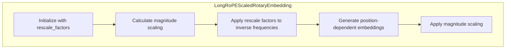
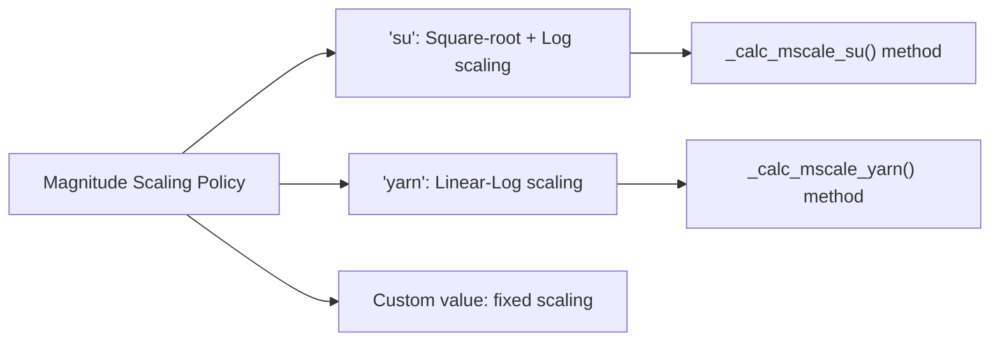
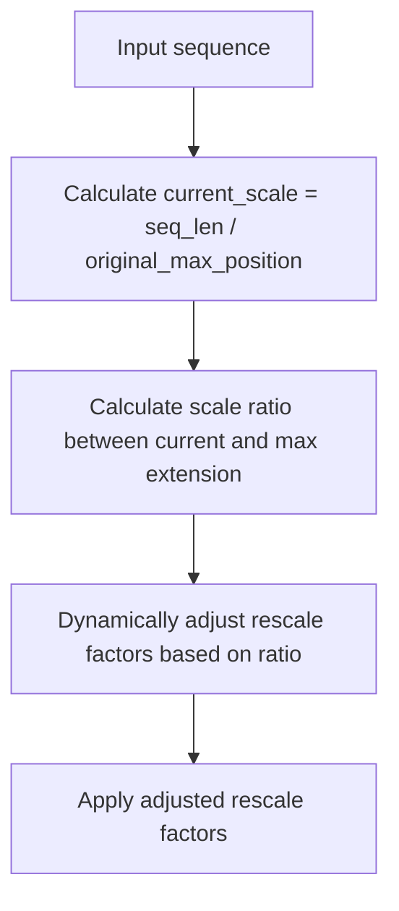
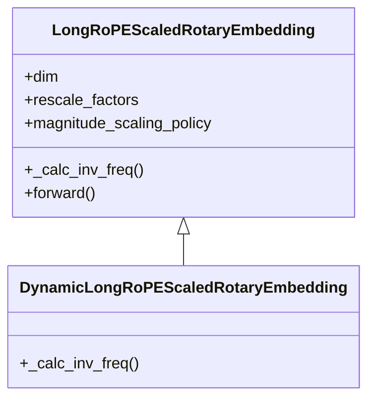
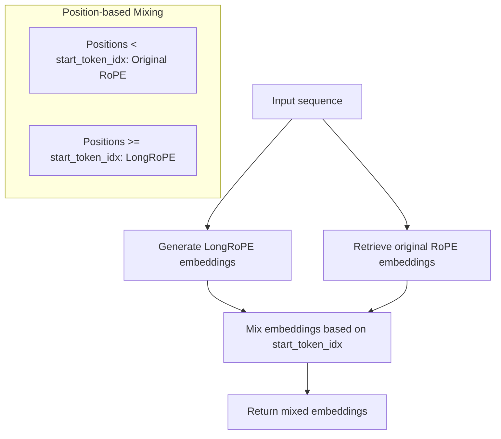
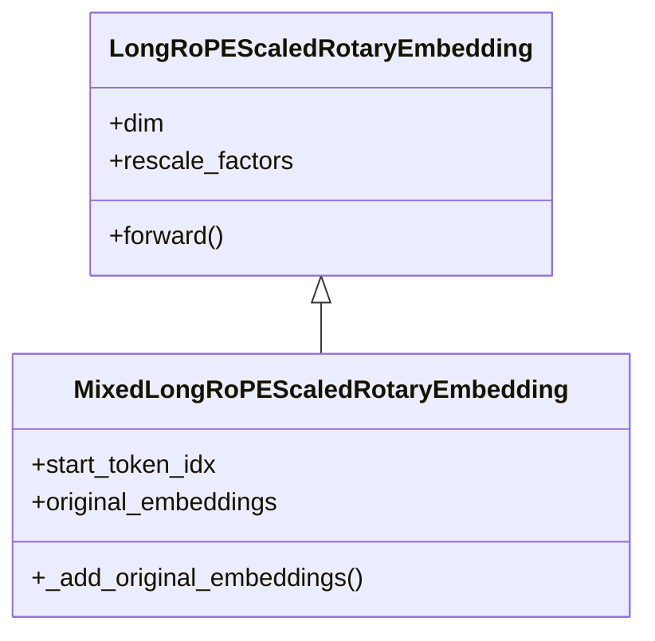
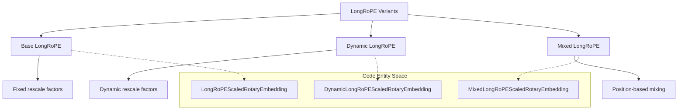
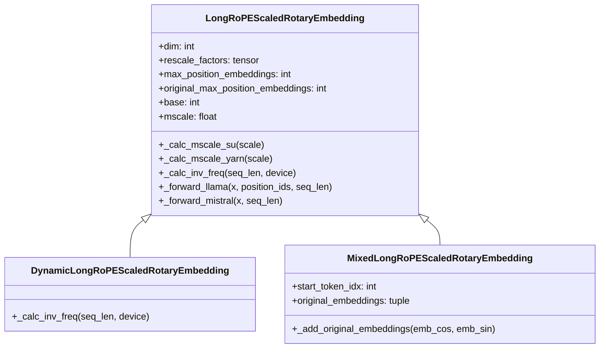

<!-- source: DeepWiki mcp.deepwiki.com · repo microsoft/LongRoPE · page 2.2 LongRoPE Variants · fetched 2026-10-26 -->

# LongRoPE Variants

Relevant source files

The following files were used as context for generating this wiki page:

- [rope/longrope.py](rope/longrope.py)

## Purpose and Scope

This document describes the different variants of LongRoPE (Long Range Rotary Positional Embeddings) implemented in the system, their specific characteristics, and guidance on when to use each variant. The page covers the base LongRoPE implementation and its specialized extensions: Dynamic LongRoPE and Mixed LongRoPE. For information about the broader RoPE module implementation, see [RoPE Module](#2.1), and for details on the YaRN alternative, see [YaRN Implementation](#2.3).

## LongRoPE Base Implementation

The base LongRoPE implementation provides the foundation for extending context windows in language models through non-uniform rescaling of rotary positional embeddings.

### Core Functionality

The base implementation is defined in the `LongRoPEScaledRotaryEmbedding` class, which modifies the standard RoPE implementation by applying dimension-specific rescale factors to the frequency calculations.

Sources: [rope/longrope.py:8-102]()

### Key Parameters

| Parameter | Description | Default |
|-----------|-------------|---------|
| `dim` | Head dimension (typically model's hidden dimension / num heads) | Required |
| `rescale_factors` | List of rescale factors for each dimension | Required |
| `max_position_embeddings` | Maximum number of position embeddings (after scaling) | 4096 |
| `original_max_position_embeddings` | Original max number of position embeddings (before scaling) | 4096 |
| `base` | Base value for positional encoding | 10000 |
| `magnitude_scaling_policy` | Attention temperature scaling function | "su" |
| `model_type` | Type of model architecture | "llama" |

Sources: [rope/longrope.py:8-60]()

### Magnitude Scaling Policies

The base implementation supports different magnitude scaling approaches to adjust attention temperature:

1. **"su" policy**: Square-root-based scaling that grows logarithmically with context extension
2. **"yarn" policy**: Linear-logarithmic scaling based on YaRN's approach
3. **Custom value**: A fixed floating-point value can be provided directly

Sources: [rope/longrope.py:42-70]()

### Model Type Support

The base implementation supports different model architectures through specialized forward methods:

- **Llama**: Uses position IDs and handles architecture-specific details
- **Mistral**: Pre-calculates inverse frequencies and uses a slightly different approach

Sources: [rope/longrope.py:54-102]()

## Dynamic LongRoPE

Dynamic LongRoPE extends the base implementation by making the rescale factors themselves context-length dependent, which allows for better adaptation to varying sequence lengths.

### Dynamic Scaling Mechanism

Sources: [rope/longrope.py:105-114]()

### Implementation Details

The `DynamicLongRoPEScaledRotaryEmbedding` class overrides just the `_calc_inv_freq` method to calculate dynamically adjusted rescale factors:

1. Computes the current context extension scale (`current_scale`)
2. References the target extension scale (`original_scale`) 
3. Calculates a dynamic scaling ratio between 0 and 1
4. Interpolates between 1.0 and the configured rescale factors based on this ratio

This approach allows the model to smoothly transition from standard RoPE to fully-scaled LongRoPE as sequence length increases.

Sources: [rope/longrope.py:105-114]()

### When to Use Dynamic LongRoPE

Dynamic LongRoPE is most appropriate when:
- Processing inputs of highly variable lengths
- You want smoother performance across different context lengths
- You need the model to adjust its positional sensitivity based on the actual sequence length

## Mixed LongRoPE

Mixed LongRoPE enables different positional embedding approaches for different token positions, allowing for hybrid processing of short-term and long-term dependencies.

### Mixing Mechanism

Sources: [rope/longrope.py:117-151]()

### Implementation Details

The `MixedLongRoPEScaledRotaryEmbedding` class extends the base implementation by:
1. Storing a reference to the original RoPE embeddings
2. Defining a boundary position (`start_token_idx`)
3. Replacing embeddings for positions before the boundary with the original embeddings

This allows precise control over which tokens use standard positional encoding versus extended positional encoding.

Sources: [rope/longrope.py:117-151]()

### When to Use Mixed LongRoPE

Mixed LongRoPE is most suitable when:
- You want to preserve precise local positional sensitivity for nearby tokens
- You need to extend context for long-range dependencies
- The model's performance on short-context tasks must remain unchanged
- You're fine-tuning a model that was pretrained with specific positional encoding patterns

## LongRoPE Variants Comparison

The following table compares the key characteristics of each LongRoPE variant:

| Feature | Base LongRoPE | Dynamic LongRoPE | Mixed LongRoPE |
|---------|---------------|------------------|----------------|
| **Primary Purpose** | General context extension | Adaptive context extension | Hybrid context processing |
| **Rescale Factors** | Fixed per dimension | Dynamically adjusted | Fixed per dimension |
| **Position Dependence** | Uniform across positions | Sequence-length dependent | Position-dependent with boundary |
| **Original Embeddings** | Not used | Not used | Preserved for initial tokens |
| **Ideal Use Case** | General-purpose extension | Variable-length inputs | Preserving local sensitivity |
| **Implementation Complexity** | Base | Low | Medium |

Sources: [rope/longrope.py:8-151]()

## Implementation Architecture

The following diagram shows how the different LongRoPE variants are organized in the code:

Sources: [rope/longrope.py:8-151]()

## Summary

The LongRoPE system provides multiple variants to address different context extension scenarios:

1. **Base LongRoPE**: General-purpose implementation with fixed rescale factors
2. **Dynamic LongRoPE**: Adaptive implementation that adjusts rescaling based on actual sequence length
3. **Mixed LongRoPE**: Hybrid implementation that preserves original embeddings for early tokens

By selecting the appropriate variant, users can optimize for different scenarios ranging from general context extension to specialized applications requiring preserved local sensitivity or dynamic adaptation to sequence length.

---

