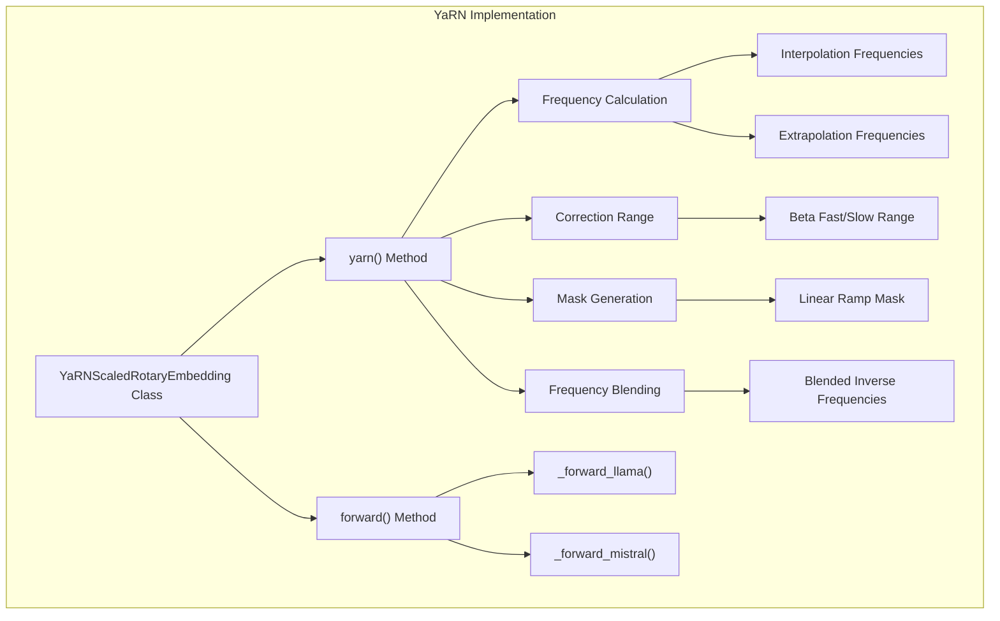
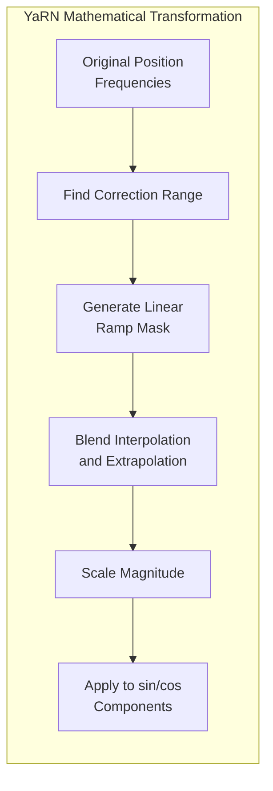
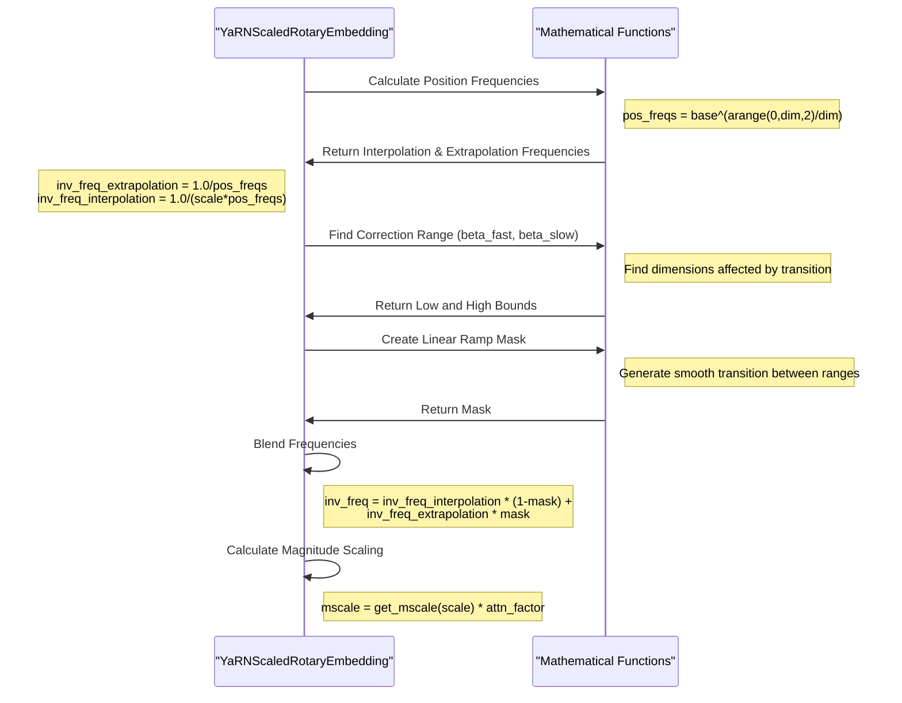
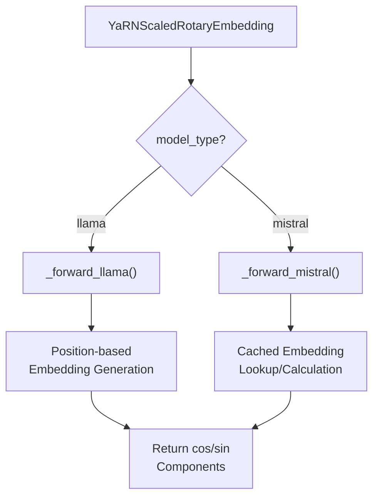

<!-- source: DeepWiki mcp.deepwiki.com · repo microsoft/LongRoPE · page 2.3 YaRN Implementation · fetched 2026-10-26 -->

# YaRN Implementation

<details>
<summary>Relevant source files</summary>

The following files were used as context for generating this wiki page:

- [rope/yarn.py](rope/yarn.py)

</details>


## Purpose and Overview

This document details the implementation of YaRN (Yet another RoPE extensioN) within the LongRoPE system. YaRN provides an alternative approach to extending the context window of Large Language Models (LLMs) through specialized modifications to Rotary Positional Embeddings (RoPE). Unlike the standard LongRoPE implementation covered in [LongRoPE Variants](#2.2), YaRN utilizes a hybrid approach combining interpolation and extrapolation techniques with frequency-dependent scaling.

## YaRN Architecture

YaRN modifies the RoPE implementation by applying selective scaling to different frequency components, allowing for better preservation of both local and global position information when extending context windows.



Sources: [rope/yarn.py:40-144]()

## Mathematical Foundation

YaRN's approach builds on RoPE's mathematical foundation but introduces a more sophisticated frequency scaling method. The key mathematical insight is the selective scaling of different frequency bands to better handle extended contexts.



Sources: [rope/yarn.py:11-37](), [rope/yarn.py:131-143]()

### Frequency Correction

YaRN uses a correction mechanism that adjusts the inverse frequencies based on the desired extrapolation range:

1. The correction dimension is calculated based on the number of rotations:
   ```
   dim_correction = (dim * log(max_pos_embeddings/(num_rotations * 2π)))/(2 * log(base))
   ```

2. A correction range is determined using two parameters: beta_fast and beta_slow, defining the boundaries for the frequency transition:
   ```
   low = floor(find_correction_dim(beta_fast, dim, base, max_pos_embeddings))
   high = ceil(find_correction_dim(beta_slow, dim, base, max_pos_embeddings))
   ```

3. A linear ramp mask blends between interpolation and extrapolation frequencies.

Sources: [rope/yarn.py:13-31]()

## Core Implementation

The core of YaRN is implemented in the `YaRNScaledRotaryEmbedding` class, which extends `torch.nn.Module` and provides specialized positional embedding calculations.

### Key Parameters

| Parameter | Description | Default |
|-----------|-------------|---------|
| `dim` | Dimension of the embedding | Required |
| `max_position_embeddings` | Maximum sequence length to support | 2048 |
| `base` | Base value for RoPE frequency calculation | 10000 |
| `scale` | Scaling factor for interpolation | 1.0 |
| `original_max_position_embeddings` | Original model's maximum sequence length | 2048 |
| `extrapolation_factor` | Factor controlling extrapolation strength | 1 |
| `attn_factor` | Factor adjusting attention scaling | 1 |
| `beta_fast` | Fast frequency transition parameter | 32 |
| `beta_slow` | Slow frequency transition parameter | 1 |
| `model_type` | Model architecture ("llama" or "mistral") | "llama" |

Sources: [rope/yarn.py:40-67]()

### Frequency Calculation Process

The core yarn algorithm is implemented in the `yarn()` method:



Sources: [rope/yarn.py:131-143]()

### Forward Pass Implementation

YaRN provides model-specific forward implementations:

1. For LLaMA-type models: `_forward_llama()` - Takes position IDs and calculates positional embeddings on-the-fly
2. For Mistral-type models: `_forward_mistral()` - Pre-computes embeddings for the entire sequence length

Both implementations:
- Calculate the sine and cosine components needed for rotary embeddings
- Apply magnitude scaling to both components
- Return properly formatted tensors for the model's attention mechanism

Sources: [rope/yarn.py:89-129]()

## Model Compatibility

YaRN is designed to work with different model architectures, currently supporting:

1. **LLaMA family models**: Uses position IDs for explicit position tracking
2. **Mistral models**: Uses cached embeddings for efficient processing

The implementation automatically selects the appropriate forward method during initialization based on the `model_type` parameter.



Sources: [rope/yarn.py:82-87](), [rope/yarn.py:89-129]()

## Comparison with Standard LongRoPE

Unlike the standard LongRoPE implementations, YaRN offers several distinguishing features:

| Feature | YaRN | Standard LongRoPE |
|---------|------|-------------------|
| Frequency Scaling | Combines interpolation and extrapolation with frequency-dependent scaling | Typically uses uniform or piece-wise scaling |
| Transition Mechanism | Smooth transition via linear ramp mask | Often discrete transitions between scaling regions |
| Parameter Sensitivity | Controlled by beta_fast and beta_slow parameters | Controlled by direct scaling factors |
| Magnitude Scaling | Dynamic scaling based on scale parameter | Varies by implementation |

YaRN's approach was specifically designed to better handle the trade-off between preserving local positional information (for nearby token relationships) and enabling extended context capabilities.

## Integration with LongRoPE System

To use YaRN in place of standard LongRoPE variants:

1. When loading a model, specify the YaRN implementation
2. Configure the YaRN-specific parameters (beta_fast, beta_slow, extrapolation_factor)
3. Set the desired context length via max_position_embeddings

YaRN integrates with the same evaluation and search mechanisms as other LongRoPE variants, allowing for comparable performance testing and optimization.

Sources: [rope/yarn.py:40-144]()

## Mathematical Details and Implementation Notes

The YaRN scaling approach involves two key mathematical components:

1. **Frequency domain manipulation**: The original RoPE frequencies are scaled in a non-uniform way that preserves higher frequency components (important for local relationships) while extending lower frequency components (important for long-range relationships).

2. **Magnitude scaling**: A logarithmic scaling function adjusts the magnitude of positional embeddings:
   ```
   get_mscale(scale) = 0.1 * log(scale) + 1.0  if scale > 1
                      = 1.0                    otherwise
   ```

The implementation is optimized for numerical stability, particularly with long sequences, by using appropriate data types (forcing float32 for certain calculations to avoid precision loss).

Sources: [rope/yarn.py:34-37](), [rope/yarn.py:114-129]()

---

