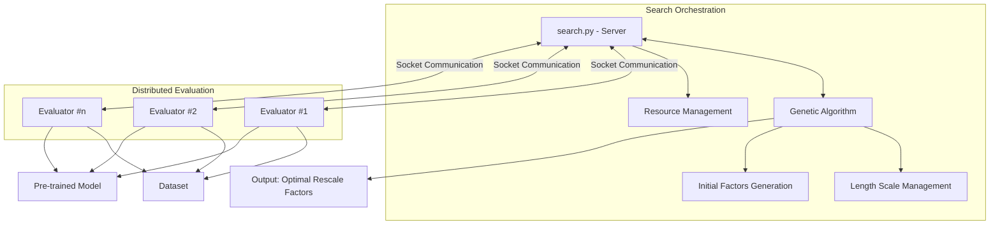
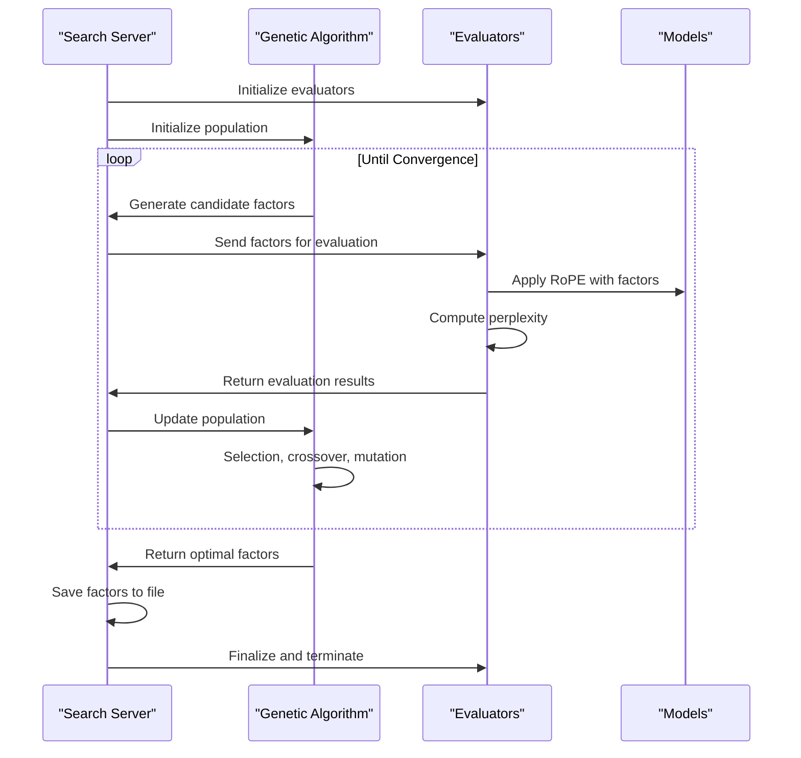
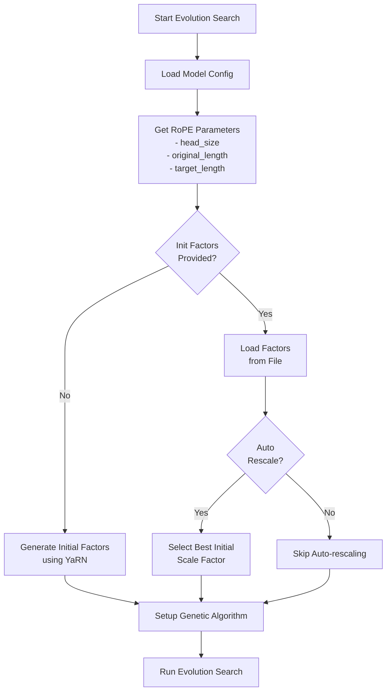
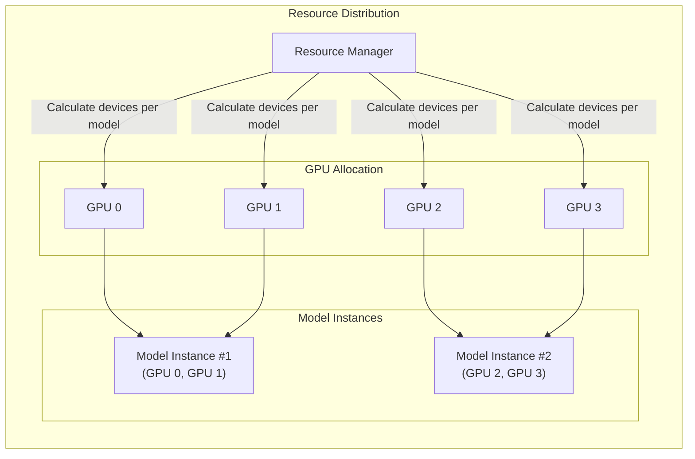

<!-- source: DeepWiki mcp.deepwiki.com · repo microsoft/LongRoPE · page 3 Evolution Search · fetched 2026-10-26 -->

# Evolution Search

<details>
<summary>Relevant source files</summary>

The following files were used as context for generating this wiki page:

- [evolution/__init__.py](evolution/__init__.py)
- [evolution/evaluate.py](evolution/evaluate.py)
- [evolution/search.py](evolution/search.py)

</details>


## Purpose and Scope

The Evolution Search subsystem in LongRoPE is responsible for finding optimal rescale factors to extend the context window of Large Language Models (LLMs) without retraining. This system uses evolutionary algorithms to search through the space of possible rescale factors, evaluating candidate solutions by measuring their performance on language modeling tasks.

This page explains the architecture and workflow of the Evolution Search process. For specific details on the genetic algorithms used, see [Search Algorithm](#3.1). For information about the evaluation methods, see [Evaluation](#4).

Sources: [evolution/search.py:1-265]()

## Architecture Overview

The Evolution Search system employs a distributed client-server architecture to efficiently evaluate multiple candidate solutions in parallel across available GPU resources.

### Evolution Search System Architecture



Sources: [evolution/search.py:70-114](), [evolution/search.py:183-207]()

The Evolution Search system consists of:

1. **Search Orchestration**: Manages the overall search process, including:
   - **Server**: Coordinates communication with evaluators
   - **Genetic Algorithm**: Implements the evolutionary search strategy
   - **Length Scale Management**: Handles context window scaling
   - **Initial Factors Generation**: Creates starting points for the search
   - **Resource Management**: Allocates GPU resources efficiently

2. **Distributed Evaluation**: Multiple evaluator instances that:
   - Run on separate GPU devices
   - Load the model and dataset
   - Evaluate candidates and return performance metrics

## Evolution Search Process

The search process follows these key steps:

### Evolution Search Workflow



Sources: [evolution/search.py:183-214](), [evolution/evaluate.py:67-79]()

### Initialization Process



Sources: [evolution/search.py:116-179]()

## Implementation Details

### Socket-Based Communication

The Evolution Search employs a socket-based client-server architecture to facilitate communication between the central search process and distributed evaluators:

1. The search process (`search.py`) acts as the server, creating a socket that:
   - Binds to a dynamically assigned port
   - Listens for connections from evaluator processes
   - Sends candidate solutions to evaluators
   - Receives evaluation results

2. Each evaluator (`evaluate.py`) acts as a client that:
   - Connects to the search server
   - Loads the model and tokenized dataset
   - Receives RoPE arguments from the server
   - Applies the specified rescale factors to the model
   - Evaluates model performance and returns results

This architecture allows for efficient parallel evaluation of multiple candidate solutions across available GPU resources.

Sources: [evolution/search.py:71-114](), [evolution/evaluate.py:24-79]()

### Resource Management

The system intelligently manages GPU resources to optimize the evaluation process:



Key resource management features:

1. **GPU Memory Analysis**: Estimates available GPU memory to determine how many GPUs are needed per model.
2. **Model Distribution**: Distributes model instances across available GPUs.
3. **Multiple Evaluators**: Creates multiple evaluator instances to utilize available resources.
4. **Device Selection**: Supports specific device selection via command-line arguments.

Sources: [evolution/search.py:77-86](), [evolution/search.py:90-114]()

## Supported Algorithms

The Evolution Search system supports two primary genetic algorithms:

1. **DimMonoGeneticAlgorithm**: Search algorithm that applies consistent monotonicity constraints across all dimensions.
2. **DimPieceMonoGeneticAlgorithm**: Search algorithm that allows for piecewise monotonicity constraints, enabling more flexible factor patterns.

The algorithm selection is controlled by the `--algorithm` parameter when launching the search process.

Sources: [evolution/search.py:183-207]()

## Initial Factor Generation

The system provides two methods for generating initial rescale factors:

1. **YaRN-based Initialization**: Automatically generates factors using the YaRN (Yet another RoPE extensioN) approach, which provides a mathematically sound starting point.
2. **Custom Initialization**: Loads pre-defined factors from a file, which can be useful when refining previously discovered factors.

When using YaRN initialization, the system selects appropriate parameters based on the model type:

```
Model-specific YaRN configurations:
- Mistral/Mixtral: beta_fast=128, beta_slow=2
- Others (Llama, Phi3, etc.): beta_fast=32, beta_slow=1
```

Sources: [evolution/search.py:153-180]()

## Configuration Options

The Evolution Search process can be customized through various command-line arguments:

| Parameter | Description | Default |
|-----------|-------------|---------|
| `--model` | Path to the model to be extended | Required |
| `--tokenized` | Path to tokenized dataset for evaluation | Required |
| `--algorithm` | Genetic algorithm to use (`dim_mono` or `dim_piece_mono`) | Required |
| `--target-length` | Target context length for extension | Required |
| `--output-dir` | Directory to save results | Required |
| `--yarn-settings` | YaRN parameter preset to use | `llama` |
| `--init-factors` | Path to initial factors file | `None` (use YaRN) |
| `--auto-rescale-init-factors` | Whether to auto-rescale initial factors | `False` |
| `--hyper-params` | Path to hyperparameters file | Algorithm defaults |
| `--length-scale` | Explicit length scaling factor | `None` (auto) |
| `--model-size-gb` | Approximate model size in GB | `14` |
| `--devices` | Comma-separated list of GPU devices to use | All available |

Sources: [evolution/search.py:222-246]()

## Usage Example

A typical workflow for running an Evolution Search:

1. **Prepare the tokenized dataset** (see [Dataset Preparation](#5.1))
2. **Configure the search process** by setting the model, target length, and other parameters
3. **Run the search** using the appropriate algorithm
4. **Evaluate the results** using the generated rescale factors

The search process outputs the following files:
- `result_final.csv`: The final optimized rescale factors
- `log-TIMESTAMP.json`: Detailed log of the search process
- `log-TIMESTAMP.txt`: Text log of the search execution

Sources: [evolution/search.py:210-214](), [evolution/search.py:249-265]()

---

