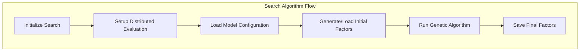
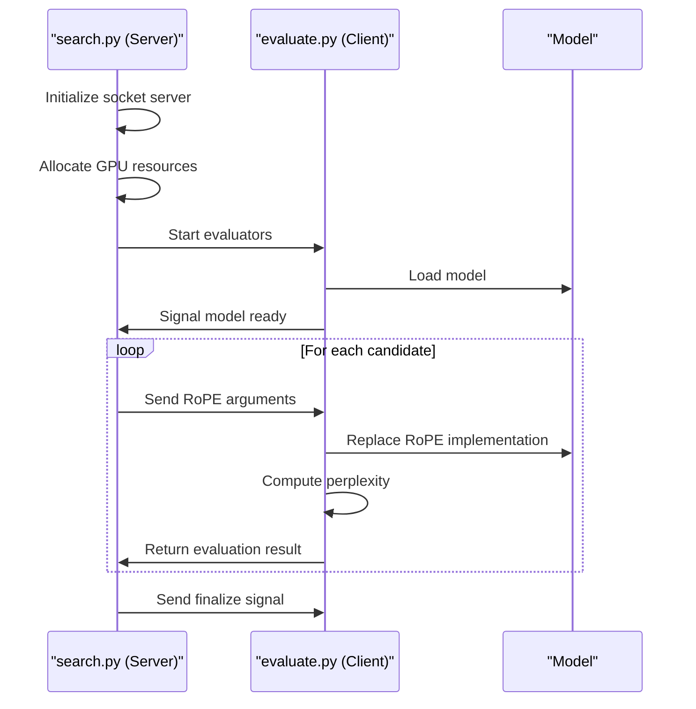
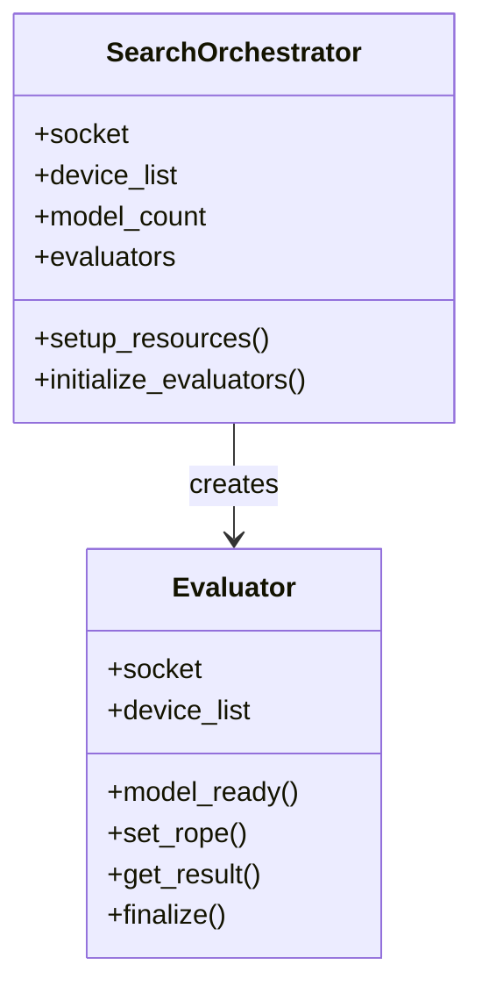
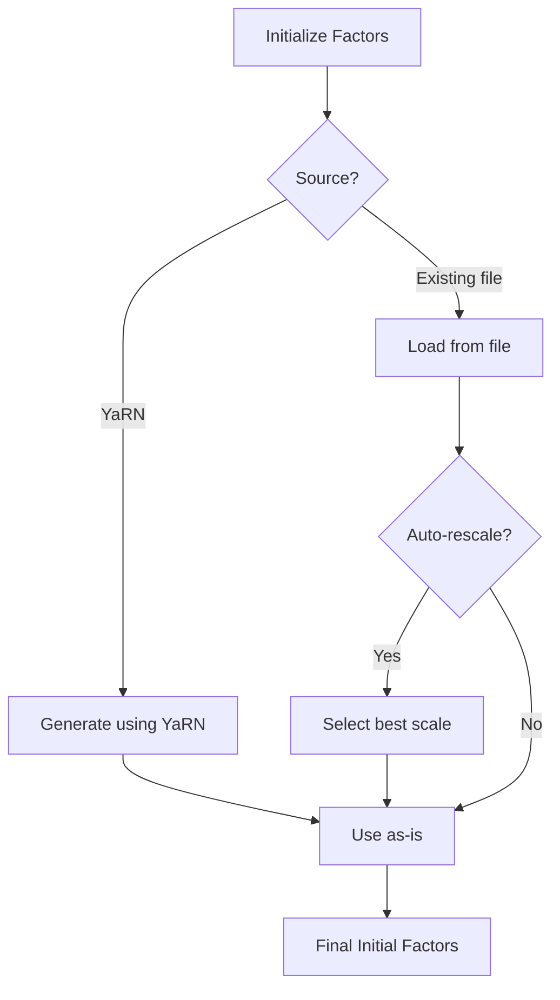
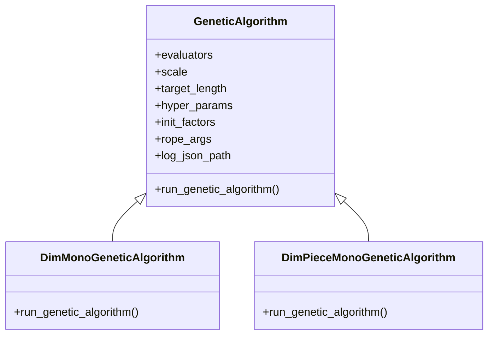
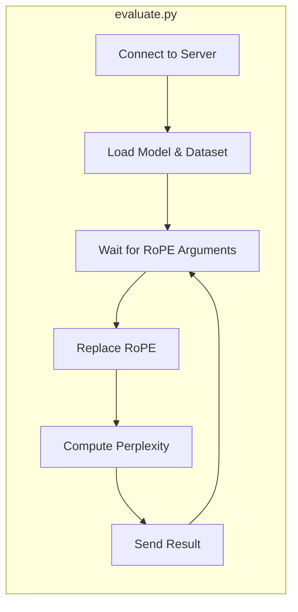
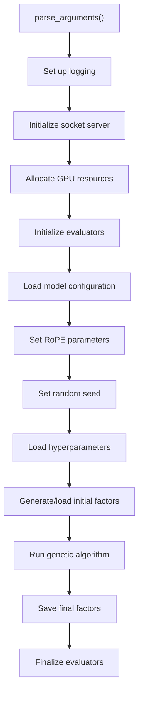

<!-- source: DeepWiki mcp.deepwiki.com · repo microsoft/LongRoPE · page 3.1 Search Algorithm · fetched 2026-10-26 -->

# Search Algorithm

<details>
<summary>Relevant source files</summary>

The following files were used as context for generating this wiki page:

- [evolution/evaluate.py](evolution/evaluate.py)
- [evolution/search.py](evolution/search.py)

</details>


The Search Algorithm in LongRoPE is a sophisticated evolutionary search process designed to find optimal rescale factors for extending the context window of Large Language Models (LLMs). This page details the implementation of the search algorithm, including its orchestration, initialization process, and evaluation mechanisms. For information about the specific genetic algorithms used, see [Genetic Algorithms](#3.2), and for details on distributed evaluation, see [Distributed Evaluation](#3.3).

## Overview

The Search Algorithm employs evolutionary optimization to discover optimal non-uniform rescaling factors for Rotary Positional Embeddings (RoPE). These factors are crucial for effectively extending an LLM's context window while maintaining its reasoning capabilities across longer sequences.



Sources: [evolution/search.py:71-215]()

## Search Orchestration

The search process is orchestrated through a server-client architecture that enables distributed evaluation across multiple GPUs. This architecture optimizes resource utilization and accelerates the search process.



Sources: [evolution/search.py:71-115](), [evolution/evaluate.py:24-82]()

### Resource Management

The search algorithm intelligently manages GPU resources based on model size and available memory:

1. Calculates memory requirements per device
2. Determines the number of devices needed per model
3. Distributes models across available devices
4. Initializes evaluators accordingly



Sources: [evolution/search.py:77-115]()

## Initial Factors Generation

Before starting the genetic algorithm, the search process needs initial rescale factors. These can be:

1. Generated using YaRN (Yet another RoPE extensioN) algorithm
2. Loaded from a previously saved file
3. Auto-rescaled to find the best starting point



Sources: [evolution/search.py:145-180]()

### YaRN-based Initialization

When no initial factors are provided, the system generates them using YaRN with model-specific settings:

```python
# Model-specific YaRN settings
if args.yarn_settings == 'mistral' or config.model_type == 'mistral':
    yarn_betas = {
        'beta_fast': 128,
        'beta_slow': 2,
    }
else:
    yarn_betas = {
        'beta_fast': 32,
        'beta_slow': 1,
    }
```

The YaRN-based initialization creates a baseline set of rescale factors that the genetic algorithm can then refine.

Sources: [evolution/search.py:153-171]()

## Execution of Genetic Algorithms

The search algorithm supports two types of genetic algorithms:

1. **DimMonoGeneticAlgorithm**: Evolves factors with monotonically increasing constraints
2. **DimPieceMonoGeneticAlgorithm**: Evolves factors with piecewise monotonically increasing constraints

The choice of algorithm is specified via command-line arguments, and both algorithms are initialized with:

- A set of evaluators for fitness assessment
- Scale and target length parameters
- Hyperparameters loaded from configuration files
- Initial factors as the starting point
- Output paths for logging and results



Sources: [evolution/search.py:183-208]()

## Evaluation Process

The evaluation process is critical to the search algorithm. It measures how well each candidate set of rescale factors performs by:

1. Loading the model with specific configurations
2. Replacing the RoPE implementation with the candidate factors
3. Computing perplexity on a tokenized dataset
4. Returning the result to the search orchestrator



Sources: [evolution/evaluate.py:24-82]()

### Socket-based Communication

The evaluator and search orchestrator communicate through a socket connection:

1. The search orchestrator creates a socket server
2. Evaluators connect as clients
3. The orchestrator sends RoPE parameters via JSON
4. Evaluators return perplexity results via JSON
5. This continues until the search is complete

Sources: [evolution/search.py:72-76](), [evolution/evaluate.py:25-82]()

## End-to-End Search Workflow

The complete search workflow integrates all components to find optimal rescale factors:



Sources: [evolution/search.py:71-266]()

## Command-Line Interface

The search algorithm is configurable through numerous command-line arguments that control:

- Model selection and configuration
- Dataset parameters
- Algorithm selection
- Evaluation settings
- Output configuration
- Resource allocation

Key parameters include:

| Parameter | Description | Default |
|-----------|-------------|---------|
| `--model` | Path to the model | Required |
| `--tokenized` | Path to the tokenized dataset | Required |
| `--algorithm` | Genetic algorithm type (dim_mono or dim_piece_mono) | Required |
| `--target-length` | Target context length | Required |
| `--output-dir` | Directory for results | Required |
| `--init-factors` | Path to initial factors file | None (uses YaRN) |
| `--hyper-params` | Path to hyperparameters file | Uses default |
| `--model-size-gb` | Estimated model size in GB | 14 |
| `--devices` | Comma-separated list of GPU devices | All available |

Sources: [evolution/search.py:222-265]()

## Implementation Details

### Evaluator Class

The `Evaluator` class (imported from `evolution.algorithms`) is a key component that:

1. Manages communication with an evaluation worker
2. Sets RoPE parameters for evaluation
3. Retrieves perplexity results
4. Handles cleanup when the search is complete

Each evaluator operates on a specific set of GPU devices and evaluates candidate solutions in parallel with other evaluators.

Sources: [evolution/search.py:20](), [evolution/search.py:88-114]()

### Rescale Function

The rescale function adapts factors from one scale to another:

```python
def rescale(
    target_length_scale: float,
    origin_length_scale: float,
    factors: np.ndarray,
):
    return 1.0 + (factors - 1.0) * ((target_length_scale - 1.0) / (origin_length_scale - 1.0))
```

This function is used during initialization and when adapting rescale factors for different target lengths.

Sources: [evolution/search.py:33-38]()

### Initial Factors Selection

The `select_init_factors` function (lines 41-68) finds the best starting point for the search by:

1. Testing the initial factors at various scales
2. Measuring perplexity for each scale
3. Selecting the scale with the lowest perplexity
4. Returning the best rescale factors and scale

Sources: [evolution/search.py:41-68]()

## Putting It All Together

The Search Algorithm is a sophisticated component of the LongRoPE system that uses evolutionary optimization to find optimal rescale factors for extending LLM context windows. It orchestrates distributed evaluation, manages resources efficiently, and employs genetic algorithms to evolve increasingly effective solutions.

The final output of the search process is a set of rescale factors that can be applied to the LLM to enable longer context windows while maintaining model performance. These factors are saved to a CSV file for later use in extending model context windows.

---

