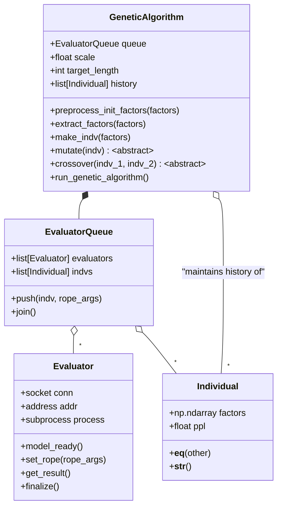
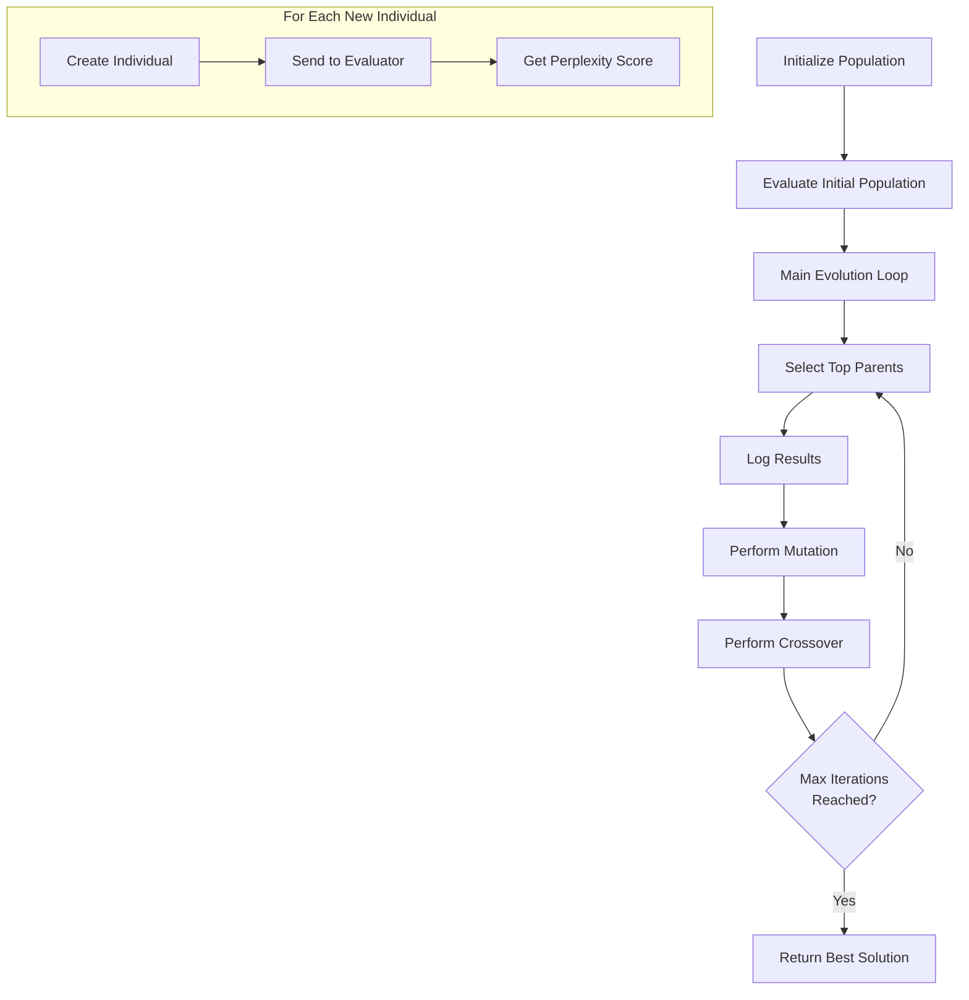
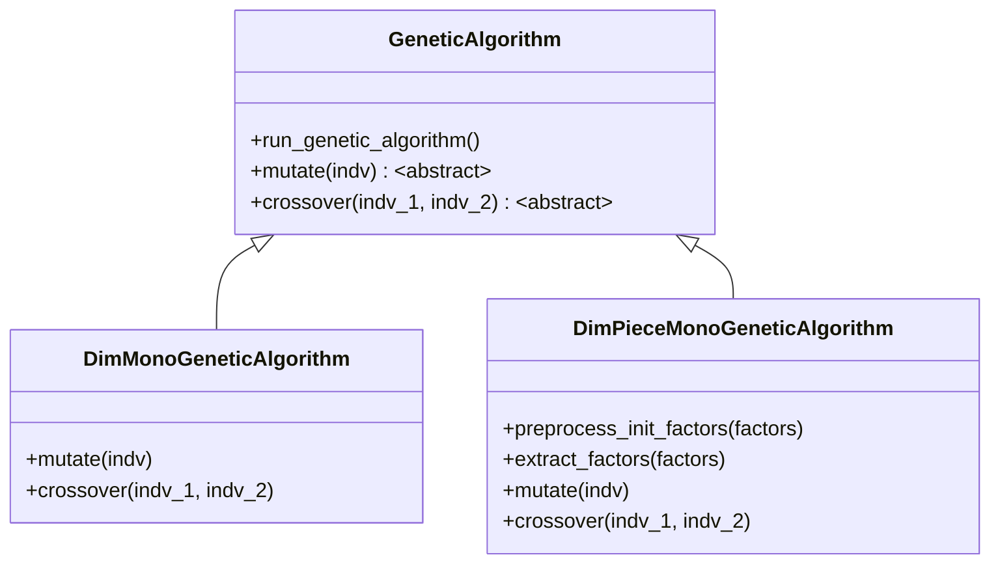
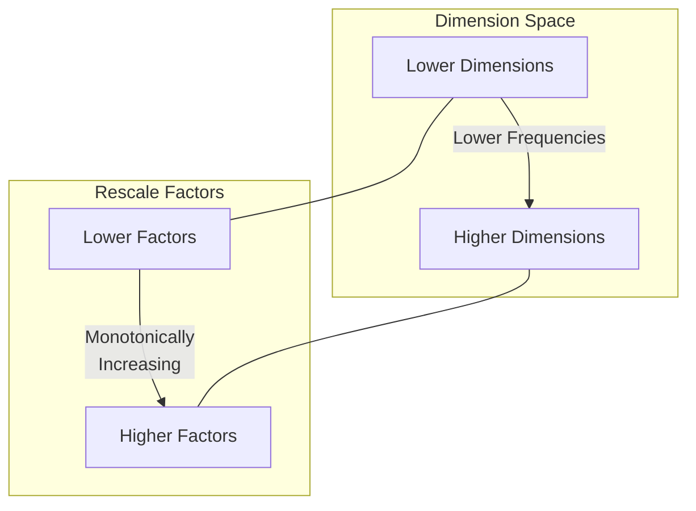
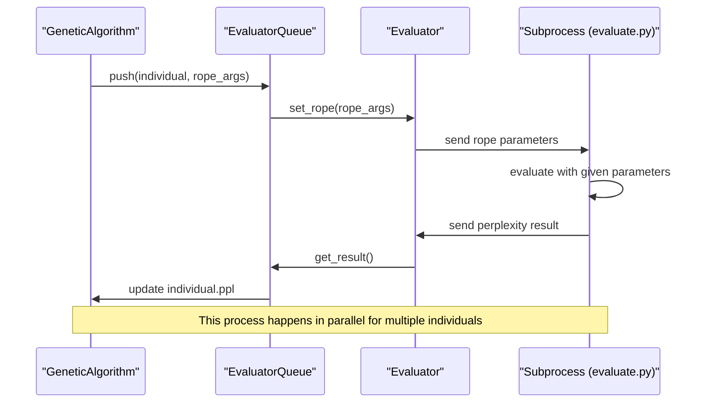

<!-- source: DeepWiki mcp.deepwiki.com · repo microsoft/LongRoPE · page 3.2 Genetic Algorithms · fetched 2026-10-26 -->

# Genetic Algorithms

<details>
<summary>Relevant source files</summary>

The following files were used as context for generating this wiki page:

- [evolution/algorithms/__init__.py](evolution/algorithms/__init__.py)
- [evolution/algorithms/dim_mono.py](evolution/algorithms/dim_mono.py)
- [evolution/algorithms/dim_piece_mono.py](evolution/algorithms/dim_piece_mono.py)
- [evolution/algorithms/genetic_base.py](evolution/algorithms/genetic_base.py)

</details>


## Purpose and Scope

This page documents the genetic algorithms used in the LongRoPE system to find optimal rescale factors for extending the context window of large language models. The genetic algorithms implement an evolutionary approach to search for rescale factor configurations that minimize perplexity while maintaining specific constraints.

This page focuses on the genetic algorithm implementations and their components. For information about how these algorithms are integrated into the overall search process, see [Search Algorithm](#3.1). For details on how candidate solutions are evaluated, see [Distributed Evaluation](#3.3).

Sources: [evolution/algorithms/__init__.py:1-6]()

## Genetic Algorithm Framework

The LongRoPE system implements a genetic algorithm framework that consists of the following core components:



**Genetic Algorithm Framework Components**

Sources: [evolution/algorithms/genetic_base.py:14-33](), [evolution/algorithms/genetic_base.py:37-82](), [evolution/algorithms/genetic_base.py:83-118](), [evolution/algorithms/genetic_base.py:119-146]()

## Individual Representation

In the genetic algorithm, each individual represents a candidate solution for the LongRoPE rescale factors. The `Individual` class encapsulates:

1. `factors` - A NumPy array containing the rescale factors
2. `ppl` (perplexity) - The fitness measure for the individual (lower is better)

```python
class Individual:
    def __init__(self, factors: np.ndarray, ppl: float = None):
        self.factors = factors
        self.ppl = ppl
```

The representation is engineered to:
- Support equality comparison between individuals (to avoid duplicates)
- Provide string representation for debugging and logging
- Store evaluation results (perplexity)

Sources: [evolution/algorithms/genetic_base.py:17-34]()

## Genetic Algorithm Process

The core genetic algorithm process is implemented in the `run_genetic_algorithm` method and follows this workflow:



**Genetic Algorithm Process Flow**

Key aspects of this process:
- Initial population generation through mutation of a base individual
- Selection of parents based on perplexity (lower is better)
- Creation of new individuals through mutation and crossover operations
- Continuous logging of best solutions
- Parallel evaluation of individuals using multiple evaluators

Sources: [evolution/algorithms/genetic_base.py:229-310]()

## Evolution Hyperparameters

The genetic algorithm's behavior is controlled by several hyperparameters:

| Parameter | Description |
|-----------|-------------|
| `population_size` | Size of the population in each generation |
| `max_time_budget` | Maximum number of iterations to run |
| `mutation_numbers` | Number of mutation operations per generation |
| `crossover_size` | Number of crossover operations per generation |
| `max_crossover_try` | Maximum attempts for crossover before falling back to mutation |
| `parents_size` | Number of top individuals to select as parents |
| `list_step` | Granularity of the search space |
| `evo_scale` | Scaling factor for algorithm parameters |

These parameters can be adjusted to balance exploration vs. exploitation in the search process.

Sources: [evolution/algorithms/genetic_base.py:151-161]()

## Algorithm Implementations

LongRoPE implements two specific genetic algorithm variants, each with its own approach to handling constraints:



**Genetic Algorithm Class Hierarchy**

Sources: [evolution/algorithms/__init__.py:1-6](), [evolution/algorithms/dim_mono.py:1-55](), [evolution/algorithms/dim_piece_mono.py:1-90]()

### DimMonoGeneticAlgorithm

This implementation enforces monotonically increasing rescale factors across dimensions. Key features:

1. **Mutation Operation**:
   - Randomly selects dimensions with 30% probability
   - For selected dimensions, chooses new values from valid monotonic ranges
   - Ensures monotonicity constraint (`np.diff(factors) >= 0`)
   - Avoids creating duplicate individuals

2. **Crossover Operation**:
   - Combines factors from two parent individuals
   - Randomly selects dimensions to inherit from the second parent
   - Verifies that the resulting individual maintains monotonicity
   - Falls back to mutation if valid crossover can't be found after maximum tries

Sources: [evolution/algorithms/dim_mono.py:11-55]()

### DimPieceMonoGeneticAlgorithm

This implementation adds piece-wise monotonicity with transition points. Key features:

1. **Factor Structure**:
   - Adds two control parameters (`alpha_dim`, `beta_dim`) to the factors array
   - These define transition points between different scaling regimes

2. **Mutation Operation**:
   - Modifies control parameters with 50% probability
   - For dimensions ≤ `alpha_dim`, sets factor to 1.0
   - For dimensions > `beta_dim`, sets factor to maximum scale
   - For dimensions between, applies monotonic random changes

3. **Crossover Operation**:
   - Handles control parameters as a unit to maintain coherence
   - Inherits either both control parameters or specific dimension factors
   - Ensures constraints between control parameters (`0 ≤ alpha_dim < beta_dim`)

Sources: [evolution/algorithms/dim_piece_mono.py:11-90]()

## Monotonicity Constraints

Both genetic algorithm implementations enforce monotonicity constraints for the rescale factors. These constraints are essential because:

1. The frequency distribution in Rotary Position Embeddings is structured with increasing frequency across dimensions
2. Monotonically increasing rescale factors maintain this relative ordering
3. Without monotonicity, there would be dimension reordering, potentially disrupting model capabilities



**Monotonicity Relationship in Rescale Factors**

Sources: [evolution/algorithms/dim_mono.py:13-35](), [evolution/algorithms/dim_piece_mono.py:22-64]()

## Evaluation Process

The evaluation of individuals is handled through a distributed system that communicates via sockets:



**Evaluation Communication Flow**

Key components of the evaluation process:

1. **Evaluator**: Manages socket communication with an evaluation subprocess
2. **EvaluatorQueue**: Coordinates multiple evaluators for parallel processing
3. **Socket Communication**: Transfers parameters and results between processes
4. **Distributed Processing**: Evaluates candidates across multiple devices

Sources: [evolution/algorithms/genetic_base.py:37-82](), [evolution/algorithms/genetic_base.py:83-118]()

## Best Solution Management

The genetic algorithm continuously tracks and updates the best solutions through:

1. **History Tracking**: All evaluated individuals are stored in a history list to avoid re-evaluating duplicates
2. **Result Logging**: Best individuals and their perplexity scores are logged at each iteration
3. **Persistent Storage**: Results are saved to JSON and CSV files for recovery and analysis
4. **Convergence Monitoring**: Improvement tracking through generations

Sources: [evolution/algorithms/genetic_base.py:206-227]()

## Integration with Search Process

The genetic algorithms are a key component of the evolution search process, which uses them to find optimal rescale factors. The integration happens through:

1. The search process creates evaluation workers
2. These workers are passed to the genetic algorithm as evaluators
3. The genetic algorithm runs autonomously, communicating with workers to evaluate candidates
4. The final optimal solution is returned to the search process

For more details on how these genetic algorithms are used in the overall search workflow, see [Search Algorithm](#3.1).

Sources: [evolution/algorithms/genetic_base.py:119-146]()

---

