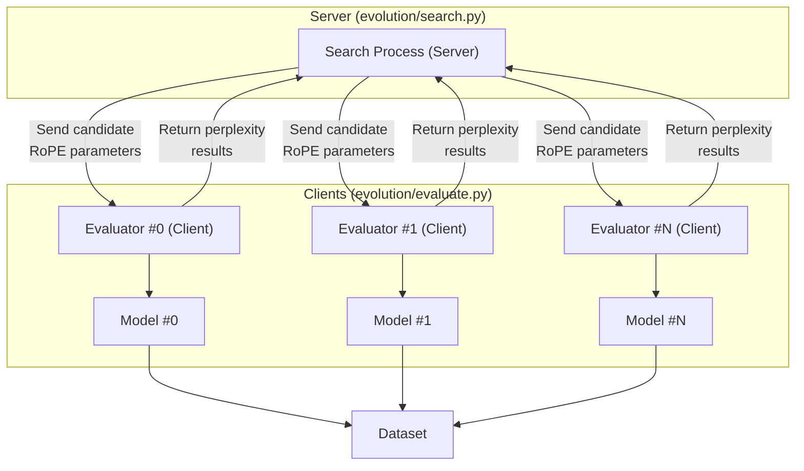
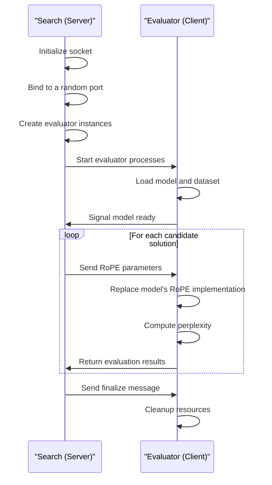
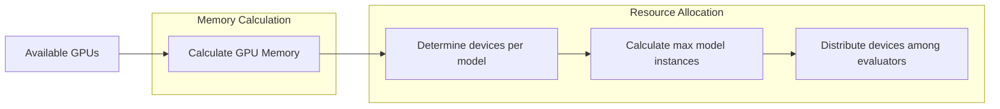
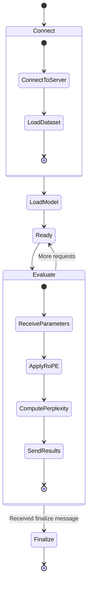
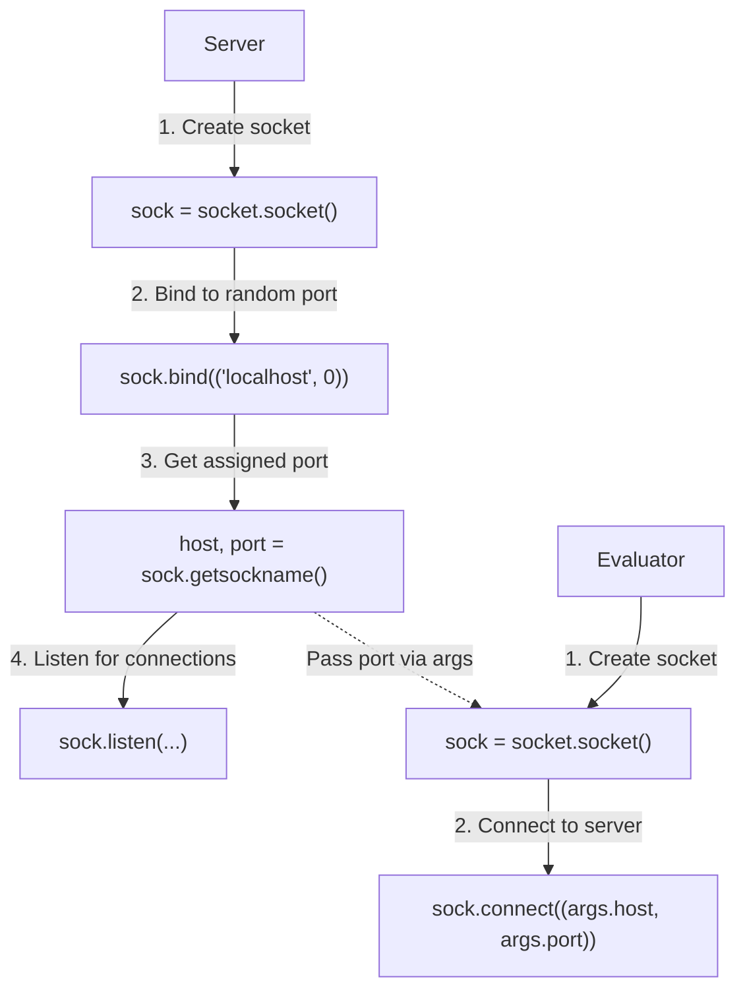
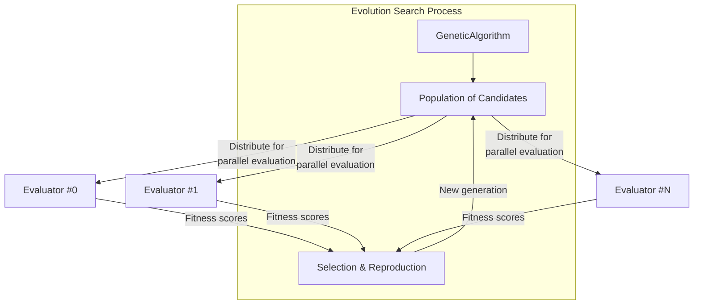

<!-- source: DeepWiki mcp.deepwiki.com · repo microsoft/LongRoPE · page 3.3 Distributed Evaluation · fetched 2026-10-26 -->

# Distributed Evaluation

Relevant source files

The following files were used as context for generating this wiki page:

- [evolution/evaluate.py](evolution/evaluate.py)
- [evolution/search.py](evolution/search.py)

## Purpose and Scope

This document explains the distributed evaluation system used in LongRoPE to parallelize the assessment of candidate rescale factors across multiple GPU devices. The distributed evaluation architecture enables efficient evolutionary search by allowing simultaneous evaluation of multiple candidates, significantly accelerating the optimization process. For information about the evolutionary search algorithms themselves, see [Search Algorithm](#3.1) and [Genetic Algorithms](#3.2).

## System Architecture

The distributed evaluation system employs a client-server architecture with socket-based communication. The search process (server) distributes candidate solutions to multiple evaluator instances (clients), which perform model inference in parallel and return perplexity results.

### Architecture Diagram

Sources: [evolution/search.py:72-114](), [evolution/evaluate.py:23-83]()

## Client-Server Communication

The communication between the server (search process) and clients (evaluators) follows a request-response pattern:

Sources: [evolution/search.py:71-114](), [evolution/evaluate.py:24-81]()

## Resource Allocation and Device Management

The system dynamically allocates GPU resources based on model size and available hardware. It calculates how many devices are needed per model instance and maximizes parallelism by running as many model instances as possible.

### Device Allocation Logic

Sources: [evolution/search.py:77-87]()

The system determines resource allocation with the following steps:

1. Calculate available memory per GPU device
2. Estimate required memory per model (specified via `model_size_gb` parameter)
3. Determine number of GPUs needed per model instance
4. Calculate maximum number of model instances that can run in parallel
5. Distribute available devices among evaluator instances

## Evaluator Implementation

Each evaluator is responsible for:
1. Loading a model instance
2. Processing evaluation requests
3. Applying RoPE parameters
4. Computing perplexity
5. Returning results to the server

### Evaluator Workflow

Sources: [evolution/evaluate.py:24-81]()

## Key Parameters and Configuration

The distributed evaluation system is configured through several key parameters:

| Parameter | Description | Default | Source |
|-----------|-------------|---------|--------|
| `model_size_gb` | Estimated model size in gigabytes | 14.0 | `search.py` |
| `devices` | Comma-separated list of GPU device IDs | All available | `search.py` |
| `attn_implementation` | Attention implementation to use | "flash_attention_2" | Both files |
| `ppl_sliding_window` | Window size for perplexity calculation | 256 | Both files |
| `use_cache` | Whether to use KV cache during inference | False | Both files |
| `save_memory` | Enable memory optimization techniques | False | Both files |
| `num_proc` | Number of processes for dataset operations | 4 | Both files |

Sources: [evolution/search.py:222-244](), [evolution/evaluate.py:85-100]()

## Connection Establishment

The server (search process) dynamically selects an available port for communication:

1. The server creates a socket and binds it to localhost with port 0 (auto-assign)
2. The system obtains the assigned port number
3. Each evaluator connects to this port to establish communication

Sources: [evolution/search.py:72-75](), [evolution/evaluate.py:26-28]()

## Message Protocol

The client-server communication uses JSON messages over sockets:

| Message Type | Direction | Structure | Purpose |
|--------------|-----------|-----------|---------|
| Model Ready | Client → Server | `{"model_ready": true}` | Signal model loaded |
| RoPE Parameters | Server → Client | `{"rope_args": {...}}` | Send parameters to evaluate |
| Evaluation Result | Client → Server | `{"result": float}` | Return perplexity score |
| Finalize | Server → Client | `{"finalize": true}` | Signal evaluation completion |

Sources: [evolution/search.py:114](), [evolution/evaluate.py:53-81]()

## Memory Management

The system implements several memory optimization strategies:

1. **Device Partitioning**: Distributing model across multiple GPUs when it doesn't fit in a single device
2. **Dynamic Resource Allocation**: Automatically calculating optimal device distribution
3. **Memory Usage Estimation**: Reserving approximately 80% of available GPU memory to prevent OOM errors

Sources: [evolution/search.py:77-87]()

## Parallel Evaluation in Genetic Algorithms

The distributed evaluation system is primarily used by the genetic algorithms to evaluate the fitness of candidate solutions in parallel:

Sources: [evolution/search.py:184-206]()

## Integration with Rope Module

The distributed evaluation system interfaces with the RoPE module to apply and test different positional embedding configurations:

1. The server sends RoPE parameters to evaluators
2. Evaluators use `rope.replace_rope()` to modify the model's positional embeddings
3. Different RoPE classes (`LongRoPEScaledRotaryEmbedding`, `YaRNScaledRotaryEmbedding`, etc.) can be specified

Sources: [evolution/evaluate.py:72-77]()

---

