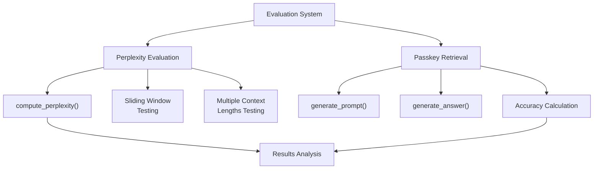
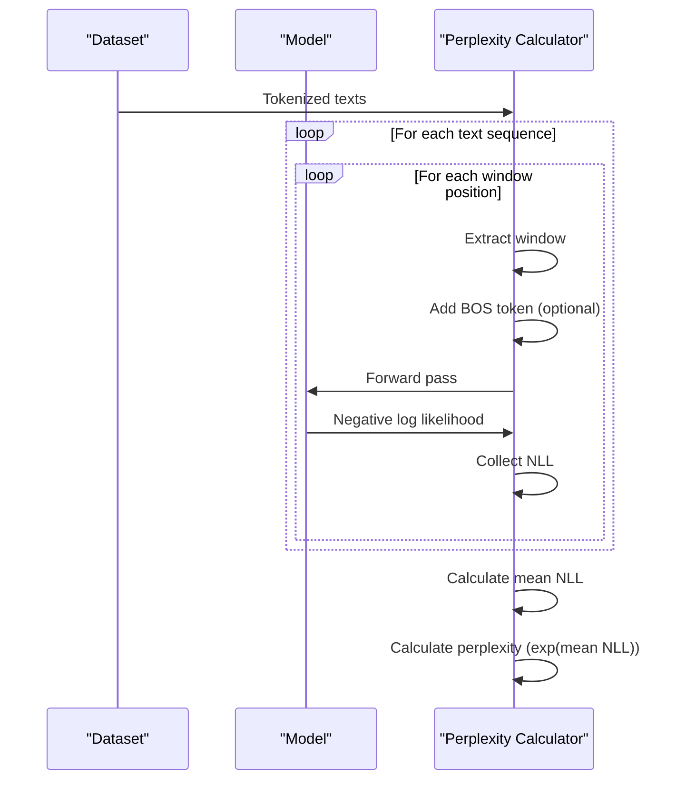
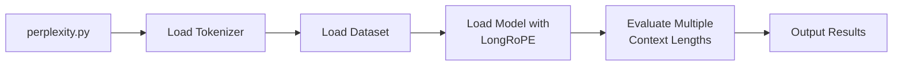
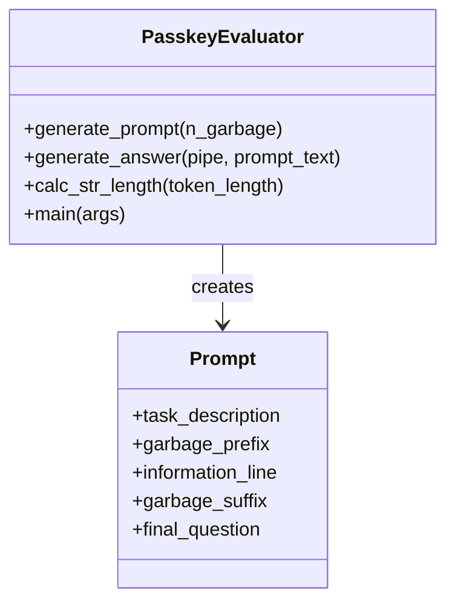
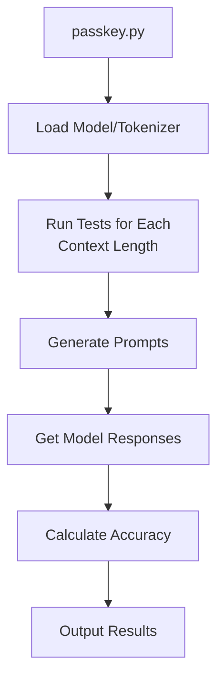
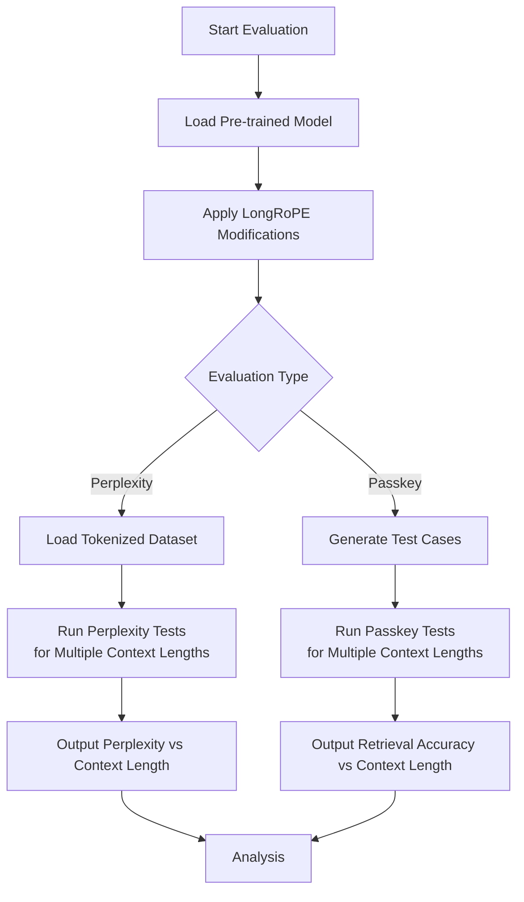
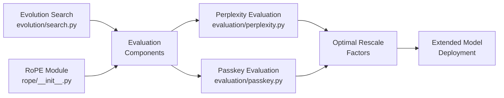

<!-- source: DeepWiki mcp.deepwiki.com · repo microsoft/LongRoPE · page 4 Evaluation · fetched 2026-10-26 -->

# Evaluation

<details>
<summary>Relevant source files</summary>

The following files were used as context for generating this wiki page:

- [evaluation/__init__.py](evaluation/__init__.py)
- [evaluation/passkey.py](evaluation/passkey.py)
- [evaluation/perplexity.py](evaluation/perplexity.py)

</details>


This page documents the evaluation systems used in LongRoPE to measure the performance of language models with extended context windows. The evaluation components provide quantitative metrics to assess how well models can process and utilize information across long contexts after applying LongRoPE modifications.

For information about running the evaluation scripts, see [Using LongRoPE](#5). For details on the evolution search process that uses these evaluation methods, see [Evolution Search](#3).

## Overview of Evaluation Methods

LongRoPE employs two complementary evaluation methods to assess model performance with extended context windows:

1. **Perplexity Evaluation**: Measures the model's ability to predict tokens across long contexts
2. **Passkey Retrieval**: Tests the model's ability to access specific information embedded deep within a context window



Sources: [evaluation/perplexity.py](), [evaluation/passkey.py]()

## Perplexity Evaluation

Perplexity is a standard metric for evaluating language models that measures how well a model predicts a sequence of text. Lower perplexity indicates better performance.

### Implementation Details

The perplexity evaluation system implements a sliding window approach to efficiently evaluate perplexity on long sequences:



Sources: [evaluation/perplexity.py:23-103]()

The key function that implements this approach is `compute_perplexity`:

```python
def compute_perplexity(
    dataset,
    model,
    tokenizer,
    add_start_token = True,
    num_tokens = None,
    sliding_window = 256,
    max_sliding_count = 10,
    truncate = False,
    use_cache = False,
    save_memory = False,
    device = None,
)
```

This function:
- Processes tokenized text in a sliding window fashion
- Can optionally add start tokens to each window
- Calculates perplexity across multiple context windows
- Supports memory optimization options

Sources: [evaluation/perplexity.py:23-103]()

### Usage

The perplexity evaluation system can be executed from the command line with various parameters:



Key parameters for perplexity testing include:
- `--model`: Path to the model
- `--tokenized`: Path to the tokenized dataset
- `--num-tokens`: Context lengths to test (comma-separated list)
- `--ppl-sliding-window`: Size of the sliding window
- `--output-file`: File to save results

The system leverages environment variables for LongRoPE configuration:
- `ROPE_METHOD`: LongRoPE variant to use
- `LONGROPE_RESCALE_FACTOR`: Path to rescale factors
- `LONGROPE_SCALING_POLICY`: Policy for applying rescale factors
- `TARGET_LENGTH`: Maximum context length

Sources: [evaluation/perplexity.py:106-193]()

## Passkey Retrieval Evaluation

The passkey retrieval evaluation tests a model's ability to access information embedded deep within a long context window. It simulates a real-world scenario where specific information needs to be retrieved from a large amount of text.

### Implementation Details

The passkey retrieval test works by:
1. Generating a prompt with a random "passkey" (a number) embedded within irrelevant text
2. Asking the model to recall the passkey
3. Measuring accuracy based on whether the model correctly retrieves the passkey



Sources: [evaluation/passkey.py:30-66]()

The key components include:

1. **Prompt Generation**: The `generate_prompt()` function creates test cases by embedding a random number (the "passkey") within a large amount of irrelevant text.

2. **Answer Generation**: The `generate_answer()` function extracts the model's response and tries to parse the passkey from it.

3. **Accuracy Calculation**: The system calculates the percentage of correctly retrieved passkeys.

Sources: [evaluation/passkey.py:30-66]()

### Usage

The passkey evaluation can be run from the command line:



Key parameters include:
- `--model`: Path to the model
- `--samples`: Number of test samples
- `--num-tokens`: Context lengths to test (comma-separated list)
- `--output-file`: File to save results
- `--log-file`: File to log detailed test information

Similar to perplexity evaluation, the system uses environment variables for LongRoPE configuration.

Sources: [evaluation/passkey.py:69-162]()

## Evaluation Workflow

The typical evaluation workflow involves testing models with various context window sizes to measure how performance changes with longer contexts:



The evaluation results provide insights into:
1. How perplexity changes with increasing context length
2. How information retrieval accuracy changes with increasing context length
3. The effectiveness of different LongRoPE configurations

Sources: [evaluation/perplexity.py](), [evaluation/passkey.py]()

## Relationship with Other Components

The evaluation system integrates with other LongRoPE components:



The evaluation components serve multiple purposes in the LongRoPE workflow:

1. **Parameter Optimization**: During evolution search, they provide fitness metrics for evaluating candidate rescale factors
2. **Final Evaluation**: They assess the final performance of models with optimized LongRoPE configurations
3. **Comparative Analysis**: They enable comparison between different LongRoPE variants and configurations

Sources: [evaluation/perplexity.py](), [evaluation/passkey.py]()

## Data Tables

### Perplexity Evaluation Parameters

| Parameter | Description | Default |
|-----------|-------------|---------|
| `--model` | Model path or identifier | (Required) |
| `--tokenized` | Path to tokenized dataset | (Required) |
| `--dataset-min-tokens` | Minimum token count for samples | None |
| `--samples` | Number of samples to evaluate | None (all) |
| `--num-tokens` | Context window sizes to test | "4096,8192,16384" |
| `--ppl-sliding-window` | Size of sliding window | 256 |
| `--truncate` | Whether to truncate sequences | False |
| `--output-file` | Path to save results | None |

Sources: [evaluation/perplexity.py:178-193]()

### Passkey Evaluation Parameters

| Parameter | Description | Default |
|-----------|-------------|---------|
| `--model` | Model path or identifier | (Required) |
| `--samples` | Number of test cases | (Required) |
| `--num-tokens` | Context window sizes to test | "4096,8192,16384" |
| `--output-file` | Path to save results | None |
| `--log-file` | Path to save detailed logs | None |

Sources: [evaluation/passkey.py:152-162]()

## Technical Note

Both evaluation methods are designed to assess the effectiveness of extended context window capabilities provided by LongRoPE. They offer complementary insights:

- **Perplexity** measures general prediction quality across the entire context
- **Passkey retrieval** specifically tests the model's ability to access and use information from distant parts of the context

When evaluating a LongRoPE implementation, it's recommended to use both metrics for a comprehensive assessment.

Sources: [evaluation/perplexity.py](), [evaluation/passkey.py]()

---

