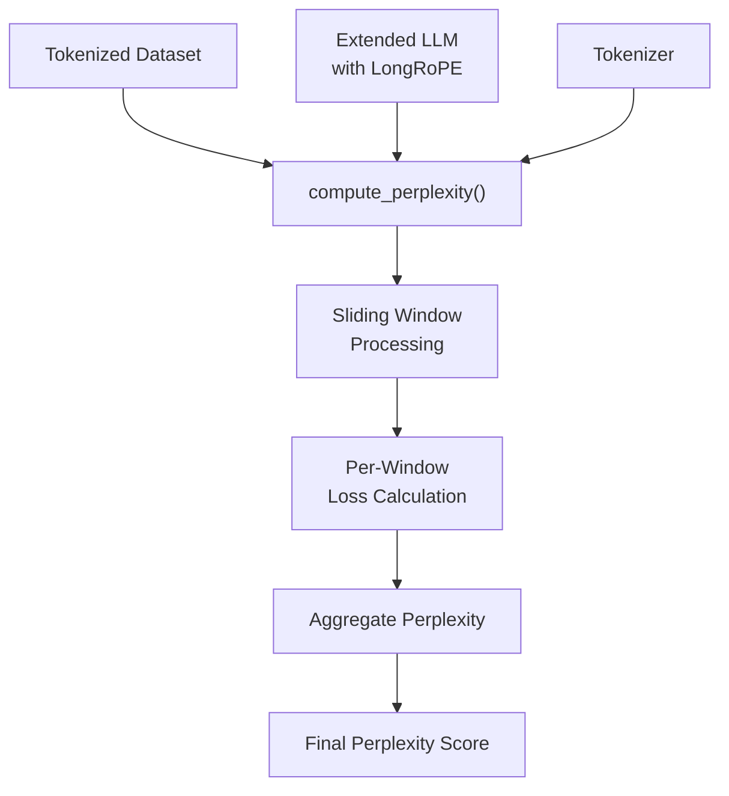
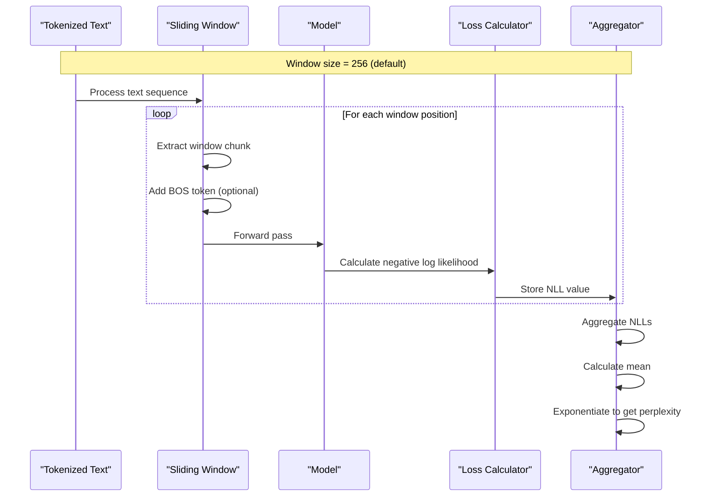
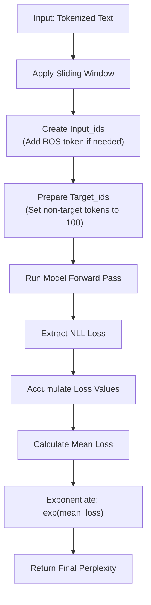
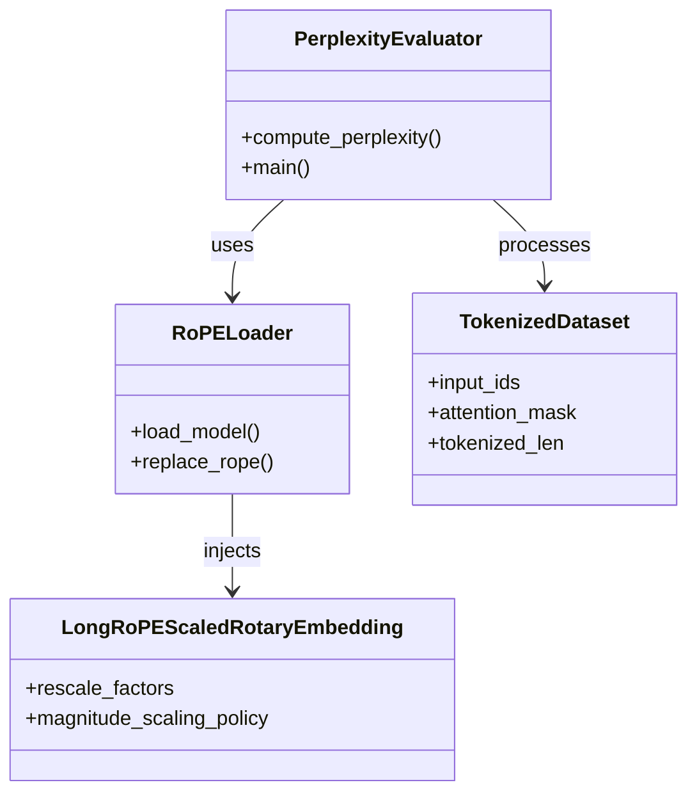
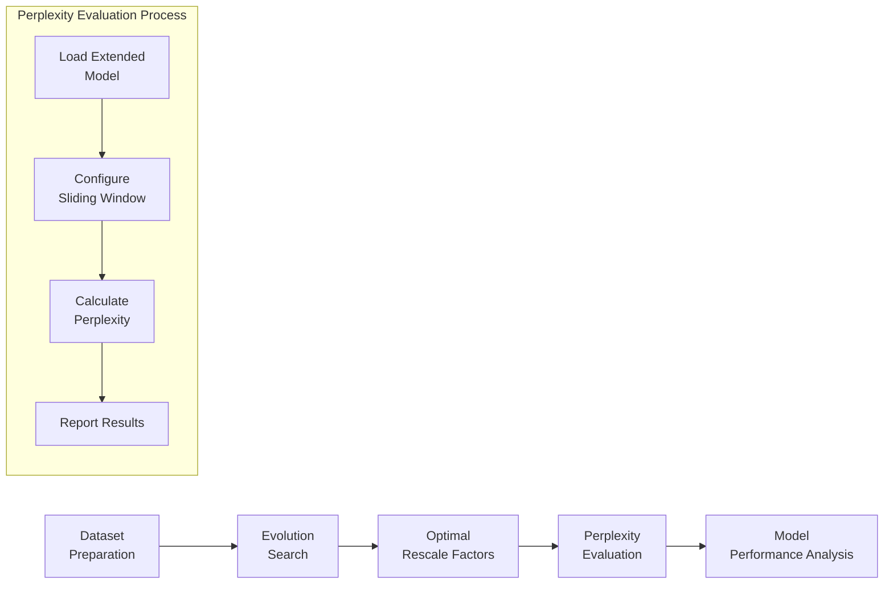

<!-- source: DeepWiki mcp.deepwiki.com · repo microsoft/LongRoPE · page 4.1 Perplexity Evaluation · fetched 2026-10-26 -->

# Perplexity Evaluation

<details>
<summary>Relevant source files</summary>

The following files were used as context for generating this wiki page:

- [evaluation/perplexity.py](evaluation/perplexity.py)

</details>


This document describes the perplexity evaluation component of the LongRoPE system, which measures the performance of language models with extended context windows. Perplexity is a standard metric for evaluating language models that quantifies how well a model predicts a text sample. For information about other evaluation methods such as passkey retrieval testing, see [Passkey Retrieval](#4.2).

## Purpose and Implementation

The perplexity evaluation module provides a sliding window approach to calculate perplexity for models with extended context lengths. This implementation has been validated against calculations reported in academic literature (arXiv 2306.15595).



**Diagram: Perplexity Evaluation Flow**

Sources: [evaluation/perplexity.py:23-103]()

## Core Functionality

The core functionality is implemented in the `compute_perplexity` function, which:

1. Takes a tokenized dataset, model, and tokenizer as inputs
2. Processes text in configurable sliding windows
3. Calculates negative log likelihood for each window
4. Aggregates these values into a final perplexity score

### Key Parameters

| Parameter | Description | Default |
|-----------|-------------|---------|
| `dataset` | Tokenized dataset with input_ids and attention_mask | Required |
| `model` | Language model with extended context | Required |
| `tokenizer` | Associated tokenizer | Required |
| `add_start_token` | Whether to add BOS token | True |
| `num_tokens` | Context length to evaluate | None |
| `sliding_window` | Size of sliding window | 256 |
| `max_sliding_count` | Maximum number of windows | 10 |
| `truncate` | Whether to truncate sequences | False |
| `use_cache` | Whether to use KV cache | False |
| `save_memory` | Enable memory optimization | False |

Sources: [evaluation/perplexity.py:23-35]()

## Sliding Window Perplexity Calculation

The sliding window approach enables evaluation of very long contexts by processing text in manageable chunks while maintaining accuracy.



**Diagram: Sliding Window Calculation Process**

Sources: [evaluation/perplexity.py:60-103]()

## Implementation Details

### Memory Management

The implementation includes memory optimization features:
- Optional method replacement for memory saving
- Explicit garbage collection after each window calculation
- CUDA cache clearing
- Support for different precision types (dtype)

These optimizations are critical when evaluating large models with long contexts, as they help prevent out-of-memory errors.

### Perplexity Calculation Internals



**Diagram: Perplexity Calculation Internals**

Sources: [evaluation/perplexity.py:60-103]()

## Integration with LongRoPE System

The perplexity evaluation module integrates with the LongRoPE system through the `load_model` function, which injects the appropriate rotary positional embedding modifications.



**Diagram: Perplexity Evaluation Code Relationships**

Sources: [evaluation/perplexity.py:117-145]()

## Command-Line Interface

The module provides a comprehensive command-line interface for standalone execution:

```
python -m evaluation.perplexity --model MODEL_NAME --tokenized DATASET_PATH [options]
```

Key options include:

| Option | Description |
|--------|-------------|
| `--model` | Model name or path |
| `--tokenized` | Path to tokenized dataset |
| `--num-tokens` | Comma-separated list of token lengths to evaluate |
| `--ppl-sliding-window` | Size of the sliding window |
| `--truncate` | Whether to truncate sequences |
| `--output-file` | Path to save results |
| `--save-memory` | Enable memory optimization |

Sources: [evaluation/perplexity.py:178-192]()

## Environment Configuration

The module uses environment variables to configure LongRoPE parameters:

| Environment Variable | Purpose |
|----------------------|---------|
| `ROPE_METHOD` | Specifies the RoPE method to use |
| `LONGROPE_RESCALE_FACTOR` | Path to rescale factors |
| `LONGROPE_SCALING_POLICY` | Scaling policy to apply |
| `TARGET_LENGTH` | Target context length |

These variables allow flexible configuration of the LongRoPE parameters without modifying code.

Sources: [evaluation/perplexity.py:118-123](), [evaluation/perplexity.py:133]()

## Output Format

The perplexity evaluation generates results for each specified context length and optionally saves them to a CSV file with the following format:

```
length,ppl
4096,2.345
8192,2.567
16384,2.789
```

This format facilitates further analysis and comparison of perplexity across different context lengths.

Sources: [evaluation/perplexity.py:164-167]()

## Usage in the LongRoPE Workflow

Perplexity evaluation serves as a key metric to validate the effectiveness of LongRoPE's context window extension. In the overall workflow, it typically follows the evolution search process, which discovers optimal rescale factors.



**Diagram: Perplexity Evaluation in LongRoPE Workflow**

Sources: [evaluation/perplexity.py:106-167]()

---

