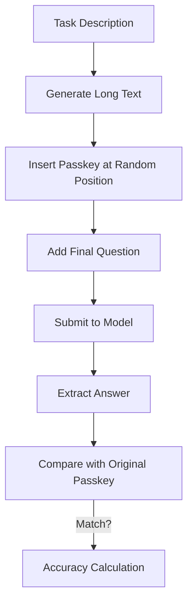
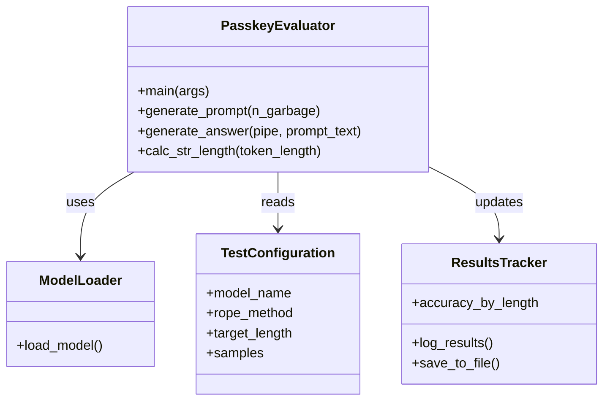
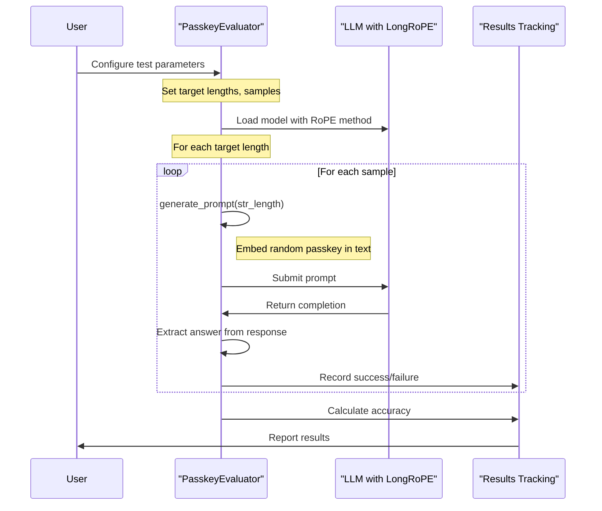
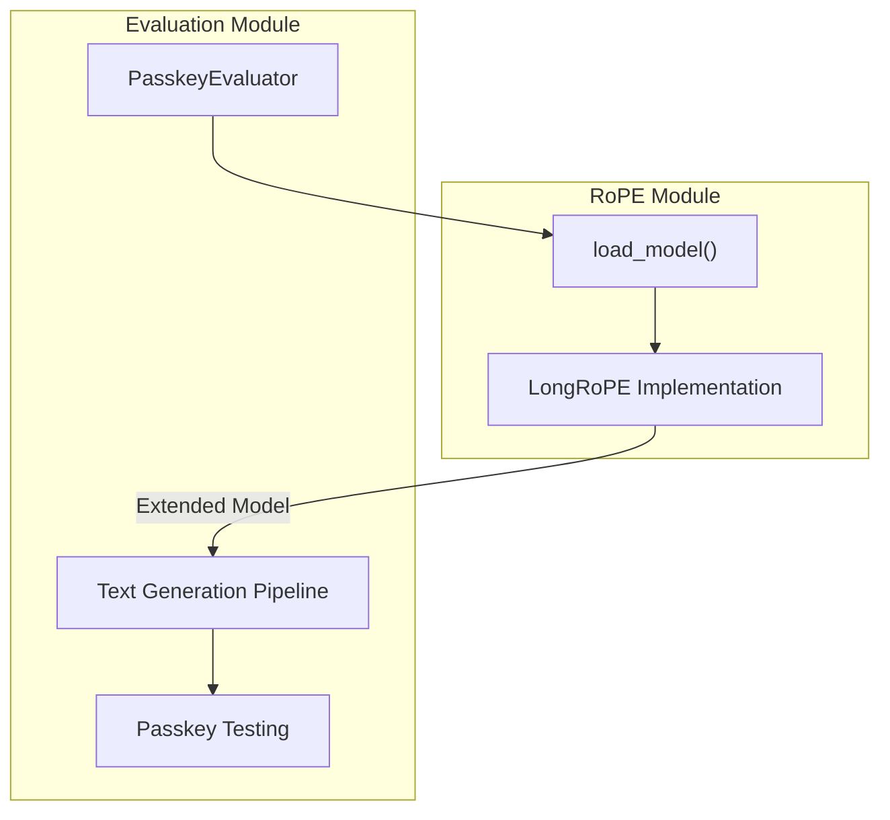

<!-- source: DeepWiki mcp.deepwiki.com · repo microsoft/LongRoPE · page 4.2 Passkey Retrieval · fetched 2026-10-26 -->

# Passkey Retrieval

<details>
<summary>Relevant source files</summary>

The following files were used as context for generating this wiki page:

- [evaluation/passkey.py](evaluation/passkey.py)

</details>


This document details the passkey retrieval evaluation method in the LongRoPE system. Passkey retrieval testing is a key method for evaluating how well models with extended context windows can recall specific information positioned within a long context. This evaluation provides a quantitative measure of a model's ability to retrieve information over long distances in text, complementing the perplexity-based evaluation covered in [Perplexity Evaluation](#4.1).

## Purpose and Concept

Passkey retrieval is an information recall test that embeds a specific "passkey" (a random number) within a large amount of irrelevant text, then asks the model to recall this passkey. This test directly measures the model's ability to:

1. Process long sequences of text
2. Pay attention to specific information buried within that text
3. Accurately retrieve the information when prompted



*Diagram: Passkey Retrieval Testing Process*

Sources: [evaluation/passkey.py:30-51](), [evaluation/passkey.py:54-62]()

## Implementation Architecture

The passkey retrieval evaluation system consists of several core components that work together to test a model's long-context capabilities:



*Diagram: Passkey Retrieval System Components*

Sources: [evaluation/passkey.py:69-142]()

## Prompt Generation

The system generates test prompts by embedding a random numerical passkey within a large amount of filler text. The position of the passkey is randomized to ensure a robust test of the model's attention capabilities.

### Prompt Structure

A typical prompt consists of:

1. A task description explaining the goal
2. A prefix of irrelevant "garbage" text
3. The passkey information line
4. A suffix of irrelevant "garbage" text
5. The final question asking for the passkey

```
Task description
[Irrelevant text prefix...]
The pass key is {random_number}. Remember it. {random_number} is the pass key.
[Irrelevant text suffix...]
What is the pass key? The pass key is
```

Sources: [evaluation/passkey.py:30-51]()

## Evaluation Process



*Diagram: Passkey Retrieval Evaluation Workflow*

Sources: [evaluation/passkey.py:107-142]()

## Test Configuration

The passkey retrieval system accepts various configuration parameters to customize the evaluation:

| Parameter | Description | Default Value |
|-----------|-------------|---------------|
| `--model` | Model name or path | Required |
| `--samples` | Number of test samples to run | None (required) |
| `--num-tokens` | Comma-separated list of token lengths to test | `4096,8192,16384` |
| `--output-file` | Path to save results CSV | None |
| `--log-file` | Path to save detailed logs | None |
| `--attn-implementation` | Attention implementation to use | `flash_attention_2` |
| `--attn-sliding-window` | Size of sliding window | `-1` (disabled) |
| `--save-memory` | Enable memory optimization | `False` |
| `--dtype` | Datatype for model loading | `None` (auto) |

Sources: [evaluation/passkey.py:152-161]()

## Environment Variables

The passkey retrieval system uses several environment variables to control the RoPE configuration:

| Variable | Purpose |
|----------|---------|
| `ROPE_METHOD` | Specifies which RoPE method to use (e.g., `longrope`) |
| `LONGROPE_RESCALE_FACTOR` | Path to the rescale factors file for LongRoPE |
| `LONGROPE_SCALING_POLICY` | Specifies the scaling policy to use |
| `TARGET_LENGTH` | Sets the maximum position embeddings for model loading |

Sources: [evaluation/passkey.py:73-80](), [evaluation/passkey.py:94-105]()

## Integration with LongRoPE System

The passkey retrieval evaluation integrates with the broader LongRoPE system by using the `load_model` function from the RoPE module to load models with extended context windows:



*Diagram: Integration with LongRoPE System*

Sources: [evaluation/passkey.py:94-105]()

## Result Interpretation

The system evaluates model performance based on accuracy - the percentage of passkeys correctly retrieved. Results are grouped by token length, allowing for analysis of how accuracy changes as context length increases.

For each configuration, the system outputs:
- Accuracy at each tested token length
- CSV output with length-accuracy pairs
- Detailed logs of individual tests (when enabled)

A successful extended model should maintain high accuracy even at the longest token lengths, demonstrating effective use of extended context windows.

Sources: [evaluation/passkey.py:134-141]()

## Usage Example

To run a passkey retrieval evaluation:

1. Set the required environment variables for your RoPE configuration
2. Run the evaluation script with appropriate parameters

```bash
# Set environment variables
export ROPE_METHOD="longrope"
export LONGROPE_RESCALE_FACTOR="/path/to/rescale/factors.json"
export LONGROPE_SCALING_POLICY="dynamic"
export TARGET_LENGTH=16384

# Run the evaluation
python evaluation/passkey.py \
    --model "path/to/your/model" \
    --samples 50 \
    --num-tokens "4096,8192,16384" \
    --output-file "passkey_results.csv" \
    --log-file "passkey_logs.txt"
```

The system will run the evaluation and produce:
1. Console output showing accuracy for each token length
2. A CSV file with the numerical results
3. A detailed log file with individual test prompts and responses

Sources: [evaluation/passkey.py:144-162]()

## Summary

Passkey retrieval testing provides a straightforward but powerful method for evaluating a model's ability to handle extended context windows. By measuring whether a model can accurately retrieve specific information from various positions within a long text, it offers a clear assessment of the effectiveness of the LongRoPE extensions in practical information retrieval scenarios.

When used in conjunction with [Perplexity Evaluation](#4.1), passkey retrieval helps provide a more complete picture of model performance with extended context windows.

---

