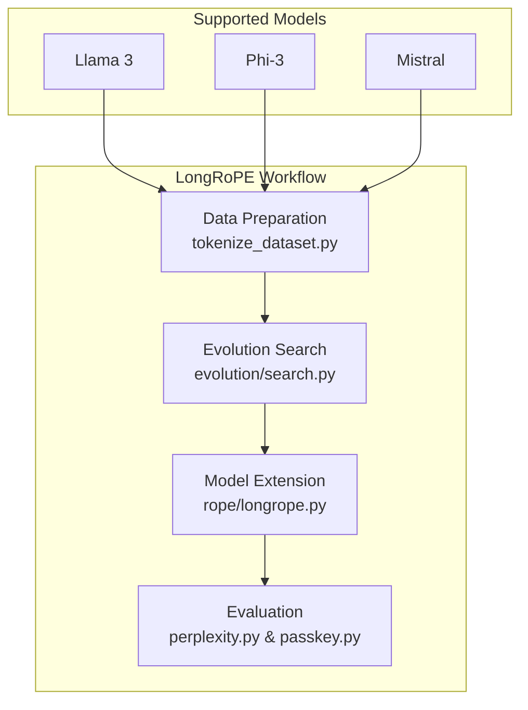
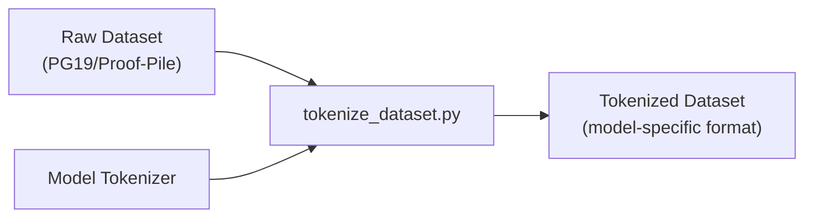
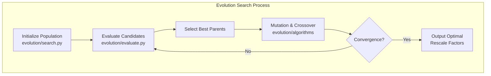
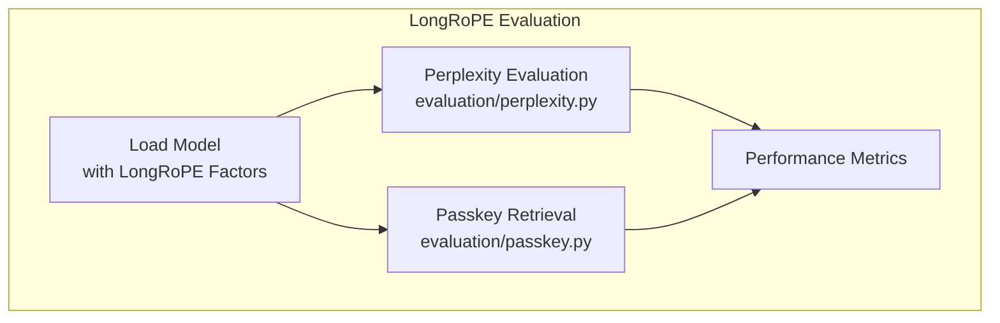
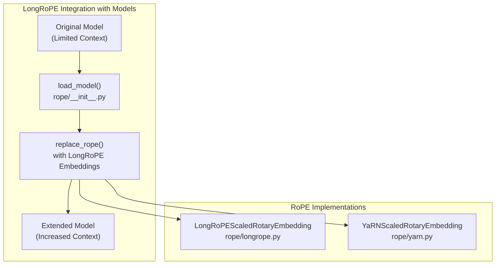

<!-- source: DeepWiki mcp.deepwiki.com · repo microsoft/LongRoPE · page 5 Using LongRoPE · fetched 2026-10-26 -->

# Using LongRoPE

<details>
<summary>Relevant source files</summary>

The following files were used as context for generating this wiki page:

- [README.md](README.md)
- [assets/logo.png](assets/logo.png)
- [examples/llama3/search.sh](examples/llama3/search.sh)
- [examples/llama3/tokenzie-data.sh](examples/llama3/tokenzie-data.sh)
- [examples/mistral/evaluate.sh](examples/mistral/evaluate.sh)
- [examples/mistral/search.sh](examples/mistral/search.sh)
- [examples/phi3/search.sh](examples/phi3/search.sh)

</details>


This guide provides practical instructions for extending the context window of Large Language Models (LLMs) using LongRoPE. It covers the complete workflow from data preparation to model evaluation, enabling you to significantly expand the context windows of models like Llama 3, Phi-3, and Mistral. For detailed information about the LongRoPE implementation itself, see [LongRoPE Implementation](#2).

## Overview of the LongRoPE Usage Process

LongRoPE extends LLM context windows through non-uniform rescaling of Rotary Positional Embeddings (RoPE). The process involves:

1. Dataset preparation and tokenization
2. Running evolution search to find optimal rescale factors
3. Evaluating the extended model



Sources: [README.md:76-102](), [examples/llama3/tokenzie-data.sh](), [examples/llama3/search.sh](), [examples/llama3/evaluate.sh]()

## Dataset Preparation

Before using LongRoPE, you need to prepare and tokenize your datasets:

1. **Required Datasets**:
   - PG19 for evolution search validation
   - Proof-Pile for evaluation

2. **Tokenization Process**:



The example below shows how to tokenize datasets for Llama 3:

```bash
# First create datasets directory if it doesn't exist
mkdir -p datasets

# Clone PG19 from HuggingFace if needed
# Tokenize PG19 as evolution search validation dataset
python utils/tokenize_dataset.py \
    --model meta-llama/Meta-Llama-3-8B \
    --dataset datasets/pg19 \
    --split validation \
    --feature text \
    --save-tokenized datasets/pg19-valid-llama-tokenized

# Tokenize Proof-Pile as evaluation dataset
python utils/tokenize_dataset.py \
    --model meta-llama/Meta-Llama-3-8B \
    --dataset hoskinson-center/proof-pile \
    --split test \
    --feature text \
    --save-tokenized datasets/proof-pile-test-llama-tokenized
```

You must tokenize the datasets using the specific model you plan to extend with LongRoPE, as each model uses its own tokenizer.

Sources: [examples/llama3/tokenzie-data.sh](), [utils/tokenize_dataset.py]()

## Running Evolution Search

The evolution search process finds optimal rescale factors for extending your model's context window:



To run the evolution search for a Llama 3 model:

```bash
TARGET_LENGTH=$((32 * 1024))  # 32K target context length

MODEL_PATH=meta-llama/Meta-Llama-3-8B
DATASET_PATH=datasets/pg19-valid-llama-tokenized
RESULT_PATH=results/search/llama3-8b/$TARGET_LENGTH

python evolution/search.py \
    --model $MODEL_PATH \
    --tokenized $DATASET_PATH \
    --algorithm dim_mono \
    --output-dir $RESULT_PATH \
    --target-length $TARGET_LENGTH \
    --dataset-min-tokens 131072 \
    --samples 5 \
    --truncate \
    --attn-implementation flash_attention_2 \
    --model-size-gb 14
```

### Key parameters:

| Parameter | Description |
|-----------|-------------|
| `--model` | Hugging Face model path or local model path |
| `--tokenized` | Path to tokenized dataset |
| `--algorithm` | Algorithm type (usually `dim_mono`) |
| `--target-length` | Target context length to extend to |
| `--samples` | Number of samples for evaluation |
| `--attn-implementation` | Attention implementation (recommended: `flash_attention_2`) |

The search produces a CSV file with the optimal rescale factors for your specific model and target context length.

Sources: [examples/llama3/search.sh](), [examples/phi3/search.sh](), [examples/mistral/search.sh](), [evolution/search.py]()

## Evaluating Extended Models

After finding optimal rescale factors, you should evaluate the extended model:



To evaluate a Llama 3 model extended with LongRoPE:

```bash
# Set environment variables
export TARGET_LENGTH=$((32 * 1024))
export ROPE_METHOD=longrope
export LONGROPE_RESCALE_FACTOR=results/search/llama3-8b/$TARGET_LENGTH/result_final.csv
export LONGROPE_SCALING_POLICY=su

# Create output directory
export OUTPUT_DIR=results/eval/llama3-8b/$TARGET_LENGTH
mkdir -p $OUTPUT_DIR

# Evaluate perplexity
python evaluation/perplexity.py \
    --model meta-llama/Meta-Llama-3-8B \
    --tokenized datasets/proof-pile-test-llama-tokenized \
    --num-tokens $TARGET_LENGTH \
    --dataset-min-tokens 131072 \
    --samples 10 \
    --truncate \
    --attn-implementation flash_attention_2 \
    --output-file $OUTPUT_DIR/proof-pile.csv

# Evaluate passkey retrieval
python evaluation/passkey.py \
    --model meta-llama/Meta-Llama-3-8B \
    --num-tokens $TARGET_LENGTH \
    --samples 10 \
    --attn-implementation flash_attention_2 \
    --output-file $OUTPUT_DIR/passkey.csv \
    --log-file $OUTPUT_DIR/passkey.log
```

### Evaluation metrics:

1. **Perplexity**: Measures how well the model predicts text over long contexts
2. **Passkey Retrieval**: Tests the model's ability to recall information from the beginning of a long context

Lower perplexity and higher passkey accuracy indicate better long-context performance.

Sources: [examples/llama3/evaluate.sh](), [examples/mistral/evaluate.sh](), [evaluation/perplexity.py](), [evaluation/passkey.py]()

## Model-Specific Guides

### Using LongRoPE with Llama 3

Llama 3 works well with LongRoPE and can be extended to 32K tokens or more:

```bash
# Tokenize data
bash ./examples/llama3/tokenzie-data.sh

# Run evolution search
bash ./examples/llama3/search.sh

# Evaluate extended model
bash ./examples/llama3/evaluate.sh
```

### Using LongRoPE with Phi-3

Phi-3 models can be extended from their base 4K context to 32K or more:

```bash
# Use the same workflow but with Phi-3 specific scripts
MODEL_PATH=microsoft/Phi-3-mini-4k-instruct

# Run search with sliding window attention
python evolution/search.py \
    --model $MODEL_PATH \
    --tokenized $DATASET_PATH \
    --algorithm dim_mono \
    --output-dir $RESULT_PATH \
    --target-length $TARGET_LENGTH \
    --dataset-min-tokens 131072 \
    --samples 5 \
    --truncate \
    --attn-implementation flash_attention_2 \
    --attn-sliding-window 131072 \
    --model-size-gb 8
```

Note the `--attn-sliding-window` parameter, which is required for some models like Phi-3 and Mistral.

### Using LongRoPE with Mistral

Mistral models can also be extended with LongRoPE:

```bash
# Use Mistral-specific scripts
MODEL_PATH=mistralai/Mistral-7B-v0.1

# For evaluation, set the rescale factors from your search results
export ROPE_METHOD=longrope
export LONGROPE_RESCALE_FACTOR=results/search/mistral-7b-v01/$TARGET_LENGTH/result_final.csv
export LONGROPE_SCALING_POLICY=su
```

Sources: [examples/llama3](), [examples/phi3/search.sh](), [examples/mistral/search.sh](), [examples/mistral/evaluate.sh]()

## Advanced Usage

### Environment Setup

```bash
# Create conda environment
conda create -n longrope python==3.10
conda activate longrope
# flash-attn needs cuda >= 11.7
pip install -r requirements.txt
```

### Customizing Evolution Search Parameters

You can customize the evolution search process by modifying the hyperparameters in `evolution/default_hyper_params/*.json`:

- Number of iterations
- Population size
- Number of parents
- Number of mutation and crossover operations

```bash
# Example of customizing search parameters
python evolution/search.py \
    --model $MODEL_PATH \
    --tokenized $DATASET_PATH \
    --algorithm dim_mono \
    --output-dir $RESULT_PATH \
    --target-length $TARGET_LENGTH \
    --hyper-params custom_params.json
```

### Understanding LongRoPE Integration



The core functionality works by:

1. Loading the model using `load_model()` from `rope/__init__.py`
2. Replacing the standard RoPE embeddings with `LongRoPEScaledRotaryEmbedding` or other variants
3. Applying the optimized rescale factors found through evolution search

Sources: [rope/__init__.py](), [rope/longrope.py](), [rope/yarn.py]()

## Performance Considerations

When using LongRoPE, consider:

1. **Memory Requirements**: Extending context windows significantly increases memory usage. Adjust batch sizes and other parameters accordingly.

2. **GPU Requirements**: Flash Attention 2 is recommended for efficient attention computation with long contexts. This requires CUDA 11.7 or newer.

3. **Trade-offs**: There may be a slight performance degradation on short context tasks when optimizing for very long contexts. Consider your use case priorities.

## Conclusion

LongRoPE provides an effective way to extend the context window of various LLMs without fine-tuning. By following the workflow outlined in this guide, you can:

1. Prepare and tokenize your datasets
2. Find optimal rescale factors through evolution search
3. Evaluate and use your extended model

For more advanced techniques and integrations, refer to the LongRoPE paper and other wiki pages about implementation details.

Sources: [README.md:67-73](), [README.md:114-125]()

---

