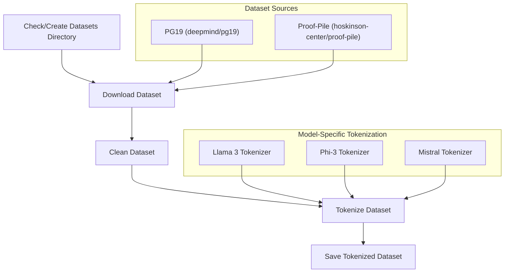
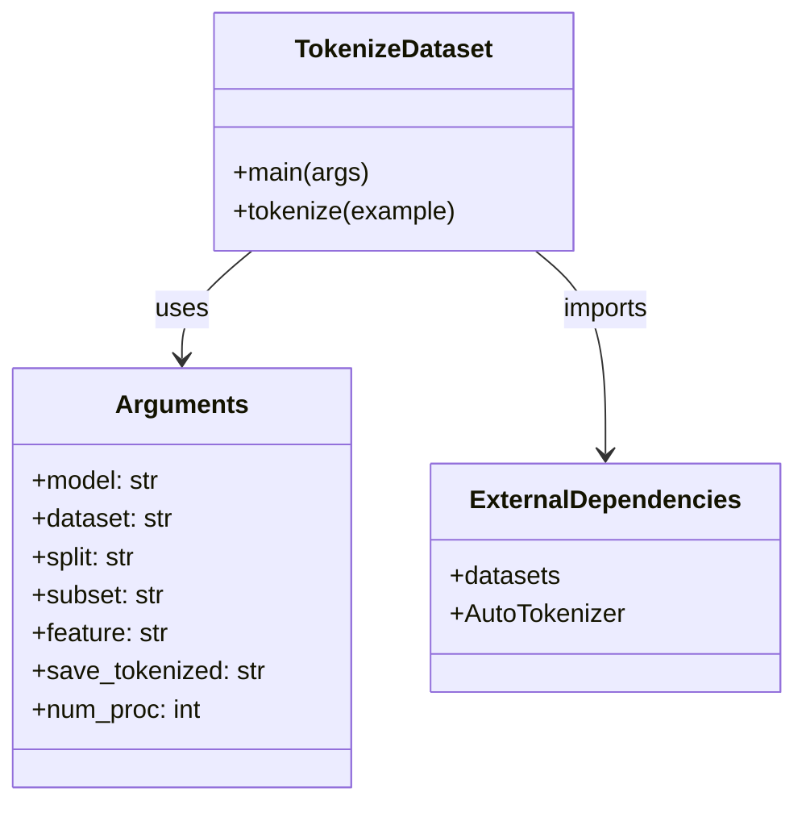
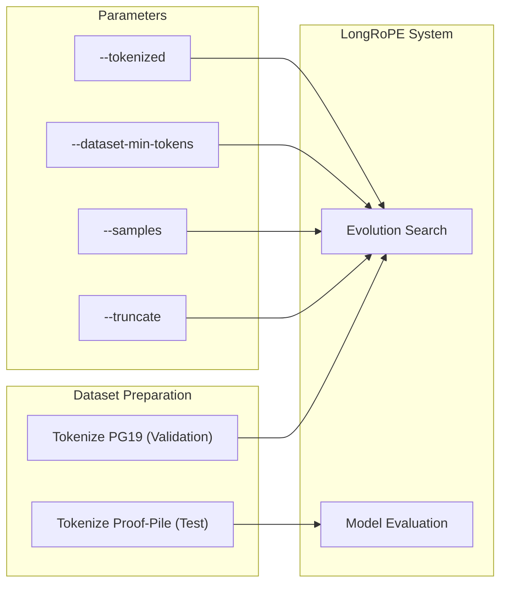

<!-- source: DeepWiki mcp.deepwiki.com · repo microsoft/LongRoPE · page 5.1 Dataset Preparation · fetched 2026-10-26 -->

# Dataset Preparation

<details>
<summary>Relevant source files</summary>

The following files were used as context for generating this wiki page:

- [examples/llama3/search.sh](examples/llama3/search.sh)
- [examples/llama3/tokenzie-data.sh](examples/llama3/tokenzie-data.sh)
- [examples/mistral/tokenzie-data.sh](examples/mistral/tokenzie-data.sh)
- [examples/phi3/tokenzie-data.sh](examples/phi3/tokenzie-data.sh)
- [utils/tokenize_dataset.py](utils/tokenize_dataset.py)

</details>


## Purpose and Overview

This page explains how to prepare and tokenize datasets for use with the LongRoPE system. Proper dataset preparation is crucial for both the evolution search process that discovers optimal rescale factors and for subsequent evaluation of extended context window models. For information about running the evolution search process itself, see [Running Evolution Search](#5.2).

The LongRoPE system primarily uses two datasets:
1. **PG19** - Used for evolution search validation
2. **Proof-Pile** - Used for model evaluation

This guide covers how to download these datasets, tokenize them with model-specific tokenizers, and prepare them for use in the LongRoPE workflow.

## Dataset Preparation Workflow

The dataset preparation process follows a consistent workflow regardless of the target model, though the specific tokenization differs based on the model's vocabulary.



Sources: [examples/llama3/tokenzie-data.sh:1-35](), [examples/phi3/tokenzie-data.sh:1-35](), [examples/mistral/tokenzie-data.sh:1-35]()

## The Tokenization Utility

The core of dataset preparation is the tokenization utility script. This script loads a dataset, processes it through a model's tokenizer, and saves the tokenized representation for efficient use in evolution search and evaluation.



Sources: [utils/tokenize_dataset.py:1-56]()

The tokenization script performs several key operations:

1. Loads the specified model's tokenizer
2. Configures the tokenizer with appropriate settings (e.g., setting pad_token to eos_token)
3. Loads the dataset from the source
4. Tokenizes each example in the dataset
5. Saves the tokenized dataset to disk

The tokenization function preserves the original dataset structure while adding tokenized fields:
- `input_ids`: The tokenized representation of the text
- `attention_mask`: Mask indicating which tokens should be attended to
- `tokenized_len`: The length of the tokenized sequence

Sources: [utils/tokenize_dataset.py:14-43]()

## Supported Datasets

### PG19

PG19 is a dataset of books from Project Gutenberg published before 1919. It's used as the validation dataset for the evolution search process in LongRoPE.

Key characteristics:
- Contains long-form text suitable for testing long context understanding
- Available via HuggingFace Datasets
- Only the validation split is used for LongRoPE

### Proof-Pile

Proof-Pile is a dataset containing mathematical proofs and related content. It's used for evaluating models extended with LongRoPE.

Key characteristics:
- Tests the model's ability to process specialized content with extended context
- Available via HuggingFace Datasets
- The test split is used for evaluation

Sources: [examples/llama3/tokenzie-data.sh:8-19](), [examples/phi3/tokenzie-data.sh:8-19](), [examples/mistral/tokenzie-data.sh:8-19]()

## Model-Specific Tokenization

Each model has a unique vocabulary and tokenization approach, which necessitates model-specific tokenization. The LongRoPE repository provides scripts for tokenizing datasets with three models:

| Model | Script Path | Tokenizer Path |
|-------|-------------|---------------|
| Llama 3 | `examples/llama3/tokenzie-data.sh` | `meta-llama/Meta-Llama-3-8B` |
| Phi-3 | `examples/phi3/tokenzie-data.sh` | `microsoft/Phi-3-mini-4k-instruct` |
| Mistral | `examples/mistral/tokenzie-data.sh` | `mistralai/Mistral-7B-v0.1` |

The tokenized datasets are saved to model-specific paths to prevent mixing tokenizations from different models:

| Dataset | Model | Output Path |
|---------|-------|-------------|
| PG19 (validation) | Llama 3 | `datasets/pg19-valid-llama-tokenized` |
| Proof-Pile (test) | Llama 3 | `datasets/proof-pile-test-llama-tokenized` |
| PG19 (validation) | Phi-3 | `datasets/pg19-valid-phi3-tokenized` |
| Proof-Pile (test) | Phi-3 | `datasets/proof-pile-test-phi3-tokenized` |
| PG19 (validation) | Mistral | `datasets/pg19-valid-mistral-tokenized` |
| Proof-Pile (test) | Mistral | `datasets/proof-pile-test-mistral-tokenized` |

Sources: [examples/llama3/tokenzie-data.sh:20-34](), [examples/phi3/tokenzie-data.sh:20-34](), [examples/mistral/tokenzie-data.sh:20-34]()

## Integration with LongRoPE System

The tokenized datasets are integrated into the LongRoPE system in two main ways:



Sources: [examples/llama3/search.sh:5-21]()

1. **Evolution Search**: The tokenized PG19 validation dataset is used in the evolution search process to find optimal rescale factors. Key parameters include:
   - `--tokenized`: Path to the tokenized dataset
   - `--dataset-min-tokens`: Minimum number of tokens to use from the dataset
   - `--samples`: Number of samples to evaluate
   - `--truncate`: Whether to truncate sequences

2. **Model Evaluation**: The tokenized Proof-Pile test dataset is used to evaluate the performance of models extended with LongRoPE.

## Step-by-Step Usage Guide

### 1. Preparing the Environment

First, ensure you have cloned the LongRoPE repository and installed all dependencies as described in [Installation and Requirements](#1.1).

### 2. Running the Tokenization Script

Choose the appropriate tokenization script based on your target model:

For Llama 3:
```bash
./examples/llama3/tokenzie-data.sh
```

For Phi-3:
```bash
./examples/phi3/tokenzie-data.sh
```

For Mistral:
```bash
./examples/mistral/tokenzie-data.sh
```

These scripts will:
1. Create a datasets directory if it doesn't exist
2. Clone the PG19 dataset if needed
3. Tokenize both the PG19 validation split and the Proof-Pile test split
4. Save the tokenized datasets to appropriate paths

### 3. Verifying Tokenization

After running the tokenization script, verify that the tokenized datasets have been created in the `datasets` directory:

```
datasets/
├── pg19/
├── pg19-valid-{model}-tokenized/
└── proof-pile-test-{model}-tokenized/
```

Where `{model}` is one of `llama`, `phi3`, or `mistral`.

## Advanced Usage

### Custom Tokenization

To tokenize a custom dataset or use different tokenization parameters, you can directly use the `tokenize_dataset.py` utility:

```bash
python utils/tokenize_dataset.py \
    --model [MODEL_PATH] \
    --dataset [DATASET_PATH_OR_NAME] \
    --split [SPLIT] \
    --feature [TEXT_FIELD_NAME] \
    --save-tokenized [OUTPUT_PATH] \
    --num-proc [NUMBER_OF_PROCESSORS]
```

Parameters:
- `--model`: Path or name of the HuggingFace model to use for tokenization
- `--dataset`: Path or name of the dataset to tokenize
- `--split`: Dataset split to use (e.g., "train", "validation", "test")
- `--subset`: (Optional) Subset of the dataset to use
- `--feature`: Field in the dataset containing the text to tokenize
- `--save-tokenized`: Path where the tokenized dataset will be saved
- `--num-proc`: Number of processors to use for tokenization (default: 4)

Sources: [utils/tokenize_dataset.py:46-56]()

## Conclusion

Proper dataset preparation is a critical first step in the LongRoPE workflow. By following the guidelines in this document, you'll have the necessary tokenized datasets for both finding optimal rescale factors through evolution search and evaluating the performance of your extended models.

After preparing your datasets, proceed to [Running Evolution Search](#5.2) to find the optimal rescale factors for your model.

---

