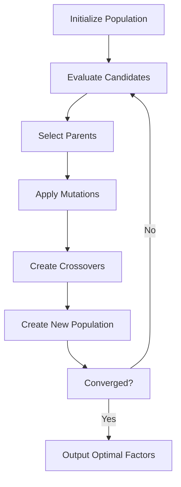
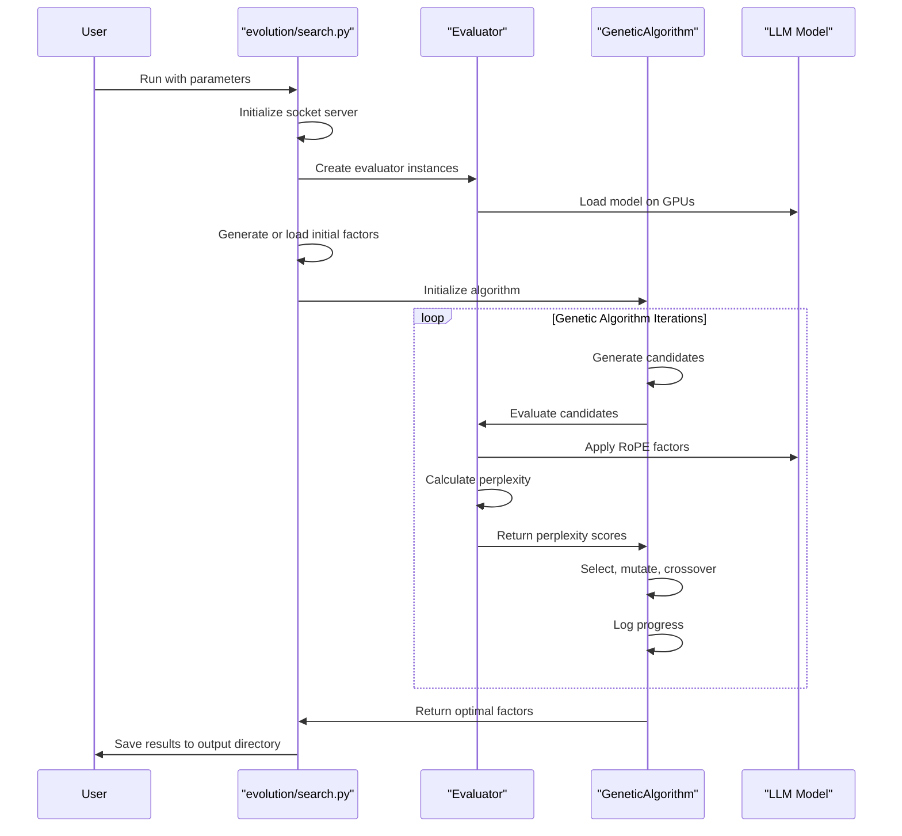
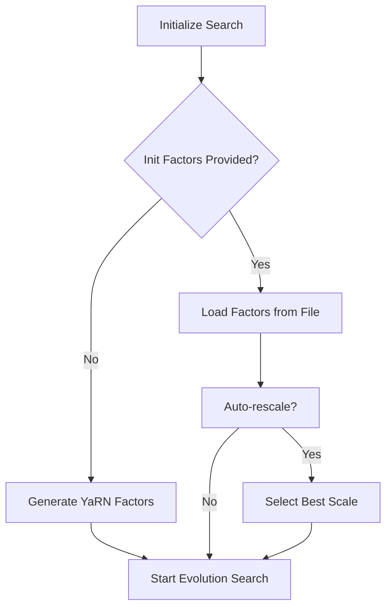

<!-- source: DeepWiki mcp.deepwiki.com · repo microsoft/LongRoPE · page 5.2 Running Evolution Search · fetched 2026-10-26 -->

# Running Evolution Search

<details>
<summary>Relevant source files</summary>

The following files were used as context for generating this wiki page:

- [evolution/search.py](evolution/search.py)
- [examples/llama3/search.sh](examples/llama3/search.sh)
- [examples/llama3/tokenzie-data.sh](examples/llama3/tokenzie-data.sh)
- [examples/mistral/search.sh](examples/mistral/search.sh)
- [examples/phi3/search.sh](examples/phi3/search.sh)

</details>


This document provides step-by-step instructions for running the evolution search process in the LongRoPE system. Evolution search is a key component that automatically discovers optimal rescale factors for extending a model's context window without retraining.

For information about preparing datasets before running evolution search, see [Dataset Preparation](#5.1). For evaluating the performance of models with the discovered rescale factors, see [Evaluating Extended Models](#5.3).

## What is Evolution Search?

Evolution search in LongRoPE uses genetic algorithms to find optimal rescale factors that extend an LLM's context window while minimizing performance degradation. The system evaluates different candidate factors by measuring perplexity on validation datasets.



Sources: [evolution/search.py:182-208]()

## Prerequisites

Before running evolution search, ensure you have:

1. **Installed LongRoPE**: Complete the installation as explained in [Installation and Requirements](#1.1).

2. **Prepared tokenized datasets**: The search process requires tokenized validation data. See [Dataset Preparation](#5.1) for instructions.

3. **GPU resources**: The search process requires one or more GPUs for efficient model evaluation.

## Search Process Architecture

The evolution search distributes model evaluation across multiple GPUs to speed up the search process. The system dynamically adapts to available GPU resources.

```mermaid
classDiagram
    class "EvolSearch" {
        +run_algorithm()
    }
    class "Evaluator" {
        +set_rope()
        +get_result()
        +model_ready()
        +finalize()
    }
    class "GeneticAlgorithm" {
        +run_genetic_algorithm()
    }
    class "DimMonoGeneticAlgorithm" {
        +mutation()
        +crossover()
    }
    class "DimPieceMonoGeneticAlgorithm" {
        +mutation()
        +crossover()
    }

    "EvolSearch" --> "Evaluator": initializes
    "EvolSearch" --> "GeneticAlgorithm": runs
    "GeneticAlgorithm" <|-- "DimMonoGeneticAlgorithm"
    "GeneticAlgorithm" <|-- "DimPieceMonoGeneticAlgorithm"
    "DimMonoGeneticAlgorithm" --> "Evaluator": uses for evaluation
    "DimPieceMonoGeneticAlgorithm" --> "Evaluator": uses for evaluation
```

Sources: [evolution/search.py:72-218]()

## Running the Search

The LongRoPE repository provides shell scripts for running evolution search with different models. The main script is `evolution/search.py`, which can be run with various parameters.

### Basic Command Structure

```
python evolution/search.py \
    --model MODEL_PATH \
    --tokenized DATASET_PATH \
    --algorithm ALGORITHM_TYPE \
    --output-dir RESULT_PATH \
    --target-length TARGET_LENGTH \
    [other options]
```

### Essential Parameters

| Parameter | Description | Example |
|-----------|-------------|---------|
| `--model` | Path to the model or HuggingFace model ID | `meta-llama/Meta-Llama-3-8B` |
| `--tokenized` | Path to tokenized dataset | `./datasets/pg19-valid-llama-tokenized` |
| `--algorithm` | Evolution algorithm type | `dim_mono` or `dim_piece_mono` |
| `--output-dir` | Directory to save results | `./results/search/llama3-8b/32768` |
| `--target-length` | Target context window length | `32768` (32K) |

Sources: [evolution/search.py:221-265](), [examples/llama3/search.sh:11-21]()

### Additional Parameters

| Parameter | Description | Default |
|-----------|-------------|---------|
| `--dataset-min-tokens` | Minimum tokens in dataset samples | `None` |
| `--samples` | Number of samples to evaluate | `None` |
| `--ppl-sliding-window` | Window size for perplexity calculation | `256` |
| `--truncate` | Truncate sequences to dataset-min-tokens | `False` |
| `--attn-implementation` | Attention implementation to use | `flash_attention_2` |
| `--attn-sliding-window` | Sliding window size for attention | `-1` |
| `--model-size-gb` | Approximate model size in GB | `14` |
| `--devices` | Comma-separated GPU indices | All available GPUs |
| `--init-factors` | Path to initial factors file | `None` (YaRN) |
| `--yarn-settings` | YaRN settings for initialization | `llama` |
| `--recovery` | Path to recovery file to resume search | `None` |

Sources: [evolution/search.py:221-265]()

## Model-Specific Examples

LongRoPE provides example scripts for running evolution search with different models. Here are examples for common models:

### Running Evolution Search for Llama 3

```bash
TARGET_LENGTH=$((32 * 1024))

MODEL_PATH=meta-llama/Meta-Llama-3-8B
DATASET_PATH=./datasets/pg19-valid-llama-tokenized
RESULT_PATH=./results/search/llama3-8b/$TARGET_LENGTH

python evolution/search.py \
    --model $MODEL_PATH \
    --tokenized $DATASET_PATH \
    --algorithm dim_mono \
    --output-dir $RESULT_PATH \
    --target-length $TARGET_LENGTH \
    --dataset-min-tokens 131072 \
    --samples 5 \
    --truncate \
    --attn-implementation flash_attention_2 \
    --model-size-gb 14
```

Sources: [examples/llama3/search.sh:1-22]()

### Running Evolution Search for Phi-3

```bash
TARGET_LENGTH=$((32 * 1024))

MODEL_PATH=microsoft/Phi-3-mini-4k-instruct
DATASET_PATH=./datasets/pg19-valid-phi3-tokenized
RESULT_PATH=./results/search/phi3-mini/$TARGET_LENGTH

python evolution/search.py \
    --model $MODEL_PATH \
    --tokenized $DATASET_PATH \
    --algorithm dim_mono \
    --output-dir $RESULT_PATH \
    --target-length $TARGET_LENGTH \
    --dataset-min-tokens 131072 \
    --samples 5 \
    --truncate \
    --attn-implementation flash_attention_2 \
    --attn-sliding-window 131072 \
    --model-size-gb 8
```

Sources: [examples/phi3/search.sh:1-23]()

### Running Evolution Search for Mistral

```bash
TARGET_LENGTH=$((32 * 1024))

MODEL_PATH=mistralai/Mistral-7B-v0.1
DATASET_PATH=./datasets/pg19-valid-mistral-tokenized
RESULT_PATH=./results/search/mistral-7b-v01/$TARGET_LENGTH

python evolution/search.py \
    --model $MODEL_PATH \
    --tokenized $DATASET_PATH \
    --algorithm dim_mono \
    --output-dir $RESULT_PATH \
    --target-length $TARGET_LENGTH \
    --dataset-min-tokens 131072 \
    --samples 5 \
    --truncate \
    --attn-implementation flash_attention_2 \
    --attn-sliding-window 131072 \
    --model-size-gb 8
```

Sources: [examples/mistral/search.sh:1-23]()

## Evolution Search Workflow

The evolution search process includes several phases that are executed automatically.



Sources: [evolution/search.py:72-218](), [evolution/search.py:182-208]()

## Understanding the Results

The evolution search saves several files to the specified output directory:

1. **result_final.csv**: The final optimized rescale factors
2. **log-[timestamp].json**: Detailed log of the search process, including perplexity scores for each candidate
3. **log-[timestamp].txt**: Text log file with search progress information

The search may take several hours to complete depending on the model size, target length, and available GPU resources.

## Evolution Search Parameters Explained

The evolution search uses different parameters that control the search process:

### Algorithm Selection

- `dim_mono`: Standard genetic algorithm for finding monotonically increasing factors
- `dim_piece_mono`: Genetic algorithm that optimizes factors in pieces, useful for very long context windows

### Initial Factors

By default, the search starts with YaRN-derived factors. You can also provide custom initial factors using the `--init-factors` parameter.



Sources: [evolution/search.py:153-180]()

## Tips for Effective Evolution Search

1. **Use sufficient GPU memory**: The search process requires loading the model multiple times for parallel evaluation. Ensure you have enough GPU memory.

2. **Select appropriate dataset**: Use diverse, high-quality text for validation to ensure the discovered factors generalize well.

3. **Adjust sample size**: If the search is too slow, reduce the number of samples using the `--samples` parameter.

4. **Start with YaRN factors**: YaRN factors often provide a good starting point for the search.

5. **Use recovery for long runs**: For long searches, enable the recovery option to resume the search if it's interrupted.

## Conclusion

Running evolution search is a crucial step in extending the context window of LLMs using LongRoPE. The process automatically discovers optimal rescale factors that balance context extension with model performance.

After completing the evolution search, you can evaluate the extended model as described in [Evaluating Extended Models](#5.3).

---

