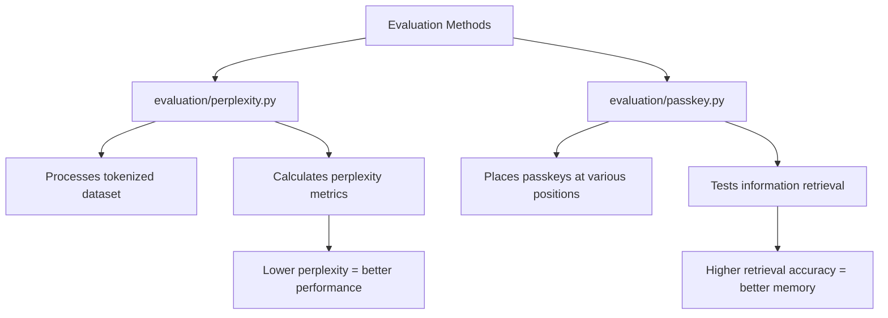
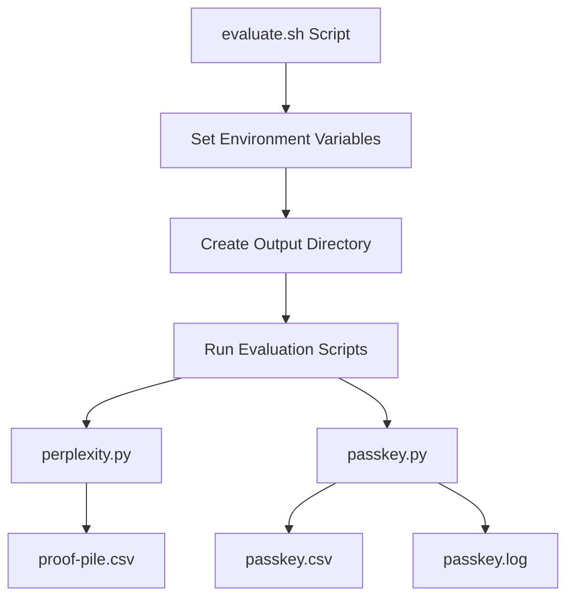
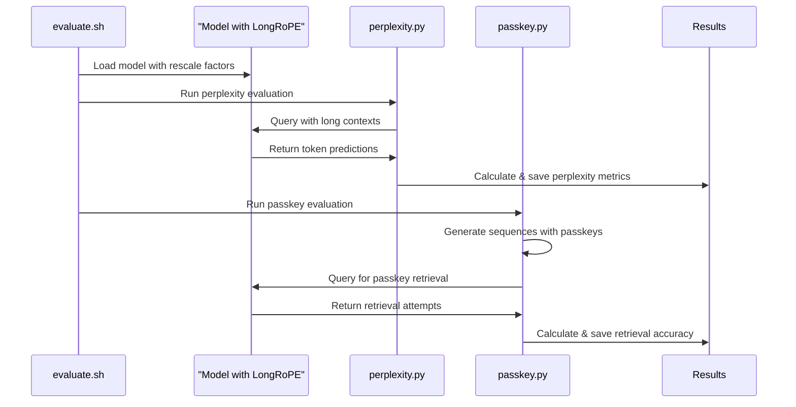

<!-- source: DeepWiki mcp.deepwiki.com · repo microsoft/LongRoPE · page 5.3 Evaluating Extended Models · fetched 2026-10-26 -->

# Evaluating Extended Models

<details>
<summary>Relevant source files</summary>

The following files were used as context for generating this wiki page:

- [examples/llama3/evaluate.sh](examples/llama3/evaluate.sh)
- [examples/mistral/evaluate.sh](examples/mistral/evaluate.sh)
- [examples/phi3/evaluate.sh](examples/phi3/evaluate.sh)

</details>


This page provides a technical guide for evaluating models extended with LongRoPE. It covers the evaluation methods, setup process, and interpretation of results. For information on how to prepare datasets for evaluation, see [Dataset Preparation](#5.1). For guidance on finding optimal rescale factors, see [Running Evolution Search](#5.2).

## Evaluation Methods

LongRoPE uses two primary evaluation methods to assess the effectiveness of context window extensions:

1. **Perplexity Evaluation**: Measures language modeling quality over extended contexts
2. **Passkey Retrieval**: Tests the model's ability to recall information at various distances



Sources: [evaluation/perplexity.py](), [evaluation/passkey.py]()

## Evaluation Setup

Before evaluating extended models, ensure you have:

1. A pre-trained model (e.g., Llama 3, Phi-3, Mistral)
2. Optimized LongRoPE rescale factors from the evolution search
3. Tokenized evaluation datasets (e.g., Proof-Pile test set)

The evaluation scripts use environment variables to configure the evaluation process:

| Environment Variable | Description | Example Value |
|----------------------|-------------|--------------|
| CUDA_VISIBLE_DEVICES | GPU device selection | 0 |
| TARGET_LENGTH | Context window size to evaluate | 32768 (32K tokens) |
| ROPE_METHOD | Positional embedding method | longrope |
| LONGROPE_RESCALE_FACTOR | Path to rescale factors | results/search/llama3-8b/32768/result_final.csv |
| LONGROPE_SCALING_POLICY | Scaling approach | su |

Sources: [examples/llama3/evaluate.sh:5-14](), [examples/phi3/evaluate.sh:5-14](), [examples/mistral/evaluate.sh:5-14]()

## Running Evaluations

The repository provides example evaluation scripts for different models. These scripts follow a consistent pattern:



### Perplexity Evaluation

The perplexity evaluation script processes tokenized datasets and measures how well the model can predict tokens in long contexts:

```bash
python evaluation/perplexity.py \
    --model $MODEL_PATH \
    --tokenized $DATASETS_PATH/proof-pile-test-llama-tokenized \
    --num-tokens $TARGET_LENGTH \
    --dataset-min-tokens 131072 \
    --samples 10 \
    --truncate \
    --attn-implementation flash_attention_2 \
    --output-file $OUTPUT_DIR/proof-pile.csv
```

Key parameters:
- `--model`: Path to the model to evaluate
- `--tokenized`: Path to tokenized dataset
- `--num-tokens`: Context length to evaluate
- `--samples`: Number of data samples to evaluate
- `--truncate`: Whether to truncate samples to the specified length
- `--attn-implementation`: Attention implementation to use

Sources: [examples/llama3/evaluate.sh:29-37]()

### Passkey Retrieval Evaluation

The passkey evaluation generates test sequences with embedded "passkeys" at different positions and tests if the model can retrieve them when prompted:

```bash
python evaluation/passkey.py \
    --model $MODEL_PATH \
    --num-tokens $TARGET_LENGTH \
    --samples 10 \
    --attn-implementation flash_attention_2 \
    --output-file $OUTPUT_DIR/passkey.csv \
    --log-file $OUTPUT_DIR/passkey.log
```

Key parameters:
- `--model`: Path to the model to evaluate
- `--num-tokens`: Context length to evaluate
- `--samples`: Number of test sequences to generate
- `--attn-implementation`: Attention implementation to use
- `--output-file`: File to save results
- `--log-file`: File to save detailed logs

Sources: [examples/llama3/evaluate.sh:39-45]()

## Evaluation Process Flow

The evaluation process follows this sequence:



Sources: [examples/llama3/evaluate.sh](), [evaluation/perplexity.py](), [evaluation/passkey.py]()

## Model-Specific Considerations

Different models may require additional parameters for evaluation:

### Mistral and Phi-3 Models

These models require an additional sliding window parameter:

```bash
--attn-sliding-window 131072
```

This parameter configures the attention sliding window size for models that use sliding window attention.

Sources: [examples/mistral/evaluate.sh:37](), [examples/phi3/evaluate.sh:37]()

## Interpreting Results

### Perplexity Results

The perplexity evaluation produces a CSV file with the following metrics:

- **Perplexity**: Lower values indicate better performance
- **Success Rate**: Percentage of sequences processed successfully
- **Total Tokens**: Number of tokens processed

Compare these metrics with the base model's performance on standard context lengths to assess the effectiveness of the context window extension.

### Passkey Retrieval Results

The passkey evaluation produces:

1. A CSV file with retrieval accuracy at different positions
2. A log file with detailed information about each retrieval attempt

Key metrics to analyze:
- **Retrieval accuracy vs. position**: How retrieval performance changes with distance
- **Average accuracy**: Overall retrieval performance across all positions
- **Failed retrievals**: Positions where the model consistently fails

## Batch Evaluation at Multiple Context Lengths

You can evaluate a model at multiple context lengths by modifying the `TARGET_LENGTH` variable. The commented code in the example scripts shows how to generate a comma-separated list of lengths:

```bash
# LENGTH_LIST=""
# TMP_LENGTH=$TARGET_LENGTH
# while (($TMP_LENGTH >= 4096))
# do
#     LENGTH_LIST="$TMP_LENGTH,$LENGTH_LIST"
#     TMP_LENGTH=$((TMP_LENGTH / 2))
# done
# TARGET_LENGTH=${LENGTH_LIST::-1}
```

This allows you to evaluate how the model performs across different context window sizes with the same LongRoPE configuration.

Sources: [examples/llama3/evaluate.sh:20-27](), [examples/phi3/evaluate.sh:20-27](), [examples/mistral/evaluate.sh:20-27]()

## Best Practices

1. **Compare with baseline**: Always compare extended model performance with the base model at its native context length
2. **Use sufficient samples**: Increase the sample count for more reliable results
3. **Test real-world use cases**: Beyond standardized evaluations, test the model on domain-specific long-context tasks
4. **Memory management**: Adjust batch sizes based on available GPU memory
5. **Save detailed logs**: Enable verbose logging for troubleshooting and analysis

By following this evaluation process, you can systematically assess how effectively LongRoPE extends your model's context window and identify optimal configurations for your specific use cases.

---

