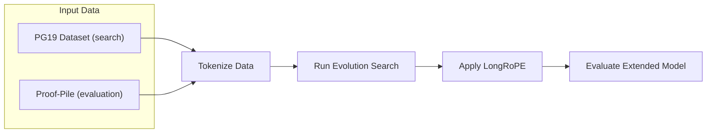
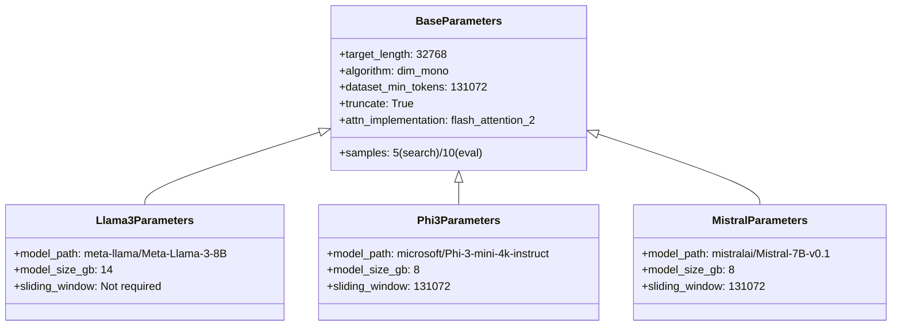
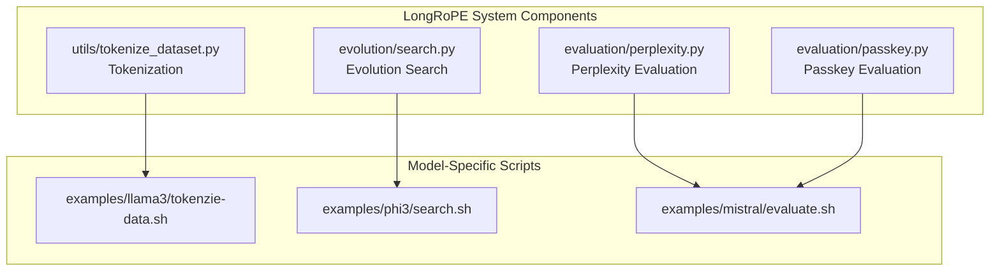
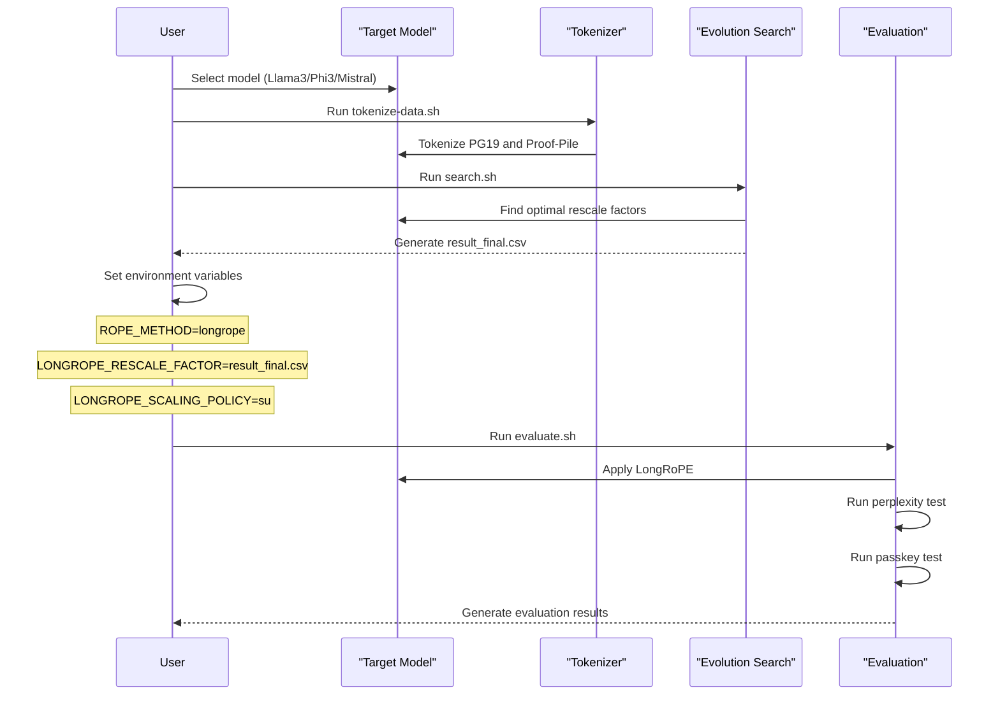

<!-- source: DeepWiki mcp.deepwiki.com · repo microsoft/LongRoPE · page 5.4 Model-Specific Guides · fetched 2026-10-26 -->

# Model-Specific Guides

<details>
<summary>Relevant source files</summary>

The following files were used as context for generating this wiki page:

- [examples/llama3/evaluate.sh](examples/llama3/evaluate.sh)
- [examples/llama3/search.sh](examples/llama3/search.sh)
- [examples/llama3/tokenzie-data.sh](examples/llama3/tokenzie-data.sh)
- [examples/mistral/evaluate.sh](examples/mistral/evaluate.sh)
- [examples/mistral/search.sh](examples/mistral/search.sh)
- [examples/phi3/evaluate.sh](examples/phi3/evaluate.sh)
- [examples/phi3/search.sh](examples/phi3/search.sh)

</details>


This page provides detailed instructions for applying LongRoPE to extend the context windows of specific language models. It covers the unique considerations, parameters, and workflows for Llama 3, Phi-3, and Mistral models. For general information about using LongRoPE, see [Using LongRoPE](#5) and for the underlying implementation details, see [LongRoPE Implementation](#2).

## Supported Models Overview

LongRoPE has been tested and optimized for the following models:

| Model | Base Version | Original Context | Target Extended Context | Special Considerations |
|-------|--------------|------------------|-------------------------|------------------------|
| Llama 3 | Meta-Llama-3-8B | 8,192 tokens | 32,768 tokens | Requires 14GB GPU memory |
| Phi-3 | Phi-3-mini-4k-instruct | 4,096 tokens | 32,768 tokens | Requires sliding window attention |
| Mistral | Mistral-7B-v0.1 | 8,192 tokens | 32,768 tokens | Requires sliding window attention |

Sources: [examples/llama3/search.sh](), [examples/phi3/search.sh](), [examples/mistral/search.sh]()

## Common Workflow

The workflow for extending any model's context length follows the same basic pattern, with some model-specific adjustments:



Sources: [examples/llama3/tokenzie-data.sh](), [examples/llama3/search.sh](), [examples/llama3/evaluate.sh]()

## Model-Specific Parameters

Each model requires specific parameters for optimal results when applying LongRoPE:



Sources: [examples/llama3/search.sh](), [examples/phi3/search.sh](), [examples/mistral/search.sh]()

## Llama 3 Guide

### Dataset Preparation

To tokenize data for Llama 3:

```bash
# Clone PG19 dataset (if needed)
git clone https://huggingface.co/datasets/deepmind/pg19.git datasets/pg19

# Tokenize datasets using Llama 3 tokenizer
python utils/tokenize_dataset.py \
    --model meta-llama/Meta-Llama-3-8B \
    --dataset datasets/pg19 \
    --split validation \
    --feature text \
    --save-tokenized datasets/pg19-valid-llama-tokenized

python utils/tokenize_dataset.py \
    --model meta-llama/Meta-Llama-3-8B \
    --dataset hoskinson-center/proof-pile \
    --split test \
    --feature text \
    --save-tokenized datasets/proof-pile-test-llama-tokenized
```

Sources: [examples/llama3/tokenzie-data.sh]()

### Evolution Search for Llama 3

Run the evolution search to find optimal rescale factors:

```bash
# Set target extended context length
TARGET_LENGTH=$((32 * 1024))

# Define paths
MODEL_PATH=meta-llama/Meta-Llama-3-8B
DATASET_PATH=datasets/pg19-valid-llama-tokenized
RESULT_PATH=results/search/llama3-8b/$TARGET_LENGTH

# Run evolution search
python evolution/search.py \
    --model $MODEL_PATH \
    --tokenized $DATASET_PATH \
    --algorithm dim_mono \
    --output-dir $RESULT_PATH \
    --target-length $TARGET_LENGTH \
    --dataset-min-tokens 131072 \
    --samples 5 \
    --truncate \
    --attn-implementation flash_attention_2 \
    --model-size-gb 14
```

Sources: [examples/llama3/search.sh]()

### Evaluation for Llama 3

Evaluate the extended model using perplexity and passkey retrieval:

```bash
# Set environment variables for LongRoPE
export ROPE_METHOD=longrope
export LONGROPE_RESCALE_FACTOR=results/search/llama3-8b/$TARGET_LENGTH/result_final.csv
export LONGROPE_SCALING_POLICY=su

# Run perplexity evaluation
python evaluation/perplexity.py \
    --model $MODEL_PATH \
    --tokenized datasets/proof-pile-test-llama-tokenized \
    --num-tokens $TARGET_LENGTH \
    --dataset-min-tokens 131072 \
    --samples 10 \
    --truncate \
    --attn-implementation flash_attention_2 \
    --output-file results/eval/llama3-8b/$TARGET_LENGTH/proof-pile.csv

# Run passkey retrieval evaluation
python evaluation/passkey.py \
    --model $MODEL_PATH \
    --num-tokens $TARGET_LENGTH \
    --samples 10 \
    --attn-implementation flash_attention_2 \
    --output-file results/eval/llama3-8b/$TARGET_LENGTH/passkey.csv \
    --log-file results/eval/llama3-8b/$TARGET_LENGTH/passkey.log
```

Sources: [examples/llama3/evaluate.sh]()

## Phi-3 Guide

### Special Considerations for Phi-3

Phi-3 requires specific handling due to its architecture:

1. Uses a sliding window attention mechanism (set to 131,072)
2. Designed with a 4K context window in its base form
3. Requires approximately 8GB of GPU memory

### Evolution Search for Phi-3

```bash
TARGET_LENGTH=$((32 * 1024))

MODEL_PATH=microsoft/Phi-3-mini-4k-instruct
DATASET_PATH=datasets/pg19-valid-phi3-tokenized
RESULT_PATH=results/search/phi3-mini/$TARGET_LENGTH

python evolution/search.py \
    --model $MODEL_PATH \
    --tokenized $DATASET_PATH \
    --algorithm dim_mono \
    --output-dir $RESULT_PATH \
    --target-length $TARGET_LENGTH \
    --dataset-min-tokens 131072 \
    --samples 5 \
    --truncate \
    --attn-implementation flash_attention_2 \
    --attn-sliding-window 131072 \
    --model-size-gb 8
```

Sources: [examples/phi3/search.sh]()

### Evaluation for Phi-3

```bash
export ROPE_METHOD=longrope
export LONGROPE_RESCALE_FACTOR=results/search/phi3-mini/$TARGET_LENGTH/result_final.csv
export LONGROPE_SCALING_POLICY=su

python evaluation/perplexity.py \
    --model $MODEL_PATH \
    --tokenized datasets/proof-pile-test-phi3-tokenized \
    --num-tokens $TARGET_LENGTH \
    --dataset-min-tokens 131072 \
    --samples 10 \
    --truncate \
    --attn-implementation flash_attention_2 \
    --attn-sliding-window 131072 \
    --output-file results/eval/phi3-mini/$TARGET_LENGTH/proof-pile.csv

python evaluation/passkey.py \
    --model $MODEL_PATH \
    --num-tokens $TARGET_LENGTH \
    --samples 10 \
    --attn-implementation flash_attention_2 \
    --attn-sliding-window 131072 \
    --output-file results/eval/phi3-mini/$TARGET_LENGTH/passkey.csv \
    --log-file results/eval/phi3-mini/$TARGET_LENGTH/passkey.log
```

Sources: [examples/phi3/evaluate.sh]()

## Mistral Guide

### Special Considerations for Mistral

Mistral has a similar configuration to Phi-3 but with different base characteristics:

1. Uses sliding window attention (131,072)
2. Has a base context window of 8,192 tokens
3. Requires approximately 8GB of GPU memory

### Evolution Search for Mistral

```bash
TARGET_LENGTH=$((32 * 1024))

MODEL_PATH=mistralai/Mistral-7B-v0.1
DATASET_PATH=datasets/pg19-valid-mistral-tokenized
RESULT_PATH=results/search/mistral-7b-v01/$TARGET_LENGTH

python evolution/search.py \
    --model $MODEL_PATH \
    --tokenized $DATASET_PATH \
    --algorithm dim_mono \
    --output-dir $RESULT_PATH \
    --target-length $TARGET_LENGTH \
    --dataset-min-tokens 131072 \
    --samples 5 \
    --truncate \
    --attn-implementation flash_attention_2 \
    --attn-sliding-window 131072 \
    --model-size-gb 8
```

Sources: [examples/mistral/search.sh]()

### Evaluation for Mistral

```bash
export ROPE_METHOD=longrope
export LONGROPE_RESCALE_FACTOR=results/search/mistral-7b-v01/$TARGET_LENGTH/result_final.csv
export LONGROPE_SCALING_POLICY=su

python evaluation/perplexity.py \
    --model $MODEL_PATH \
    --tokenized datasets/proof-pile-test-mistral-tokenized \
    --num-tokens $TARGET_LENGTH \
    --dataset-min-tokens 131072 \
    --samples 10 \
    --truncate \
    --attn-implementation flash_attention_2 \
    --attn-sliding-window 131072 \
    --output-file results/eval/mistral-7b-v01/$TARGET_LENGTH/proof-pile.csv

python evaluation/passkey.py \
    --model $MODEL_PATH \
    --num-tokens $TARGET_LENGTH \
    --samples 10 \
    --attn-implementation flash_attention_2 \
    --attn-sliding-window 131072 \
    --output-file results/eval/mistral-7b-v01/$TARGET_LENGTH/passkey.csv \
    --log-file results/eval/mistral-7b-v01/$TARGET_LENGTH/passkey.log
```

Sources: [examples/mistral/evaluate.sh]()

## Code to Model Mapping

This diagram shows how the LongRoPE system components map to model-specific scripts:



Sources: [examples/llama3/tokenzie-data.sh](), [examples/phi3/search.sh](), [examples/mistral/evaluate.sh]()

## Model Processing Workflow

This diagram illustrates the complete processing workflow for extending a model's context window:



Sources: [examples/llama3/tokenzie-data.sh](), [examples/llama3/search.sh](), [examples/llama3/evaluate.sh](), [examples/phi3/search.sh](), [examples/phi3/evaluate.sh](), [examples/mistral/search.sh](), [examples/mistral/evaluate.sh]()

## Best Practices and Recommendations

1. **Memory Requirements**:
   - Llama 3 requires at least 14GB GPU memory
   - Phi-3 and Mistral require at least 8GB GPU memory
   - Additional memory may be needed for very long contexts

2. **Attention Mechanisms**:
   - Always use Flash Attention 2 for improved performance
   - For Phi-3 and Mistral, use sliding window attention with a large window size (131,072)

3. **Scaling Policies**:
   - The recommended scaling policy is "su" (scale uniformly)
   - This setting is controlled via the `LONGROPE_SCALING_POLICY` environment variable

4. **Model-Specific Tokenization**:
   - Always use the model's own tokenizer for dataset preparation
   - Different models have different tokenization characteristics
   - Use the tokenize-data.sh script with the appropriate model path

5. **Evaluating Different Context Lengths**:
   - The commented-out section in the evaluation scripts shows how to evaluate multiple context lengths
   - Uncomment these lines to test a range of context lengths after finding the optimal rescale factors