# Page: Overview

# Overview

<details>
<summary>Relevant source files</summary>

The following files were used as context for generating this wiki page:

- [README.md](README.md)
- [assets/logo.png](assets/logo.png)
- [requirements.txt](requirements.txt)

</details>


This page provides a comprehensive introduction to the LongRoPE system, which enables extending the context window of Large Language Models (LLMs) beyond 2 million tokens through non-uniform rescaling of Rotary Positional Embeddings (RoPE). For specific implementation details, see [LongRoPE Implementation](#2), for evolution search methodology, see [Evolution Search](#3), and for evaluation approaches, see [Evaluation](#4).

## Purpose and Scope

LongRoPE is an efficient approach that extends LLM context windows by applying non-uniform scaling to positional embeddings. This repository implements:

1. A flexible RoPE module for loading and modifying pre-trained models
2. Evolution-based search to find optimal rescale factors
3. Evaluation frameworks for measuring extended context performance

The current implementation focuses primarily on the evolution search component, allowing users to find optimal RoPE scaling factors for extending LLM context windows without retraining.

Sources: [README.md:1-3](), [README.md:67-74]()

## System Architecture

The LongRoPE system consists of three primary components that work together to extend LLM context windows:

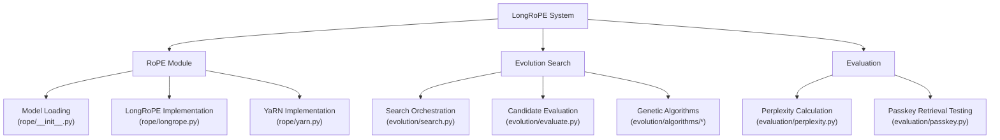

### Component Relationships

The RoPE module serves as the foundation, handling the loading of pre-trained models and replacing their positional embeddings with non-uniformly scaled versions. The Evolution Search component identifies optimal rescale factors through genetic algorithms, while the Evaluation component provides metrics to assess the performance of the extended models.

Sources: [README.md:67-74]()

## Key Technologies and Approaches

LongRoPE's effectiveness is based on the following key technical approaches:

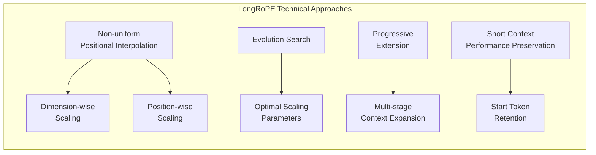

### Non-uniform RoPE Scaling

LongRoPE uses two forms of non-uniformity in positional interpolation:
1. **Varying RoPE dimensions**: Different scaling factors for different embedding dimensions
2. **Token positions**: Different scaling factors for different parts of the context window

This approach allows for more efficient extension of context windows compared to uniform scaling methods.

Sources: [README.md:67-74]()

## System Workflow

The typical workflow for using LongRoPE follows this sequence:

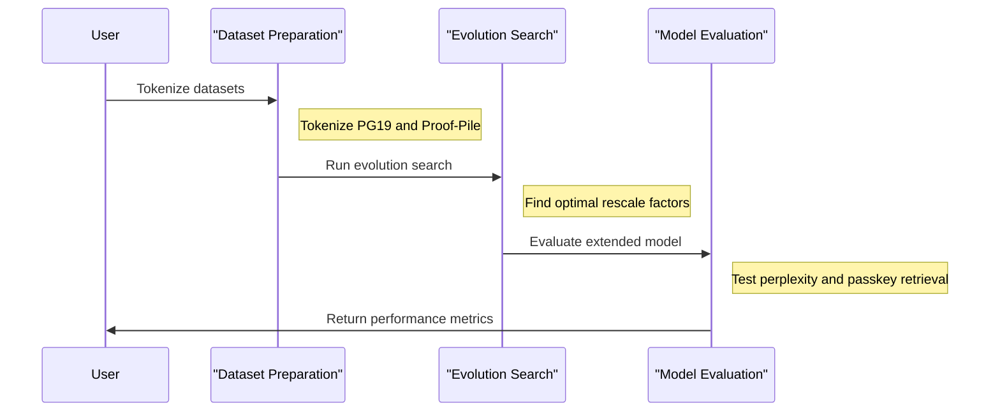

This workflow allows users to find optimal RoPE scaling parameters for their specific models and evaluate the performance of the extended models.

Sources: [README.md:87-110]()

## Code Organization

The LongRoPE codebase is organized into several key modules:

| Module | Purpose | Key Files |
|--------|---------|-----------|
| **rope** | Implements RoPE variants | `rope/__init__.py`, `rope/longrope.py`, `rope/yarn.py` |
| **evolution** | Implements search algorithms | `evolution/search.py`, `evolution/evaluate.py`, `evolution/algorithms/` |
| **evaluation** | Implements evaluation metrics | `evaluation/perplexity.py`, `evaluation/passkey.py` |
| **examples** | Model-specific examples | `examples/llama3/`, `examples/phi3/`, `examples/mistral/` |
| **utils** | Utility functions | `utils/tokenize_dataset.py` |

Sources: [README.md:76-110]()

## Supported Models and Performance

LongRoPE has been integrated into Microsoft Phi-3 models and can be applied to other LLMs like Llama 3 and Mistral. The Phi-3 models with LongRoPE support a 128k context window:

- Phi-3-mini-128k-instruct
- Phi-3-small-128k-instruct
- Phi-3-medium-128k-instruct
- Phi-3-vision-128k-instruct

### Performance on Long-Context Tasks

Phi-3 models with LongRoPE achieve competitive performance on long-context benchmarks:

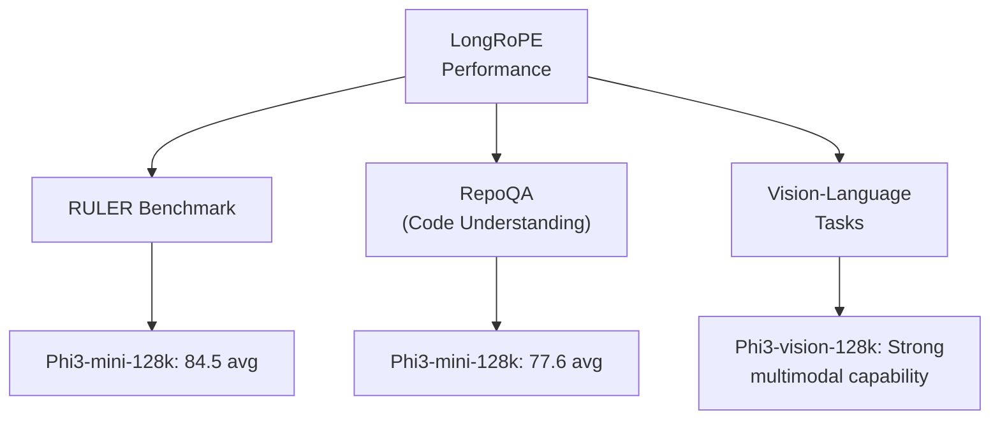

Sources: [README.md:18-66]()

## System Requirements

To use LongRoPE, the following dependencies are required:

- Python 3.10
- PyTorch 2.1.0
- Transformers 4.41.2
- Flash Attention
- CUDA 11.7 or higher (for flash-attn)
- Additional libraries listed in requirements.txt

The system can be installed using the provided requirements file:

```bash
conda create -n longrope python==3.10
conda activate longrope
pip install -r requirements.txt
```

Sources: [README.md:79-86](), [requirements.txt:1-18]()

## Getting Started

For detailed guides on using LongRoPE with specific models, see [Using LongRoPE](#5) and its sub-pages. For key concepts behind the technology, refer to [Key Concepts](#1.2).

The typical usage pattern involves:

1. Tokenizing datasets using provided scripts
2. Running evolution search to find optimal rescale factors
3. Evaluating the extended model's performance

These steps are documented in the example scripts provided for each supported model.

Sources: [README.md:87-110]()

---

# Page: Installation and Requirements

# Installation and Requirements

<details>
<summary>Relevant source files</summary>

The following files were used as context for generating this wiki page:

- [.gitignore](.gitignore)
- [README.md](README.md)
- [assets/logo.png](assets/logo.png)
- [requirements.txt](requirements.txt)

</details>


This page guides you through the process of setting up your environment to use the LongRoPE system for extending the context window of Large Language Models (LLMs). For a conceptual overview of the system, see [Key Concepts](#1.2).

## Hardware Requirements

LongRoPE requires GPU acceleration for optimal performance:

- **NVIDIA GPU with CUDA support**
- **CUDA Version**: 11.7 or higher (specifically required for flash-attention)
- **RAM**: Minimum 16GB recommended (more for larger models)
- **Storage**: ~5GB for code and dependencies (excluding model weights and datasets)

Sources: [README.md:79-86]()

## Software Setup Process

### Installation Workflow

The following diagram illustrates the standard installation process for the LongRoPE system:

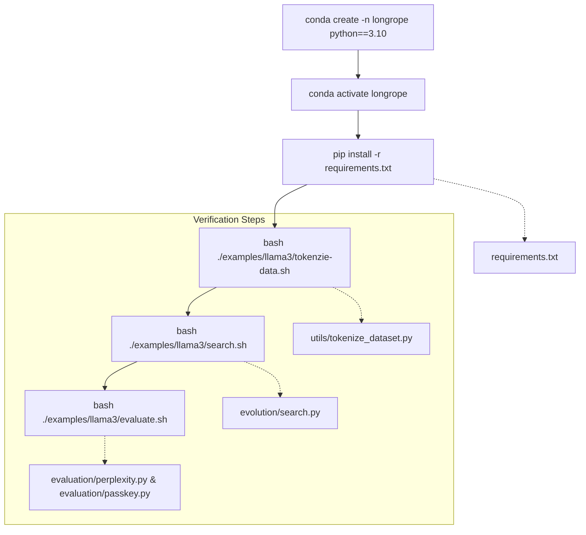

Sources: [README.md:79-86](), [README.md:90-110]()

### Step-by-Step Installation

1. **Create and activate a conda environment**:

```bash
conda create -n longrope python==3.10
conda activate longrope
```

2. **Install dependencies**:

```bash
# flash-attn needs cuda >= 11.7
pip install -r requirements.txt
```

Sources: [README.md:79-86]()

## Dependencies

The following table shows the key dependencies required by LongRoPE:

| Package | Version | Purpose |
|---------|---------|---------|
| torch | 2.1.0 | Deep learning framework |
| torchvision | 0.16.0 | Computer vision utilities |
| torchaudio | 2.1.0 | Audio processing |
| transformers | 4.41.2 | Hugging Face Transformers library |
| huggingface-hub | 0.23.0 | Model hub integration |
| datasets | 2.18.0 | Dataset handling |
| accelerate | - | Distributed training utilities |
| flash-attn | - | Efficient attention implementation |
| numpy, pandas | - | Data processing |
| einops | - | Tensor operations |
| tqdm, mlflow | - | Progress tracking and logging |
| tiktoken | - | Tokenization utilities |
| pytest | - | Testing framework |

Sources: [requirements.txt:1-17]()

## Component Dependency Structure

The following diagram shows how software dependencies relate to LongRoPE code components:

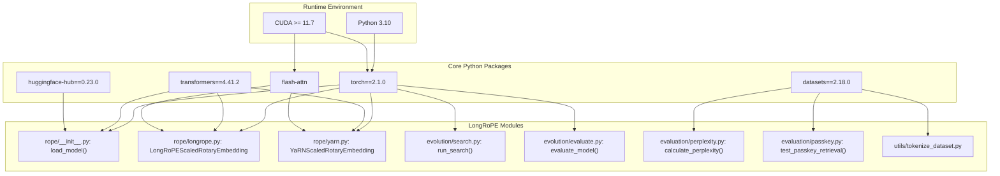

Sources: [README.md:67-74](), [requirements.txt:1-17]()

## Verifying Installation

To verify that your installation is working correctly, run the following tests:

### 1. Tokenize Test Datasets

This step tokenizes PG19 (for evolution search validation) and Proof-Pile (for evaluation):

```bash
bash ./examples/llama3/tokenzie-data.sh
```

### 2. Run Evolution Search

Execute an evolution search on Llama-3-8B model to extend to a 128k sequence length:

```bash
bash ./examples/llama3/search.sh
```

### 3. Evaluate Extended Model

Evaluate the long-context perplexity and passkey accuracy:

```bash
bash ./examples/llama3/evaluate.sh
```

Sources: [README.md:90-94](), [README.md:98-102](), [README.md:106-110]()

## Dataset Storage Structure

LongRoPE expects datasets to be stored in the `datasets` directory (automatically created during tokenization):

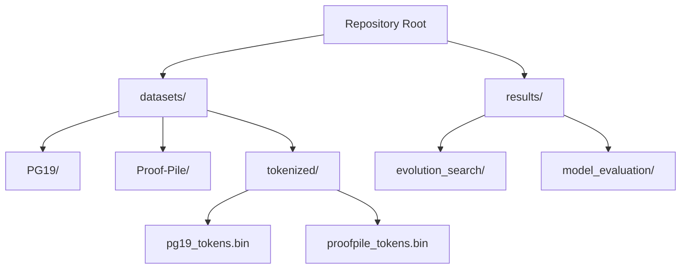

Sources: [.gitignore:1-3](), [README.md:90-94]()

## Troubleshooting

### CUDA Compatibility Issues

If you encounter CUDA-related errors:
- Verify your NVIDIA driver version supports CUDA 11.7+
- Check that `nvcc --version` returns the expected version
- Ensure PyTorch was installed with CUDA support (`torch.cuda.is_available()` should return `True`)

### Flash Attention Installation

Flash Attention may require additional setup on some systems:
- Ensure you have the required CUDA toolkit installed
- Try installing directly from source if package installation fails
- Check CUDA architecture compatibility with your GPU

### Memory Issues

If you encounter out-of-memory errors:
- Reduce batch sizes in the search configuration files
- Use a smaller model variant
- Close other GPU-intensive applications
- For multi-GPU systems, ensure proper distribution across devices

Sources: [README.md:79-86](), [requirements.txt:1-17]()

## Evolution Search Customization

The evolution search process can be customized by modifying the hyperparameters in `evolution/default_hyper_params/*.json`. Key parameters include:
- Number of iterations
- Population size
- Number of parents
- Number of mutation and crossover operations per iteration

These parameters affect convergence time and robustness of searching results.

Sources: [README.md:103-104]()

## Next Steps

After completing the installation:
- Learn about [Key Concepts](#1.2) of context window extension
- Explore [LongRoPE Implementation](#2) details
- Follow guides for [Running Evolution Search](#5.2)
- See [Model-Specific Guides](#5.4) for instructions relevant to your model

---

# Page: Key Concepts

# Key Concepts

<details>
<summary>Relevant source files</summary>

The following files were used as context for generating this wiki page:

- [README.md](README.md)
- [assets/logo.png](assets/logo.png)
- [rope/__init__.py](rope/__init__.py)

</details>


This document provides an overview of the core concepts behind LongRoPE, explaining the fundamental techniques that enable extending context windows in large language models (LLMs) beyond traditional limits. For implementation details, see [LongRoPE Implementation](#2), and for practical usage, see [Using LongRoPE](#5).

## What is RoPE?

Rotary Position Embeddings (RoPE) is a technique used in modern LLMs to encode positional information into attention mechanisms. RoPE applies a rotation to the embedding vectors, with the rotation frequency depending on the token position.

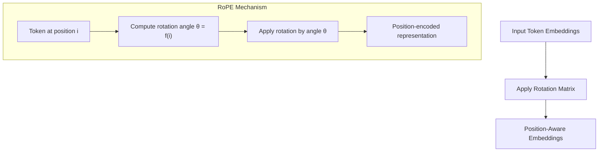

Sources: [README.md:68-69](). [rope/__init__.py:9-11]()

## Context Window Limitation

LLMs have a maximum context length they can process, determined by how they were pre-trained. This limitation stems from:

1. The fixed positional encoding scheme that doesn't generalize to unseen positions
2. Training resources and computational constraints
3. Quadratic memory and computational costs of self-attention

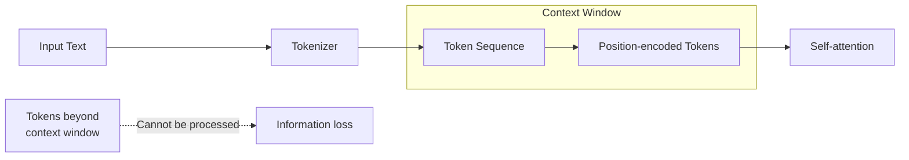

Sources: [README.md:67-72]()

## Non-uniform Rescaling Approach

LongRoPE extends context windows by applying non-uniform rescaling to positional embeddings across two dimensions:

1. **Varying RoPE dimensions**: Different rescaling factors for different embedding dimensions
2. **Varying token positions**: Different treatment for tokens at different positions

```mermaid
classDiagram
    class "Standard RoPE" {
        +Uniform scaling across dimensions
        +Same scaling for all positions
    }
    class "LongRoPE" {
        +Non-uniform scaling across dimensions
        +Position-specific scaling
    }
    
    "Standard RoPE" <|-- "LongRoPE"
```

Sources: [README.md:68-72](). [rope/__init__.py:10]()

## LongRoPE Implementation Variants

LongRoPE offers several implementation variants to address different use cases:

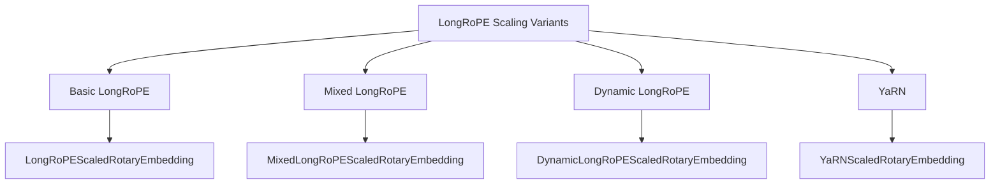

### Basic LongRoPE

The core implementation that applies dimension-specific rescaling factors to extend the context window.

### Mixed LongRoPE

Preserves the original positional embeddings for the initial tokens (to maintain short-context performance) while applying rescaling to later tokens.

### Dynamic LongRoPE

Implements a dynamic calculation of inverse frequencies based on rescale factors.

### YaRN

An alternative approach that uses different scaling rates for fast and slow dimensions.

Sources: [rope/__init__.py:10-11](). [rope/__init__.py:145-165]()

## Evolution Search for Optimal Rescaling

LongRoPE uses an evolutionary algorithm to find the optimal rescale factors for positional embeddings:

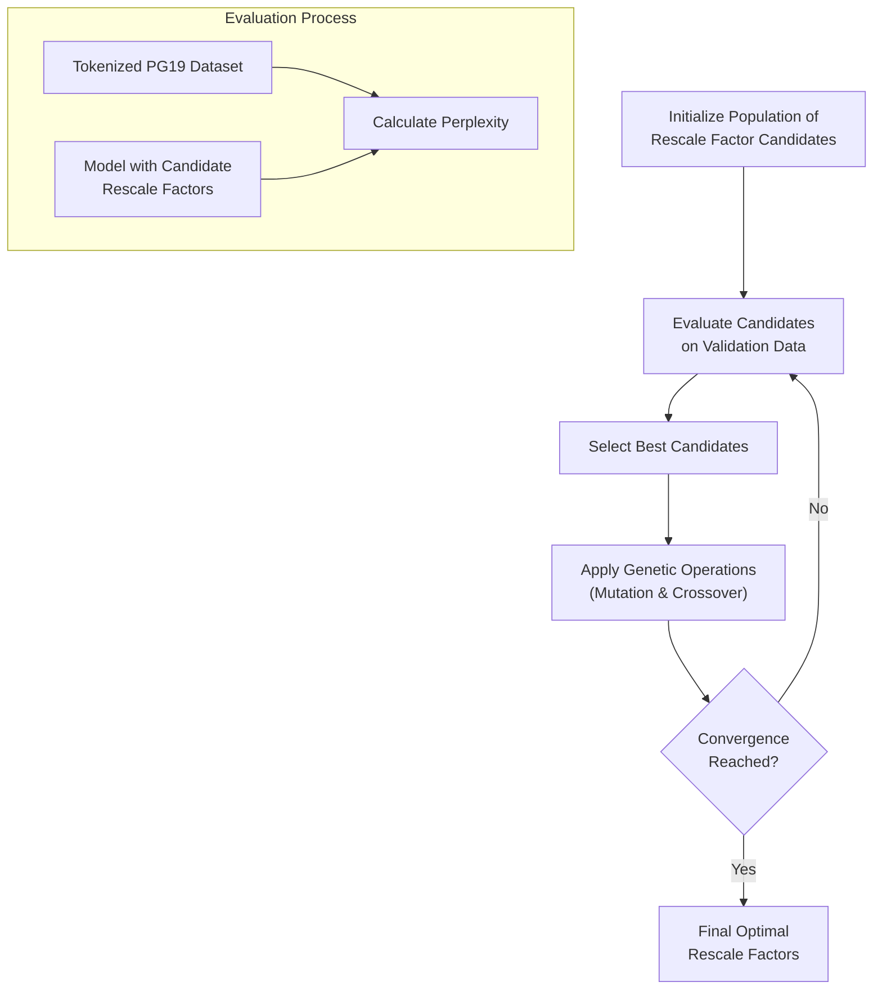

The evolution search systematically explores the space of possible rescaling factors to:
1. Maximize performance on long sequences
2. Minimize degradation on short sequences
3. Find factors that generalize across different tasks

Sources: [README.md:70](). [README.md:96-104]()

## Key Parameters and Configuration

| Parameter | Description | Impact |
|-----------|-------------|--------|
| `rescale_factors` | Dimension-specific scaling values | Determines how each dimension is scaled |
| `original_max_position_embeddings` | Original context length | Baseline for scaling calculation |
| `max_position_embeddings` | Target extended context length | Goal length after scaling |
| `start_token_idx` | Position from which to apply scaling (Mixed LongRoPE) | Preserves performance on short sequences |
| `magnitude_scaling_policy` | How magnitude is adjusted during scaling | Affects numerical stability |

Sources: [rope/__init__.py:136-152]()

## Model Integration Process

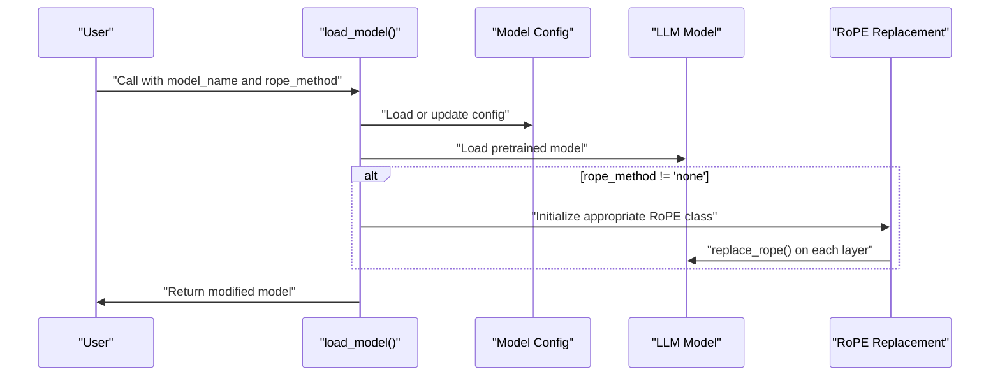

The LongRoPE system integrates with existing models by:
1. Loading the pretrained model
2. Creating the appropriate RoPE replacement based on the chosen method
3. Replacing the RoPE module in each transformer layer
4. Retaining the model's parameters while changing how positions are encoded

Sources: [rope/__init__.py:53-170]()

## Evolutionary Search and Evaluation Workflow

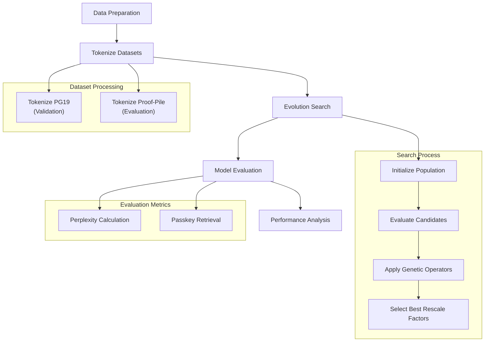

Sources: [README.md:88-110]()

## Real-world Impact

LongRoPE enables:
1. Processing documents with 2 million+ tokens in a single forward pass
2. Maintaining performance on short sequences while extending to long ones
3. Supporting both fine-tuning extensions and zero-shot extensions

The technique is integrated into Microsoft Phi-3 models, extending their context length to 128k tokens while maintaining strong performance across various tasks.

Sources: [README.md:18-65]()

---

# Page: LongRoPE Implementation

# LongRoPE Implementation

<details>
<summary>Relevant source files</summary>

The following files were used as context for generating this wiki page:

- [rope/__init__.py](rope/__init__.py)
- [rope/longrope.py](rope/longrope.py)
- [rope/yarn.py](rope/yarn.py)

</details>


This document provides a detailed technical explanation of the LongRoPE implementation in the codebase, which extends the context window of Large Language Models through non-uniform rescaling of Rotary Positional Embeddings (RoPE). For information about running the evolution search to find optimal rescale factors, see [Evolution Search](#3), and for evaluation methods, see [Evaluation](#4).

## Technical Foundations

LongRoPE extends the effective context length of transformer models by applying non-uniform scaling factors to different frequency components of rotary positional embeddings. Unlike uniform scaling methods (like PI or Dynamic NTK), LongRoPE uses different rescaling factors for each frequency dimension, which can be optimized through evolutionary search to better preserve the model's ability to understand both local and global context.

### Core Concept: Non-uniform Frequency Scaling

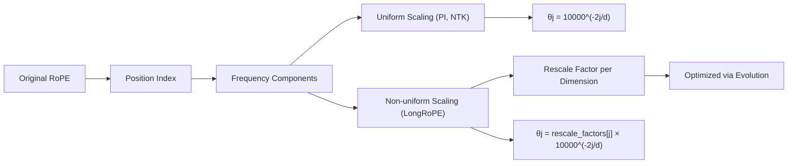

Sources: [rope/longrope.py:7-76]()/[rope/__init__.py:18-50]()

### Magnitude Scaling Policies

LongRoPE implements different policies to scale the magnitude of positional embeddings, which helps maintain signal strength in extended contexts:

| Policy | Formula | Application |
|--------|---------|-------------|
| su | `sqrt(1 + log(scale)/log(original_max_position_embeddings))` | Default for LongRoPE |
| yarn | `0.1 * log(scale) + 1.0` | Alternative scaling approach |
| custom | Fixed value provided by user | Manual control |

Sources: [rope/longrope.py:62-70]()

## LongRoPE Class Hierarchy

```mermaid
classDiagram
    class "torch.nn.Module" {
        +forward()
    }
    
    class "LongRoPEScaledRotaryEmbedding" {
        +dim: int
        +rescale_factors: Tensor
        +mscale: float
        +_calc_inv_freq()
        +_forward_llama()
        +_forward_mistral()
    }
    
    class "DynamicLongRoPEScaledRotaryEmbedding" {
        +_calc_inv_freq()
    }
    
    class "MixedLongRoPEScaledRotaryEmbedding" {
        +start_token_idx: int
        +original_embeddings: Tuple
        +_add_original_embeddings()
    }
    
    "torch.nn.Module" <|-- "LongRoPEScaledRotaryEmbedding"
    "LongRoPEScaledRotaryEmbedding" <|-- "DynamicLongRoPEScaledRotaryEmbedding"
    "LongRoPEScaledRotaryEmbedding" <|-- "MixedLongRoPEScaledRotaryEmbedding"
```

Sources: [rope/longrope.py:8-151]()

## LongRoPE Variants

### Base Implementation

The `LongRoPEScaledRotaryEmbedding` class is the foundation of LongRoPE, which applies non-uniform scaling to frequency components:

- Accepts pre-computed rescale factors from evolution search
- Supports different model types (Llama, Mistral)
- Applies magnitude scaling to maintain signal strength
- Dynamically calculates inverse frequencies based on rescaling factors

Key implementation aspects:

```python
# Calculate inverse frequencies using rescale factors
def _calc_inv_freq(self, seq_len, device):
    rescale_factors = self.rescale_factors.to(device)
    exponent = torch.arange(0, self.dim, 2, dtype=torch.float32, device=device) / self.dim
    return 1.0 / (rescale_factors * (self.base ** exponent))
```

Sources: [rope/longrope.py:8-102]()

### Dynamic LongRoPE

The `DynamicLongRoPEScaledRotaryEmbedding` variant dynamically adjusts the scaling factors based on the current sequence length:

- Scales the rescale factors proportionally to the current context length
- Allows for adaptive behavior with varying context sizes
- Interpolates between original and target scaling factors

Sources: [rope/longrope.py:105-114]()

### Mixed LongRoPE

The `MixedLongRoPEScaledRotaryEmbedding` variant preserves original embeddings for the first N tokens:

- Maintains original RoPE embeddings for tokens up to `start_token_idx`
- Applies LongRoPE scaling to tokens after `start_token_idx`
- Helps preserve near-term reasoning while extending far-context capabilities

Sources: [rope/longrope.py:117-151]()

## Model Integration Flow

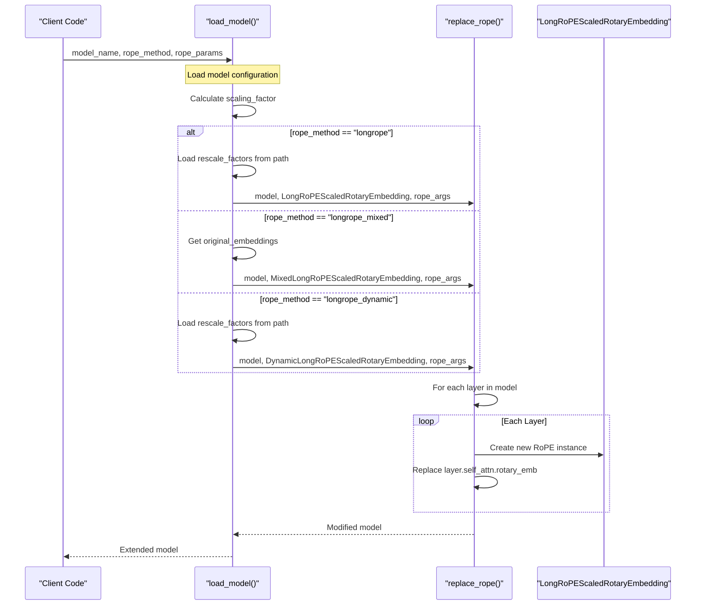

Sources: [rope/__init__.py:52-170]()

## Loading and Configuring LongRoPE

The `load_model` function serves as the entry point for applying LongRoPE to a model:

1. Loads the pre-trained model configuration
2. Calculates the scaling factor based on target and original max position embeddings
3. Loads optimization-derived rescale factors from a file
4. Creates the appropriate LongRoPE variant based on the specified method
5. Replaces the original RoPE implementation in each layer

Example configuration parameters:

| Parameter | Description | Example Value |
|-----------|-------------|---------------|
| `rope_method` | Which RoPE scaling method to use | "longrope", "longrope_mixed", "longrope_dynamic" |
| `max_position_embeddings` | Target extended context length | 16384 |
| `longrope_params_path` | Path to optimized rescale factors | "./rescale_factors.csv" |
| `longrope_scaling_policy` | Magnitude scaling approach | "su" |
| `start_token_idx` | For mixed mode, where to start scaling | 512 |

Sources: [rope/__init__.py:53-170]()

## Implementation Details 

### Forward Method Specialization

LongRoPE implements model-specific forward methods to accommodate differences in how RoPE is applied:

- `_forward_llama`: For Llama-style models, takes position_ids as input
- `_forward_mistral`: For Mistral-style models, uses sequence indices directly

Both methods:
1. Calculate inverse frequencies using rescale factors
2. Compute cosine and sine embeddings
3. Apply magnitude scaling to preserve signal strength

Sources: [rope/longrope.py:76-102]()

### Calculating Inverse Frequencies

The core of LongRoPE's non-uniform scaling is implemented in the `_calc_inv_freq` method:

```python
def _calc_inv_freq(self, seq_len, device):
    rescale_factors = self.rescale_factors.to(device)
    exponent = torch.arange(0, self.dim, 2, dtype=torch.float32, device=device) / self.dim
    return 1.0 / (rescale_factors * (self.base ** exponent))
```

This applies the dimension-specific rescale factors to the standard RoPE frequency calculation, enabling the optimization of different scaling factors for each frequency component.

Sources: [rope/longrope.py:72-75]()

## Comparison with YaRN

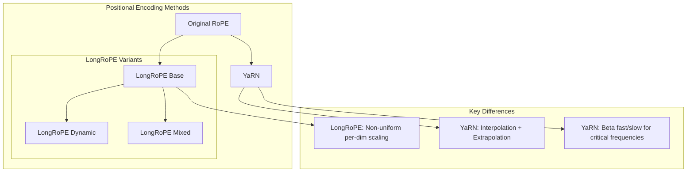

While LongRoPE uses evolution-optimized per-dimension rescale factors, YaRN (`YaRNScaledRotaryEmbedding`) provides an alternative approach:

| Feature | LongRoPE | YaRN |
|---------|----------|------|
| Scaling approach | Non-uniform per dimension | Interpolation/extrapolation with linear ramp |
| Parameter optimization | Evolutionary search | Fixed heuristics (beta_fast, beta_slow) |
| Critical frequency handling | Implicit in evolved parameters | Explicit with beta parameters |
| Adaptability | Through dynamic variant | Through extrapolation factor |

Sources: [rope/yarn.py:10-143]()

## Integration with Model Loading

The `load_model` function in `rope/__init__.py` provides the main interface for extending a model's context window with LongRoPE:

```python
model = load_model(
    model_name_or_path="meta-llama/Llama-3-8B",
    rope_method="longrope",
    max_position_embeddings=16384,
    rope_params={
        "longrope_params_path": "path/to/rescale_factors.csv",
        "longrope_scaling_policy": "su"
    }
)
```

This function:
1. Loads the pre-trained model configuration
2. Calculates the scaling factor based on the desired context extension
3. Selects the appropriate RoPE implementation based on `rope_method`
4. Loads the optimized rescale factors for LongRoPE variants
5. Replaces the model's original RoPE implementation with the extended version

Sources: [rope/__init__.py:53-170]()

## Model Compatibility

LongRoPE supports different model architectures through specialized forward methods:

| Model Type | Forward Method | Notes |
|------------|----------------|-------|
| Llama | `_forward_llama` | Used for Llama, Phi-3, etc. |
| Mistral | `_forward_mistral` | Used for Mistral, Mixtral |

The implementation automatically detects the model type and uses the appropriate forward method. For unrecognized model types, it defaults to the Llama implementation with a warning.

Sources: [rope/longrope.py:54-60]()

---

# Page: RoPE Module

# RoPE Module

<details>
<summary>Relevant source files</summary>

The following files were used as context for generating this wiki page:

- [rope/__init__.py](rope/__init__.py)

</details>


This document provides a technical specification of the RoPE (Rotary Positional Embedding) Module within the LongRoPE system. This module serves as the core component responsible for loading pre-trained Large Language Models (LLMs) and modifying their positional embedding mechanisms to extend context windows. For specific variants of LongRoPE implementations, see [LongRoPE Variants](#2.2). For information about the YaRN implementation alternative, see [YaRN Implementation](#2.3).

## Module Structure

The RoPE Module consists of a set of Python classes and utility functions that handle model loading and positional embedding replacement.

```mermaid
classDiagram
    class "load_model()" {
        +str model_name_or_path
        +str rope_method
        +int max_position_embeddings
        +type model_class
        +AutoConfig config
        +dict rope_params
        +int attn_sliding_window
        +bool save_memory
        +Load and configure model
        +Replace RoPE implementation
    }
    
    class "replace_rope()" {
        +AutoModelForCausalLM model
        +type rope_class
        +dict rope_args
        +Replace RoPE in each layer
    }
    
    class "LongRoPEScaledRotaryEmbedding" {
        +RoPE implementation
        +Adjustable frequency scaling
    }
    
    class "MixedLongRoPEScaledRotaryEmbedding" {
        +Mixed RoPE implementation
        +Uses original embeddings
    }
    
    class "DynamicLongRoPEScaledRotaryEmbedding" {
        +Dynamic RoPE implementation
        +Adaptive frequency calculation
    }
    
    class "YaRNScaledRotaryEmbedding" {
        +YaRN implementation
        +Different scaling approach
    }
    
    "load_model()" --> "replace_rope()" : calls
    "replace_rope()" --> "LongRoPEScaledRotaryEmbedding" : instantiates
    "replace_rope()" --> "MixedLongRoPEScaledRotaryEmbedding" : instantiates
    "replace_rope()" --> "DynamicLongRoPEScaledRotaryEmbedding" : instantiates
    "replace_rope()" --> "YaRNScaledRotaryEmbedding" : instantiates
```

**Diagram: RoPE Module Components and Relationships**

Sources: [rope/__init__.py:1-171]()

## Functionality and Key Components

The RoPE Module serves two primary functions:

1. Loading pre-trained LLMs using Hugging Face's transformers library
2. Replacing the standard RoPE implementation with variants designed to extend context windows

### Model Loading

The model loading functionality is implemented in the `load_model()` function, which handles:

- Loading a pre-trained model from a specified path or name
- Configuring the model with specified parameters
- Replacing the RoPE implementation when necessary

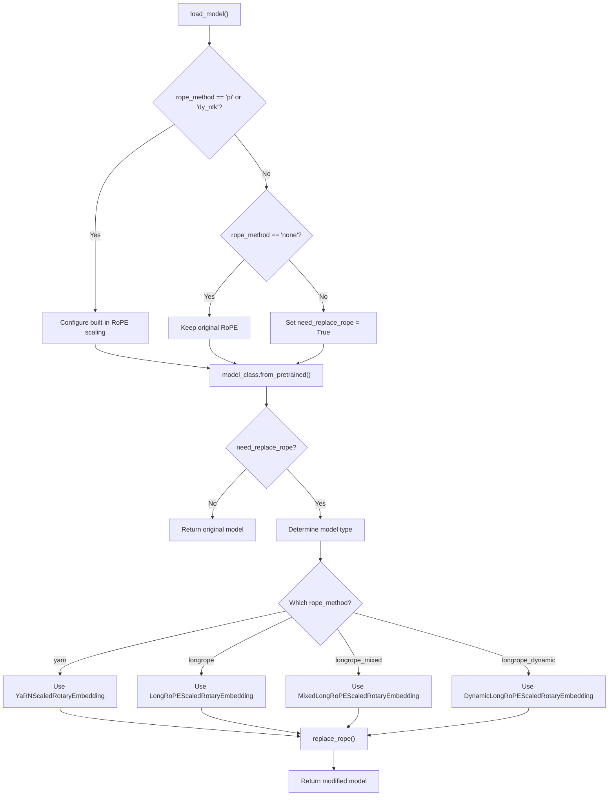

**Diagram: Model Loading and RoPE Replacement Process**

Sources: [rope/__init__.py:53-170]()

### RoPE Replacement

The RoPE replacement functionality is implemented in the `replace_rope()` function, which:

- Iterates through each layer of the model
- Configures layer-specific RoPE parameters
- Replaces the existing rotary embedding with the specified implementation

```mermaid
sequenceDiagram
    participant C as "Client Code"
    participant L as "load_model()"
    participant R as "replace_rope()"
    participant M as "Model"
    participant RE as "RotaryEmbedding"
    
    C->>L: Call with model_name and rope_method
    L->>L: Configure parameters
    L->>M: Load pre-trained model
    L->>L: Determine RoPE variant
    L->>R: Pass model, rope_class, rope_args
    
    loop For each layer
        R->>R: Prepare layer-specific args
        R->>R: Determine device
        R->>RE: Instantiate new RoPE
        R->>M: Replace layer.self_attn.rotary_emb
    end
    
    R->>L: Return modified model
    L->>C: Return final model
```

**Diagram: RoPE Replacement Process Flow**

Sources: [rope/__init__.py:18-50]()

## Supported RoPE Methods

The module supports various RoPE methods for extending context windows:

| Method | Class | Description | Configuration |
|--------|-------|-------------|--------------|
| `'pi'` | Built-in | Linear scaling of RoPE frequencies | Uses transformers built-in support |
| `'dy_ntk'` | Built-in | Dynamic NTK scaling | Uses transformers built-in support |
| `'yarn'` | `YaRNScaledRotaryEmbedding` | Yet Another RoPE extensioN | Configurable extrapolation factor |
| `'longrope'` | `LongRoPEScaledRotaryEmbedding` | Basic LongRoPE implementation | Uses rescale factors from file |
| `'longrope_mixed'` | `MixedLongRoPEScaledRotaryEmbedding` | Mixed implementation using original embeddings | Combines original and scaled embeddings |
| `'longrope_dynamic'` | `DynamicLongRoPEScaledRotaryEmbedding` | Dynamic implementation with adaptive scaling | Adapts frequencies dynamically |

Sources: [rope/__init__.py:107-168]()

## Configuration Parameters

The RoPE Module accepts various parameters to customize its behavior:

```mermaid
classDiagram
    class "RoPE Configuration" {
        +model_name_or_path: str
        +rope_method: str
        +max_position_embeddings: int
        +model_class: type
        +config: AutoConfig
        +rope_params: dict
        +attn_sliding_window: int
        +save_memory: bool
    }
    
    class "LongRoPE Parameters" {
        +longrope_params_path: str
        +longrope_scaling_policy: str
        +start_token_idx: int (for mixed)
    }
    
    class "Implementation Parameters" {
        +original_max_position_embeddings: int
        +max_position_embeddings: int
        +scale: float
        +base: float
        +model_type: str
        +rescale_factors: ndarray
        +magnitude_scaling_policy: str
    }
    
    "RoPE Configuration" --> "LongRoPE Parameters" : contains
    "RoPE Configuration" --> "Implementation Parameters" : generates
```

**Diagram: RoPE Configuration Parameters**

Sources: [rope/__init__.py:53-85](), [rope/__init__.py:136-162]()

### Key Parameter Details

- **model_name_or_path**: The Hugging Face model identifier or local path
- **rope_method**: Specifies which RoPE implementation to use
- **max_position_embeddings**: Maximum context window size after scaling
- **rope_params**: Additional parameters for specific RoPE methods
  - **longrope_params_path**: Path to rescale factors file for LongRoPE
  - **longrope_scaling_policy**: Policy for magnitude scaling
  - **start_token_idx**: Starting token index for mixed implementation

Sources: [rope/__init__.py:53-85]()

## Model Type Support

The module supports different model architectures with special handling for each:

- **Mistral/Mixtral models**: Uses specific RoPE configuration for these architectures
- **Llama models**: Default handling for most models
- **Phi-3 models**: Explicitly supported
- **Other models**: Fallback to Llama-style configuration with a warning

```mermaid
flowchart TD
    A["Determine model_type"] --> B{"config.model_type?"}
    B -- "mistral" --> C["rope_model_type = 'mistral'"]
    B -- "mixtral" --> C
    B -- "llama" --> D["rope_model_type = 'llama'"]
    B -- "phi3" --> D
    B -- "other" --> E["Warning: Unrecognized model type"]
    E --> D
    
    C --> F["Configure rope_args with model_type"]
    D --> F
    
    F --> G["Instantiate appropriate RoPE class"]
```

**Diagram: Model Type Detection and Handling**

Sources: [rope/__init__.py:128-141]()

## Implementation Process

The process of implementing extended context windows follows these steps:

1. **Model Loading**: Load the pre-trained model
2. **Scaling Factor Calculation**: Determine the scaling factor based on original and target context sizes
3. **RoPE Method Selection**: Choose the appropriate RoPE method
4. **Parameter Configuration**: Set up parameters for the selected method
5. **RoPE Replacement**: Replace the original RoPE implementation in each layer

For LongRoPE methods, the system loads rescale factors from a file, which are used to non-uniformly scale the frequency of rotary embeddings across different attention head dimensions.

Sources: [rope/__init__.py:87-107](), [rope/__init__.py:146-152]()

## Memory Optimization

The module includes an optional memory optimization feature through the `save_memory` parameter, which uses the `replace_methods` function from `utils.save_memory` to modify model methods for reduced memory usage.

Sources: [rope/__init__.py:125-126]()

---

# Page: LongRoPE Variants

# LongRoPE Variants

<details>
<summary>Relevant source files</summary>

The following files were used as context for generating this wiki page:

- [rope/longrope.py](rope/longrope.py)

</details>


## Purpose and Scope

This document describes the different variants of LongRoPE (Long Range Rotary Positional Embeddings) implemented in the system, their specific characteristics, and guidance on when to use each variant. The page covers the base LongRoPE implementation and its specialized extensions: Dynamic LongRoPE and Mixed LongRoPE. For information about the broader RoPE module implementation, see [RoPE Module](#2.1), and for details on the YaRN alternative, see [YaRN Implementation](#2.3).

## LongRoPE Base Implementation

The base LongRoPE implementation provides the foundation for extending context windows in language models through non-uniform rescaling of rotary positional embeddings.

### Core Functionality

The base implementation is defined in the `LongRoPEScaledRotaryEmbedding` class, which modifies the standard RoPE implementation by applying dimension-specific rescale factors to the frequency calculations.

```mermaid
flowchart TD
    subgraph "LongRoPEScaledRotaryEmbedding"
        A["Initialize with rescale_factors"] --> B["Calculate magnitude scaling"]
        B --> C["Apply rescale factors to inverse frequencies"]
        C --> D["Generate position-dependent embeddings"]
        D --> E["Apply magnitude scaling"]
    end
```

Sources: [rope/longrope.py:8-102]()

### Key Parameters

| Parameter | Description | Default |
|-----------|-------------|---------|
| `dim` | Head dimension (typically model's hidden dimension / num heads) | Required |
| `rescale_factors` | List of rescale factors for each dimension | Required |
| `max_position_embeddings` | Maximum number of position embeddings (after scaling) | 4096 |
| `original_max_position_embeddings` | Original max number of position embeddings (before scaling) | 4096 |
| `base` | Base value for positional encoding | 10000 |
| `magnitude_scaling_policy` | Attention temperature scaling function | "su" |
| `model_type` | Type of model architecture | "llama" |

Sources: [rope/longrope.py:8-60]()

### Magnitude Scaling Policies

The base implementation supports different magnitude scaling approaches to adjust attention temperature:

1. **"su" policy**: Square-root-based scaling that grows logarithmically with context extension
2. **"yarn" policy**: Linear-logarithmic scaling based on YaRN's approach
3. **Custom value**: A fixed floating-point value can be provided directly

```mermaid
graph LR
    A["Magnitude Scaling Policy"] --> B["'su': Square-root + Log scaling"]
    A --> C["'yarn': Linear-Log scaling"]
    A --> D["Custom value: fixed scaling"]
    
    B --> E["_calc_mscale_su() method"]
    C --> F["_calc_mscale_yarn() method"]
```

Sources: [rope/longrope.py:42-70]()

### Model Type Support

The base implementation supports different model architectures through specialized forward methods:

- **Llama**: Uses position IDs and handles architecture-specific details
- **Mistral**: Pre-calculates inverse frequencies and uses a slightly different approach

Sources: [rope/longrope.py:54-102]()

## Dynamic LongRoPE

Dynamic LongRoPE extends the base implementation by making the rescale factors themselves context-length dependent, which allows for better adaptation to varying sequence lengths.

### Dynamic Scaling Mechanism

```mermaid
flowchart TD
    A["Input sequence"] --> B["Calculate current_scale = seq_len / original_max_position"]
    B --> C["Calculate scale ratio between current and max extension"]
    C --> D["Dynamically adjust rescale factors based on ratio"]
    D --> E["Apply adjusted rescale factors"]
```

Sources: [rope/longrope.py:105-114]()

### Implementation Details

The `DynamicLongRoPEScaledRotaryEmbedding` class overrides just the `_calc_inv_freq` method to calculate dynamically adjusted rescale factors:

1. Computes the current context extension scale (`current_scale`)
2. References the target extension scale (`original_scale`) 
3. Calculates a dynamic scaling ratio between 0 and 1
4. Interpolates between 1.0 and the configured rescale factors based on this ratio

This approach allows the model to smoothly transition from standard RoPE to fully-scaled LongRoPE as sequence length increases.

```mermaid
classDiagram
    class LongRoPEScaledRotaryEmbedding {
        +dim
        +rescale_factors
        +magnitude_scaling_policy
        +_calc_inv_freq()
        +forward()
    }
    
    class DynamicLongRoPEScaledRotaryEmbedding {
        +_calc_inv_freq()
    }
    
    LongRoPEScaledRotaryEmbedding <|-- DynamicLongRoPEScaledRotaryEmbedding
```

Sources: [rope/longrope.py:105-114]()

### When to Use Dynamic LongRoPE

Dynamic LongRoPE is most appropriate when:
- Processing inputs of highly variable lengths
- You want smoother performance across different context lengths
- You need the model to adjust its positional sensitivity based on the actual sequence length

## Mixed LongRoPE

Mixed LongRoPE enables different positional embedding approaches for different token positions, allowing for hybrid processing of short-term and long-term dependencies.

### Mixing Mechanism

```mermaid
flowchart TD
    A["Input sequence"] --> B["Generate LongRoPE embeddings"]
    A --> C["Retrieve original RoPE embeddings"]
    B --> D["Mix embeddings based on start_token_idx"]
    C --> D
    D --> E["Return mixed embeddings"]
    
    subgraph "Position-based Mixing"
        F["Positions < start_token_idx: Original RoPE"]
        G["Positions >= start_token_idx: LongRoPE"]
    end
```

Sources: [rope/longrope.py:117-151]()

### Implementation Details

The `MixedLongRoPEScaledRotaryEmbedding` class extends the base implementation by:
1. Storing a reference to the original RoPE embeddings
2. Defining a boundary position (`start_token_idx`)
3. Replacing embeddings for positions before the boundary with the original embeddings

This allows precise control over which tokens use standard positional encoding versus extended positional encoding.

```mermaid
classDiagram
    class LongRoPEScaledRotaryEmbedding {
        +dim
        +rescale_factors
        +forward()
    }
    
    class MixedLongRoPEScaledRotaryEmbedding {
        +start_token_idx
        +original_embeddings
        +_add_original_embeddings()
    }
    
    LongRoPEScaledRotaryEmbedding <|-- MixedLongRoPEScaledRotaryEmbedding
```

Sources: [rope/longrope.py:117-151]()

### When to Use Mixed LongRoPE

Mixed LongRoPE is most suitable when:
- You want to preserve precise local positional sensitivity for nearby tokens
- You need to extend context for long-range dependencies
- The model's performance on short-context tasks must remain unchanged
- You're fine-tuning a model that was pretrained with specific positional encoding patterns

## LongRoPE Variants Comparison

The following table compares the key characteristics of each LongRoPE variant:

| Feature | Base LongRoPE | Dynamic LongRoPE | Mixed LongRoPE |
|---------|---------------|------------------|----------------|
| **Primary Purpose** | General context extension | Adaptive context extension | Hybrid context processing |
| **Rescale Factors** | Fixed per dimension | Dynamically adjusted | Fixed per dimension |
| **Position Dependence** | Uniform across positions | Sequence-length dependent | Position-dependent with boundary |
| **Original Embeddings** | Not used | Not used | Preserved for initial tokens |
| **Ideal Use Case** | General-purpose extension | Variable-length inputs | Preserving local sensitivity |
| **Implementation Complexity** | Base | Low | Medium |

```mermaid
graph TD
    A["LongRoPE Variants"] --> B["Base LongRoPE"]
    A --> C["Dynamic LongRoPE"]
    A --> D["Mixed LongRoPE"]
    
    B --> E["Fixed rescale factors"]
    C --> F["Dynamic rescale factors"]
    D --> G["Position-based mixing"]
    
    subgraph "Code Entity Space"
        H["LongRoPEScaledRotaryEmbedding"]
        I["DynamicLongRoPEScaledRotaryEmbedding"]
        J["MixedLongRoPEScaledRotaryEmbedding"]
    end
    
    B -.-> H
    C -.-> I
    D -.-> J
```

Sources: [rope/longrope.py:8-151]()

## Implementation Architecture

The following diagram shows how the different LongRoPE variants are organized in the code:

```mermaid
classDiagram
    class LongRoPEScaledRotaryEmbedding {
        +dim: int
        +rescale_factors: tensor
        +max_position_embeddings: int
        +original_max_position_embeddings: int
        +base: int
        +mscale: float
        +_calc_mscale_su(scale)
        +_calc_mscale_yarn(scale)
        +_calc_inv_freq(seq_len, device)
        +_forward_llama(x, position_ids, seq_len)
        +_forward_mistral(x, seq_len)
    }
    
    class DynamicLongRoPEScaledRotaryEmbedding {
        +_calc_inv_freq(seq_len, device)
    }
    
    class MixedLongRoPEScaledRotaryEmbedding {
        +start_token_idx: int
        +original_embeddings: tuple
        +_add_original_embeddings(emb_cos, emb_sin)
    }
    
    LongRoPEScaledRotaryEmbedding <|-- DynamicLongRoPEScaledRotaryEmbedding
    LongRoPEScaledRotaryEmbedding <|-- MixedLongRoPEScaledRotaryEmbedding
```

Sources: [rope/longrope.py:8-151]()

## Summary

The LongRoPE system provides multiple variants to address different context extension scenarios:

1. **Base LongRoPE**: General-purpose implementation with fixed rescale factors
2. **Dynamic LongRoPE**: Adaptive implementation that adjusts rescaling based on actual sequence length
3. **Mixed LongRoPE**: Hybrid implementation that preserves original embeddings for early tokens

By selecting the appropriate variant, users can optimize for different scenarios ranging from general context extension to specialized applications requiring preserved local sensitivity or dynamic adaptation to sequence length.

---

# Page: YaRN Implementation

# YaRN Implementation

<details>
<summary>Relevant source files</summary>

The following files were used as context for generating this wiki page:

- [rope/yarn.py](rope/yarn.py)

</details>


## Purpose and Overview

This document details the implementation of YaRN (Yet another RoPE extensioN) within the LongRoPE system. YaRN provides an alternative approach to extending the context window of Large Language Models (LLMs) through specialized modifications to Rotary Positional Embeddings (RoPE). Unlike the standard LongRoPE implementation covered in [LongRoPE Variants](#2.2), YaRN utilizes a hybrid approach combining interpolation and extrapolation techniques with frequency-dependent scaling.

## YaRN Architecture

YaRN modifies the RoPE implementation by applying selective scaling to different frequency components, allowing for better preservation of both local and global position information when extending context windows.

```mermaid
flowchart TD
    subgraph "YaRN Implementation"
        A["YaRNScaledRotaryEmbedding Class"] --> B["yarn() Method"]
        A --> C["forward() Method"]
        
        B --> D["Frequency Calculation"]
        B --> E["Correction Range"]
        B --> F["Mask Generation"]
        B --> G["Frequency Blending"]
        
        C --> H["_forward_llama()"]
        C --> I["_forward_mistral()"]
        
        D --> J["Interpolation Frequencies"]
        D --> K["Extrapolation Frequencies"]
        
        E --> L["Beta Fast/Slow Range"]
        
        F --> M["Linear Ramp Mask"]
        
        G --> N["Blended Inverse Frequencies"]
    end
```

Sources: [rope/yarn.py:40-144]()

## Mathematical Foundation

YaRN's approach builds on RoPE's mathematical foundation but introduces a more sophisticated frequency scaling method. The key mathematical insight is the selective scaling of different frequency bands to better handle extended contexts.

```mermaid
flowchart LR
    subgraph "YaRN Mathematical Transformation"
        A["Original Position\nFrequencies"] --> B["Find Correction Range"]
        B --> C["Generate Linear\nRamp Mask"]
        C --> D["Blend Interpolation\nand Extrapolation"]
        D --> E["Scale Magnitude"]
        E --> F["Apply to sin/cos\nComponents"]
    end
```

Sources: [rope/yarn.py:11-37](), [rope/yarn.py:131-143]()

### Frequency Correction

YaRN uses a correction mechanism that adjusts the inverse frequencies based on the desired extrapolation range:

1. The correction dimension is calculated based on the number of rotations:
   ```
   dim_correction = (dim * log(max_pos_embeddings/(num_rotations * 2π)))/(2 * log(base))
   ```

2. A correction range is determined using two parameters: beta_fast and beta_slow, defining the boundaries for the frequency transition:
   ```
   low = floor(find_correction_dim(beta_fast, dim, base, max_pos_embeddings))
   high = ceil(find_correction_dim(beta_slow, dim, base, max_pos_embeddings))
   ```

3. A linear ramp mask blends between interpolation and extrapolation frequencies.

Sources: [rope/yarn.py:13-31]()

## Core Implementation

The core of YaRN is implemented in the `YaRNScaledRotaryEmbedding` class, which extends `torch.nn.Module` and provides specialized positional embedding calculations.

### Key Parameters

| Parameter | Description | Default |
|-----------|-------------|---------|
| `dim` | Dimension of the embedding | Required |
| `max_position_embeddings` | Maximum sequence length to support | 2048 |
| `base` | Base value for RoPE frequency calculation | 10000 |
| `scale` | Scaling factor for interpolation | 1.0 |
| `original_max_position_embeddings` | Original model's maximum sequence length | 2048 |
| `extrapolation_factor` | Factor controlling extrapolation strength | 1 |
| `attn_factor` | Factor adjusting attention scaling | 1 |
| `beta_fast` | Fast frequency transition parameter | 32 |
| `beta_slow` | Slow frequency transition parameter | 1 |
| `model_type` | Model architecture ("llama" or "mistral") | "llama" |

Sources: [rope/yarn.py:40-67]()

### Frequency Calculation Process

The core yarn algorithm is implemented in the `yarn()` method:

```mermaid
sequenceDiagram
    participant YaRN as "YaRNScaledRotaryEmbedding"
    participant Math as "Mathematical Functions"
    
    YaRN->>Math: Calculate Position Frequencies
    Note right of Math: pos_freqs = base^(arange(0,dim,2)/dim)
    
    Math->>YaRN: Return Interpolation & Extrapolation Frequencies
    Note left of YaRN: inv_freq_extrapolation = 1.0/pos_freqs<br>inv_freq_interpolation = 1.0/(scale*pos_freqs)
    
    YaRN->>Math: Find Correction Range (beta_fast, beta_slow)
    Note right of Math: Find dimensions affected by transition
    
    Math->>YaRN: Return Low and High Bounds
    
    YaRN->>Math: Create Linear Ramp Mask
    Note right of Math: Generate smooth transition between ranges
    
    Math->>YaRN: Return Mask
    
    YaRN->>YaRN: Blend Frequencies
    Note right of YaRN: inv_freq = inv_freq_interpolation * (1-mask) + <br>inv_freq_extrapolation * mask
    
    YaRN->>YaRN: Calculate Magnitude Scaling
    Note right of YaRN: mscale = get_mscale(scale) * attn_factor
```

Sources: [rope/yarn.py:131-143]()

### Forward Pass Implementation

YaRN provides model-specific forward implementations:

1. For LLaMA-type models: `_forward_llama()` - Takes position IDs and calculates positional embeddings on-the-fly
2. For Mistral-type models: `_forward_mistral()` - Pre-computes embeddings for the entire sequence length

Both implementations:
- Calculate the sine and cosine components needed for rotary embeddings
- Apply magnitude scaling to both components
- Return properly formatted tensors for the model's attention mechanism

Sources: [rope/yarn.py:89-129]()

## Model Compatibility

YaRN is designed to work with different model architectures, currently supporting:

1. **LLaMA family models**: Uses position IDs for explicit position tracking
2. **Mistral models**: Uses cached embeddings for efficient processing

The implementation automatically selects the appropriate forward method during initialization based on the `model_type` parameter.

```mermaid
graph TD
    A["YaRNScaledRotaryEmbedding"] --> B{"model_type?"}
    B -->|"llama"| C["_forward_llama()"]
    B -->|"mistral"| D["_forward_mistral()"]
    
    C --> E["Position-based\nEmbedding Generation"]
    D --> F["Cached Embedding\nLookup/Calculation"]
    
    E --> G["Return cos/sin\nComponents"]
    F --> G
```

Sources: [rope/yarn.py:82-87](), [rope/yarn.py:89-129]()

## Comparison with Standard LongRoPE

Unlike the standard LongRoPE implementations, YaRN offers several distinguishing features:

| Feature | YaRN | Standard LongRoPE |
|---------|------|-------------------|
| Frequency Scaling | Combines interpolation and extrapolation with frequency-dependent scaling | Typically uses uniform or piece-wise scaling |
| Transition Mechanism | Smooth transition via linear ramp mask | Often discrete transitions between scaling regions |
| Parameter Sensitivity | Controlled by beta_fast and beta_slow parameters | Controlled by direct scaling factors |
| Magnitude Scaling | Dynamic scaling based on scale parameter | Varies by implementation |

YaRN's approach was specifically designed to better handle the trade-off between preserving local positional information (for nearby token relationships) and enabling extended context capabilities.

## Integration with LongRoPE System

To use YaRN in place of standard LongRoPE variants:

1. When loading a model, specify the YaRN implementation
2. Configure the YaRN-specific parameters (beta_fast, beta_slow, extrapolation_factor)
3. Set the desired context length via max_position_embeddings

YaRN integrates with the same evaluation and search mechanisms as other LongRoPE variants, allowing for comparable performance testing and optimization.

Sources: [rope/yarn.py:40-144]()

## Mathematical Details and Implementation Notes

The YaRN scaling approach involves two key mathematical components:

1. **Frequency domain manipulation**: The original RoPE frequencies are scaled in a non-uniform way that preserves higher frequency components (important for local relationships) while extending lower frequency components (important for long-range relationships).

2. **Magnitude scaling**: A logarithmic scaling function adjusts the magnitude of positional embeddings:
   ```
   get_mscale(scale) = 0.1 * log(scale) + 1.0  if scale > 1
                      = 1.0                    otherwise
   ```

The implementation is optimized for numerical stability, particularly with long sequences, by using appropriate data types (forcing float32 for certain calculations to avoid precision loss).

Sources: [rope/yarn.py:34-37](), [rope/yarn.py:114-129]()

---

# Page: Evolution Search

# Evolution Search

<details>
<summary>Relevant source files</summary>

The following files were used as context for generating this wiki page:

- [evolution/__init__.py](evolution/__init__.py)
- [evolution/evaluate.py](evolution/evaluate.py)
- [evolution/search.py](evolution/search.py)

</details>


## Purpose and Scope

The Evolution Search subsystem in LongRoPE is responsible for finding optimal rescale factors to extend the context window of Large Language Models (LLMs) without retraining. This system uses evolutionary algorithms to search through the space of possible rescale factors, evaluating candidate solutions by measuring their performance on language modeling tasks.

This page explains the architecture and workflow of the Evolution Search process. For specific details on the genetic algorithms used, see [Search Algorithm](#3.1). For information about the evaluation methods, see [Evaluation](#4).

Sources: [evolution/search.py:1-265]()

## Architecture Overview

The Evolution Search system employs a distributed client-server architecture to efficiently evaluate multiple candidate solutions in parallel across available GPU resources.

### Evolution Search System Architecture

```mermaid
flowchart TD
    subgraph "Search Orchestration"
        SS["search.py - Server"]
        GA["Genetic Algorithm"]
        LSM["Length Scale Management"]
        IF["Initial Factors Generation"]
        RM["Resource Management"]
    end
    
    subgraph "Distributed Evaluation" 
        E1["Evaluator #1"]
        E2["Evaluator #2"]
        En["Evaluator #n"]
    end
    
    DS["Dataset"]
    Model["Pre-trained Model"]
    RF["Output: Optimal Rescale Factors"]
    
    SS <--> GA
    GA --> LSM
    GA --> IF
    SS --> RM
    
    SS <--> |"Socket Communication"| E1
    SS <--> |"Socket Communication"| E2
    SS <--> |"Socket Communication"| En
    
    E1 --> DS
    E2 --> DS
    En --> DS
    
    E1 --> Model
    E2 --> Model
    En --> Model
    
    GA --> RF
```

Sources: [evolution/search.py:70-114](), [evolution/search.py:183-207]()

The Evolution Search system consists of:

1. **Search Orchestration**: Manages the overall search process, including:
   - **Server**: Coordinates communication with evaluators
   - **Genetic Algorithm**: Implements the evolutionary search strategy
   - **Length Scale Management**: Handles context window scaling
   - **Initial Factors Generation**: Creates starting points for the search
   - **Resource Management**: Allocates GPU resources efficiently

2. **Distributed Evaluation**: Multiple evaluator instances that:
   - Run on separate GPU devices
   - Load the model and dataset
   - Evaluate candidates and return performance metrics

## Evolution Search Process

The search process follows these key steps:

### Evolution Search Workflow

```mermaid
sequenceDiagram
    participant SS as "Search Server"
    participant GA as "Genetic Algorithm"
    participant E as "Evaluators"
    participant M as "Models"
    
    SS->>E: Initialize evaluators
    SS->>GA: Initialize population
    
    loop Until Convergence
        GA->>SS: Generate candidate factors
        SS->>E: Send factors for evaluation
        E->>M: Apply RoPE with factors
        E->>E: Compute perplexity
        E->>SS: Return evaluation results
        SS->>GA: Update population
        GA->>GA: Selection, crossover, mutation
    end
    
    GA->>SS: Return optimal factors
    SS->>SS: Save factors to file
    SS->>E: Finalize and terminate
```

Sources: [evolution/search.py:183-214](), [evolution/evaluate.py:67-79]()

### Initialization Process

```mermaid
flowchart TD
    Start["Start Evolution Search"] --> LoadConfig["Load Model Config"]
    LoadConfig --> GR["Get RoPE Parameters\n- head_size\n- original_length\n- target_length"]
    GR --> IF{"Init Factors\nProvided?"}
    
    IF -->|"No"| YaRN["Generate Initial Factors\nusing YaRN"]
    IF -->|"Yes"| Load["Load Factors\nfrom File"]
    
    Load --> AR{"Auto\nRescale?"}
    AR -->|"Yes"| Select["Select Best Initial\nScale Factor"]
    AR -->|"No"| Skip["Skip Auto-rescaling"]
    
    YaRN --> Setup["Setup Genetic Algorithm"]
    Select --> Setup
    Skip --> Setup
    
    Setup --> Run["Run Evolution Search"]
```

Sources: [evolution/search.py:116-179]()

## Implementation Details

### Socket-Based Communication

The Evolution Search employs a socket-based client-server architecture to facilitate communication between the central search process and distributed evaluators:

1. The search process (`search.py`) acts as the server, creating a socket that:
   - Binds to a dynamically assigned port
   - Listens for connections from evaluator processes
   - Sends candidate solutions to evaluators
   - Receives evaluation results

2. Each evaluator (`evaluate.py`) acts as a client that:
   - Connects to the search server
   - Loads the model and tokenized dataset
   - Receives RoPE arguments from the server
   - Applies the specified rescale factors to the model
   - Evaluates model performance and returns results

This architecture allows for efficient parallel evaluation of multiple candidate solutions across available GPU resources.

Sources: [evolution/search.py:71-114](), [evolution/evaluate.py:24-79]()

### Resource Management

The system intelligently manages GPU resources to optimize the evaluation process:

```mermaid
flowchart LR
    subgraph "Resource Distribution"
        RM["Resource Manager"]
        
        subgraph "GPU Allocation"
            G0["GPU 0"]
            G1["GPU 1"]
            G2["GPU 2"]
            G3["GPU 3"]
        end
        
        subgraph "Model Instances"
            M1["Model Instance #1\n(GPU 0, GPU 1)"]
            M2["Model Instance #2\n(GPU 2, GPU 3)"]
        end
    end
    
    RM -->|"Calculate devices per model"| G0
    RM -->|"Calculate devices per model"| G1
    RM -->|"Calculate devices per model"| G2
    RM -->|"Calculate devices per model"| G3
    
    G0 --> M1
    G1 --> M1
    G2 --> M2
    G3 --> M2
```

Key resource management features:

1. **GPU Memory Analysis**: Estimates available GPU memory to determine how many GPUs are needed per model.
2. **Model Distribution**: Distributes model instances across available GPUs.
3. **Multiple Evaluators**: Creates multiple evaluator instances to utilize available resources.
4. **Device Selection**: Supports specific device selection via command-line arguments.

Sources: [evolution/search.py:77-86](), [evolution/search.py:90-114]()

## Supported Algorithms

The Evolution Search system supports two primary genetic algorithms:

1. **DimMonoGeneticAlgorithm**: Search algorithm that applies consistent monotonicity constraints across all dimensions.
2. **DimPieceMonoGeneticAlgorithm**: Search algorithm that allows for piecewise monotonicity constraints, enabling more flexible factor patterns.

The algorithm selection is controlled by the `--algorithm` parameter when launching the search process.

Sources: [evolution/search.py:183-207]()

## Initial Factor Generation

The system provides two methods for generating initial rescale factors:

1. **YaRN-based Initialization**: Automatically generates factors using the YaRN (Yet another RoPE extensioN) approach, which provides a mathematically sound starting point.
2. **Custom Initialization**: Loads pre-defined factors from a file, which can be useful when refining previously discovered factors.

When using YaRN initialization, the system selects appropriate parameters based on the model type:

```
Model-specific YaRN configurations:
- Mistral/Mixtral: beta_fast=128, beta_slow=2
- Others (Llama, Phi3, etc.): beta_fast=32, beta_slow=1
```

Sources: [evolution/search.py:153-180]()

## Configuration Options

The Evolution Search process can be customized through various command-line arguments:

| Parameter | Description | Default |
|-----------|-------------|---------|
| `--model` | Path to the model to be extended | Required |
| `--tokenized` | Path to tokenized dataset for evaluation | Required |
| `--algorithm` | Genetic algorithm to use (`dim_mono` or `dim_piece_mono`) | Required |
| `--target-length` | Target context length for extension | Required |
| `--output-dir` | Directory to save results | Required |
| `--yarn-settings` | YaRN parameter preset to use | `llama` |
| `--init-factors` | Path to initial factors file | `None` (use YaRN) |
| `--auto-rescale-init-factors` | Whether to auto-rescale initial factors | `False` |
| `--hyper-params` | Path to hyperparameters file | Algorithm defaults |
| `--length-scale` | Explicit length scaling factor | `None` (auto) |
| `--model-size-gb` | Approximate model size in GB | `14` |
| `--devices` | Comma-separated list of GPU devices to use | All available |

Sources: [evolution/search.py:222-246]()

## Usage Example

A typical workflow for running an Evolution Search:

1. **Prepare the tokenized dataset** (see [Dataset Preparation](#5.1))
2. **Configure the search process** by setting the model, target length, and other parameters
3. **Run the search** using the appropriate algorithm
4. **Evaluate the results** using the generated rescale factors

The search process outputs the following files:
- `result_final.csv`: The final optimized rescale factors
- `log-TIMESTAMP.json`: Detailed log of the search process
- `log-TIMESTAMP.txt`: Text log of the search execution

Sources: [evolution/search.py:210-214](), [evolution/search.py:249-265]()

---

# Page: Search Algorithm

# Search Algorithm

<details>
<summary>Relevant source files</summary>

The following files were used as context for generating this wiki page:

- [evolution/evaluate.py](evolution/evaluate.py)
- [evolution/search.py](evolution/search.py)

</details>


The Search Algorithm in LongRoPE is a sophisticated evolutionary search process designed to find optimal rescale factors for extending the context window of Large Language Models (LLMs). This page details the implementation of the search algorithm, including its orchestration, initialization process, and evaluation mechanisms. For information about the specific genetic algorithms used, see [Genetic Algorithms](#3.2), and for details on distributed evaluation, see [Distributed Evaluation](#3.3).

## Overview

The Search Algorithm employs evolutionary optimization to discover optimal non-uniform rescaling factors for Rotary Positional Embeddings (RoPE). These factors are crucial for effectively extending an LLM's context window while maintaining its reasoning capabilities across longer sequences.

```mermaid
flowchart TB
    subgraph "Search Algorithm Flow"
        A["Initialize Search"] --> B["Setup Distributed Evaluation"]
        B --> C["Load Model Configuration"]
        C --> D["Generate/Load Initial Factors"]
        D --> E["Run Genetic Algorithm"]
        E --> F["Save Final Factors"]
    end
```

Sources: [evolution/search.py:71-215]()

## Search Orchestration

The search process is orchestrated through a server-client architecture that enables distributed evaluation across multiple GPUs. This architecture optimizes resource utilization and accelerates the search process.

```mermaid
sequenceDiagram
    participant SP as "search.py (Server)"
    participant EP as "evaluate.py (Client)"
    participant M as "Model"
    
    SP->>SP: Initialize socket server
    SP->>SP: Allocate GPU resources
    SP->>EP: Start evaluators
    
    EP->>M: Load model
    EP->>SP: Signal model ready
    
    loop For each candidate
        SP->>EP: Send RoPE arguments
        EP->>M: Replace RoPE implementation
        EP->>EP: Compute perplexity
        EP->>SP: Return evaluation result
    end
    
    SP->>EP: Send finalize signal
```

Sources: [evolution/search.py:71-115](), [evolution/evaluate.py:24-82]()

### Resource Management

The search algorithm intelligently manages GPU resources based on model size and available memory:

1. Calculates memory requirements per device
2. Determines the number of devices needed per model
3. Distributes models across available devices
4. Initializes evaluators accordingly

```mermaid
classDiagram
    class SearchOrchestrator {
        +socket
        +device_list
        +model_count
        +evaluators
        +setup_resources()
        +initialize_evaluators()
    }
    
    class Evaluator {
        +socket
        +device_list
        +model_ready()
        +set_rope()
        +get_result()
        +finalize()
    }
    
    SearchOrchestrator --> Evaluator : creates
```

Sources: [evolution/search.py:77-115]()

## Initial Factors Generation

Before starting the genetic algorithm, the search process needs initial rescale factors. These can be:

1. Generated using YaRN (Yet another RoPE extensioN) algorithm
2. Loaded from a previously saved file
3. Auto-rescaled to find the best starting point

```mermaid
flowchart TD
    A["Initialize Factors"] --> B{Source?}
    B -- "YaRN" --> C["Generate using YaRN"]
    B -- "Existing file" --> D["Load from file"]
    D --> E{Auto-rescale?}
    E -- "Yes" --> F["Select best scale"]
    E -- "No" --> G["Use as-is"]
    C --> G
    F --> G
    G --> H["Final Initial Factors"]
```

Sources: [evolution/search.py:145-180]()

### YaRN-based Initialization

When no initial factors are provided, the system generates them using YaRN with model-specific settings:

```python
# Model-specific YaRN settings
if args.yarn_settings == 'mistral' or config.model_type == 'mistral':
    yarn_betas = {
        'beta_fast': 128,
        'beta_slow': 2,
    }
else:
    yarn_betas = {
        'beta_fast': 32,
        'beta_slow': 1,
    }
```

The YaRN-based initialization creates a baseline set of rescale factors that the genetic algorithm can then refine.

Sources: [evolution/search.py:153-171]()

## Execution of Genetic Algorithms

The search algorithm supports two types of genetic algorithms:

1. **DimMonoGeneticAlgorithm**: Evolves factors with monotonically increasing constraints
2. **DimPieceMonoGeneticAlgorithm**: Evolves factors with piecewise monotonically increasing constraints

The choice of algorithm is specified via command-line arguments, and both algorithms are initialized with:

- A set of evaluators for fitness assessment
- Scale and target length parameters
- Hyperparameters loaded from configuration files
- Initial factors as the starting point
- Output paths for logging and results

```mermaid
classDiagram
    class GeneticAlgorithm {
        +evaluators
        +scale
        +target_length
        +hyper_params
        +init_factors
        +rope_args
        +log_json_path
        +run_genetic_algorithm()
    }
    
    class DimMonoGeneticAlgorithm {
        +run_genetic_algorithm()
    }
    
    class DimPieceMonoGeneticAlgorithm {
        +run_genetic_algorithm()
    }
    
    GeneticAlgorithm <|-- DimMonoGeneticAlgorithm
    GeneticAlgorithm <|-- DimPieceMonoGeneticAlgorithm
```

Sources: [evolution/search.py:183-208]()

## Evaluation Process

The evaluation process is critical to the search algorithm. It measures how well each candidate set of rescale factors performs by:

1. Loading the model with specific configurations
2. Replacing the RoPE implementation with the candidate factors
3. Computing perplexity on a tokenized dataset
4. Returning the result to the search orchestrator

```mermaid
flowchart LR
    subgraph "evaluate.py"
        A["Connect to Server"] --> B["Load Model & Dataset"]
        B --> C["Wait for RoPE Arguments"]
        C --> D["Replace RoPE"]
        D --> E["Compute Perplexity"]
        E --> F["Send Result"]
        F --> C
    end
```

Sources: [evolution/evaluate.py:24-82]()

### Socket-based Communication

The evaluator and search orchestrator communicate through a socket connection:

1. The search orchestrator creates a socket server
2. Evaluators connect as clients
3. The orchestrator sends RoPE parameters via JSON
4. Evaluators return perplexity results via JSON
5. This continues until the search is complete

Sources: [evolution/search.py:72-76](), [evolution/evaluate.py:25-82]()

## End-to-End Search Workflow

The complete search workflow integrates all components to find optimal rescale factors:

```mermaid
flowchart TD
    A["parse_arguments()"] --> B["Set up logging"]
    B --> C["Initialize socket server"]
    C --> D["Allocate GPU resources"]
    D --> E["Initialize evaluators"]
    E --> F["Load model configuration"]
    F --> G["Set RoPE parameters"]
    G --> H["Set random seed"]
    H --> I["Load hyperparameters"]
    I --> J["Generate/load initial factors"]
    J --> K["Run genetic algorithm"]
    K --> L["Save final factors"]
    L --> M["Finalize evaluators"]
```

Sources: [evolution/search.py:71-266]()

## Command-Line Interface

The search algorithm is configurable through numerous command-line arguments that control:

- Model selection and configuration
- Dataset parameters
- Algorithm selection
- Evaluation settings
- Output configuration
- Resource allocation

Key parameters include:

| Parameter | Description | Default |
|-----------|-------------|---------|
| `--model` | Path to the model | Required |
| `--tokenized` | Path to the tokenized dataset | Required |
| `--algorithm` | Genetic algorithm type (dim_mono or dim_piece_mono) | Required |
| `--target-length` | Target context length | Required |
| `--output-dir` | Directory for results | Required |
| `--init-factors` | Path to initial factors file | None (uses YaRN) |
| `--hyper-params` | Path to hyperparameters file | Uses default |
| `--model-size-gb` | Estimated model size in GB | 14 |
| `--devices` | Comma-separated list of GPU devices | All available |

Sources: [evolution/search.py:222-265]()

## Implementation Details

### Evaluator Class

The `Evaluator` class (imported from `evolution.algorithms`) is a key component that:

1. Manages communication with an evaluation worker
2. Sets RoPE parameters for evaluation
3. Retrieves perplexity results
4. Handles cleanup when the search is complete

Each evaluator operates on a specific set of GPU devices and evaluates candidate solutions in parallel with other evaluators.

Sources: [evolution/search.py:20](), [evolution/search.py:88-114]()

### Rescale Function

The rescale function adapts factors from one scale to another:

```python
def rescale(
    target_length_scale: float,
    origin_length_scale: float,
    factors: np.ndarray,
):
    return 1.0 + (factors - 1.0) * ((target_length_scale - 1.0) / (origin_length_scale - 1.0))
```

This function is used during initialization and when adapting rescale factors for different target lengths.

Sources: [evolution/search.py:33-38]()

### Initial Factors Selection

The `select_init_factors` function (lines 41-68) finds the best starting point for the search by:

1. Testing the initial factors at various scales
2. Measuring perplexity for each scale
3. Selecting the scale with the lowest perplexity
4. Returning the best rescale factors and scale

Sources: [evolution/search.py:41-68]()

## Putting It All Together

The Search Algorithm is a sophisticated component of the LongRoPE system that uses evolutionary optimization to find optimal rescale factors for extending LLM context windows. It orchestrates distributed evaluation, manages resources efficiently, and employs genetic algorithms to evolve increasingly effective solutions.

The final output of the search process is a set of rescale factors that can be applied to the LLM to enable longer context windows while maintaining model performance. These factors are saved to a CSV file for later use in extending model context windows.

---

# Page: Genetic Algorithms

# Genetic Algorithms

<details>
<summary>Relevant source files</summary>

The following files were used as context for generating this wiki page:

- [evolution/algorithms/__init__.py](evolution/algorithms/__init__.py)
- [evolution/algorithms/dim_mono.py](evolution/algorithms/dim_mono.py)
- [evolution/algorithms/dim_piece_mono.py](evolution/algorithms/dim_piece_mono.py)
- [evolution/algorithms/genetic_base.py](evolution/algorithms/genetic_base.py)

</details>


## Purpose and Scope

This page documents the genetic algorithms used in the LongRoPE system to find optimal rescale factors for extending the context window of large language models. The genetic algorithms implement an evolutionary approach to search for rescale factor configurations that minimize perplexity while maintaining specific constraints.

This page focuses on the genetic algorithm implementations and their components. For information about how these algorithms are integrated into the overall search process, see [Search Algorithm](#3.1). For details on how candidate solutions are evaluated, see [Distributed Evaluation](#3.3).

Sources: [evolution/algorithms/__init__.py:1-6]()

## Genetic Algorithm Framework

The LongRoPE system implements a genetic algorithm framework that consists of the following core components:

```mermaid
classDiagram
    class Individual {
        +np.ndarray factors
        +float ppl
        +__eq__(other)
        +__str__()
    }
    
    class Evaluator {
        +socket conn
        +address addr
        +subprocess process
        +model_ready()
        +set_rope(rope_args)
        +get_result()
        +finalize()
    }
    
    class EvaluatorQueue {
        +list[Evaluator] evaluators
        +list[Individual] indvs
        +push(indv, rope_args)
        +join()
    }
    
    class GeneticAlgorithm {
        +EvaluatorQueue queue
        +float scale
        +int target_length
        +list[Individual] history
        +preprocess_init_factors(factors)
        +extract_factors(factors)
        +make_indv(factors)
        +mutate(indv)~abstract~
        +crossover(indv_1, indv_2)~abstract~
        +run_genetic_algorithm()
    }
    
    GeneticAlgorithm *-- EvaluatorQueue
    EvaluatorQueue o-- "*" Evaluator
    EvaluatorQueue o-- "*" Individual
    GeneticAlgorithm o-- "*" Individual : "maintains history of"
```

**Genetic Algorithm Framework Components**

Sources: [evolution/algorithms/genetic_base.py:14-33](), [evolution/algorithms/genetic_base.py:37-82](), [evolution/algorithms/genetic_base.py:83-118](), [evolution/algorithms/genetic_base.py:119-146]()

## Individual Representation

In the genetic algorithm, each individual represents a candidate solution for the LongRoPE rescale factors. The `Individual` class encapsulates:

1. `factors` - A NumPy array containing the rescale factors
2. `ppl` (perplexity) - The fitness measure for the individual (lower is better)

```python
class Individual:
    def __init__(self, factors: np.ndarray, ppl: float = None):
        self.factors = factors
        self.ppl = ppl
```

The representation is engineered to:
- Support equality comparison between individuals (to avoid duplicates)
- Provide string representation for debugging and logging
- Store evaluation results (perplexity)

Sources: [evolution/algorithms/genetic_base.py:17-34]()

## Genetic Algorithm Process

The core genetic algorithm process is implemented in the `run_genetic_algorithm` method and follows this workflow:

```mermaid
flowchart TD
    A["Initialize Population"] --> B["Evaluate Initial Population"]
    B --> C["Main Evolution Loop"]
    
    C --> D["Select Top Parents"]
    D --> E["Log Results"]
    E --> F["Perform Mutation"]
    F --> G["Perform Crossover"]
    G --> H{"Max Iterations\nReached?"}
    H -- "No" --> D
    H -- "Yes" --> I["Return Best Solution"]
    
    subgraph "For Each New Individual"
        J["Create Individual"] --> K["Send to Evaluator"]
        K --> L["Get Perplexity Score"]
    end
```

**Genetic Algorithm Process Flow**

Key aspects of this process:
- Initial population generation through mutation of a base individual
- Selection of parents based on perplexity (lower is better)
- Creation of new individuals through mutation and crossover operations
- Continuous logging of best solutions
- Parallel evaluation of individuals using multiple evaluators

Sources: [evolution/algorithms/genetic_base.py:229-310]()

## Evolution Hyperparameters

The genetic algorithm's behavior is controlled by several hyperparameters:

| Parameter | Description |
|-----------|-------------|
| `population_size` | Size of the population in each generation |
| `max_time_budget` | Maximum number of iterations to run |
| `mutation_numbers` | Number of mutation operations per generation |
| `crossover_size` | Number of crossover operations per generation |
| `max_crossover_try` | Maximum attempts for crossover before falling back to mutation |
| `parents_size` | Number of top individuals to select as parents |
| `list_step` | Granularity of the search space |
| `evo_scale` | Scaling factor for algorithm parameters |

These parameters can be adjusted to balance exploration vs. exploitation in the search process.

Sources: [evolution/algorithms/genetic_base.py:151-161]()

## Algorithm Implementations

LongRoPE implements two specific genetic algorithm variants, each with its own approach to handling constraints:

```mermaid
classDiagram
    class GeneticAlgorithm {
        +run_genetic_algorithm()
        +mutate(indv)~abstract~
        +crossover(indv_1, indv_2)~abstract~
    }
    
    class DimMonoGeneticAlgorithm {
        +mutate(indv)
        +crossover(indv_1, indv_2)
    }
    
    class DimPieceMonoGeneticAlgorithm {
        +preprocess_init_factors(factors)
        +extract_factors(factors)
        +mutate(indv)
        +crossover(indv_1, indv_2)
    }
    
    GeneticAlgorithm <|-- DimMonoGeneticAlgorithm
    GeneticAlgorithm <|-- DimPieceMonoGeneticAlgorithm
```

**Genetic Algorithm Class Hierarchy**

Sources: [evolution/algorithms/__init__.py:1-6](), [evolution/algorithms/dim_mono.py:1-55](), [evolution/algorithms/dim_piece_mono.py:1-90]()

### DimMonoGeneticAlgorithm

This implementation enforces monotonically increasing rescale factors across dimensions. Key features:

1. **Mutation Operation**:
   - Randomly selects dimensions with 30% probability
   - For selected dimensions, chooses new values from valid monotonic ranges
   - Ensures monotonicity constraint (`np.diff(factors) >= 0`)
   - Avoids creating duplicate individuals

2. **Crossover Operation**:
   - Combines factors from two parent individuals
   - Randomly selects dimensions to inherit from the second parent
   - Verifies that the resulting individual maintains monotonicity
   - Falls back to mutation if valid crossover can't be found after maximum tries

Sources: [evolution/algorithms/dim_mono.py:11-55]()

### DimPieceMonoGeneticAlgorithm

This implementation adds piece-wise monotonicity with transition points. Key features:

1. **Factor Structure**:
   - Adds two control parameters (`alpha_dim`, `beta_dim`) to the factors array
   - These define transition points between different scaling regimes

2. **Mutation Operation**:
   - Modifies control parameters with 50% probability
   - For dimensions ≤ `alpha_dim`, sets factor to 1.0
   - For dimensions > `beta_dim`, sets factor to maximum scale
   - For dimensions between, applies monotonic random changes

3. **Crossover Operation**:
   - Handles control parameters as a unit to maintain coherence
   - Inherits either both control parameters or specific dimension factors
   - Ensures constraints between control parameters (`0 ≤ alpha_dim < beta_dim`)

Sources: [evolution/algorithms/dim_piece_mono.py:11-90]()

## Monotonicity Constraints

Both genetic algorithm implementations enforce monotonicity constraints for the rescale factors. These constraints are essential because:

1. The frequency distribution in Rotary Position Embeddings is structured with increasing frequency across dimensions
2. Monotonically increasing rescale factors maintain this relative ordering
3. Without monotonicity, there would be dimension reordering, potentially disrupting model capabilities

```mermaid
graph TD
    subgraph "Dimension Space"
        A["Lower Dimensions"] -->|"Lower Frequencies"| B["Higher Dimensions"]
    end
    
    subgraph "Rescale Factors"
        C["Lower Factors"] -->|"Monotonically<br>Increasing"| D["Higher Factors"]
    end
    
    A --- C
    B --- D
```

**Monotonicity Relationship in Rescale Factors**

Sources: [evolution/algorithms/dim_mono.py:13-35](), [evolution/algorithms/dim_piece_mono.py:22-64]()

## Evaluation Process

The evaluation of individuals is handled through a distributed system that communicates via sockets:

```mermaid
sequenceDiagram
    participant GA as "GeneticAlgorithm"
    participant EQ as "EvaluatorQueue"
    participant E as "Evaluator"
    participant SP as "Subprocess (evaluate.py)"
    
    GA->>EQ: push(individual, rope_args)
    EQ->>E: set_rope(rope_args)
    E->>SP: send rope parameters
    SP->>SP: evaluate with given parameters
    SP->>E: send perplexity result
    E->>EQ: get_result()
    EQ->>GA: update individual.ppl
    
    Note over GA,SP: This process happens in parallel for multiple individuals
```

**Evaluation Communication Flow**

Key components of the evaluation process:

1. **Evaluator**: Manages socket communication with an evaluation subprocess
2. **EvaluatorQueue**: Coordinates multiple evaluators for parallel processing
3. **Socket Communication**: Transfers parameters and results between processes
4. **Distributed Processing**: Evaluates candidates across multiple devices

Sources: [evolution/algorithms/genetic_base.py:37-82](), [evolution/algorithms/genetic_base.py:83-118]()

## Best Solution Management

The genetic algorithm continuously tracks and updates the best solutions through:

1. **History Tracking**: All evaluated individuals are stored in a history list to avoid re-evaluating duplicates
2. **Result Logging**: Best individuals and their perplexity scores are logged at each iteration
3. **Persistent Storage**: Results are saved to JSON and CSV files for recovery and analysis
4. **Convergence Monitoring**: Improvement tracking through generations

Sources: [evolution/algorithms/genetic_base.py:206-227]()

## Integration with Search Process

The genetic algorithms are a key component of the evolution search process, which uses them to find optimal rescale factors. The integration happens through:

1. The search process creates evaluation workers
2. These workers are passed to the genetic algorithm as evaluators
3. The genetic algorithm runs autonomously, communicating with workers to evaluate candidates
4. The final optimal solution is returned to the search process

For more details on how these genetic algorithms are used in the overall search workflow, see [Search Algorithm](#3.1).

Sources: [evolution/algorithms/genetic_base.py:119-146]()

---

# Page: Distributed Evaluation

# Distributed Evaluation

<details>
<summary>Relevant source files</summary>

The following files were used as context for generating this wiki page:

- [evolution/evaluate.py](evolution/evaluate.py)
- [evolution/search.py](evolution/search.py)

</details>


## Purpose and Scope

This document explains the distributed evaluation system used in LongRoPE to parallelize the assessment of candidate rescale factors across multiple GPU devices. The distributed evaluation architecture enables efficient evolutionary search by allowing simultaneous evaluation of multiple candidates, significantly accelerating the optimization process. For information about the evolutionary search algorithms themselves, see [Search Algorithm](#3.1) and [Genetic Algorithms](#3.2).

## System Architecture

The distributed evaluation system employs a client-server architecture with socket-based communication. The search process (server) distributes candidate solutions to multiple evaluator instances (clients), which perform model inference in parallel and return perplexity results.

### Architecture Diagram

```mermaid
flowchart TD
    A["Search Process (Server)"] --> |"Send candidate\nRoPE parameters"| B["Evaluator #0 (Client)"]
    A --> |"Send candidate\nRoPE parameters"| C["Evaluator #1 (Client)"]
    A --> |"Send candidate\nRoPE parameters"| D["Evaluator #N (Client)"]
    
    B --> |"Return perplexity\nresults"| A
    C --> |"Return perplexity\nresults"| A
    D --> |"Return perplexity\nresults"| A
    
    B --> E["Model #0"]
    C --> F["Model #1"]
    D --> G["Model #N"]
    
    E --> H["Dataset"]
    F --> H
    G --> H
    
    subgraph "Server (evolution/search.py)"
        A
    end
    
    subgraph "Clients (evolution/evaluate.py)"
        B
        C
        D
        E
        F
        G
    end
```

Sources: [evolution/search.py:72-114](), [evolution/evaluate.py:23-83]()

## Client-Server Communication

The communication between the server (search process) and clients (evaluators) follows a request-response pattern:

```mermaid
sequenceDiagram
    participant Server as "Search (Server)"
    participant Client as "Evaluator (Client)"
    
    Server->>Server: Initialize socket
    Server->>Server: Bind to a random port
    Server->>Server: Create evaluator instances
    Server->>Client: Start evaluator processes
    Client->>Client: Load model and dataset
    Client->>Server: Signal model ready
    
    loop For each candidate solution
        Server->>Client: Send RoPE parameters
        Client->>Client: Replace model's RoPE implementation
        Client->>Client: Compute perplexity
        Client->>Server: Return evaluation results
    end
    
    Server->>Client: Send finalize message
    Client->>Client: Cleanup resources
```

Sources: [evolution/search.py:71-114](), [evolution/evaluate.py:24-81]()

## Resource Allocation and Device Management

The system dynamically allocates GPU resources based on model size and available hardware. It calculates how many devices are needed per model instance and maximizes parallelism by running as many model instances as possible.

### Device Allocation Logic

```mermaid
flowchart LR
    A["Available GPUs"] --> B["Calculate GPU Memory"]
    B --> C["Determine devices per model"]
    C --> D["Calculate max model instances"]
    D --> E["Distribute devices among evaluators"]
    
    subgraph "Memory Calculation"
        B
    end
    
    subgraph "Resource Allocation"
        C
        D
        E
    end
```

Sources: [evolution/search.py:77-87]()

The system determines resource allocation with the following steps:

1. Calculate available memory per GPU device
2. Estimate required memory per model (specified via `model_size_gb` parameter)
3. Determine number of GPUs needed per model instance
4. Calculate maximum number of model instances that can run in parallel
5. Distribute available devices among evaluator instances

## Evaluator Implementation

Each evaluator is responsible for:
1. Loading a model instance
2. Processing evaluation requests
3. Applying RoPE parameters
4. Computing perplexity
5. Returning results to the server

### Evaluator Workflow

```mermaid
stateDiagram-v2
    [*] --> Connect
    Connect --> LoadModel
    LoadModel --> Ready
    Ready --> Evaluate
    Evaluate --> Ready: More requests
    Evaluate --> Finalize: Received finalize message
    Finalize --> [*]
    
    state Connect {
        [*] --> ConnectToServer
        ConnectToServer --> LoadDataset
        LoadDataset --> [*]
    }
    
    state Evaluate {
        [*] --> ReceiveParameters
        ReceiveParameters --> ApplyRoPE
        ApplyRoPE --> ComputePerplexity
        ComputePerplexity --> SendResults
        SendResults --> [*]
    }
```

Sources: [evolution/evaluate.py:24-81]()

## Key Parameters and Configuration

The distributed evaluation system is configured through several key parameters:

| Parameter | Description | Default | Source |
|-----------|-------------|---------|--------|
| `model_size_gb` | Estimated model size in gigabytes | 14.0 | `search.py` |
| `devices` | Comma-separated list of GPU device IDs | All available | `search.py` |
| `attn_implementation` | Attention implementation to use | "flash_attention_2" | Both files |
| `ppl_sliding_window` | Window size for perplexity calculation | 256 | Both files |
| `use_cache` | Whether to use KV cache during inference | False | Both files |
| `save_memory` | Enable memory optimization techniques | False | Both files |
| `num_proc` | Number of processes for dataset operations | 4 | Both files |

Sources: [evolution/search.py:222-244](), [evolution/evaluate.py:85-100]()

## Connection Establishment

The server (search process) dynamically selects an available port for communication:

1. The server creates a socket and binds it to localhost with port 0 (auto-assign)
2. The system obtains the assigned port number
3. Each evaluator connects to this port to establish communication

```mermaid
flowchart TB
    A["Server"] -->|"1. Create socket"| B["sock = socket.socket()"]
    B -->|"2. Bind to random port"| C["sock.bind(('localhost', 0))"]
    C -->|"3. Get assigned port"| D["host, port = sock.getsockname()"]
    D -->|"4. Listen for connections"| E["sock.listen(...)"]
    
    F["Evaluator"] -->|"1. Create socket"| G["sock = socket.socket()"]
    G -->|"2. Connect to server"| H["sock.connect((args.host, args.port))"]
    
    D -.->|"Pass port via args"| G
```

Sources: [evolution/search.py:72-75](), [evolution/evaluate.py:26-28]()

## Message Protocol

The client-server communication uses JSON messages over sockets:

| Message Type | Direction | Structure | Purpose |
|--------------|-----------|-----------|---------|
| Model Ready | Client → Server | `{"model_ready": true}` | Signal model loaded |
| RoPE Parameters | Server → Client | `{"rope_args": {...}}` | Send parameters to evaluate |
| Evaluation Result | Client → Server | `{"result": float}` | Return perplexity score |
| Finalize | Server → Client | `{"finalize": true}` | Signal evaluation completion |

Sources: [evolution/search.py:114](), [evolution/evaluate.py:53-81]()

## Memory Management

The system implements several memory optimization strategies:

1. **Device Partitioning**: Distributing model across multiple GPUs when it doesn't fit in a single device
2. **Dynamic Resource Allocation**: Automatically calculating optimal device distribution
3. **Memory Usage Estimation**: Reserving approximately 80% of available GPU memory to prevent OOM errors

Sources: [evolution/search.py:77-87]()

## Parallel Evaluation in Genetic Algorithms

The distributed evaluation system is primarily used by the genetic algorithms to evaluate the fitness of candidate solutions in parallel:

```mermaid
flowchart TD
    A["GeneticAlgorithm"] --> B["Population of Candidates"]
    B --> |"Distribute for\nparallel evaluation"| C["Evaluator #0"]
    B --> |"Distribute for\nparallel evaluation"| D["Evaluator #1"]
    B --> |"Distribute for\nparallel evaluation"| E["Evaluator #N"]
    
    C --> |"Fitness scores"| F["Selection & Reproduction"]
    D --> |"Fitness scores"| F
    E --> |"Fitness scores"| F
    
    F --> |"New generation"| B
    
    subgraph "Evolution Search Process"
        A
        B
        F
    end
```

Sources: [evolution/search.py:184-206]()

## Integration with Rope Module

The distributed evaluation system interfaces with the RoPE module to apply and test different positional embedding configurations:

1. The server sends RoPE parameters to evaluators
2. Evaluators use `rope.replace_rope()` to modify the model's positional embeddings
3. Different RoPE classes (`LongRoPEScaledRotaryEmbedding`, `YaRNScaledRotaryEmbedding`, etc.) can be specified

Sources: [evolution/evaluate.py:72-77]()

---

# Page: Evaluation

# Evaluation

<details>
<summary>Relevant source files</summary>

The following files were used as context for generating this wiki page:

- [evaluation/__init__.py](evaluation/__init__.py)
- [evaluation/passkey.py](evaluation/passkey.py)
- [evaluation/perplexity.py](evaluation/perplexity.py)

</details>


This page documents the evaluation systems used in LongRoPE to measure the performance of language models with extended context windows. The evaluation components provide quantitative metrics to assess how well models can process and utilize information across long contexts after applying LongRoPE modifications.

For information about running the evaluation scripts, see [Using LongRoPE](#5). For details on the evolution search process that uses these evaluation methods, see [Evolution Search](#3).

## Overview of Evaluation Methods

LongRoPE employs two complementary evaluation methods to assess model performance with extended context windows:

1. **Perplexity Evaluation**: Measures the model's ability to predict tokens across long contexts
2. **Passkey Retrieval**: Tests the model's ability to access specific information embedded deep within a context window

```mermaid
flowchart TD
    A["Evaluation System"] --> B["Perplexity Evaluation"]
    A --> C["Passkey Retrieval"]
    
    B --> B1["compute_perplexity()"]
    B --> B2["Sliding Window\nTesting"]
    B --> B3["Multiple Context\nLengths Testing"]
    
    C --> C1["generate_prompt()"]
    C --> C2["generate_answer()"]
    C --> C3["Accuracy Calculation"]
    
    B1 --> D["Results Analysis"]
    C3 --> D
```

Sources: [evaluation/perplexity.py](), [evaluation/passkey.py]()

## Perplexity Evaluation

Perplexity is a standard metric for evaluating language models that measures how well a model predicts a sequence of text. Lower perplexity indicates better performance.

### Implementation Details

The perplexity evaluation system implements a sliding window approach to efficiently evaluate perplexity on long sequences:

```mermaid
sequenceDiagram
    participant D as "Dataset"
    participant M as "Model"
    participant P as "Perplexity Calculator"
    
    D->>P: Tokenized texts
    
    loop For each text sequence
        loop For each window position
            P->>P: Extract window
            P->>P: Add BOS token (optional)
            P->>M: Forward pass
            M->>P: Negative log likelihood
            P->>P: Collect NLL
        end
    end
    
    P->>P: Calculate mean NLL
    P->>P: Calculate perplexity (exp(mean NLL))
```

Sources: [evaluation/perplexity.py:23-103]()

The key function that implements this approach is `compute_perplexity`:

```python
def compute_perplexity(
    dataset,
    model,
    tokenizer,
    add_start_token = True,
    num_tokens = None,
    sliding_window = 256,
    max_sliding_count = 10,
    truncate = False,
    use_cache = False,
    save_memory = False,
    device = None,
)
```

This function:
- Processes tokenized text in a sliding window fashion
- Can optionally add start tokens to each window
- Calculates perplexity across multiple context windows
- Supports memory optimization options

Sources: [evaluation/perplexity.py:23-103]()

### Usage

The perplexity evaluation system can be executed from the command line with various parameters:

```mermaid
flowchart LR
    A["perplexity.py"] --> B["Load Tokenizer"]
    B --> C["Load Dataset"]
    C --> D["Load Model with\nLongRoPE"]
    D --> E["Evaluate Multiple\nContext Lengths"]
    E --> F["Output Results"]
```

Key parameters for perplexity testing include:
- `--model`: Path to the model
- `--tokenized`: Path to the tokenized dataset
- `--num-tokens`: Context lengths to test (comma-separated list)
- `--ppl-sliding-window`: Size of the sliding window
- `--output-file`: File to save results

The system leverages environment variables for LongRoPE configuration:
- `ROPE_METHOD`: LongRoPE variant to use
- `LONGROPE_RESCALE_FACTOR`: Path to rescale factors
- `LONGROPE_SCALING_POLICY`: Policy for applying rescale factors
- `TARGET_LENGTH`: Maximum context length

Sources: [evaluation/perplexity.py:106-193]()

## Passkey Retrieval Evaluation

The passkey retrieval evaluation tests a model's ability to access information embedded deep within a long context window. It simulates a real-world scenario where specific information needs to be retrieved from a large amount of text.

### Implementation Details

The passkey retrieval test works by:
1. Generating a prompt with a random "passkey" (a number) embedded within irrelevant text
2. Asking the model to recall the passkey
3. Measuring accuracy based on whether the model correctly retrieves the passkey

```mermaid
classDiagram
    class PasskeyEvaluator {
        +generate_prompt(n_garbage)
        +generate_answer(pipe, prompt_text)
        +calc_str_length(token_length)
        +main(args)
    }
    
    class Prompt {
        +task_description
        +garbage_prefix
        +information_line
        +garbage_suffix
        +final_question
    }
    
    PasskeyEvaluator --> Prompt: creates
```

Sources: [evaluation/passkey.py:30-66]()

The key components include:

1. **Prompt Generation**: The `generate_prompt()` function creates test cases by embedding a random number (the "passkey") within a large amount of irrelevant text.

2. **Answer Generation**: The `generate_answer()` function extracts the model's response and tries to parse the passkey from it.

3. **Accuracy Calculation**: The system calculates the percentage of correctly retrieved passkeys.

Sources: [evaluation/passkey.py:30-66]()

### Usage

The passkey evaluation can be run from the command line:

```mermaid
flowchart TD
    A["passkey.py"] --> B["Load Model/Tokenizer"]
    B --> C["Run Tests for Each\nContext Length"]
    C --> D["Generate Prompts"]
    D --> E["Get Model Responses"]
    E --> F["Calculate Accuracy"]
    F --> G["Output Results"]
```

Key parameters include:
- `--model`: Path to the model
- `--samples`: Number of test samples
- `--num-tokens`: Context lengths to test (comma-separated list)
- `--output-file`: File to save results
- `--log-file`: File to log detailed test information

Similar to perplexity evaluation, the system uses environment variables for LongRoPE configuration.

Sources: [evaluation/passkey.py:69-162]()

## Evaluation Workflow

The typical evaluation workflow involves testing models with various context window sizes to measure how performance changes with longer contexts:

```mermaid
flowchart TD
    A["Start Evaluation"] --> B["Load Pre-trained Model"]
    B --> C["Apply LongRoPE Modifications"]
    C --> D{"Evaluation Type"}
    
    D -- "Perplexity" --> E["Load Tokenized Dataset"]
    D -- "Passkey" --> F["Generate Test Cases"]
    
    E --> G["Run Perplexity Tests\nfor Multiple Context Lengths"]
    F --> H["Run Passkey Tests\nfor Multiple Context Lengths"]
    
    G --> I["Output Perplexity vs Context Length"]
    H --> J["Output Retrieval Accuracy vs Context Length"]
    
    I --> K["Analysis"]
    J --> K
```

The evaluation results provide insights into:
1. How perplexity changes with increasing context length
2. How information retrieval accuracy changes with increasing context length
3. The effectiveness of different LongRoPE configurations

Sources: [evaluation/perplexity.py](), [evaluation/passkey.py]()

## Relationship with Other Components

The evaluation system integrates with other LongRoPE components:

```mermaid
flowchart LR
    A["Evolution Search\nevolution/search.py"] --> B["Evaluation\nComponents"]
    B --> C1["Perplexity Evaluation\nevaluation/perplexity.py"]
    B --> C2["Passkey Evaluation\nevaluation/passkey.py"]
    
    D["RoPE Module\nrope/__init__.py"] --> B
    
    C1 --> E["Optimal Rescale\nFactors"]
    C2 --> E
    
    E --> F["Extended Model\nDeployment"]
```

The evaluation components serve multiple purposes in the LongRoPE workflow:

1. **Parameter Optimization**: During evolution search, they provide fitness metrics for evaluating candidate rescale factors
2. **Final Evaluation**: They assess the final performance of models with optimized LongRoPE configurations
3. **Comparative Analysis**: They enable comparison between different LongRoPE variants and configurations

Sources: [evaluation/perplexity.py](), [evaluation/passkey.py]()

## Data Tables

### Perplexity Evaluation Parameters

| Parameter | Description | Default |
|-----------|-------------|---------|
| `--model` | Model path or identifier | (Required) |
| `--tokenized` | Path to tokenized dataset | (Required) |
| `--dataset-min-tokens` | Minimum token count for samples | None |
| `--samples` | Number of samples to evaluate | None (all) |
| `--num-tokens` | Context window sizes to test | "4096,8192,16384" |
| `--ppl-sliding-window` | Size of sliding window | 256 |
| `--truncate` | Whether to truncate sequences | False |
| `--output-file` | Path to save results | None |

Sources: [evaluation/perplexity.py:178-193]()

### Passkey Evaluation Parameters

| Parameter | Description | Default |
|-----------|-------------|---------|
| `--model` | Model path or identifier | (Required) |
| `--samples` | Number of test cases | (Required) |
| `--num-tokens` | Context window sizes to test | "4096,8192,16384" |
| `--output-file` | Path to save results | None |
| `--log-file` | Path to save detailed logs | None |

Sources: [evaluation/passkey.py:152-162]()

## Technical Note

Both evaluation methods are designed to assess the effectiveness of extended context window capabilities provided by LongRoPE. They offer complementary insights:

- **Perplexity** measures general prediction quality across the entire context
- **Passkey retrieval** specifically tests the model's ability to access and use information from distant parts of the context

When evaluating a LongRoPE implementation, it's recommended to use both metrics for a comprehensive assessment.

Sources: [evaluation/perplexity.py](), [evaluation/passkey.py]()

---

# Page: Perplexity Evaluation

# Perplexity Evaluation

<details>
<summary>Relevant source files</summary>

The following files were used as context for generating this wiki page:

- [evaluation/perplexity.py](evaluation/perplexity.py)

</details>


This document describes the perplexity evaluation component of the LongRoPE system, which measures the performance of language models with extended context windows. Perplexity is a standard metric for evaluating language models that quantifies how well a model predicts a text sample. For information about other evaluation methods such as passkey retrieval testing, see [Passkey Retrieval](#4.2).

## Purpose and Implementation

The perplexity evaluation module provides a sliding window approach to calculate perplexity for models with extended context lengths. This implementation has been validated against calculations reported in academic literature (arXiv 2306.15595).

```mermaid
flowchart TD
    A["Tokenized Dataset"] --> B["compute_perplexity()"]
    C["Extended LLM<br/>with LongRoPE"] --> B
    D["Tokenizer"] --> B
    B --> E["Sliding Window<br/>Processing"]
    E --> F["Per-Window<br/>Loss Calculation"]
    F --> G["Aggregate Perplexity"]
    G --> H["Final Perplexity Score"]
```

**Diagram: Perplexity Evaluation Flow**

Sources: [evaluation/perplexity.py:23-103]()

## Core Functionality

The core functionality is implemented in the `compute_perplexity` function, which:

1. Takes a tokenized dataset, model, and tokenizer as inputs
2. Processes text in configurable sliding windows
3. Calculates negative log likelihood for each window
4. Aggregates these values into a final perplexity score

### Key Parameters

| Parameter | Description | Default |
|-----------|-------------|---------|
| `dataset` | Tokenized dataset with input_ids and attention_mask | Required |
| `model` | Language model with extended context | Required |
| `tokenizer` | Associated tokenizer | Required |
| `add_start_token` | Whether to add BOS token | True |
| `num_tokens` | Context length to evaluate | None |
| `sliding_window` | Size of sliding window | 256 |
| `max_sliding_count` | Maximum number of windows | 10 |
| `truncate` | Whether to truncate sequences | False |
| `use_cache` | Whether to use KV cache | False |
| `save_memory` | Enable memory optimization | False |

Sources: [evaluation/perplexity.py:23-35]()

## Sliding Window Perplexity Calculation

The sliding window approach enables evaluation of very long contexts by processing text in manageable chunks while maintaining accuracy.

```mermaid
sequenceDiagram
    participant T as "Tokenized Text"
    participant SW as "Sliding Window"
    participant M as "Model"
    participant C as "Loss Calculator"
    participant A as "Aggregator"
    
    Note over T,A: Window size = 256 (default)
    
    T->>SW: Process text sequence
    loop For each window position
        SW->>SW: Extract window chunk
        SW->>SW: Add BOS token (optional)
        SW->>M: Forward pass
        M->>C: Calculate negative log likelihood
        C->>A: Store NLL value
    end
    A->>A: Aggregate NLLs
    A->>A: Calculate mean
    A->>A: Exponentiate to get perplexity
```

**Diagram: Sliding Window Calculation Process**

Sources: [evaluation/perplexity.py:60-103]()

## Implementation Details

### Memory Management

The implementation includes memory optimization features:
- Optional method replacement for memory saving
- Explicit garbage collection after each window calculation
- CUDA cache clearing
- Support for different precision types (dtype)

These optimizations are critical when evaluating large models with long contexts, as they help prevent out-of-memory errors.

### Perplexity Calculation Internals

```mermaid
graph TD
    A["Input: Tokenized Text"] --> B["Apply Sliding Window"]
    B --> C["Create Input_ids<br/>(Add BOS token if needed)"]
    C --> D["Prepare Target_ids<br/>(Set non-target tokens to -100)"]
    D --> E["Run Model Forward Pass"]
    E --> F["Extract NLL Loss"]
    F --> G["Accumulate Loss Values"]
    G --> H["Calculate Mean Loss"]
    H --> I["Exponentiate: exp(mean_loss)"]
    I --> J["Return Final Perplexity"]
```

**Diagram: Perplexity Calculation Internals**

Sources: [evaluation/perplexity.py:60-103]()

## Integration with LongRoPE System

The perplexity evaluation module integrates with the LongRoPE system through the `load_model` function, which injects the appropriate rotary positional embedding modifications.

```mermaid
classDiagram
    class PerplexityEvaluator {
        +compute_perplexity()
        +main()
    }
    
    class RoPELoader {
        +load_model()
        +replace_rope()
    }
    
    class LongRoPEScaledRotaryEmbedding {
        +rescale_factors
        +magnitude_scaling_policy
    }
    
    class TokenizedDataset {
        +input_ids
        +attention_mask
        +tokenized_len
    }
    
    PerplexityEvaluator --> RoPELoader: uses
    RoPELoader --> LongRoPEScaledRotaryEmbedding: injects
    PerplexityEvaluator --> TokenizedDataset: processes
```

**Diagram: Perplexity Evaluation Code Relationships**

Sources: [evaluation/perplexity.py:117-145]()

## Command-Line Interface

The module provides a comprehensive command-line interface for standalone execution:

```
python -m evaluation.perplexity --model MODEL_NAME --tokenized DATASET_PATH [options]
```

Key options include:

| Option | Description |
|--------|-------------|
| `--model` | Model name or path |
| `--tokenized` | Path to tokenized dataset |
| `--num-tokens` | Comma-separated list of token lengths to evaluate |
| `--ppl-sliding-window` | Size of the sliding window |
| `--truncate` | Whether to truncate sequences |
| `--output-file` | Path to save results |
| `--save-memory` | Enable memory optimization |

Sources: [evaluation/perplexity.py:178-192]()

## Environment Configuration

The module uses environment variables to configure LongRoPE parameters:

| Environment Variable | Purpose |
|----------------------|---------|
| `ROPE_METHOD` | Specifies the RoPE method to use |
| `LONGROPE_RESCALE_FACTOR` | Path to rescale factors |
| `LONGROPE_SCALING_POLICY` | Scaling policy to apply |
| `TARGET_LENGTH` | Target context length |

These variables allow flexible configuration of the LongRoPE parameters without modifying code.

Sources: [evaluation/perplexity.py:118-123](), [evaluation/perplexity.py:133]()

## Output Format

The perplexity evaluation generates results for each specified context length and optionally saves them to a CSV file with the following format:

```
length,ppl
4096,2.345
8192,2.567
16384,2.789
```

This format facilitates further analysis and comparison of perplexity across different context lengths.

Sources: [evaluation/perplexity.py:164-167]()

## Usage in the LongRoPE Workflow

Perplexity evaluation serves as a key metric to validate the effectiveness of LongRoPE's context window extension. In the overall workflow, it typically follows the evolution search process, which discovers optimal rescale factors.

```mermaid
flowchart LR
    A["Dataset<br/>Preparation"] --> B["Evolution<br/>Search"]
    B --> C["Optimal<br/>Rescale Factors"]
    C --> D["Perplexity<br/>Evaluation"]
    D --> E["Model<br/>Performance Analysis"]
    
    subgraph "Perplexity Evaluation Process"
        D1["Load Extended<br/>Model"] --> D2["Configure<br/>Sliding Window"]
        D2 --> D3["Calculate<br/>Perplexity"]
        D3 --> D4["Report Results"]
    end
```

**Diagram: Perplexity Evaluation in LongRoPE Workflow**

Sources: [evaluation/perplexity.py:106-167]()

---

# Page: Passkey Retrieval

# Passkey Retrieval

<details>
<summary>Relevant source files</summary>

The following files were used as context for generating this wiki page:

- [evaluation/passkey.py](evaluation/passkey.py)

</details>


This document details the passkey retrieval evaluation method in the LongRoPE system. Passkey retrieval testing is a key method for evaluating how well models with extended context windows can recall specific information positioned within a long context. This evaluation provides a quantitative measure of a model's ability to retrieve information over long distances in text, complementing the perplexity-based evaluation covered in [Perplexity Evaluation](#4.1).

## Purpose and Concept

Passkey retrieval is an information recall test that embeds a specific "passkey" (a random number) within a large amount of irrelevant text, then asks the model to recall this passkey. This test directly measures the model's ability to:

1. Process long sequences of text
2. Pay attention to specific information buried within that text
3. Accurately retrieve the information when prompted

```mermaid
flowchart TD
    A["Task Description"] --> B["Generate Long Text"]
    B --> C["Insert Passkey at Random Position"]
    C --> D["Add Final Question"]
    D --> E["Submit to Model"]
    E --> F["Extract Answer"]
    F --> G["Compare with Original Passkey"]
    G --> |"Match?"| H["Accuracy Calculation"]
```

*Diagram: Passkey Retrieval Testing Process*

Sources: [evaluation/passkey.py:30-51](), [evaluation/passkey.py:54-62]()

## Implementation Architecture

The passkey retrieval evaluation system consists of several core components that work together to test a model's long-context capabilities:

```mermaid
classDiagram
    class PasskeyEvaluator {
        +main(args)
        +generate_prompt(n_garbage)
        +generate_answer(pipe, prompt_text)
        +calc_str_length(token_length)
    }
    
    class ModelLoader {
        +load_model()
    }
    
    class TestConfiguration {
        +model_name
        +rope_method
        +target_length
        +samples
    }
    
    class ResultsTracker {
        +accuracy_by_length
        +log_results()
        +save_to_file()
    }
    
    PasskeyEvaluator --> ModelLoader: uses
    PasskeyEvaluator --> TestConfiguration: reads
    PasskeyEvaluator --> ResultsTracker: updates
```

*Diagram: Passkey Retrieval System Components*

Sources: [evaluation/passkey.py:69-142]()

## Prompt Generation

The system generates test prompts by embedding a random numerical passkey within a large amount of filler text. The position of the passkey is randomized to ensure a robust test of the model's attention capabilities.

### Prompt Structure

A typical prompt consists of:

1. A task description explaining the goal
2. A prefix of irrelevant "garbage" text
3. The passkey information line
4. A suffix of irrelevant "garbage" text
5. The final question asking for the passkey

```
Task description
[Irrelevant text prefix...]
The pass key is {random_number}. Remember it. {random_number} is the pass key.
[Irrelevant text suffix...]
What is the pass key? The pass key is
```

Sources: [evaluation/passkey.py:30-51]()

## Evaluation Process

```mermaid
sequenceDiagram
    participant User
    participant Passkey as "PasskeyEvaluator"
    participant Model as "LLM with LongRoPE"
    participant Results as "Results Tracking"
    
    User->>Passkey: Configure test parameters
    Note over Passkey: Set target lengths, samples
    Passkey->>Model: Load model with RoPE method
    Note over Passkey: For each target length
    loop For each sample
        Passkey->>Passkey: generate_prompt(str_length)
        Note right of Passkey: Embed random passkey in text
        Passkey->>Model: Submit prompt
        Model->>Passkey: Return completion
        Passkey->>Passkey: Extract answer from response
        Passkey->>Results: Record success/failure
    end
    Passkey->>Results: Calculate accuracy
    Results->>User: Report results
```

*Diagram: Passkey Retrieval Evaluation Workflow*

Sources: [evaluation/passkey.py:107-142]()

## Test Configuration

The passkey retrieval system accepts various configuration parameters to customize the evaluation:

| Parameter | Description | Default Value |
|-----------|-------------|---------------|
| `--model` | Model name or path | Required |
| `--samples` | Number of test samples to run | None (required) |
| `--num-tokens` | Comma-separated list of token lengths to test | `4096,8192,16384` |
| `--output-file` | Path to save results CSV | None |
| `--log-file` | Path to save detailed logs | None |
| `--attn-implementation` | Attention implementation to use | `flash_attention_2` |
| `--attn-sliding-window` | Size of sliding window | `-1` (disabled) |
| `--save-memory` | Enable memory optimization | `False` |
| `--dtype` | Datatype for model loading | `None` (auto) |

Sources: [evaluation/passkey.py:152-161]()

## Environment Variables

The passkey retrieval system uses several environment variables to control the RoPE configuration:

| Variable | Purpose |
|----------|---------|
| `ROPE_METHOD` | Specifies which RoPE method to use (e.g., `longrope`) |
| `LONGROPE_RESCALE_FACTOR` | Path to the rescale factors file for LongRoPE |
| `LONGROPE_SCALING_POLICY` | Specifies the scaling policy to use |
| `TARGET_LENGTH` | Sets the maximum position embeddings for model loading |

Sources: [evaluation/passkey.py:73-80](), [evaluation/passkey.py:94-105]()

## Integration with LongRoPE System

The passkey retrieval evaluation integrates with the broader LongRoPE system by using the `load_model` function from the RoPE module to load models with extended context windows:

```mermaid
flowchart TD
    A["PasskeyEvaluator"] --> B["load_model()"]
    B --> C["LongRoPE Implementation"]
    C --> |"Extended Model"| D["Text Generation Pipeline"]
    D --> E["Passkey Testing"]

    subgraph "RoPE Module"
        B
        C
    end

    subgraph "Evaluation Module"
        A
        D
        E
    end
```

*Diagram: Integration with LongRoPE System*

Sources: [evaluation/passkey.py:94-105]()

## Result Interpretation

The system evaluates model performance based on accuracy - the percentage of passkeys correctly retrieved. Results are grouped by token length, allowing for analysis of how accuracy changes as context length increases.

For each configuration, the system outputs:
- Accuracy at each tested token length
- CSV output with length-accuracy pairs
- Detailed logs of individual tests (when enabled)

A successful extended model should maintain high accuracy even at the longest token lengths, demonstrating effective use of extended context windows.

Sources: [evaluation/passkey.py:134-141]()

## Usage Example

To run a passkey retrieval evaluation:

1. Set the required environment variables for your RoPE configuration
2. Run the evaluation script with appropriate parameters

```bash
# Set environment variables
export ROPE_METHOD="longrope"
export LONGROPE_RESCALE_FACTOR="/path/to/rescale/factors.json"
export LONGROPE_SCALING_POLICY="dynamic"
export TARGET_LENGTH=16384

# Run the evaluation
python evaluation/passkey.py \
    --model "path/to/your/model" \
    --samples 50 \
    --num-tokens "4096,8192,16384" \
    --output-file "passkey_results.csv" \
    --log-file "passkey_logs.txt"
```

The system will run the evaluation and produce:
1. Console output showing accuracy for each token length
2. A CSV file with the numerical results
3. A detailed log file with individual test prompts and responses

Sources: [evaluation/passkey.py:144-162]()

## Summary

Passkey retrieval testing provides a straightforward but powerful method for evaluating a model's ability to handle extended context windows. By measuring whether a model can accurately retrieve specific information from various positions within a long text, it offers a clear assessment of the effectiveness of the LongRoPE extensions in practical information retrieval scenarios.

When used in conjunction with [Perplexity Evaluation](#4.1), passkey retrieval helps provide a more complete picture of model performance with extended context windows.

---

# Page: Using LongRoPE

# Using LongRoPE

<details>
<summary>Relevant source files</summary>

The following files were used as context for generating this wiki page:

- [README.md](README.md)
- [assets/logo.png](assets/logo.png)
- [examples/llama3/search.sh](examples/llama3/search.sh)
- [examples/llama3/tokenzie-data.sh](examples/llama3/tokenzie-data.sh)
- [examples/mistral/evaluate.sh](examples/mistral/evaluate.sh)
- [examples/mistral/search.sh](examples/mistral/search.sh)
- [examples/phi3/search.sh](examples/phi3/search.sh)

</details>


This guide provides practical instructions for extending the context window of Large Language Models (LLMs) using LongRoPE. It covers the complete workflow from data preparation to model evaluation, enabling you to significantly expand the context windows of models like Llama 3, Phi-3, and Mistral. For detailed information about the LongRoPE implementation itself, see [LongRoPE Implementation](#2).

## Overview of the LongRoPE Usage Process

LongRoPE extends LLM context windows through non-uniform rescaling of Rotary Positional Embeddings (RoPE). The process involves:

1. Dataset preparation and tokenization
2. Running evolution search to find optimal rescale factors
3. Evaluating the extended model

```mermaid
flowchart TD
    subgraph "LongRoPE Workflow"
        A["Data Preparation<br>tokenize_dataset.py"] --> B["Evolution Search<br>evolution/search.py"]
        B --> C["Model Extension<br>rope/longrope.py"]
        C --> D["Evaluation<br>perplexity.py & passkey.py"]
    end

    subgraph "Supported Models"
        M1["Llama 3"]
        M2["Phi-3"]
        M3["Mistral"]
    end

    M1 --> A
    M2 --> A
    M3 --> A
```

Sources: [README.md:76-102](), [examples/llama3/tokenzie-data.sh](), [examples/llama3/search.sh](), [examples/llama3/evaluate.sh]()

## Dataset Preparation

Before using LongRoPE, you need to prepare and tokenize your datasets:

1. **Required Datasets**:
   - PG19 for evolution search validation
   - Proof-Pile for evaluation

2. **Tokenization Process**:

```mermaid
flowchart LR
    A["Raw Dataset<br>(PG19/Proof-Pile)"] --> B["tokenize_dataset.py"]
    B --> C["Tokenized Dataset<br>(model-specific format)"]
    D["Model Tokenizer"] --> B
```

The example below shows how to tokenize datasets for Llama 3:

```bash
# First create datasets directory if it doesn't exist
mkdir -p datasets

# Clone PG19 from HuggingFace if needed
# Tokenize PG19 as evolution search validation dataset
python utils/tokenize_dataset.py \
    --model meta-llama/Meta-Llama-3-8B \
    --dataset datasets/pg19 \
    --split validation \
    --feature text \
    --save-tokenized datasets/pg19-valid-llama-tokenized

# Tokenize Proof-Pile as evaluation dataset
python utils/tokenize_dataset.py \
    --model meta-llama/Meta-Llama-3-8B \
    --dataset hoskinson-center/proof-pile \
    --split test \
    --feature text \
    --save-tokenized datasets/proof-pile-test-llama-tokenized
```

You must tokenize the datasets using the specific model you plan to extend with LongRoPE, as each model uses its own tokenizer.

Sources: [examples/llama3/tokenzie-data.sh](), [utils/tokenize_dataset.py]()

## Running Evolution Search

The evolution search process finds optimal rescale factors for extending your model's context window:

```mermaid
flowchart TD
    subgraph "Evolution Search Process"
        A["Initialize Population<br>evolution/search.py"] --> B["Evaluate Candidates<br>evolution/evaluate.py"]
        B --> C["Select Best Parents"]
        C --> D["Mutation & Crossover<br>evolution/algorithms"]
        D --> E{Convergence?}
        E -- No --> B
        E -- Yes --> F["Output Optimal<br>Rescale Factors"]
    end
```

To run the evolution search for a Llama 3 model:

```bash
TARGET_LENGTH=$((32 * 1024))  # 32K target context length

MODEL_PATH=meta-llama/Meta-Llama-3-8B
DATASET_PATH=datasets/pg19-valid-llama-tokenized
RESULT_PATH=results/search/llama3-8b/$TARGET_LENGTH

python evolution/search.py \
    --model $MODEL_PATH \
    --tokenized $DATASET_PATH \
    --algorithm dim_mono \
    --output-dir $RESULT_PATH \
    --target-length $TARGET_LENGTH \
    --dataset-min-tokens 131072 \
    --samples 5 \
    --truncate \
    --attn-implementation flash_attention_2 \
    --model-size-gb 14
```

### Key parameters:

| Parameter | Description |
|-----------|-------------|
| `--model` | Hugging Face model path or local model path |
| `--tokenized` | Path to tokenized dataset |
| `--algorithm` | Algorithm type (usually `dim_mono`) |
| `--target-length` | Target context length to extend to |
| `--samples` | Number of samples for evaluation |
| `--attn-implementation` | Attention implementation (recommended: `flash_attention_2`) |

The search produces a CSV file with the optimal rescale factors for your specific model and target context length.

Sources: [examples/llama3/search.sh](), [examples/phi3/search.sh](), [examples/mistral/search.sh](), [evolution/search.py]()

## Evaluating Extended Models

After finding optimal rescale factors, you should evaluate the extended model:

```mermaid
flowchart TD
    subgraph "LongRoPE Evaluation"
        A["Load Model<br>with LongRoPE Factors"] --> B1["Perplexity Evaluation<br>evaluation/perplexity.py"]
        A --> B2["Passkey Retrieval<br>evaluation/passkey.py"]
        B1 --> C["Performance Metrics"]
        B2 --> C
    end
```

To evaluate a Llama 3 model extended with LongRoPE:

```bash
# Set environment variables
export TARGET_LENGTH=$((32 * 1024))
export ROPE_METHOD=longrope
export LONGROPE_RESCALE_FACTOR=results/search/llama3-8b/$TARGET_LENGTH/result_final.csv
export LONGROPE_SCALING_POLICY=su

# Create output directory
export OUTPUT_DIR=results/eval/llama3-8b/$TARGET_LENGTH
mkdir -p $OUTPUT_DIR

# Evaluate perplexity
python evaluation/perplexity.py \
    --model meta-llama/Meta-Llama-3-8B \
    --tokenized datasets/proof-pile-test-llama-tokenized \
    --num-tokens $TARGET_LENGTH \
    --dataset-min-tokens 131072 \
    --samples 10 \
    --truncate \
    --attn-implementation flash_attention_2 \
    --output-file $OUTPUT_DIR/proof-pile.csv

# Evaluate passkey retrieval
python evaluation/passkey.py \
    --model meta-llama/Meta-Llama-3-8B \
    --num-tokens $TARGET_LENGTH \
    --samples 10 \
    --attn-implementation flash_attention_2 \
    --output-file $OUTPUT_DIR/passkey.csv \
    --log-file $OUTPUT_DIR/passkey.log
```

### Evaluation metrics:

1. **Perplexity**: Measures how well the model predicts text over long contexts
2. **Passkey Retrieval**: Tests the model's ability to recall information from the beginning of a long context

Lower perplexity and higher passkey accuracy indicate better long-context performance.

Sources: [examples/llama3/evaluate.sh](), [examples/mistral/evaluate.sh](), [evaluation/perplexity.py](), [evaluation/passkey.py]()

## Model-Specific Guides

### Using LongRoPE with Llama 3

Llama 3 works well with LongRoPE and can be extended to 32K tokens or more:

```bash
# Tokenize data
bash ./examples/llama3/tokenzie-data.sh

# Run evolution search
bash ./examples/llama3/search.sh

# Evaluate extended model
bash ./examples/llama3/evaluate.sh
```

### Using LongRoPE with Phi-3

Phi-3 models can be extended from their base 4K context to 32K or more:

```bash
# Use the same workflow but with Phi-3 specific scripts
MODEL_PATH=microsoft/Phi-3-mini-4k-instruct

# Run search with sliding window attention
python evolution/search.py \
    --model $MODEL_PATH \
    --tokenized $DATASET_PATH \
    --algorithm dim_mono \
    --output-dir $RESULT_PATH \
    --target-length $TARGET_LENGTH \
    --dataset-min-tokens 131072 \
    --samples 5 \
    --truncate \
    --attn-implementation flash_attention_2 \
    --attn-sliding-window 131072 \
    --model-size-gb 8
```

Note the `--attn-sliding-window` parameter, which is required for some models like Phi-3 and Mistral.

### Using LongRoPE with Mistral

Mistral models can also be extended with LongRoPE:

```bash
# Use Mistral-specific scripts
MODEL_PATH=mistralai/Mistral-7B-v0.1

# For evaluation, set the rescale factors from your search results
export ROPE_METHOD=longrope
export LONGROPE_RESCALE_FACTOR=results/search/mistral-7b-v01/$TARGET_LENGTH/result_final.csv
export LONGROPE_SCALING_POLICY=su
```

Sources: [examples/llama3](), [examples/phi3/search.sh](), [examples/mistral/search.sh](), [examples/mistral/evaluate.sh]()

## Advanced Usage

### Environment Setup

```bash
# Create conda environment
conda create -n longrope python==3.10
conda activate longrope
# flash-attn needs cuda >= 11.7
pip install -r requirements.txt
```

### Customizing Evolution Search Parameters

You can customize the evolution search process by modifying the hyperparameters in `evolution/default_hyper_params/*.json`:

- Number of iterations
- Population size
- Number of parents
- Number of mutation and crossover operations

```bash
# Example of customizing search parameters
python evolution/search.py \
    --model $MODEL_PATH \
    --tokenized $DATASET_PATH \
    --algorithm dim_mono \
    --output-dir $RESULT_PATH \
    --target-length $TARGET_LENGTH \
    --hyper-params custom_params.json
```

### Understanding LongRoPE Integration

```mermaid
flowchart TD
    subgraph "LongRoPE Integration with Models"
        A["Original Model<br>(Limited Context)"] --> B["load_model()<br>rope/__init__.py"]
        B --> C["replace_rope()<br>with LongRoPE Embeddings"]
        C --> D["Extended Model<br>(Increased Context)"]
    end
    
    subgraph "RoPE Implementations"
        E1["LongRoPEScaledRotaryEmbedding<br>rope/longrope.py"]
        E2["YaRNScaledRotaryEmbedding<br>rope/yarn.py"]
    end
    
    C --> E1
    C --> E2
```

The core functionality works by:

1. Loading the model using `load_model()` from `rope/__init__.py`
2. Replacing the standard RoPE embeddings with `LongRoPEScaledRotaryEmbedding` or other variants
3. Applying the optimized rescale factors found through evolution search

Sources: [rope/__init__.py](), [rope/longrope.py](), [rope/yarn.py]()

## Performance Considerations

When using LongRoPE, consider:

1. **Memory Requirements**: Extending context windows significantly increases memory usage. Adjust batch sizes and other parameters accordingly.

2. **GPU Requirements**: Flash Attention 2 is recommended for efficient attention computation with long contexts. This requires CUDA 11.7 or newer.

3. **Trade-offs**: There may be a slight performance degradation on short context tasks when optimizing for very long contexts. Consider your use case priorities.

## Conclusion

LongRoPE provides an effective way to extend the context window of various LLMs without fine-tuning. By following the workflow outlined in this guide, you can:

1. Prepare and tokenize your datasets
2. Find optimal rescale factors through evolution search
3. Evaluate and use your extended model

For more advanced techniques and integrations, refer to the LongRoPE paper and other wiki pages about implementation details.

Sources: [README.md:67-73](), [README.md:114-125]()

---

# Page: Dataset Preparation

# Dataset Preparation

<details>
<summary>Relevant source files</summary>

The following files were used as context for generating this wiki page:

- [examples/llama3/search.sh](examples/llama3/search.sh)
- [examples/llama3/tokenzie-data.sh](examples/llama3/tokenzie-data.sh)
- [examples/mistral/tokenzie-data.sh](examples/mistral/tokenzie-data.sh)
- [examples/phi3/tokenzie-data.sh](examples/phi3/tokenzie-data.sh)
- [utils/tokenize_dataset.py](utils/tokenize_dataset.py)

</details>


## Purpose and Overview

This page explains how to prepare and tokenize datasets for use with the LongRoPE system. Proper dataset preparation is crucial for both the evolution search process that discovers optimal rescale factors and for subsequent evaluation of extended context window models. For information about running the evolution search process itself, see [Running Evolution Search](#5.2).

The LongRoPE system primarily uses two datasets:
1. **PG19** - Used for evolution search validation
2. **Proof-Pile** - Used for model evaluation

This guide covers how to download these datasets, tokenize them with model-specific tokenizers, and prepare them for use in the LongRoPE workflow.

## Dataset Preparation Workflow

The dataset preparation process follows a consistent workflow regardless of the target model, though the specific tokenization differs based on the model's vocabulary.

```mermaid
flowchart TD
    A["Check/Create Datasets Directory"] --> B["Download Dataset"]
    B --> C["Clean Dataset"]
    C --> D["Tokenize Dataset"]
    D --> E["Save Tokenized Dataset"]
    
    subgraph "Dataset Sources"
        F["PG19 (deepmind/pg19)"]
        G["Proof-Pile (hoskinson-center/proof-pile)"]
    end
    
    F --> B
    G --> B
    
    subgraph "Model-Specific Tokenization"
        H["Llama 3 Tokenizer"]
        I["Phi-3 Tokenizer"]
        J["Mistral Tokenizer"]
    end
    
    H --> D
    I --> D
    J --> D
```

Sources: [examples/llama3/tokenzie-data.sh:1-35](), [examples/phi3/tokenzie-data.sh:1-35](), [examples/mistral/tokenzie-data.sh:1-35]()

## The Tokenization Utility

The core of dataset preparation is the tokenization utility script. This script loads a dataset, processes it through a model's tokenizer, and saves the tokenized representation for efficient use in evolution search and evaluation.

```mermaid
classDiagram
    class TokenizeDataset {
        +main(args)
        +tokenize(example)
    }
    
    class Arguments {
        +model: str
        +dataset: str
        +split: str
        +subset: str
        +feature: str
        +save_tokenized: str
        +num_proc: int
    }
    
    class ExternalDependencies {
        +datasets
        +AutoTokenizer
    }
    
    TokenizeDataset --> Arguments: uses
    TokenizeDataset --> ExternalDependencies: imports
```

Sources: [utils/tokenize_dataset.py:1-56]()

The tokenization script performs several key operations:

1. Loads the specified model's tokenizer
2. Configures the tokenizer with appropriate settings (e.g., setting pad_token to eos_token)
3. Loads the dataset from the source
4. Tokenizes each example in the dataset
5. Saves the tokenized dataset to disk

The tokenization function preserves the original dataset structure while adding tokenized fields:
- `input_ids`: The tokenized representation of the text
- `attention_mask`: Mask indicating which tokens should be attended to
- `tokenized_len`: The length of the tokenized sequence

Sources: [utils/tokenize_dataset.py:14-43]()

## Supported Datasets

### PG19

PG19 is a dataset of books from Project Gutenberg published before 1919. It's used as the validation dataset for the evolution search process in LongRoPE.

Key characteristics:
- Contains long-form text suitable for testing long context understanding
- Available via HuggingFace Datasets
- Only the validation split is used for LongRoPE

### Proof-Pile

Proof-Pile is a dataset containing mathematical proofs and related content. It's used for evaluating models extended with LongRoPE.

Key characteristics:
- Tests the model's ability to process specialized content with extended context
- Available via HuggingFace Datasets
- The test split is used for evaluation

Sources: [examples/llama3/tokenzie-data.sh:8-19](), [examples/phi3/tokenzie-data.sh:8-19](), [examples/mistral/tokenzie-data.sh:8-19]()

## Model-Specific Tokenization

Each model has a unique vocabulary and tokenization approach, which necessitates model-specific tokenization. The LongRoPE repository provides scripts for tokenizing datasets with three models:

| Model | Script Path | Tokenizer Path |
|-------|-------------|---------------|
| Llama 3 | `examples/llama3/tokenzie-data.sh` | `meta-llama/Meta-Llama-3-8B` |
| Phi-3 | `examples/phi3/tokenzie-data.sh` | `microsoft/Phi-3-mini-4k-instruct` |
| Mistral | `examples/mistral/tokenzie-data.sh` | `mistralai/Mistral-7B-v0.1` |

The tokenized datasets are saved to model-specific paths to prevent mixing tokenizations from different models:

| Dataset | Model | Output Path |
|---------|-------|-------------|
| PG19 (validation) | Llama 3 | `datasets/pg19-valid-llama-tokenized` |
| Proof-Pile (test) | Llama 3 | `datasets/proof-pile-test-llama-tokenized` |
| PG19 (validation) | Phi-3 | `datasets/pg19-valid-phi3-tokenized` |
| Proof-Pile (test) | Phi-3 | `datasets/proof-pile-test-phi3-tokenized` |
| PG19 (validation) | Mistral | `datasets/pg19-valid-mistral-tokenized` |
| Proof-Pile (test) | Mistral | `datasets/proof-pile-test-mistral-tokenized` |

Sources: [examples/llama3/tokenzie-data.sh:20-34](), [examples/phi3/tokenzie-data.sh:20-34](), [examples/mistral/tokenzie-data.sh:20-34]()

## Integration with LongRoPE System

The tokenized datasets are integrated into the LongRoPE system in two main ways:

```mermaid
flowchart LR
    subgraph "Dataset Preparation"
        A["Tokenize PG19 (Validation)"]
        B["Tokenize Proof-Pile (Test)"]
    end
    
    subgraph "LongRoPE System"
        C["Evolution Search"]
        D["Model Evaluation"]
    end
    
    A --> C
    B --> D
    
    subgraph "Parameters"
        E["--tokenized"]
        F["--dataset-min-tokens"]
        G["--samples"]
        H["--truncate"]
    end
    
    E --> C
    F --> C
    G --> C
    H --> C
```

Sources: [examples/llama3/search.sh:5-21]()

1. **Evolution Search**: The tokenized PG19 validation dataset is used in the evolution search process to find optimal rescale factors. Key parameters include:
   - `--tokenized`: Path to the tokenized dataset
   - `--dataset-min-tokens`: Minimum number of tokens to use from the dataset
   - `--samples`: Number of samples to evaluate
   - `--truncate`: Whether to truncate sequences

2. **Model Evaluation**: The tokenized Proof-Pile test dataset is used to evaluate the performance of models extended with LongRoPE.

## Step-by-Step Usage Guide

### 1. Preparing the Environment

First, ensure you have cloned the LongRoPE repository and installed all dependencies as described in [Installation and Requirements](#1.1).

### 2. Running the Tokenization Script

Choose the appropriate tokenization script based on your target model:

For Llama 3:
```bash
./examples/llama3/tokenzie-data.sh
```

For Phi-3:
```bash
./examples/phi3/tokenzie-data.sh
```

For Mistral:
```bash
./examples/mistral/tokenzie-data.sh
```

These scripts will:
1. Create a datasets directory if it doesn't exist
2. Clone the PG19 dataset if needed
3. Tokenize both the PG19 validation split and the Proof-Pile test split
4. Save the tokenized datasets to appropriate paths

### 3. Verifying Tokenization

After running the tokenization script, verify that the tokenized datasets have been created in the `datasets` directory:

```
datasets/
├── pg19/
├── pg19-valid-{model}-tokenized/
└── proof-pile-test-{model}-tokenized/
```

Where `{model}` is one of `llama`, `phi3`, or `mistral`.

## Advanced Usage

### Custom Tokenization

To tokenize a custom dataset or use different tokenization parameters, you can directly use the `tokenize_dataset.py` utility:

```bash
python utils/tokenize_dataset.py \
    --model [MODEL_PATH] \
    --dataset [DATASET_PATH_OR_NAME] \
    --split [SPLIT] \
    --feature [TEXT_FIELD_NAME] \
    --save-tokenized [OUTPUT_PATH] \
    --num-proc [NUMBER_OF_PROCESSORS]
```

Parameters:
- `--model`: Path or name of the HuggingFace model to use for tokenization
- `--dataset`: Path or name of the dataset to tokenize
- `--split`: Dataset split to use (e.g., "train", "validation", "test")
- `--subset`: (Optional) Subset of the dataset to use
- `--feature`: Field in the dataset containing the text to tokenize
- `--save-tokenized`: Path where the tokenized dataset will be saved
- `--num-proc`: Number of processors to use for tokenization (default: 4)

Sources: [utils/tokenize_dataset.py:46-56]()

## Conclusion

Proper dataset preparation is a critical first step in the LongRoPE workflow. By following the guidelines in this document, you'll have the necessary tokenized datasets for both finding optimal rescale factors through evolution search and evaluating the performance of your extended models.

After preparing your datasets, proceed to [Running Evolution Search](#5.2) to find the optimal rescale factors for your model.

---

# Page: Running Evolution Search

# Running Evolution Search

<details>
<summary>Relevant source files</summary>

The following files were used as context for generating this wiki page:

- [evolution/search.py](evolution/search.py)
- [examples/llama3/search.sh](examples/llama3/search.sh)
- [examples/llama3/tokenzie-data.sh](examples/llama3/tokenzie-data.sh)
- [examples/mistral/search.sh](examples/mistral/search.sh)
- [examples/phi3/search.sh](examples/phi3/search.sh)

</details>


This document provides step-by-step instructions for running the evolution search process in the LongRoPE system. Evolution search is a key component that automatically discovers optimal rescale factors for extending a model's context window without retraining.

For information about preparing datasets before running evolution search, see [Dataset Preparation](#5.1). For evaluating the performance of models with the discovered rescale factors, see [Evaluating Extended Models](#5.3).

## What is Evolution Search?

Evolution search in LongRoPE uses genetic algorithms to find optimal rescale factors that extend an LLM's context window while minimizing performance degradation. The system evaluates different candidate factors by measuring perplexity on validation datasets.

```mermaid
flowchart TD
    id1["Initialize Population"] --> id2["Evaluate Candidates"]
    id2 --> id3["Select Parents"]
    id3 --> id4["Apply Mutations"]
    id4 --> id5["Create Crossovers"]
    id5 --> id6["Create New Population"]
    id6 --> id7["Converged?"]
    id7 -- "No" --> id2
    id7 -- "Yes" --> id8["Output Optimal Factors"]
```

Sources: [evolution/search.py:182-208]()

## Prerequisites

Before running evolution search, ensure you have:

1. **Installed LongRoPE**: Complete the installation as explained in [Installation and Requirements](#1.1).

2. **Prepared tokenized datasets**: The search process requires tokenized validation data. See [Dataset Preparation](#5.1) for instructions.

3. **GPU resources**: The search process requires one or more GPUs for efficient model evaluation.

## Search Process Architecture

The evolution search distributes model evaluation across multiple GPUs to speed up the search process. The system dynamically adapts to available GPU resources.

```mermaid
classDiagram
    class "EvolSearch" {
        +run_algorithm()
    }
    class "Evaluator" {
        +set_rope()
        +get_result()
        +model_ready()
        +finalize()
    }
    class "GeneticAlgorithm" {
        +run_genetic_algorithm()
    }
    class "DimMonoGeneticAlgorithm" {
        +mutation()
        +crossover()
    }
    class "DimPieceMonoGeneticAlgorithm" {
        +mutation()
        +crossover()
    }

    "EvolSearch" --> "Evaluator": initializes
    "EvolSearch" --> "GeneticAlgorithm": runs
    "GeneticAlgorithm" <|-- "DimMonoGeneticAlgorithm"
    "GeneticAlgorithm" <|-- "DimPieceMonoGeneticAlgorithm"
    "DimMonoGeneticAlgorithm" --> "Evaluator": uses for evaluation
    "DimPieceMonoGeneticAlgorithm" --> "Evaluator": uses for evaluation
```

Sources: [evolution/search.py:72-218]()

## Running the Search

The LongRoPE repository provides shell scripts for running evolution search with different models. The main script is `evolution/search.py`, which can be run with various parameters.

### Basic Command Structure

```
python evolution/search.py \
    --model MODEL_PATH \
    --tokenized DATASET_PATH \
    --algorithm ALGORITHM_TYPE \
    --output-dir RESULT_PATH \
    --target-length TARGET_LENGTH \
    [other options]
```

### Essential Parameters

| Parameter | Description | Example |
|-----------|-------------|---------|
| `--model` | Path to the model or HuggingFace model ID | `meta-llama/Meta-Llama-3-8B` |
| `--tokenized` | Path to tokenized dataset | `./datasets/pg19-valid-llama-tokenized` |
| `--algorithm` | Evolution algorithm type | `dim_mono` or `dim_piece_mono` |
| `--output-dir` | Directory to save results | `./results/search/llama3-8b/32768` |
| `--target-length` | Target context window length | `32768` (32K) |

Sources: [evolution/search.py:221-265](), [examples/llama3/search.sh:11-21]()

### Additional Parameters

| Parameter | Description | Default |
|-----------|-------------|---------|
| `--dataset-min-tokens` | Minimum tokens in dataset samples | `None` |
| `--samples` | Number of samples to evaluate | `None` |
| `--ppl-sliding-window` | Window size for perplexity calculation | `256` |
| `--truncate` | Truncate sequences to dataset-min-tokens | `False` |
| `--attn-implementation` | Attention implementation to use | `flash_attention_2` |
| `--attn-sliding-window` | Sliding window size for attention | `-1` |
| `--model-size-gb` | Approximate model size in GB | `14` |
| `--devices` | Comma-separated GPU indices | All available GPUs |
| `--init-factors` | Path to initial factors file | `None` (YaRN) |
| `--yarn-settings` | YaRN settings for initialization | `llama` |
| `--recovery` | Path to recovery file to resume search | `None` |

Sources: [evolution/search.py:221-265]()

## Model-Specific Examples

LongRoPE provides example scripts for running evolution search with different models. Here are examples for common models:

### Running Evolution Search for Llama 3

```bash
TARGET_LENGTH=$((32 * 1024))

MODEL_PATH=meta-llama/Meta-Llama-3-8B
DATASET_PATH=./datasets/pg19-valid-llama-tokenized
RESULT_PATH=./results/search/llama3-8b/$TARGET_LENGTH

python evolution/search.py \
    --model $MODEL_PATH \
    --tokenized $DATASET_PATH \
    --algorithm dim_mono \
    --output-dir $RESULT_PATH \
    --target-length $TARGET_LENGTH \
    --dataset-min-tokens 131072 \
    --samples 5 \
    --truncate \
    --attn-implementation flash_attention_2 \
    --model-size-gb 14
```

Sources: [examples/llama3/search.sh:1-22]()

### Running Evolution Search for Phi-3

```bash
TARGET_LENGTH=$((32 * 1024))

MODEL_PATH=microsoft/Phi-3-mini-4k-instruct
DATASET_PATH=./datasets/pg19-valid-phi3-tokenized
RESULT_PATH=./results/search/phi3-mini/$TARGET_LENGTH

python evolution/search.py \
    --model $MODEL_PATH \
    --tokenized $DATASET_PATH \
    --algorithm dim_mono \
    --output-dir $RESULT_PATH \
    --target-length $TARGET_LENGTH \
    --dataset-min-tokens 131072 \
    --samples 5 \
    --truncate \
    --attn-implementation flash_attention_2 \
    --attn-sliding-window 131072 \
    --model-size-gb 8
```

Sources: [examples/phi3/search.sh:1-23]()

### Running Evolution Search for Mistral

```bash
TARGET_LENGTH=$((32 * 1024))

MODEL_PATH=mistralai/Mistral-7B-v0.1
DATASET_PATH=./datasets/pg19-valid-mistral-tokenized
RESULT_PATH=./results/search/mistral-7b-v01/$TARGET_LENGTH

python evolution/search.py \
    --model $MODEL_PATH \
    --tokenized $DATASET_PATH \
    --algorithm dim_mono \
    --output-dir $RESULT_PATH \
    --target-length $TARGET_LENGTH \
    --dataset-min-tokens 131072 \
    --samples 5 \
    --truncate \
    --attn-implementation flash_attention_2 \
    --attn-sliding-window 131072 \
    --model-size-gb 8
```

Sources: [examples/mistral/search.sh:1-23]()

## Evolution Search Workflow

The evolution search process includes several phases that are executed automatically.

```mermaid
sequenceDiagram
    participant User
    participant SearchScript as "evolution/search.py"
    participant Evaluator as "Evaluator"
    participant GeneticAlg as "GeneticAlgorithm"
    participant Model as "LLM Model"
    
    User->>SearchScript: Run with parameters
    SearchScript->>SearchScript: Initialize socket server
    SearchScript->>Evaluator: Create evaluator instances
    Evaluator->>Model: Load model on GPUs
    SearchScript->>SearchScript: Generate or load initial factors
    SearchScript->>GeneticAlg: Initialize algorithm
    
    loop Genetic Algorithm Iterations
        GeneticAlg->>GeneticAlg: Generate candidates
        GeneticAlg->>Evaluator: Evaluate candidates
        Evaluator->>Model: Apply RoPE factors
        Evaluator->>Evaluator: Calculate perplexity
        Evaluator->>GeneticAlg: Return perplexity scores
        GeneticAlg->>GeneticAlg: Select, mutate, crossover
        GeneticAlg->>GeneticAlg: Log progress
    end
    
    GeneticAlg->>SearchScript: Return optimal factors
    SearchScript->>User: Save results to output directory
```

Sources: [evolution/search.py:72-218](), [evolution/search.py:182-208]()

## Understanding the Results

The evolution search saves several files to the specified output directory:

1. **result_final.csv**: The final optimized rescale factors
2. **log-[timestamp].json**: Detailed log of the search process, including perplexity scores for each candidate
3. **log-[timestamp].txt**: Text log file with search progress information

The search may take several hours to complete depending on the model size, target length, and available GPU resources.

## Evolution Search Parameters Explained

The evolution search uses different parameters that control the search process:

### Algorithm Selection

- `dim_mono`: Standard genetic algorithm for finding monotonically increasing factors
- `dim_piece_mono`: Genetic algorithm that optimizes factors in pieces, useful for very long context windows

### Initial Factors

By default, the search starts with YaRN-derived factors. You can also provide custom initial factors using the `--init-factors` parameter.

```mermaid
flowchart TD
    id1["Initialize Search"] --> id2{"Init Factors Provided?"}
    id2 -- "Yes" --> id3["Load Factors from File"]
    id2 -- "No" --> id4["Generate YaRN Factors"]
    id3 --> id5["Auto-rescale?"]
    id4 --> id6["Start Evolution Search"]
    id5 -- "Yes" --> id7["Select Best Scale"]
    id5 -- "No" --> id6
    id7 --> id6
```

Sources: [evolution/search.py:153-180]()

## Tips for Effective Evolution Search

1. **Use sufficient GPU memory**: The search process requires loading the model multiple times for parallel evaluation. Ensure you have enough GPU memory.

2. **Select appropriate dataset**: Use diverse, high-quality text for validation to ensure the discovered factors generalize well.

3. **Adjust sample size**: If the search is too slow, reduce the number of samples using the `--samples` parameter.

4. **Start with YaRN factors**: YaRN factors often provide a good starting point for the search.

5. **Use recovery for long runs**: For long searches, enable the recovery option to resume the search if it's interrupted.

## Conclusion

Running evolution search is a crucial step in extending the context window of LLMs using LongRoPE. The process automatically discovers optimal rescale factors that balance context extension with model performance.

After completing the evolution search, you can evaluate the extended model as described in [Evaluating Extended Models](#5.3).

---

# Page: Evaluating Extended Models

# Evaluating Extended Models

<details>
<summary>Relevant source files</summary>

The following files were used as context for generating this wiki page:

- [examples/llama3/evaluate.sh](examples/llama3/evaluate.sh)
- [examples/mistral/evaluate.sh](examples/mistral/evaluate.sh)
- [examples/phi3/evaluate.sh](examples/phi3/evaluate.sh)

</details>


This page provides a technical guide for evaluating models extended with LongRoPE. It covers the evaluation methods, setup process, and interpretation of results. For information on how to prepare datasets for evaluation, see [Dataset Preparation](#5.1). For guidance on finding optimal rescale factors, see [Running Evolution Search](#5.2).

## Evaluation Methods

LongRoPE uses two primary evaluation methods to assess the effectiveness of context window extensions:

1. **Perplexity Evaluation**: Measures language modeling quality over extended contexts
2. **Passkey Retrieval**: Tests the model's ability to recall information at various distances

```mermaid
graph TD
    A["Evaluation Methods"] --> B["evaluation/perplexity.py"]
    A --> C["evaluation/passkey.py"]
    
    B --> D["Processes tokenized dataset"]
    B --> E["Calculates perplexity metrics"]
    
    C --> F["Places passkeys at various positions"]
    C --> G["Tests information retrieval"]
    
    E --> H["Lower perplexity = better performance"]
    G --> I["Higher retrieval accuracy = better memory"]
```

Sources: [evaluation/perplexity.py](), [evaluation/passkey.py]()

## Evaluation Setup

Before evaluating extended models, ensure you have:

1. A pre-trained model (e.g., Llama 3, Phi-3, Mistral)
2. Optimized LongRoPE rescale factors from the evolution search
3. Tokenized evaluation datasets (e.g., Proof-Pile test set)

The evaluation scripts use environment variables to configure the evaluation process:

| Environment Variable | Description | Example Value |
|----------------------|-------------|--------------|
| CUDA_VISIBLE_DEVICES | GPU device selection | 0 |
| TARGET_LENGTH | Context window size to evaluate | 32768 (32K tokens) |
| ROPE_METHOD | Positional embedding method | longrope |
| LONGROPE_RESCALE_FACTOR | Path to rescale factors | results/search/llama3-8b/32768/result_final.csv |
| LONGROPE_SCALING_POLICY | Scaling approach | su |

Sources: [examples/llama3/evaluate.sh:5-14](), [examples/phi3/evaluate.sh:5-14](), [examples/mistral/evaluate.sh:5-14]()

## Running Evaluations

The repository provides example evaluation scripts for different models. These scripts follow a consistent pattern:

```mermaid
flowchart TD
    A["evaluate.sh Script"] --> B["Set Environment Variables"]
    B --> C["Create Output Directory"]
    C --> D["Run Evaluation Scripts"]
    
    D --> E["perplexity.py"]
    D --> F["passkey.py"]
    
    E --> G["proof-pile.csv"]
    F --> H["passkey.csv"]
    F --> I["passkey.log"]
```

### Perplexity Evaluation

The perplexity evaluation script processes tokenized datasets and measures how well the model can predict tokens in long contexts:

```bash
python evaluation/perplexity.py \
    --model $MODEL_PATH \
    --tokenized $DATASETS_PATH/proof-pile-test-llama-tokenized \
    --num-tokens $TARGET_LENGTH \
    --dataset-min-tokens 131072 \
    --samples 10 \
    --truncate \
    --attn-implementation flash_attention_2 \
    --output-file $OUTPUT_DIR/proof-pile.csv
```

Key parameters:
- `--model`: Path to the model to evaluate
- `--tokenized`: Path to tokenized dataset
- `--num-tokens`: Context length to evaluate
- `--samples`: Number of data samples to evaluate
- `--truncate`: Whether to truncate samples to the specified length
- `--attn-implementation`: Attention implementation to use

Sources: [examples/llama3/evaluate.sh:29-37]()

### Passkey Retrieval Evaluation

The passkey evaluation generates test sequences with embedded "passkeys" at different positions and tests if the model can retrieve them when prompted:

```bash
python evaluation/passkey.py \
    --model $MODEL_PATH \
    --num-tokens $TARGET_LENGTH \
    --samples 10 \
    --attn-implementation flash_attention_2 \
    --output-file $OUTPUT_DIR/passkey.csv \
    --log-file $OUTPUT_DIR/passkey.log
```

Key parameters:
- `--model`: Path to the model to evaluate
- `--num-tokens`: Context length to evaluate
- `--samples`: Number of test sequences to generate
- `--attn-implementation`: Attention implementation to use
- `--output-file`: File to save results
- `--log-file`: File to save detailed logs

Sources: [examples/llama3/evaluate.sh:39-45]()

## Evaluation Process Flow

The evaluation process follows this sequence:

```mermaid
sequenceDiagram
    participant S as evaluate.sh
    participant M as "Model with LongRoPE"
    participant P as perplexity.py
    participant K as passkey.py
    participant R as Results
    
    S->>M: Load model with rescale factors
    S->>P: Run perplexity evaluation
    P->>M: Query with long contexts
    M->>P: Return token predictions
    P->>R: Calculate & save perplexity metrics
    
    S->>K: Run passkey evaluation
    K->>K: Generate sequences with passkeys
    K->>M: Query for passkey retrieval
    M->>K: Return retrieval attempts
    K->>R: Calculate & save retrieval accuracy
```

Sources: [examples/llama3/evaluate.sh](), [evaluation/perplexity.py](), [evaluation/passkey.py]()

## Model-Specific Considerations

Different models may require additional parameters for evaluation:

### Mistral and Phi-3 Models

These models require an additional sliding window parameter:

```bash
--attn-sliding-window 131072
```

This parameter configures the attention sliding window size for models that use sliding window attention.

Sources: [examples/mistral/evaluate.sh:37](), [examples/phi3/evaluate.sh:37]()

## Interpreting Results

### Perplexity Results

The perplexity evaluation produces a CSV file with the following metrics:

- **Perplexity**: Lower values indicate better performance
- **Success Rate**: Percentage of sequences processed successfully
- **Total Tokens**: Number of tokens processed

Compare these metrics with the base model's performance on standard context lengths to assess the effectiveness of the context window extension.

### Passkey Retrieval Results

The passkey evaluation produces:

1. A CSV file with retrieval accuracy at different positions
2. A log file with detailed information about each retrieval attempt

Key metrics to analyze:
- **Retrieval accuracy vs. position**: How retrieval performance changes with distance
- **Average accuracy**: Overall retrieval performance across all positions
- **Failed retrievals**: Positions where the model consistently fails

## Batch Evaluation at Multiple Context Lengths

You can evaluate a model at multiple context lengths by modifying the `TARGET_LENGTH` variable. The commented code in the example scripts shows how to generate a comma-separated list of lengths:

```bash
# LENGTH_LIST=""
# TMP_LENGTH=$TARGET_LENGTH
# while (($TMP_LENGTH >= 4096))
# do
#     LENGTH_LIST="$TMP_LENGTH,$LENGTH_LIST"
#     TMP_LENGTH=$((TMP_LENGTH / 2))
# done
# TARGET_LENGTH=${LENGTH_LIST::-1}
```

This allows you to evaluate how the model performs across different context window sizes with the same LongRoPE configuration.

Sources: [examples/llama3/evaluate.sh:20-27](), [examples/phi3/evaluate.sh:20-27](), [examples/mistral/evaluate.sh:20-27]()

## Best Practices

1. **Compare with baseline**: Always compare extended model performance with the base model at its native context length
2. **Use sufficient samples**: Increase the sample count for more reliable results
3. **Test real-world use cases**: Beyond standardized evaluations, test the model on domain-specific long-context tasks
4. **Memory management**: Adjust batch sizes based on available GPU memory
5. **Save detailed logs**: Enable verbose logging for troubleshooting and analysis

By following this evaluation process, you can systematically assess how effectively LongRoPE extends your model's context window and identify optimal configurations for your specific use cases.

---

# Page: Model-Specific Guides

# Model-Specific Guides

<details>
<summary>Relevant source files</summary>

The following files were used as context for generating this wiki page:

- [examples/llama3/evaluate.sh](examples/llama3/evaluate.sh)
- [examples/llama3/search.sh](examples/llama3/search.sh)
- [examples/llama3/tokenzie-data.sh](examples/llama3/tokenzie-data.sh)
- [examples/mistral/evaluate.sh](examples/mistral/evaluate.sh)
- [examples/mistral/search.sh](examples/mistral/search.sh)
- [examples/phi3/evaluate.sh](examples/phi3/evaluate.sh)
- [examples/phi3/search.sh](examples/phi3/search.sh)

</details>


This page provides detailed instructions for applying LongRoPE to extend the context windows of specific language models. It covers the unique considerations, parameters, and workflows for Llama 3, Phi-3, and Mistral models. For general information about using LongRoPE, see [Using LongRoPE](#5) and for the underlying implementation details, see [LongRoPE Implementation](#2).

## Supported Models Overview

LongRoPE has been tested and optimized for the following models:

| Model | Base Version | Original Context | Target Extended Context | Special Considerations |
|-------|--------------|------------------|-------------------------|------------------------|
| Llama 3 | Meta-Llama-3-8B | 8,192 tokens | 32,768 tokens | Requires 14GB GPU memory |
| Phi-3 | Phi-3-mini-4k-instruct | 4,096 tokens | 32,768 tokens | Requires sliding window attention |
| Mistral | Mistral-7B-v0.1 | 8,192 tokens | 32,768 tokens | Requires sliding window attention |

Sources: [examples/llama3/search.sh](), [examples/phi3/search.sh](), [examples/mistral/search.sh]()

## Common Workflow

The workflow for extending any model's context length follows the same basic pattern, with some model-specific adjustments:

```mermaid
flowchart LR
    A["Tokenize Data"] --> B["Run Evolution Search"]
    B --> C["Apply LongRoPE"]
    C --> D["Evaluate Extended Model"]
    
    subgraph "Input Data"
        E["PG19 Dataset (search)"]
        F["Proof-Pile (evaluation)"]
    end
    
    E --> A
    F --> A
```

Sources: [examples/llama3/tokenzie-data.sh](), [examples/llama3/search.sh](), [examples/llama3/evaluate.sh]()

## Model-Specific Parameters

Each model requires specific parameters for optimal results when applying LongRoPE:

```mermaid
classDiagram
    class BaseParameters {
        +target_length: 32768
        +algorithm: dim_mono
        +dataset_min_tokens: 131072
        +samples: 5(search)/10(eval)
        +truncate: True
        +attn_implementation: flash_attention_2
    }
    
    class Llama3Parameters {
        +model_path: meta-llama/Meta-Llama-3-8B
        +model_size_gb: 14
        +sliding_window: Not required
    }
    
    class Phi3Parameters {
        +model_path: microsoft/Phi-3-mini-4k-instruct
        +model_size_gb: 8
        +sliding_window: 131072
    }
    
    class MistralParameters {
        +model_path: mistralai/Mistral-7B-v0.1
        +model_size_gb: 8
        +sliding_window: 131072
    }
    
    BaseParameters <|-- Llama3Parameters
    BaseParameters <|-- Phi3Parameters
    BaseParameters <|-- MistralParameters
```

Sources: [examples/llama3/search.sh](), [examples/phi3/search.sh](), [examples/mistral/search.sh]()

## Llama 3 Guide

### Dataset Preparation

To tokenize data for Llama 3:

```bash
# Clone PG19 dataset (if needed)
git clone https://huggingface.co/datasets/deepmind/pg19.git datasets/pg19

# Tokenize datasets using Llama 3 tokenizer
python utils/tokenize_dataset.py \
    --model meta-llama/Meta-Llama-3-8B \
    --dataset datasets/pg19 \
    --split validation \
    --feature text \
    --save-tokenized datasets/pg19-valid-llama-tokenized

python utils/tokenize_dataset.py \
    --model meta-llama/Meta-Llama-3-8B \
    --dataset hoskinson-center/proof-pile \
    --split test \
    --feature text \
    --save-tokenized datasets/proof-pile-test-llama-tokenized
```

Sources: [examples/llama3/tokenzie-data.sh]()

### Evolution Search for Llama 3

Run the evolution search to find optimal rescale factors:

```bash
# Set target extended context length
TARGET_LENGTH=$((32 * 1024))

# Define paths
MODEL_PATH=meta-llama/Meta-Llama-3-8B
DATASET_PATH=datasets/pg19-valid-llama-tokenized
RESULT_PATH=results/search/llama3-8b/$TARGET_LENGTH

# Run evolution search
python evolution/search.py \
    --model $MODEL_PATH \
    --tokenized $DATASET_PATH \
    --algorithm dim_mono \
    --output-dir $RESULT_PATH \
    --target-length $TARGET_LENGTH \
    --dataset-min-tokens 131072 \
    --samples 5 \
    --truncate \
    --attn-implementation flash_attention_2 \
    --model-size-gb 14
```

Sources: [examples/llama3/search.sh]()

### Evaluation for Llama 3

Evaluate the extended model using perplexity and passkey retrieval:

```bash
# Set environment variables for LongRoPE
export ROPE_METHOD=longrope
export LONGROPE_RESCALE_FACTOR=results/search/llama3-8b/$TARGET_LENGTH/result_final.csv
export LONGROPE_SCALING_POLICY=su

# Run perplexity evaluation
python evaluation/perplexity.py \
    --model $MODEL_PATH \
    --tokenized datasets/proof-pile-test-llama-tokenized \
    --num-tokens $TARGET_LENGTH \
    --dataset-min-tokens 131072 \
    --samples 10 \
    --truncate \
    --attn-implementation flash_attention_2 \
    --output-file results/eval/llama3-8b/$TARGET_LENGTH/proof-pile.csv

# Run passkey retrieval evaluation
python evaluation/passkey.py \
    --model $MODEL_PATH \
    --num-tokens $TARGET_LENGTH \
    --samples 10 \
    --attn-implementation flash_attention_2 \
    --output-file results/eval/llama3-8b/$TARGET_LENGTH/passkey.csv \
    --log-file results/eval/llama3-8b/$TARGET_LENGTH/passkey.log
```

Sources: [examples/llama3/evaluate.sh]()

## Phi-3 Guide

### Special Considerations for Phi-3

Phi-3 requires specific handling due to its architecture:

1. Uses a sliding window attention mechanism (set to 131,072)
2. Designed with a 4K context window in its base form
3. Requires approximately 8GB of GPU memory

### Evolution Search for Phi-3

```bash
TARGET_LENGTH=$((32 * 1024))

MODEL_PATH=microsoft/Phi-3-mini-4k-instruct
DATASET_PATH=datasets/pg19-valid-phi3-tokenized
RESULT_PATH=results/search/phi3-mini/$TARGET_LENGTH

python evolution/search.py \
    --model $MODEL_PATH \
    --tokenized $DATASET_PATH \
    --algorithm dim_mono \
    --output-dir $RESULT_PATH \
    --target-length $TARGET_LENGTH \
    --dataset-min-tokens 131072 \
    --samples 5 \
    --truncate \
    --attn-implementation flash_attention_2 \
    --attn-sliding-window 131072 \
    --model-size-gb 8
```

Sources: [examples/phi3/search.sh]()

### Evaluation for Phi-3

```bash
export ROPE_METHOD=longrope
export LONGROPE_RESCALE_FACTOR=results/search/phi3-mini/$TARGET_LENGTH/result_final.csv
export LONGROPE_SCALING_POLICY=su

python evaluation/perplexity.py \
    --model $MODEL_PATH \
    --tokenized datasets/proof-pile-test-phi3-tokenized \
    --num-tokens $TARGET_LENGTH \
    --dataset-min-tokens 131072 \
    --samples 10 \
    --truncate \
    --attn-implementation flash_attention_2 \
    --attn-sliding-window 131072 \
    --output-file results/eval/phi3-mini/$TARGET_LENGTH/proof-pile.csv

python evaluation/passkey.py \
    --model $MODEL_PATH \
    --num-tokens $TARGET_LENGTH \
    --samples 10 \
    --attn-implementation flash_attention_2 \
    --attn-sliding-window 131072 \
    --output-file results/eval/phi3-mini/$TARGET_LENGTH/passkey.csv \
    --log-file results/eval/phi3-mini/$TARGET_LENGTH/passkey.log
```

Sources: [examples/phi3/evaluate.sh]()

## Mistral Guide

### Special Considerations for Mistral

Mistral has a similar configuration to Phi-3 but with different base characteristics:

1. Uses sliding window attention (131,072)
2. Has a base context window of 8,192 tokens
3. Requires approximately 8GB of GPU memory

### Evolution Search for Mistral

```bash
TARGET_LENGTH=$((32 * 1024))

MODEL_PATH=mistralai/Mistral-7B-v0.1
DATASET_PATH=datasets/pg19-valid-mistral-tokenized
RESULT_PATH=results/search/mistral-7b-v01/$TARGET_LENGTH

python evolution/search.py \
    --model $MODEL_PATH \
    --tokenized $DATASET_PATH \
    --algorithm dim_mono \
    --output-dir $RESULT_PATH \
    --target-length $TARGET_LENGTH \
    --dataset-min-tokens 131072 \
    --samples 5 \
    --truncate \
    --attn-implementation flash_attention_2 \
    --attn-sliding-window 131072 \
    --model-size-gb 8
```

Sources: [examples/mistral/search.sh]()

### Evaluation for Mistral

```bash
export ROPE_METHOD=longrope
export LONGROPE_RESCALE_FACTOR=results/search/mistral-7b-v01/$TARGET_LENGTH/result_final.csv
export LONGROPE_SCALING_POLICY=su

python evaluation/perplexity.py \
    --model $MODEL_PATH \
    --tokenized datasets/proof-pile-test-mistral-tokenized \
    --num-tokens $TARGET_LENGTH \
    --dataset-min-tokens 131072 \
    --samples 10 \
    --truncate \
    --attn-implementation flash_attention_2 \
    --attn-sliding-window 131072 \
    --output-file results/eval/mistral-7b-v01/$TARGET_LENGTH/proof-pile.csv

python evaluation/passkey.py \
    --model $MODEL_PATH \
    --num-tokens $TARGET_LENGTH \
    --samples 10 \
    --attn-implementation flash_attention_2 \
    --attn-sliding-window 131072 \
    --output-file results/eval/mistral-7b-v01/$TARGET_LENGTH/passkey.csv \
    --log-file results/eval/mistral-7b-v01/$TARGET_LENGTH/passkey.log
```

Sources: [examples/mistral/evaluate.sh]()

## Code to Model Mapping

This diagram shows how the LongRoPE system components map to model-specific scripts:

```mermaid
flowchart TB
    subgraph "LongRoPE System Components"
        A["utils/tokenize_dataset.py\nTokenization"]
        B["evolution/search.py\nEvolution Search"]
        C["evaluation/perplexity.py\nPerplexity Evaluation"]
        D["evaluation/passkey.py\nPasskey Evaluation"]
    end
    
    subgraph "Model-Specific Scripts"
        E["examples/llama3/tokenzie-data.sh"]
        F["examples/phi3/search.sh"]
        G["examples/mistral/evaluate.sh"]
    end
    
    A --> E
    B --> F
    C --> G
    D --> G
```

Sources: [examples/llama3/tokenzie-data.sh](), [examples/phi3/search.sh](), [examples/mistral/evaluate.sh]()

## Model Processing Workflow

This diagram illustrates the complete processing workflow for extending a model's context window:

```mermaid
sequenceDiagram
    participant User
    participant Model as "Target Model"
    participant Tokenizer as "Tokenizer"
    participant Search as "Evolution Search"
    participant Evaluation as "Evaluation"
    
    User->>Model: Select model (Llama3/Phi3/Mistral)
    User->>Tokenizer: Run tokenize-data.sh
    Tokenizer->>Model: Tokenize PG19 and Proof-Pile
    
    User->>Search: Run search.sh
    Search->>Model: Find optimal rescale factors
    Search-->>User: Generate result_final.csv
    
    User->>User: Set environment variables
    Note over User: ROPE_METHOD=longrope
    Note over User: LONGROPE_RESCALE_FACTOR=result_final.csv
    Note over User: LONGROPE_SCALING_POLICY=su
    
    User->>Evaluation: Run evaluate.sh
    Evaluation->>Model: Apply LongRoPE
    Evaluation->>Evaluation: Run perplexity test
    Evaluation->>Evaluation: Run passkey test
    Evaluation-->>User: Generate evaluation results
```

Sources: [examples/llama3/tokenzie-data.sh](), [examples/llama3/search.sh](), [examples/llama3/evaluate.sh](), [examples/phi3/search.sh](), [examples/phi3/evaluate.sh](), [examples/mistral/search.sh](), [examples/mistral/evaluate.sh]()

## Best Practices and Recommendations

1. **Memory Requirements**:
   - Llama 3 requires at least 14GB GPU memory
   - Phi-3 and Mistral require at least 8GB GPU memory
   - Additional memory may be needed for very long contexts

2. **Attention Mechanisms**:
   - Always use Flash Attention 2 for improved performance
   - For Phi-3 and Mistral, use sliding window attention with a large window size (131,072)

3. **Scaling Policies**:
   - The recommended scaling policy is "su" (scale uniformly)
   - This setting is controlled via the `LONGROPE_SCALING_POLICY` environment variable

4. **Model-Specific Tokenization**:
   - Always use the model's own tokenizer for dataset preparation
   - Different models have different tokenization characteristics
   - Use the tokenize-data.sh script with the appropriate model path

5. **Evaluating Different Context Lengths**:
   - The commented-out section in the evaluation scripts shows how to evaluate multiple context lengths
   - Uncomment these lines to test a range of context lengths after finding the optimal rescale factors