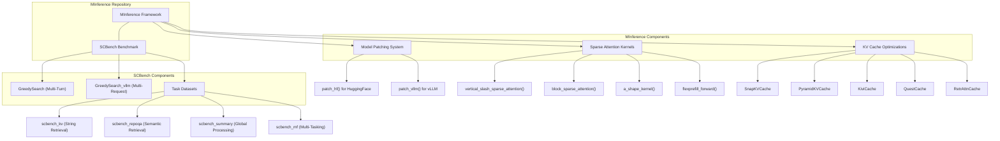
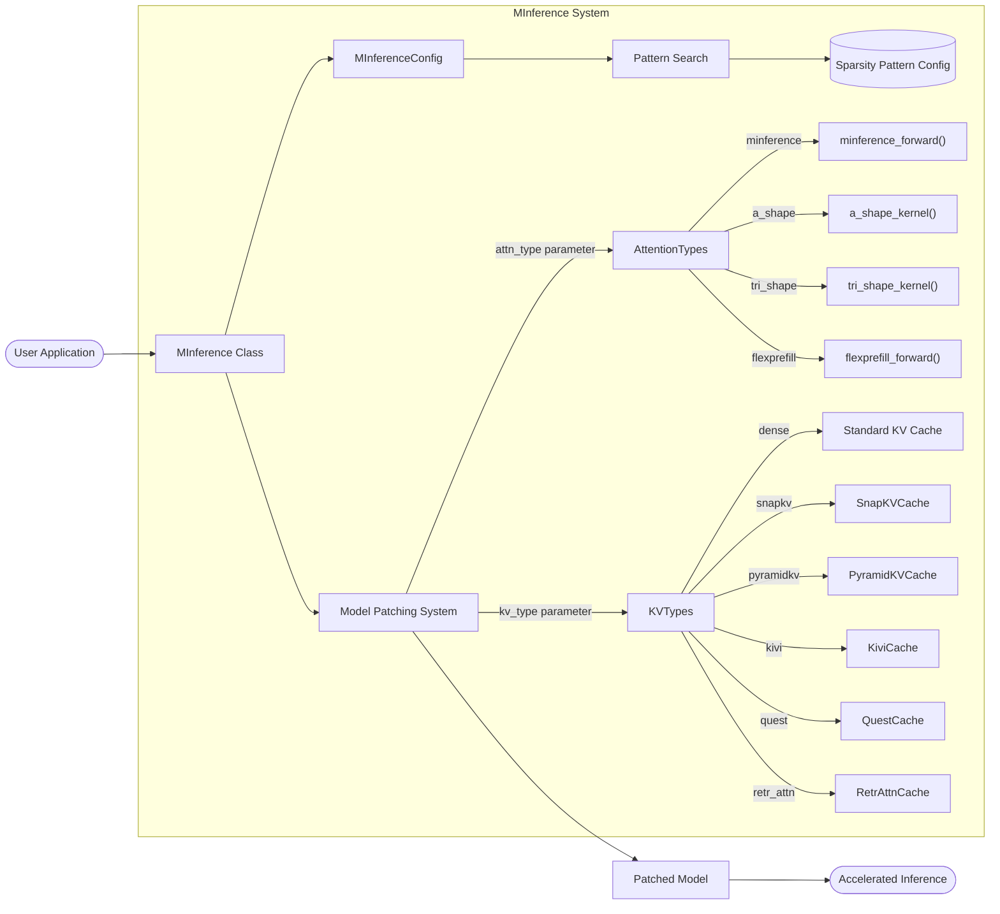
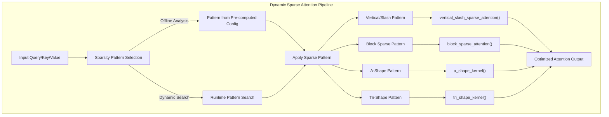
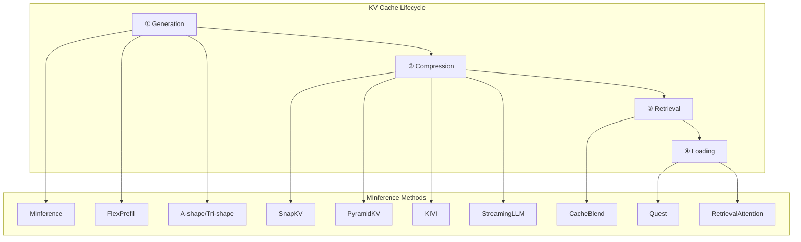
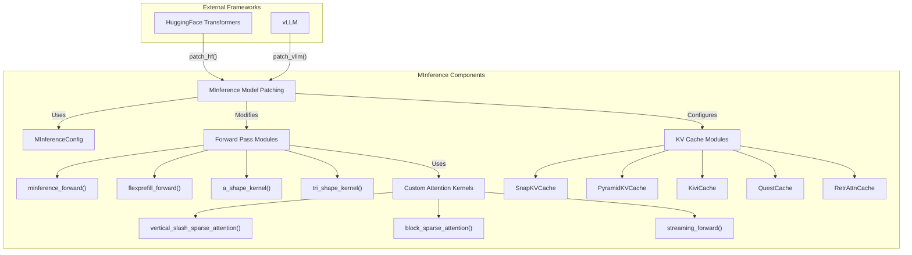

<!-- source: DeepWiki mcp.deepwiki.com · repo microsoft/MInference · page 1 Overview · fetched 2026-10-26 -->

# Overview

Relevant source files

The following files were used as context for generating this wiki page:

- [README.md](README.md)
- [minference/version.py](minference/version.py)

This document provides a comprehensive introduction to the MInference repository, which contains two primary components designed to accelerate and evaluate large language models (LLMs) with long contexts.

## Purpose and Scope

MInference is a framework that significantly accelerates inference for large language models, particularly when processing long contexts (up to 1 million tokens). It achieves this through dynamic sparse attention patterns and KV cache optimization techniques. This overview explains the system architecture, key components, and how they interact to provide up to 10x faster processing while maintaining accuracy.

For more detailed information about usage examples, see [Usage Examples](#6). For instructions on contributing to the project, see [Contributing and Development](#7).

## System Architecture

The MInference repository consists of two main components: the MInference framework (the acceleration system) and SCBench (the evaluation benchmark).

### High-Level Architecture

Sources: [README.md:40-55]()

## MInference Framework

The core of the repository is the MInference framework, which leverages dynamic sparse attention patterns to accelerate LLM inference. The framework identifies that attention in LLMs naturally exhibits sparse patterns and exploits this characteristic to reduce computation while maintaining model accuracy.

### MInference Workflow

Sources: [README.md:110-168]()

The workflow diagram illustrates how MInference integrates with existing models:

1. Users initialize MInference with specific attention and KV cache types
2. MInference patches the model architecture with the optimized modules
3. The patched model performs accelerated inference with the selected optimizations

### Dynamic Sparse Attention Mechanism

Sources: [README.md:80-87]()

MInference's primary innovation is its approach to sparse attention:

1. **Offline Analysis**: Pre-determines which sparse pattern each attention head belongs to
2. **Dynamic Computation**: Approximates sparse indices at runtime
3. **Optimized Kernels**: Uses custom kernels for each pattern type to maximize efficiency

## KV Cache Lifecycle

A key concept in MInference is the KV cache lifecycle, which consists of four stages:

Sources: [README.md:80-87]()

MInference provides optimizations for each stage:

1. **Generation**: Creating KV cache during initial processing (using dynamic sparse attention)
2. **Compression**: Reducing the size of KV cache for efficiency
3. **Retrieval**: Selecting relevant KV cache entries
4. **Loading**: Utilizing retrieved KV cache for inference

## SCBench Benchmark Suite

SCBench (SharedContextBench) is a benchmark suite specifically designed to evaluate long-context methods from a KV cache-centric perspective. It provides a comprehensive framework for assessing the performance of different optimization techniques.

### Evaluation Modes

SCBench implements two primary evaluation modes:

1. **Multi-Turn Mode**: Simulates conversations where context builds up over multiple interactions
2. **Multi-Request Mode**: Evaluates handling of shared context across multiple separate requests

### Task Categories

SCBench includes tasks across four categories of long-context capabilities:

| Category | Description | Example Dataset |
|----------|-------------|-----------------|
| String Retrieval | Finding exact matches in long contexts | scbench_kv |
| Semantic Retrieval | Finding conceptually related information | scbench_repoqa |
| Global Processing | Understanding information across the entire context | scbench_summary |
| Multi-Tasking | Handling multiple tasks with the same context | scbench_mf |

Sources: [README.md:191-217]()

## Supported Features

### Supported Models

MInference supports a wide range of LLMs, including:

| Model Family | Supported Variants |
|--------------|-------------------|
| Qwen2.5 | 7B, 32B, 72B, and 1M versions |
| LLaMA-3.1 | 8B, 70B |
| LLaMA-3 | 8B, 70B with various context lengths |
| GLM-4 | 9B with 1M context |
| Yi | 9B with 200K context |
| Phi-3 | mini with 128K context |
| Qwen2 | 7B |

Sources: [README.md:101-109]()

### Efficient Methods

MInference supports various efficient methods categorized by KV cache lifecycle stage:

| Lifecycle Stage | Supported Methods |
|-----------------|-------------------|
| KV Cache Generation | MInference, FlexPrefill, A-shape, Tri-shape, MInference w/ static, Dilated, Strided |
| KV Cache Compression | StreamingLLM, SnapKV, PyramidKV, KIVI |
| KV Cache Retrieval | CacheBlend |
| KV Cache Loading | Quest, RetrievalAttention |

Sources: [README.md:80-87]()

## Integration Architecture

Sources: [README.md:110-168]()

This diagram illustrates how MInference integrates with external LLM frameworks:

1. MInference provides patching methods for both HuggingFace and vLLM frameworks
2. The patching system modifies the model's forward pass and KV cache implementations
3. Custom attention kernels provide the core optimization functionality

## Current Version

MInference is currently at version 0.1.6 as indicated in the version file.

Sources: [minference/version.py:4-14]()

---

