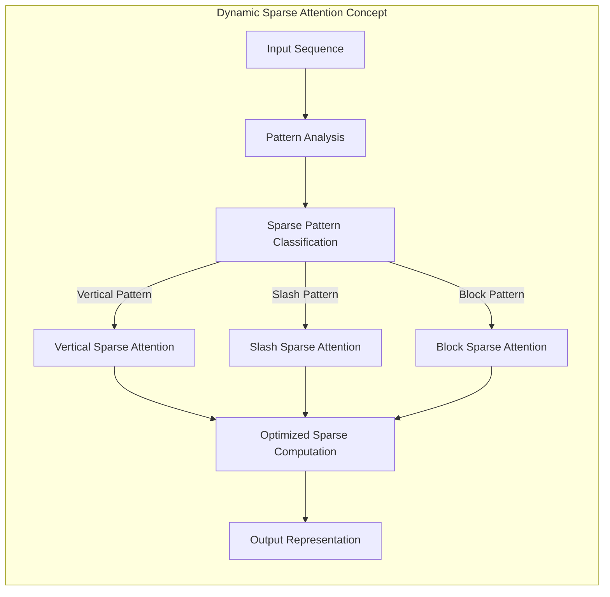
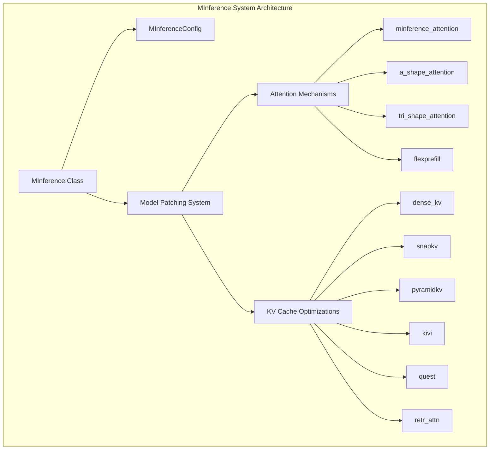
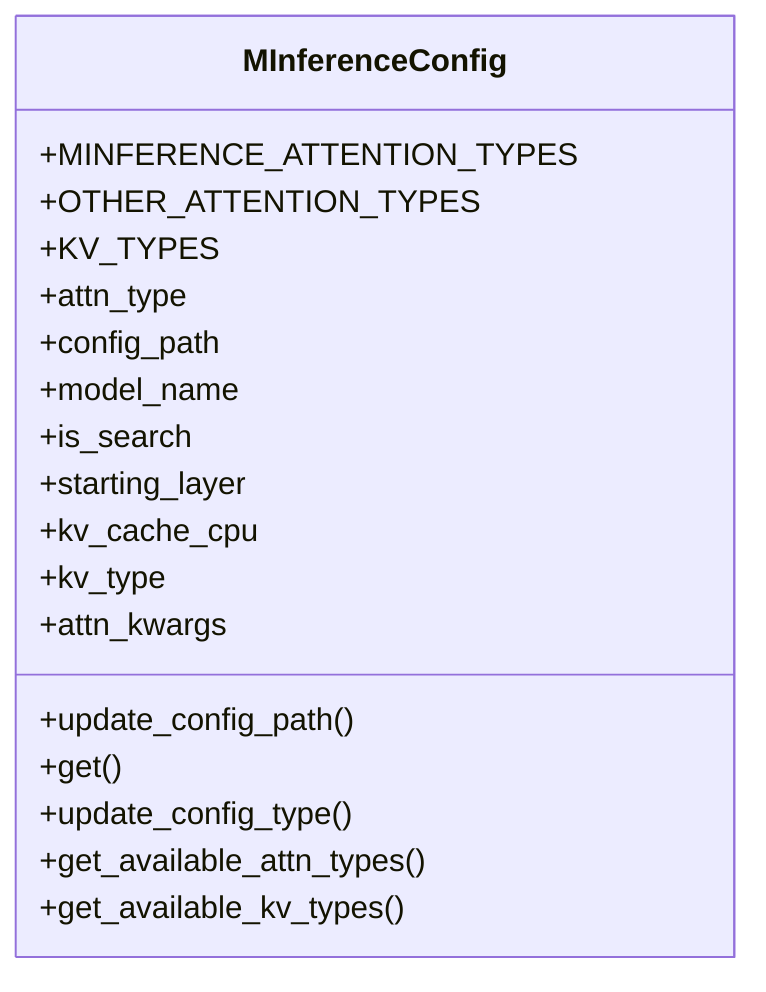
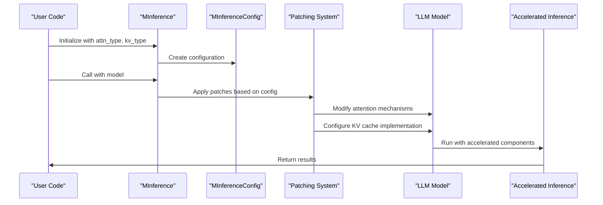
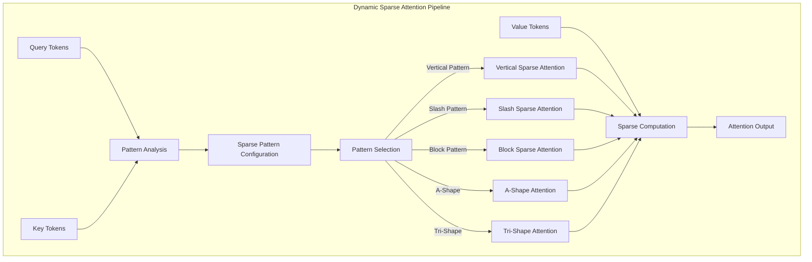

<!-- source: DeepWiki mcp.deepwiki.com · repo microsoft/MInference · page 1.1 MInference Introduction · fetched 2026-10-26 -->

# MInference Introduction

<details>
<summary>Relevant source files</summary>

The following files were used as context for generating this wiki page:

- [README.md](README.md)
- [minference/minference_configuration.py](minference/minference_configuration.py)
- [minference/models_patch.py](minference/models_patch.py)
- [minference/version.py](minference/version.py)

</details>


## Purpose and Scope

This document provides a comprehensive introduction to MInference, an acceleration framework designed specifically for long-context LLMs (Large Language Models). MInference enables efficient processing of very long contexts (up to 1 million tokens) through dynamic sparse attention and KV cache optimization techniques. This page focuses on the core concepts, architecture, and functionality of MInference itself. For information about SCBench, the companion benchmark suite, see [SCBench Introduction](#1.2).

## What is MInference?

MInference is a framework that leverages the dynamic sparse nature of attention in LLMs to significantly accelerate inference, particularly during the pre-filling phase when processing long contexts. It can process 1 million tokens approximately 10x faster on a single A100 GPU while maintaining or even improving model accuracy.

The core insight behind MInference is that attention in LLMs naturally exhibits sparse patterns - not all tokens need to attend to all other tokens. By identifying and exploiting these patterns, MInference can dramatically reduce computation without sacrificing model performance.

Sources: [README.md:7-18]()

## Core Concepts

MInference operates on two key observations:

1. **Dynamic Sparse Attention**: Attention in LLMs is naturally sparse - different attention heads exhibit distinct sparse patterns.
2. **Pattern-Based Optimization**: These sparse patterns can be identified offline and then used to accelerate inference dynamically.

MInference first analyzes model attention heads offline to categorize them into different pattern types (vertical, slash, block, etc.), then applies optimized computational kernels for each pattern during inference.



Sources: [README.md:40-43]()

## MInference Architecture

MInference provides a patching system that modifies existing LLM implementations to use sparse attention and optimized KV cache techniques.



Sources: [minference/models_patch.py:13-176](), [minference/minference_configuration.py:9-101]()

### MInferenceConfig

The `MInferenceConfig` class manages configuration settings for MInference including:

- `attn_type`: Specifies the attention mechanism to use
- `kv_type`: Specifies the KV cache implementation to use
- `model_name`: Target model identifier
- `config_path`: Path to configuration file with sparse pattern information
- Additional parameters for specific mechanisms



Sources: [minference/minference_configuration.py:9-101]()

## Key Components

### Attention Types

MInference supports multiple attention types:

1. **minference**: The primary dynamic sparse attention implementation
2. **a_shape**: A-shape attention pattern combining local and global attention
3. **tri_shape**: Tri-shape attention pattern (three-part attention)
4. **flexprefill**: Flexible prefill mechanism that optimizes token budget
5. **static**: Static sparse pattern version of minference
6. **dilated**: Dilated attention patterns

Sources: [minference/minference_configuration.py:10-30]()

### KV Cache Types

MInference offers several KV cache implementations:

1. **dense**: Standard dense KV cache
2. **streamingllm**: StreamingLLM's window-based KV cache
3. **snapkv**: SnapKV compression technique
4. **pyramidkv**: Pyramid compression technique
5. **quest**: Quest attention for KV cache optimization
6. **retr_attn**: Retrieval-augmented attention
7. **kivi**: KIVI quantization technique

Sources: [minference/minference_configuration.py:31-39]()

## Workflow

MInference follows a straightforward workflow for accelerating LLM inference:



Sources: [minference/models_patch.py:13-176]()

## The MInference Class

The main entry point for using MInference is the `MInference` class, which is responsible for:

1. Initializing the configuration based on provided parameters
2. Applying the appropriate patches to the target model
3. Configuring attention mechanisms and KV cache implementations

```python
# Example initialization
minference_patch = MInference(
    attn_type="minference",  # Attention mechanism
    model_name="meta-llama/Meta-Llama-3.1-8B-Instruct",  # Target model
    kv_type="snapkv"  # KV cache implementation
)
model = minference_patch(model)  # Apply patches to model
```

Sources: [minference/models_patch.py:13-176](), [README.md:120-122]()

## Supported Models

MInference supports a wide range of long-context LLMs including:

- LLaMA-3 and LLaMA-3.1 (8B, 70B)
- Qwen2 and Qwen2.5 (7B, 14B, 32B, 72B)
- GLM-4 (9B)
- Yi (9B)
- Phi-3 (mini-128k)

A complete list of supported models can be obtained programmatically:

```python
from minference import get_support_models
supported_models = get_support_models()
```

Sources: [README.md:101-109]()

## Dynamic Sparse Attention Mechanism

The core innovation of MInference is its dynamic sparse attention mechanism:



The process involves:
1. Determining sparse patterns for each attention head (offline)
2. Applying custom kernels optimized for each pattern type
3. Dynamically computing attention only for relevant token pairs

Sources: [README.md:40-43]()

## Integration with MInference

MInference can be integrated with models from Hugging Face Transformers and vLLM:

### Hugging Face Integration

```python
from transformers import pipeline
from minference import MInference

# Initialize pipeline with model
pipe = pipeline("text-generation", model=model_name, torch_dtype="auto", device_map="auto")

# Patch with MInference
minference_patch = MInference("minference", model_name)
pipe.model = minference_patch(pipe.model)

# Generate text with accelerated inference
pipe(prompt, max_length=10)
```

### vLLM Integration

```python
from vllm import LLM, SamplingParams
from minference import MInference

# Initialize vLLM
llm = LLM(model_name, enforce_eager=True, max_model_len=128_000, enable_chunked_prefill=False)

# Patch with MInference
minference_patch = MInference("vllm", model_name)
llm = minference_patch(llm)

# Generate text with accelerated inference
outputs = llm.generate(prompts, sampling_params)
```

Sources: [README.md:113-168]()

## Performance and Benefits

MInference delivers significant performance improvements:
- Up to 10x faster pre-filling on an A100 GPU
- Ability to process contexts up to 1 million tokens in length
- Maintained or improved accuracy compared to dense attention
- Reduced memory usage through optimized KV cache techniques

Sources: [README.md:18-40]()

## Conclusion

MInference provides a powerful framework for accelerating long-context LLM inference through dynamic sparse attention and KV cache optimizations. By leveraging the inherent sparsity in attention mechanisms, it enables efficient processing of very long contexts while maintaining model quality.

The following pages provide more detailed information about specific components:
- [Model Patching System](#2.1) - Details on how MInference patches existing model architectures
- [Sparse Attention Mechanisms](#2.2) - Documentation of various sparse attention mechanisms
- [KV Cache Optimizations](#3) - Overview of KV cache optimization techniques

---

