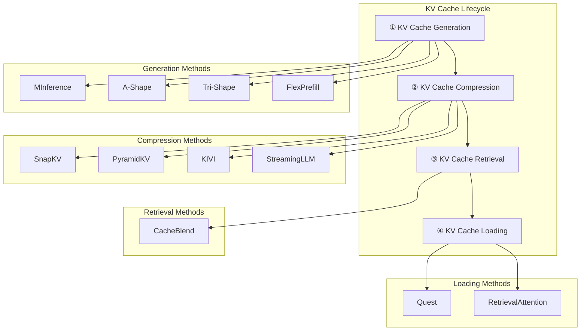
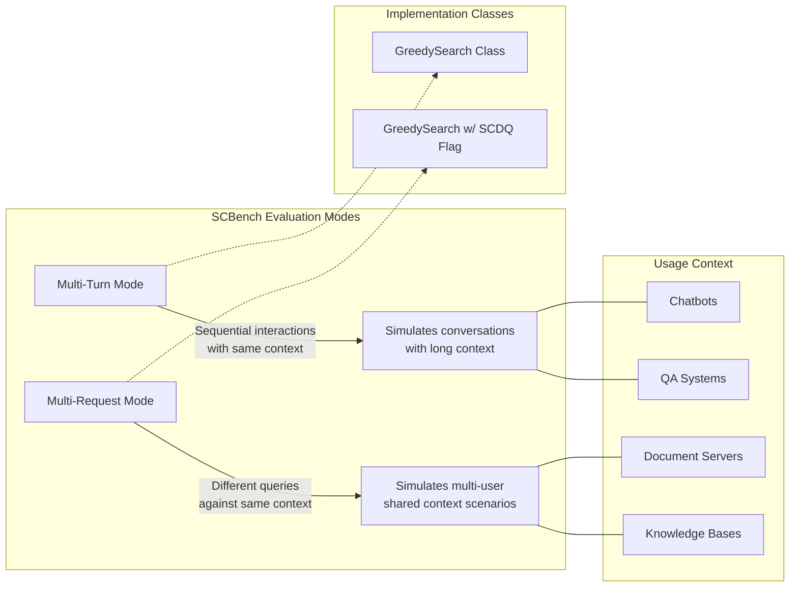

<!-- source: DeepWiki mcp.deepwiki.com · repo microsoft/MInference · page 1.2 SCBench Introduction · fetched 2026-10-26 -->

# SCBench Introduction

<details>
<summary>Relevant source files</summary>

The following files were used as context for generating this wiki page:

- [README.md](README.md)
- [images/SCBench_onepage.png](images/SCBench_onepage.png)
- [minference/version.py](minference/version.py)
- [scbench/readme.md](scbench/readme.md)

</details>


## Purpose and Scope

SCBench (SharedContextBench) is a comprehensive benchmark suite designed to evaluate long-context methods for large language models (LLMs) from a KV (key-value) cache-centric perspective. It specifically targets the assessment of various optimization techniques across the full KV cache lifecycle: generation, compression, retrieval, and loading. This document introduces SCBench, its architecture, evaluation methodology, and key components. For an introduction to MInference, which provides the optimization techniques that SCBench evaluates, see [MInference Introduction](#1.1).

Sources: [README.md:12-14](), [README.md:45-47](), [scbench/readme.md:1-9]()

## KV Cache Lifecycle Evaluation Framework

SCBench uniquely evaluates methods from a KV cache-centric perspective, analyzing the full lifecycle of KV caches in long-context LLM processing. This approach provides a more comprehensive assessment than traditional benchmarks that focus only on accuracy metrics.



Sources: [README.md:80-85](), [scbench/readme.md:118-123]()

## Evaluation Modes

SCBench evaluates long-context methods in two distinct operational modes to comprehensively assess their performance in different usage scenarios.



Sources: [scbench/readme.md:145-148](), [README.md:38-39]()

## Task Categories

SCBench includes 12 diverse tasks across four categories, each designed to evaluate specific long-context capabilities of LLMs.

| Category | Description | Tasks | Capability Tested |
|----------|-------------|-------|-------------------|
| **String Retrieval** | Tests ability to find exact strings in long contexts | `scbench_kv`, `scbench_prefix_suffix`, `scbench_vt` | Direct string retrieval, pattern matching |
| **Semantic Retrieval** | Tests understanding and retrieval based on meaning | `scbench_repoqa`, `scbench_qa_eng`, `scbench_qa_chn`, `scbench_choice_eng` | Semantic comprehension, knowledge distillation |
| **Global Information Processing** | Tests analysis of entire documents | `scbench_many_shot`, `scbench_mf`, `scbench_summary` | Global context processing, statistical analysis |
| **Multi-Tasking** | Tests performing multiple tasks simultaneously | `scbench_summary_with_needles`, `scbench_repoqa_and_kv` | Task switching, complex reasoning |

Sources: [scbench/readme.md:118-144](), [README.md:198-205]()

## Data Structure and Format

SCBench uses a standardized data format across all tasks to ensure consistency and ease of integration.

```mermaid
classDiagram
    class "SCBenchDataPoint" {
        +string id
        +string context
        +array multi_turns
    }
    
    class "MultiTurn" {
        +string input
        +string answer
    }
    
    "SCBenchDataPoint" "1" --> "*" "MultiTurn"
```

Each data point in SCBench contains:
- A unique identifier
- A long context (repository code, documents, many-shot examples, etc.)
- A series of multi-turn interactions with input questions and reference answers

Sources: [scbench/readme.md:25-35](), [README.md:208-217]()

## System Integration

SCBench is designed to work with multiple frameworks and evaluation methodologies, with particular optimization for the MInference framework.

```mermaid
flowchart TD
    subgraph "External Frameworks"
        HF["HuggingFace Transformers"]
        VLLM["vLLM"]
    end
    
    subgraph "SCBench Components"
        Data["SCBench Datasets\n(HF Datasets Format)"]
        Eval["Evaluation Utilities"]
        Tasks["12 Task Categories"]
        
        Eval --> HFEval["GreedySearch Class"]
        Eval --> VLLMEval["GreedySearch_vllm Class"]
        
        Tasks --> StringR["String Retrieval Tasks"]
        Tasks --> SemanticR["Semantic Retrieval Tasks"]
        Tasks --> GlobalP["Global Processing Tasks"]
        Tasks --> MultiT["Multi-Tasking Tasks"]
    end
    
    subgraph "MInference Methods"
        AttnTypes["Attention Types"]
        KVTypes["KV Cache Types"]
        
        AttnTypes --> MATTN["minference"]
        AttnTypes --> AATTN["a_shape"]
        AttnTypes --> TATTN["tri_shape"]
        
        KVTypes --> DKVCACHE["dense"]
        KVTypes --> SNKVCACHE["snapkv"]
        KVTypes --> PYKVCACHE["pyramidkv"]
        KVTypes --> KIVIKVCACHE["kivi"]
        KVTypes --> QUESTKVCACHE["quest"]
    end
    
    Data --> Tasks
    HF --> HFEval
    VLLM --> VLLMEval
    HFEval --> Results["Benchmark Results"]
    VLLMEval --> Results
    AttnTypes --> HFEval
    KVTypes --> HFEval
    AttnTypes --> VLLMEval
    KVTypes --> VLLMEval
```



Sources: [scbench/readme.md:38-63](), [README.md:221-243]()

## Using SCBench

SCBench data can be loaded using the Hugging Face datasets library and evaluated using the provided utilities.

To load SCBench data:

```python
from datasets import load_dataset

datasets = [
    "scbench_kv", "scbench_prefix_suffix", "scbench_vt", 
    "scbench_repoqa", "scbench_qa_eng", "scbench_qa_chn", 
    "scbench_choice_eng", "scbench_many_shot", "scbench_summary", 
    "scbench_mf", "scbench_summary_with_needles", "scbench_repoqa_and_kv"
]

for dataset in datasets:
    data = load_dataset("microsoft/SCBench", dataset, split="test")
```

The benchmark supports various evaluation configurations:

| Configuration | Description |
|---------------|-------------|
| `--max_seq_length` | Maximum sequence length for the test |
| `--max_turns` | Maximum number of turns for the test |
| `--num_eval_examples` | Number of test examples to use |
| `--attn_type` | Attention type to use (e.g., `dense`, `minference`, `a_shape`, `tri_shape`) |
| `--kv_type` | KV cache type to use (e.g., `dense`, `kivi`, `snapkv`, `quest`, `pyramidkv`) |
| `--same_context_different_query` | Enable Multi-Request Mode evaluation |

Sources: [scbench/readme.md:14-23](), [scbench/readme.md:67-91](), [scbench/readme.md:98-115]()

## Configuring Efficient Long-Context Methods

SCBench allows detailed configuration of various long-context methods to evaluate their performance:

| Method Type | Available Options | Key Parameters |
|-------------|-------------------|----------------|
| Attention Types | `dense`, `minference`, `a_shape`, `tri_shape` | `n_local`, `n_init`, `n_last`, pattern config |
| KV Cache Types | `dense`, `kivi`, `snapkv`, `pyramidkv`, `quest`, `streamingllm` | `bits`, `group_size`, `window_size`, `chunk_size` |

Custom hyperparameters can be specified through the `--hyper_param` argument:

```
python run_multiturnbench.py ... --hyper_param '{"n_local": 4096}'
```

Sources: [scbench/readme.md:173-214]()

## Comparison with Other Benchmarks

SCBench differentiates itself from previous long-context benchmarks by offering:

1. Comprehensive evaluation across single-turn, multi-turn, and multi-request scenarios
2. Focus on the full KV cache lifecycle (generation, compression, retrieval, loading)
3. KV cache reuse techniques evaluation
4. Standardized data format and evaluation methodology

While other benchmarks may focus on accuracy or specialized tasks, SCBench provides a more holistic assessment framework for evaluating efficient long-context methods from a KV cache-centric perspective.

Sources: [scbench/readme.md:218-221]()

---

