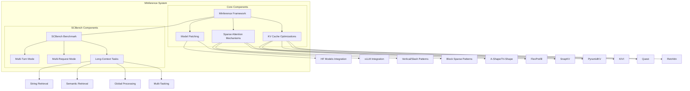
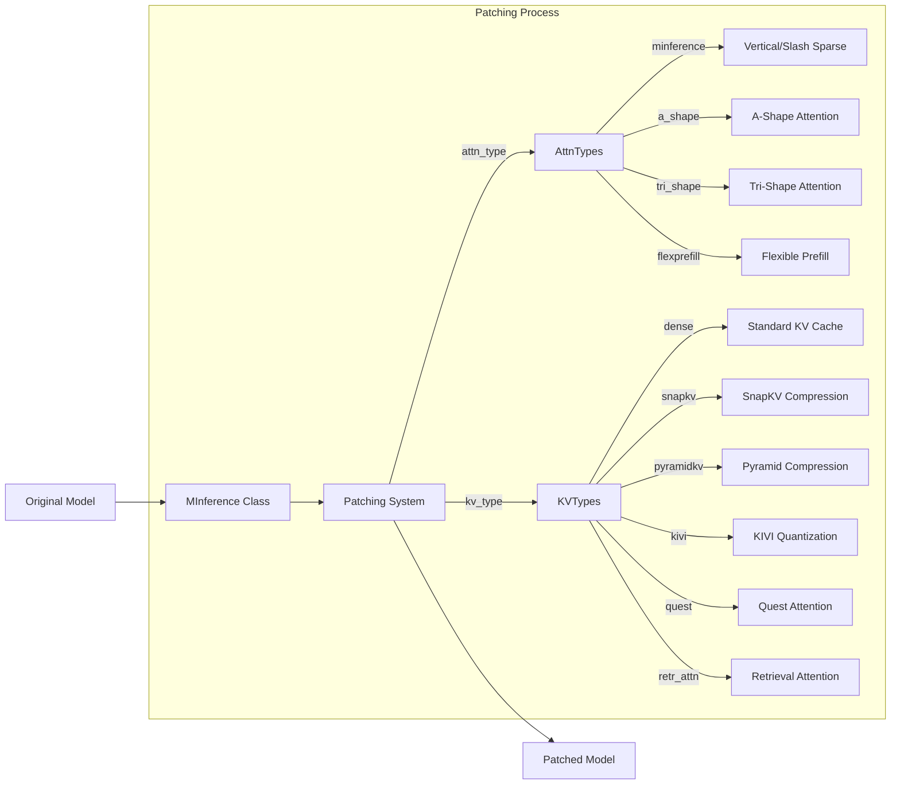
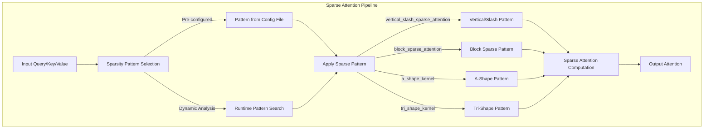
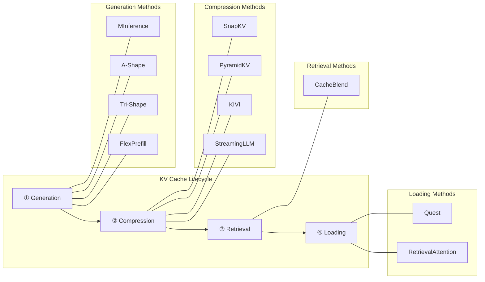
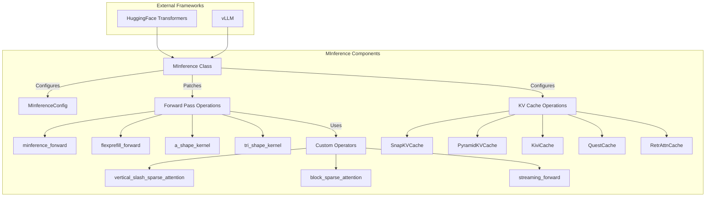
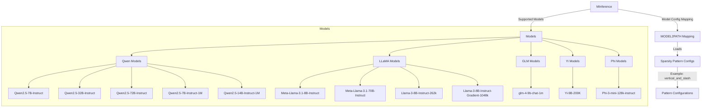
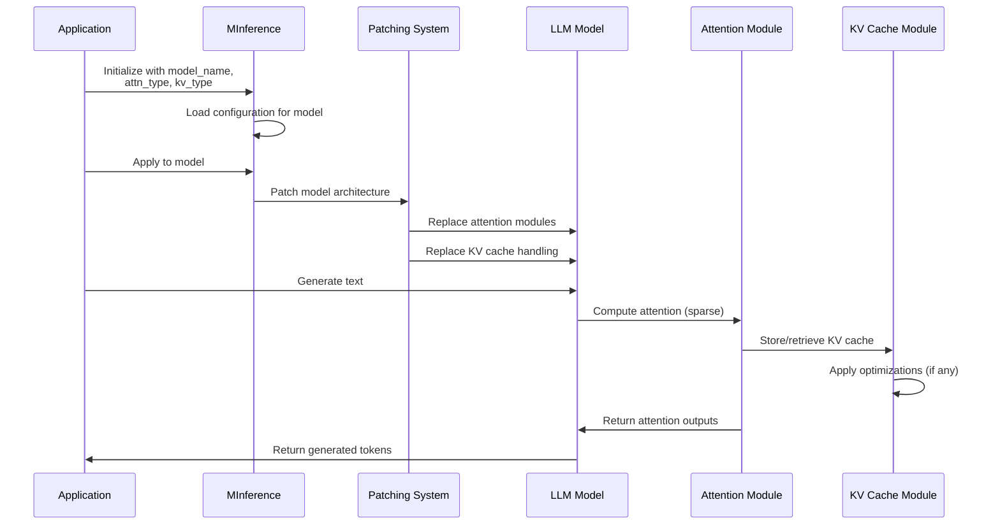
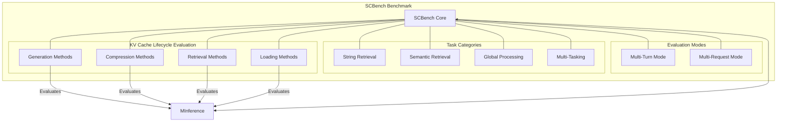

<!-- source: DeepWiki mcp.deepwiki.com · repo microsoft/MInference · page 1.3 System Architecture · fetched 2026-10-26 -->

# System Architecture

<details>
<summary>Relevant source files</summary>

The following files were used as context for generating this wiki page:

- [README.md](README.md)
- [minference/__init__.py](minference/__init__.py)
- [minference/configs/Qwen2.5_14B_Instruct_1M.json](minference/configs/Qwen2.5_14B_Instruct_1M.json)
- [minference/configs/Qwen2.5_7B_Instruct_128k_instruct_kv_out_v32_fit_o_best_pattern.json](minference/configs/Qwen2.5_7B_Instruct_128k_instruct_kv_out_v32_fit_o_best_pattern.json)
- [minference/configs/Qwen2.5_7B_Instruct_1M.json](minference/configs/Qwen2.5_7B_Instruct_1M.json)
- [minference/configs/model2path.py](minference/configs/model2path.py)
- [minference/version.py](minference/version.py)

</details>


This document provides a comprehensive overview of the MInference system architecture, explaining how its components interact to accelerate inference for large language models (LLMs) with long contexts. It focuses on the structural design and relationships between core components, explaining how dynamic sparse attention and KV cache optimizations are implemented. For specific details about MInference's capabilities, see [MInference Introduction](#1.1), and for information about the SCBench benchmark suite, see [SCBench Introduction](#1.2).

## 1. High-Level Architecture Overview

MInference is structured around two primary components: the core acceleration framework (MInference) and the evaluation benchmark suite (SCBench). The system is designed to optimize LLM inference through dynamic sparse attention and various KV cache optimizations.



Sources: [README.md:1-326]()

## 2. System Core Components

MInference consists of three primary core components that work together to accelerate LLM inference:

### 2.1 Configuration System

The `MInferenceConfig` class serves as the central configuration hub, managing settings for sparse attention patterns and KV cache optimizations. It provides available attention types and KV cache types through static methods.

```mermaid
classDiagram
    class MInferenceConfig {
        +get_available_attn_types()
        +get_available_kv_types()
        -model2path mapping
        -config handling
    }
    
    MInferenceConfig --> "ModelConfigMap" : uses
    
    class ModelConfigMap {
        +MODEL2PATH
        +get_support_models()
        +check_path()
    }
```

Sources: [minference/configs/model2path.py:1-79](), [minference/__init__.py:1-32]()

### 2.2 Model Patching System

The patching system modifies existing model architectures to incorporate MInference's optimizations without requiring model retraining. It works with both HuggingFace Transformers and vLLM.



Sources: [README.md:110-168]()

### 2.3 Sparse Attention Mechanisms

MInference implements multiple sparse attention mechanisms to optimize LLM inference. These include:

1. **Vertical/Slash Sparse Attention**: Focuses on specific tokens (vertical) and nearby context (slash)
2. **Block Sparse Attention**: Groups tokens into dense blocks for efficient computation
3. **A-Shape Attention**: Combines local and global attention patterns
4. **Tri-Shape Attention**: Three-part attention pattern for different token relationships
5. **FlexPrefill**: Flexible prefill mechanism for optimized token processing



Sources: [minference/__init__.py:9-11](), [README.md:72-82]()

### 2.4 KV Cache Optimizations

MInference implements several KV cache optimization techniques to improve memory efficiency and performance:

1. **SnapKV**: Compresses the KV cache through selective token retention
2. **PyramidKV**: Hierarchical compression of KV cache
3. **KIVI**: Quantization-based KV cache optimization
4. **Quest**: Query-based selective token caching
5. **RetrievalAttention**: Vector retrieval augmented attention



Sources: [README.md:80-87]()

## 3. System Integration Architecture

MInference is designed to integrate with existing LLM frameworks, primarily HuggingFace Transformers and vLLM, through a patching mechanism.



Sources: [minference/__init__.py:7-18](), [README.md:110-168]()

## 4. Models and Compatibility

MInference supports a wide range of LLMs. Each model has a preconfigured sparse attention pattern configuration stored in JSON files.

### 4.1 Supported Model Architecture



The model configuration mapping system loads pre-determined optimal sparsity patterns for each supported model from configuration files.

Sources: [minference/configs/model2path.py:7-65](), [minference/configs/Qwen2.5_7B_Instruct_1M.json:1-2](), [minference/configs/Qwen2.5_14B_Instruct_1M.json:1-2]()

## 5. Execution Workflow

The following diagram illustrates the execution workflow when using MInference to accelerate LLM inference.



### Integration Methods

MInference offers different integration methods:

#### 1. For Hugging Face models:

```python
from transformers import pipeline
from minference import MInference

pipe = pipeline("text-generation", model=model_name, torch_dtype="auto", device_map="auto")
minference_patch = MInference("minference", model_name)
pipe.model = minference_patch(pipe.model)
```

#### 2. For vLLM integration:

```python
from vllm import LLM, SamplingParams
from minference import MInference

llm = LLM(model_name, enforce_eager=True, max_model_len=128_000, enable_chunked_prefill=False)
minference_patch = MInference("vllm", model_name)
llm = minference_patch(llm)
```

Sources: [README.md:110-168]()

## 6. SCBench Integration

SCBench (SharedContextBench) is tightly integrated with MInference to evaluate long-context methods from a KV cache-centric perspective.



SCBench evaluates MInference across different stages of the KV cache lifecycle. It offers two evaluation modes:

1. **Multi-Turn Mode**: Simulates conversation-like interactions with long contexts
2. **Multi-Request Mode**: Evaluates shared context processing capabilities

Sources: [README.md:189-245]()

## 7. Performance and Scalability

MInference is designed to accelerate LLM inference significantly, particularly for models with long contexts. It provides up to 10x speedup for pre-filling operations on an A100 GPU while maintaining accuracy.

Key performance characteristics:

| Feature | Benefit |
|---------|---------|
| Dynamic Sparse Attention | Reduces computational complexity from O(n²) to O(n) |
| KV Cache Optimization | Reduces memory requirements for long sequences |
| Pattern Adaptation | Automatically selects optimal sparse patterns |
| Framework Integration | Works with existing models without retraining |

The system scales with model size and context length, providing greater relative speedups as context length increases.

Sources: [README.md:38-50]()

## 8. System Requirements and Dependencies

MInference has the following dependencies:

- PyTorch
- Transformers >= 4.46.0
- FlashAttention-2 (Optional)
- Triton

For SCBench, additional requirements include:
- datasets >= 2.15.0

Sources: [README.md:58-63](), [README.md:193-195]()

---

