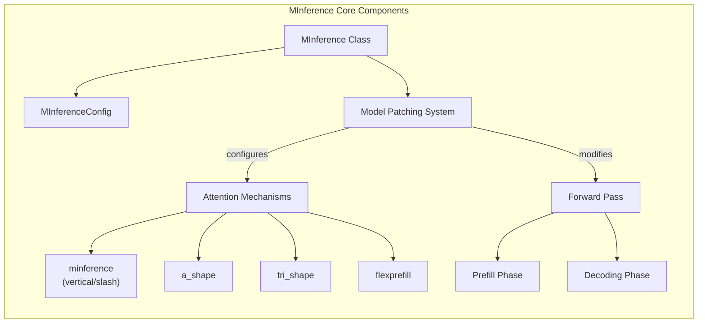
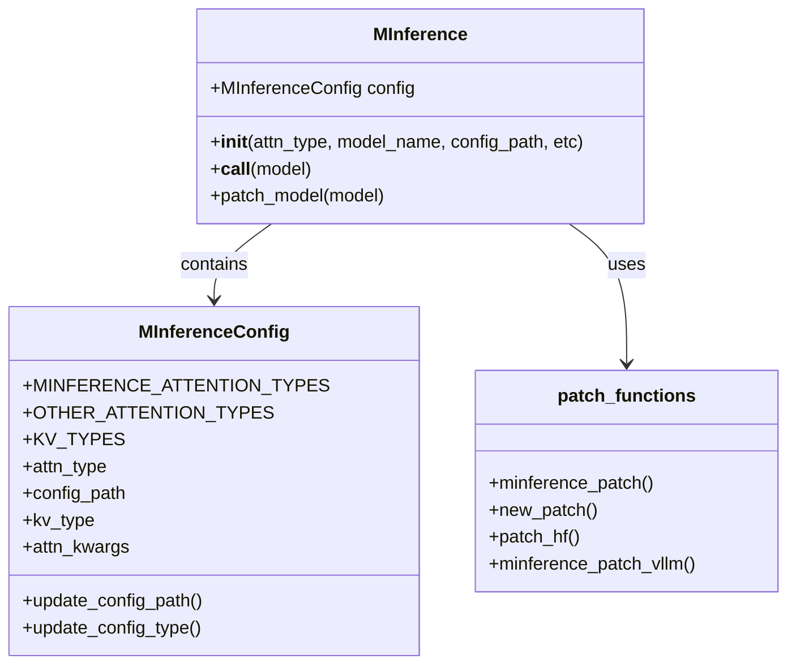
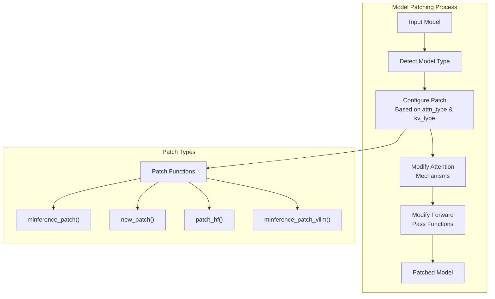
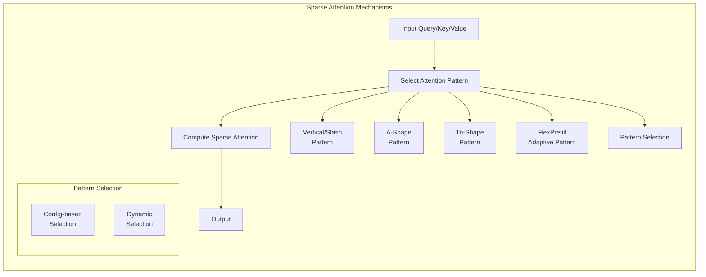
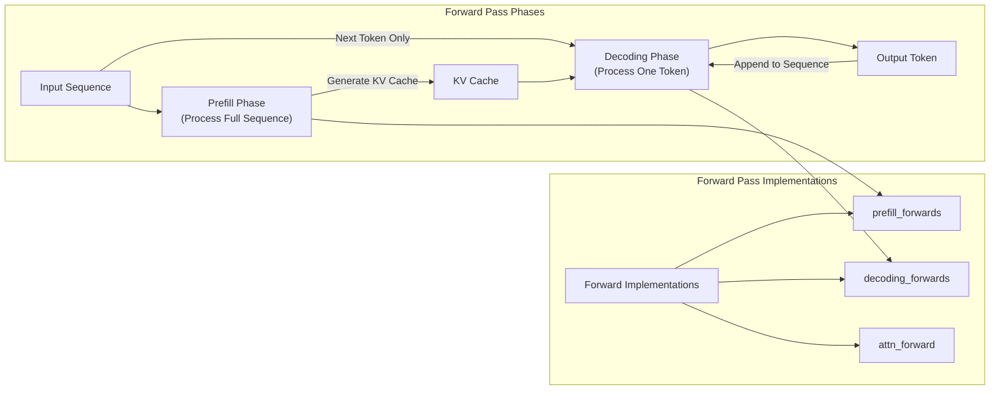
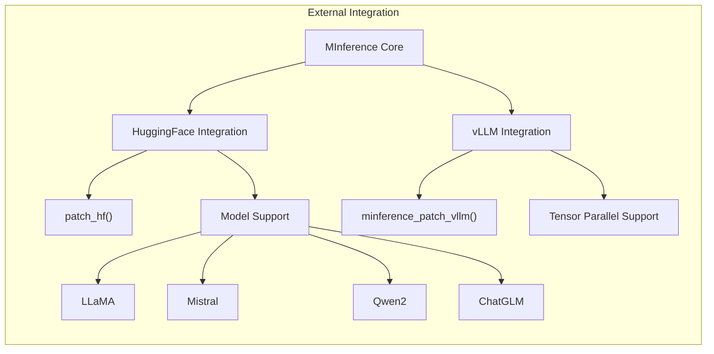

<!-- source: DeepWiki mcp.deepwiki.com · repo microsoft/MInference · page 2 MInference Core · fetched 2026-10-26 -->

# MInference Core

<details>
<summary>Relevant source files</summary>

The following files were used as context for generating this wiki page:

- [minference/minference_configuration.py](minference/minference_configuration.py)
- [minference/models_patch.py](minference/models_patch.py)
- [minference/patch.py](minference/patch.py)

</details>


## Overview

MInference Core provides the fundamental components and mechanisms for accelerating inference in large language models (LLMs), particularly when processing long contexts. It acts as the central hub of the MInference framework, handling model patching, sparse attention implementations, and forward pass optimizations that enable efficient processing of long sequences.

For information about KV Cache optimizations specifically, see [KV Cache Optimizations](#3).

Sources: [minference/models_patch.py:13-41](), [minference/minference_configuration.py:9-40]()



Sources: [minference/patch.py:25-39](), [minference/models_patch.py:13-40]()

## Core Architecture

MInference Core follows a modular design that allows for flexible configuration of different attention mechanisms and optimizations. The central entry point is the `MInference` class, which configures and applies patches to transform standard model architectures into more efficient versions.



Sources: [minference/models_patch.py:13-176](), [minference/minference_configuration.py:9-102]()

## Configuration System

The `MInferenceConfig` class defines the available configuration options for MInference. It validates and processes user-provided configuration to ensure that the selected attention mechanisms and KV cache types are supported.

### Supported Attention Types

| Category | Attention Types |
|----------|----------------|
| MInference | minference, vllm_minference |
| Other | hf, vllm, dense, static, dilated1, dilated2, a_shape, tri_shape, vllm_a_shape, vllm_tri_shape, inf_llm, flexprefill, vllm_flexprefill |

### Supported KV Cache Types

| KV Cache Types |
|----------------|
| dense |
| streamingllm |
| snapkv |
| pyramidkv |
| quest |
| retr_attn |
| kivi |

Sources: [minference/minference_configuration.py:10-39]()

## Model Patching System

The model patching system is responsible for modifying existing model architectures to incorporate MInference optimizations. It replaces standard attention mechanisms with optimized versions and adds necessary functionality for KV cache management.



Sources: [minference/patch.py:800-986](), [minference/models_patch.py:42-176]()

### Patching Process

1. The patching process begins with the `MInference.patch_model()` method, which determines the appropriate patching function based on the provided configuration.
2. Different patching functions are used depending on the model type and requested attention mechanism:
   - `minference_patch()`: Used for the original MInference sparse attention
   - `new_patch()`: Used for newer attention types like a_shape, tri_shape, flexprefill
   - `patch_hf()`: Used for patching HuggingFace models
   - `minference_patch_vllm()`: Used for patching vLLM models

Sources: [minference/patch.py:800-1040](), [minference/models_patch.py:42-176]()

### Modification Points

The patching system modifies several key components of the model:

1. **Attention Forward Method**: Replaces the standard attention computation with optimized versions
2. **Layer Forward Method**: Modifies how decoder layers process inputs
3. **Model Forward Method**: Updates the overall model forward pass
4. **Generation Preparation**: Modifies how inputs are prepared for generation
5. **Cache Handling**: Adds specialized KV cache management

Sources: [minference/patch.py:43-193](), [minference/patch.py:800-986]()

## Sparse Attention Mechanisms

MInference Core implements several sparse attention mechanisms to reduce the computational complexity of processing long sequences.



Sources: [minference/patch.py:209-214](), [minference/patch.py:25-39]()

### Minference (Vertical/Slash)

The core sparse attention mechanism in MInference combines vertical attention (which focuses on specific tokens throughout the sequence) with diagonal or "slash" attention (which captures local context).

Key implementation functions:
- `minference_forward()`: Implements the core sparse attention forward pass
- `gather_last_q_vertical_slash_topk_v4()`: Selects tokens for sparse attention

Sources: [minference/patch.py:31-37](), [minference/patch.py:910-922]()

### A-Shape Attention

A-Shape attention implements a pattern that combines global attention for initial tokens with local attention for recent tokens. This can be visualized as an "A" shape in the attention matrix.

The key implementation is in `stream_llm_forward()` which is specialized for this pattern.

Sources: [minference/patch.py:38](), [minference/models_patch.py:89-92]()

### Tri-Shape Attention

Tri-Shape attention extends A-Shape by adding a third component that focuses on the most recent tokens, creating a three-part attention pattern.

Key configuration parameters:
- `n_local`: Number of recent tokens to attend to
- `n_init`: Number of initial tokens to attend to
- `n_last`: Number of most recent tokens to attend to

Sources: [minference/models_patch.py:94-98]()

### FlexPrefill

FlexPrefill implements an adaptive attention mechanism that dynamically adjusts token budgets during the prefill phase based on sequence characteristics.

Key configuration parameters:
- `gamma`: Weighting parameter for token importance
- `tau`: Temperature parameter for token selection
- `block_size`: Size of token blocks for processing

Sources: [minference/models_patch.py:73-79](), [minference/patch.py:25]()

## Forward Pass Implementation

The forward pass implementation in MInference Core is divided into two main phases: prefill and decoding. Different optimizations are applied to each phase.



Sources: [minference/patch.py:25-26](), [minference/patch.py:858-869]()

### Prefill Phase

The prefill phase processes the entire input sequence and generates the initial key-value cache. In MInference, this phase benefits from:

1. **Sparse attention patterns** that reduce computational complexity
2. **Optimized processing** for different attention types (minference, a_shape, tri_shape, flexprefill)

The prefill implementations are configured via `prefill_forwards` dictionary that maps attention types to their specific implementations.

Sources: [minference/patch.py:25](), [minference/patch.py:858-869]()

### Decoding Phase

The decoding phase processes one token at a time using the previously generated KV cache. This phase benefits from:

1. **Efficient KV cache access** patterns
2. **Specialized forward functions** for different KV cache types

The decoding implementations are configured via `decoding_forwards` dictionary that maps KV cache types to their specific implementations.

Sources: [minference/patch.py:26](), [minference/patch.py:858-869]()

## Integration with External Systems

MInference Core provides integration with other frameworks like HuggingFace Transformers and vLLM through specialized patching functions.



Sources: [minference/patch.py:1288-1305](), [minference/patch.py:1308-1501]()

### HuggingFace Integration

MInference Core integrates with HuggingFace Transformers through the `patch_hf()` function, which supports:

- LlamaForCausalLM
- MistralForCausalLM
- Qwen2ForCausalLM
- ChatGLMForConditionalGeneration
- And other compatible models

The integration modifies the model's forward pass, attention mechanism, and generation process to incorporate MInference optimizations.

Sources: [minference/patch.py:1308-1501]()

### vLLM Integration

MInference Core integrates with vLLM through the `minference_patch_vllm()` function, which supports:

- Tensor parallel processing
- Custom attention implementations in the vLLM framework
- Support for A-Shape, Tri-Shape, and FlexPrefill attention patterns

The integration modifies the vLLM model executor to use MInference's optimized attention mechanisms.

Sources: [minference/patch.py:1043-1305]()

## Usage Example

To use MInference Core, you create an instance of the `MInference` class with the desired configuration and apply it to a model:

```python
from minference import MInference

# Create a MInference configuration
minference = MInference(
    attn_type="minference",         # Type of attention mechanism
    model_name="llama-7b",          # Model name for predefined configurations
    kv_type="dense",                # Type of KV cache
    attn_kwargs={                   # Additional attention-specific arguments
        "topk": 512                 # Number of tokens to select for sparse attention
    }
)

# Apply to a model
patched_model = minference(model)
```

Sources: [minference/models_patch.py:13-41]()

## Summary

MInference Core provides the foundation for accelerating inference in large language models through:

1. A flexible model patching system that modifies existing architectures
2. Multiple sparse attention mechanisms that reduce computational complexity
3. Optimized forward pass implementations for prefill and decoding phases
4. Integration with popular frameworks like HuggingFace and vLLM

These capabilities enable efficient processing of long sequences, making it possible to work with larger contexts while maintaining reasonable computational requirements.

---

