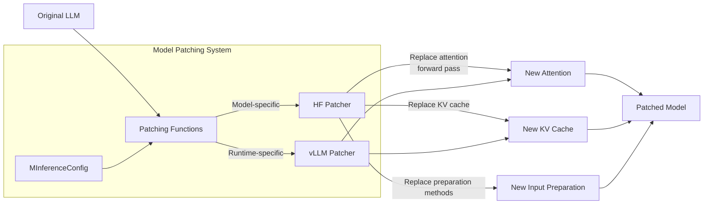
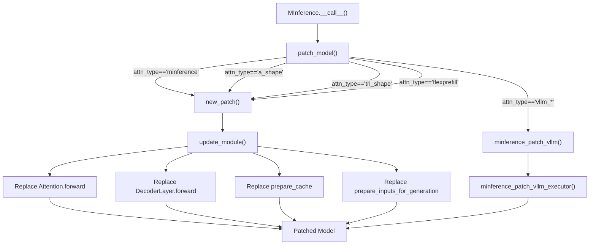
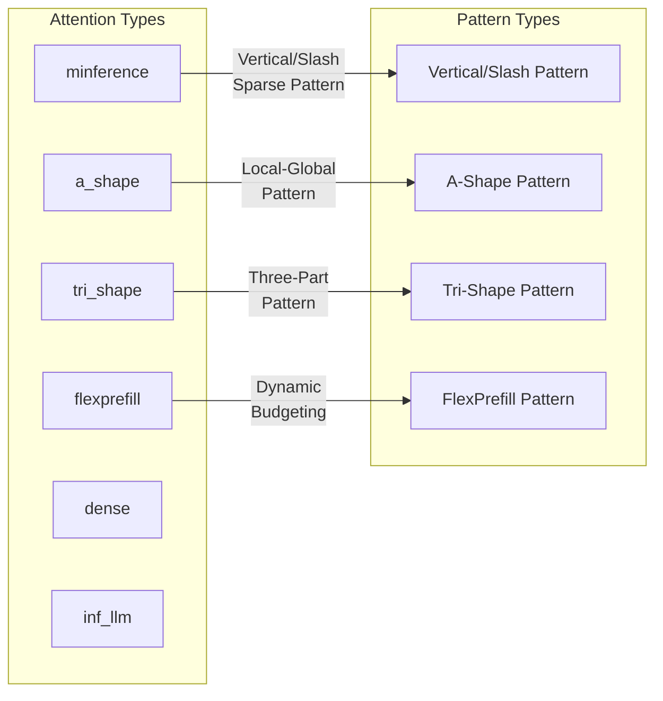
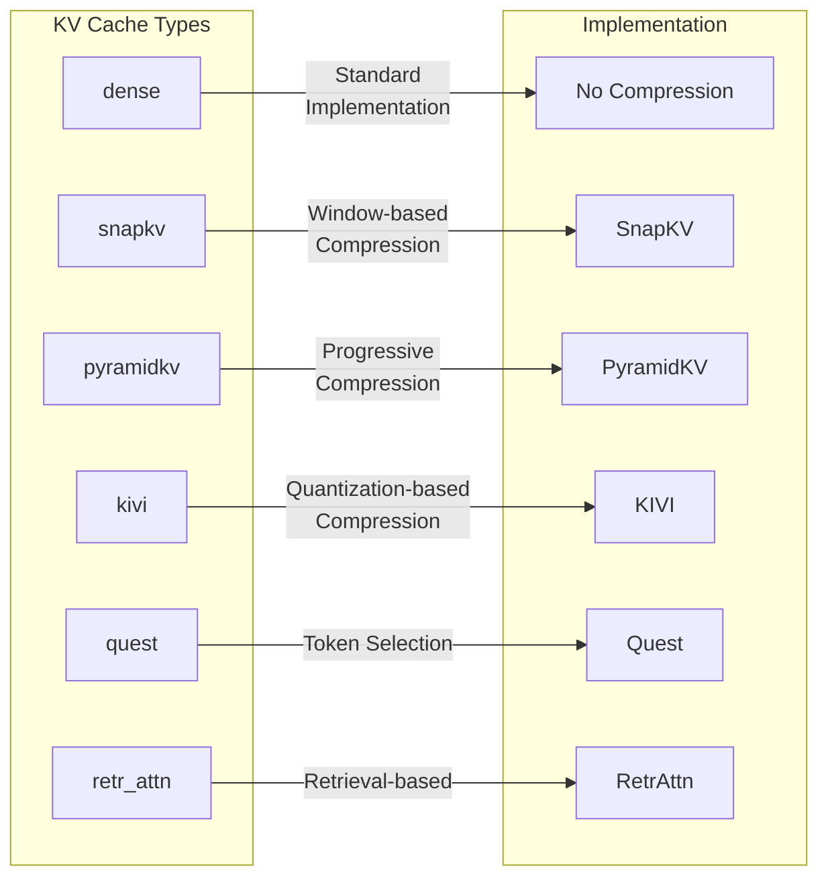
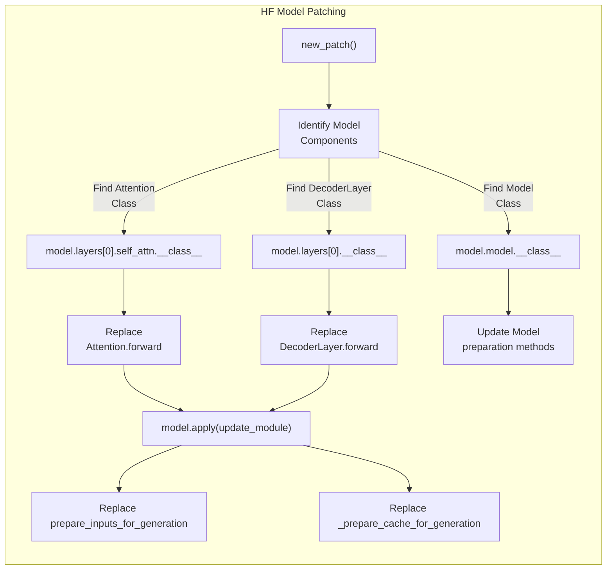
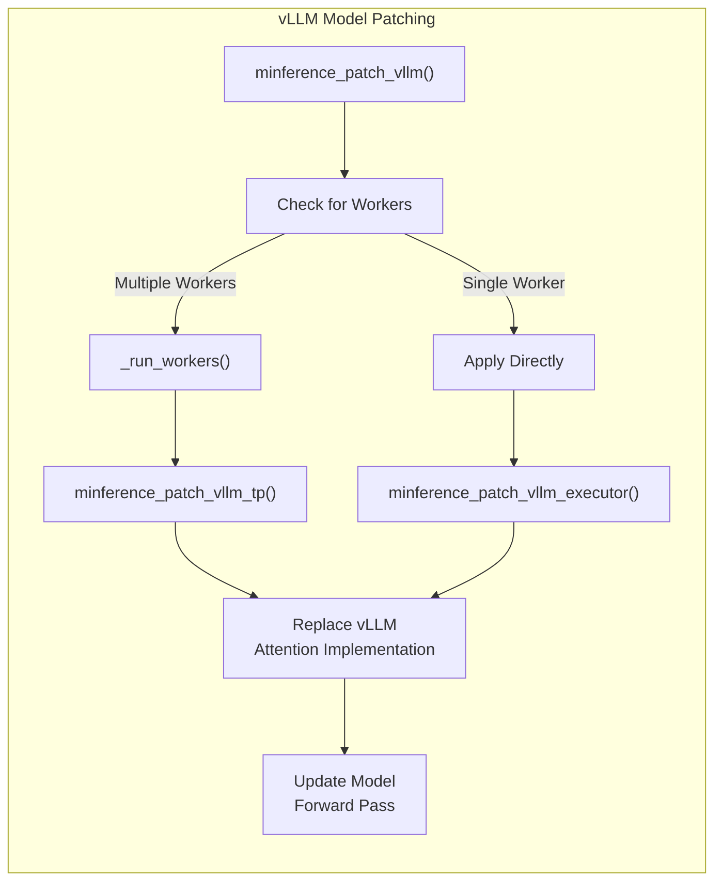
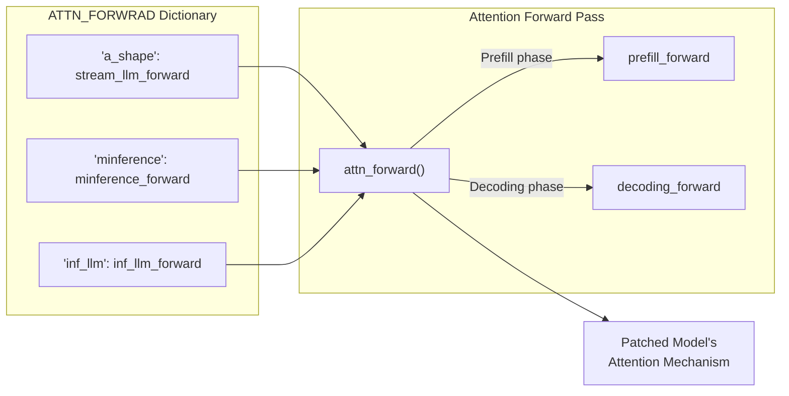
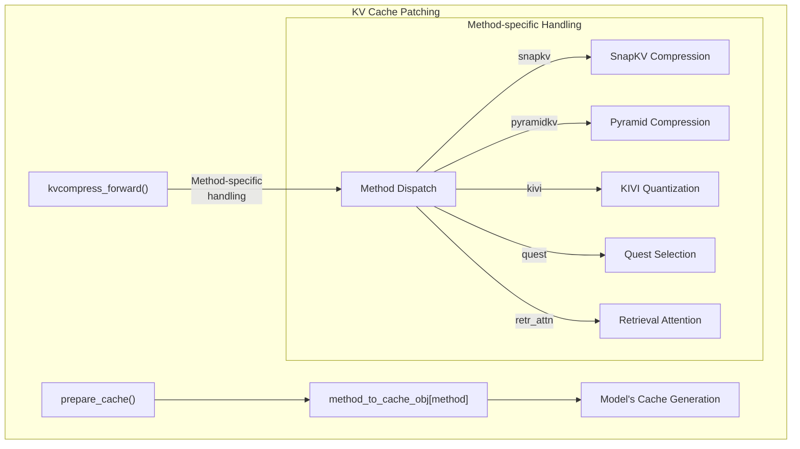
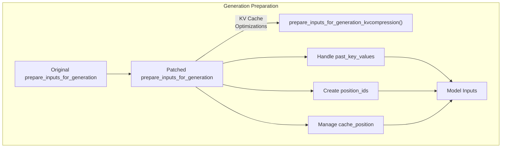

<!-- source: DeepWiki mcp.deepwiki.com · repo microsoft/MInference · page 2.1 Model Patching System · fetched 2026-10-26 -->

# Model Patching System

<details>
<summary>Relevant source files</summary>

The following files were used as context for generating this wiki page:

- [minference/minference_configuration.py](minference/minference_configuration.py)
- [minference/models_patch.py](minference/models_patch.py)
- [minference/patch.py](minference/patch.py)

</details>


## Purpose and Scope

The Model Patching System is the core mechanism within MInference that dynamically modifies LLM architectures to incorporate optimized attention mechanisms and KV cache strategies. This page documents how MInference intercepts and replaces key components of Transformer-based models to improve inference efficiency, particularly for long contexts. For information about specific sparse attention mechanisms, see [Sparse Attention Mechanisms](#2.2). For KV cache optimizations, see [KV Cache Optimizations](#3).

## Overview

The patching system serves as the bridge between standard model implementations (from HuggingFace Transformers or vLLM) and MInference's optimization techniques. Rather than requiring custom model training, it dynamically replaces critical functions in existing model architectures at runtime.



*Model Patching System High-Level Overview*

Sources: [minference/patch.py:798-892](), [minference/models_patch.py:13-40]()

## Core Components

### MInference Class

The `MInference` class serves as the primary entry point for accessing the patching system. It provides a clean interface for specifying which optimizations to apply to a model.

```python
# Example usage
from minference import MInference
from transformers import AutoModelForCausalLM

model = AutoModelForCausalLM.from_pretrained("meta-llama/Llama-2-7b-hf")
minference = MInference(
    attn_type="minference",  # Use MInference sparse attention
    model_name="llama2-7b",  # Pre-configured model
    kv_type="snapkv"         # Use SnapKV compression
)
patched_model = minference(model)  # Apply patches
```

Sources: [minference/models_patch.py:13-40]()

### MInferenceConfig

The `MInferenceConfig` class manages the configuration options for patching models, supporting various attention and KV cache optimization types.

```mermaid
classDiagram
    class "MInferenceConfig" {
        +MINFERENCE_ATTENTION_TYPES: list
        +OTHER_ATTENTION_TYPES: list
        +KV_TYPES: list
        +attn_type: str
        +config_path: str
        +model_name: str
        +is_search: bool
        +starting_layer: int
        +kv_cache_cpu: bool
        +kv_type: str
        +attn_kwargs: dict
        +update_config_path()
        +update_config_type()
        +get_available_attn_types()
        +get_available_kv_types()
    }
```

*Configuration Options Structure*

Sources: [minference/minference_configuration.py:9-101]()

## Patching Process

The model patching process follows a specific workflow to transform the original model architecture.



*Model Patching Workflow*

Sources: [minference/models_patch.py:39-176](), [minference/patch.py:848-893](), [minference/patch.py:1042-1305]()

## Supported Patching Strategies

MInference provides several patching strategies, each specialized for different model architectures or optimizations.

### Attention Type Variants



*Supported Attention Patterns*

Sources: [minference/minference_configuration.py:10-30](), [minference/models_patch.py:84-140]()

### KV Cache Optimization Variants



*Supported KV Cache Optimizations*

Sources: [minference/minference_configuration.py:31-39](), [minference/models_patch.py:43-68]()

## Technical Implementation

### Patching HuggingFace Models

For HuggingFace models, the patching process involves:

1. Replacing the attention forward pass with optimized implementations
2. Updating the model's preparation functions for generation
3. Modifying KV cache handling for optimized memory usage



*HuggingFace Model Patching Process*

Sources: [minference/patch.py:850-892](), [minference/patch.py:1308-1502]()

### Patching vLLM Models

For vLLM models, the patching process involves special handling due to vLLM's tensor-parallel implementation:



*vLLM Model Patching Process*

Sources: [minference/patch.py:1043-1305](), [minference/models_patch.py:142-171]()

## Patching Functions

The patching system uses several specialized functions to handle different model architectures and optimization strategies:

| Function | Purpose | Applied To |
|----------|---------|------------|
| `new_patch()` | Core patching function for HF models | General HF models |
| `patch_glm_4_1m()` | Specialized for GLM models | GLM-4 models |
| `minference_patch()` | Original MInference patching | Specialized cases |
| `minference_patch_vllm()` | Patches vLLM models | vLLM models |
| `patch_hf()` | Lower-level HF patching | Internal use |

Sources: [minference/patch.py:800-1304]()

## Attention Forward Pass Modification

A critical aspect of the patching system is how it modifies the attention forward pass. The system supports different forward pass implementations for different attention types:



*Attention Forward Pass Modification*

Sources: [minference/patch.py:209-213](), [minference/patch.py:863-868]()

## Implementation Details

### KV Cache Handling

The patching system implements special handling for KV cache operations:



*KV Cache Configuration Flow*

Sources: [minference/patch.py:460-473](), [minference/patch.py:995-1003]()

### Custom Rope Embeddings

The patching system also provides a custom implementation of rotary position embeddings:

```mermaid
classDiagram
    class "RotaryEmbeddingESM" {
        +dim: int
        +base: Union[int, float]
        +distance_scale: Union[int, float]
        +is_glm4: bool
        +inv_freq: Tensor
        +rotate_half()
        +apply_rotary_pos_emb()
        +_update_cos_sin_tables()
        +apply_rotary_pos_emb_one_angle()
        +forward()
    }
```

*Custom Rotary Embeddings Implementation*

Sources: [minference/patch.py:44-183]()

## Integration with Generation Process

The patching system modifies how models prepare inputs for text generation by replacing critical functions:



*Generation Input Preparation Flow*

Sources: [minference/patch.py:294-457](), [minference/patch.py:885-890]()

## Usage Examples

Here's a complete example of how to use the Model Patching System with different configurations:

```python
# Standard MInference patching
from minference import MInference
from transformers import AutoModelForCausalLM

# Load original model
model = AutoModelForCausalLM.from_pretrained("meta-llama/Llama-2-7b-hf")

# Apply MInference vertical/slash pattern with default settings
minf_model = MInference(
    attn_type="minference",
    model_name="llama2-7b",
)(model)

# Apply A-Shape attention with SnapKV compression
ashape_snapkv_model = MInference(
    attn_type="a_shape",
    kv_type="snapkv",
    attn_kwargs={
        "n_local": 3968,
        "n_init": 128,
        "window_size": 32,
    }
)(model)

# Apply FlexPrefill with PyramidKV
flex_pyramidkv_model = MInference(
    attn_type="flexprefill",
    kv_type="pyramidkv",
    attn_kwargs={
        "gamma": 0.95,
        "tau": 0.1,
        "block_size": 128,
        "window_size": 32,
        "kernel_size": 5,
    }
)(model)

# Patch vLLM model
from vllm import LLM
llm = LLM(model="meta-llama/Llama-2-7b-hf")
patched_llm = MInference(
    attn_type="vllm_minference",
    config_path="configs/llama2-7b.json"
)(llm)
```

## Conclusion

The Model Patching System is the core enabler of MInference's ability to accelerate LLM inference. By dynamically replacing critical components of existing model architectures, it allows for optimized attention and KV cache handling without requiring model retraining or modification. This system supports a wide range of attention mechanisms and KV cache optimizations, enabling users to select the appropriate strategy for their specific use case.

---

