<!-- source: DeepWiki mcp.deepwiki.com · repo microsoft/MInference · page 2.2 Sparse Attention Mechanisms · fetched 2026-10-26 -->

# Sparse Attention Mechanisms

Relevant source files

The following files were used as context for generating this wiki page:

- [assets/license_header.txt](assets/license_header.txt)
- [minference/modules/minference_forward.py](minference/modules/minference_forward.py)
- [minference/ops/streaming_kernel.py](minference/ops/streaming_kernel.py)
- [minference/utils.py](minference/utils.py)

## Purpose and Scope

This document describes the sparse attention mechanisms implemented in MInference to accelerate inference for large language models (LLMs), particularly when processing long contexts. These mechanisms reduce the computational complexity of attention calculations by focusing only on the most relevant tokens, rather than computing full attention which scales quadratically with sequence length.

The page focuses on the implementation details of various sparse attention patterns, their selection mechanisms, and how they integrate with the model architecture. For information about optimizing KV caches through compression, quantization, and retrieval, see [KV Cache Optimizations](#3).

## Overview of Sparse Attention

Traditional attention mechanisms in LLMs compute attention scores between all pairs of tokens, which leads to quadratic complexity O(n²) with respect to sequence length. MInference addresses this challenge by implementing sparse attention patterns that focus computation on a subset of token interactions that are most relevant for model performance.

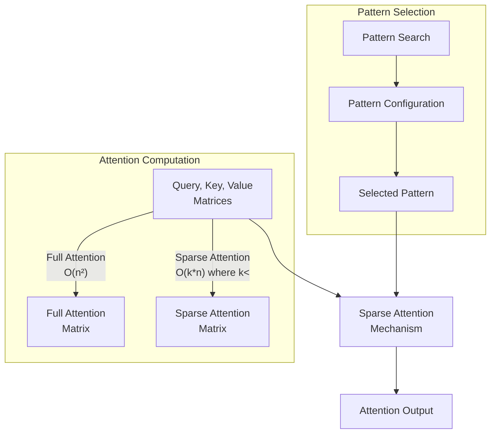

Sources: [minference/modules/minference_forward.py:224-225](), [minference/modules/minference_forward.py:242-250]()

## Sparse Attention Pattern Types

MInference implements several sparse attention patterns, each with different characteristics and use cases:

### 1. Vertical/Slash Pattern

This pattern combines two attention mechanisms:
- **Vertical attention**: Focuses on specific tokens throughout the sequence
- **Slash attention**: Focuses on diagonal patterns, capturing local context

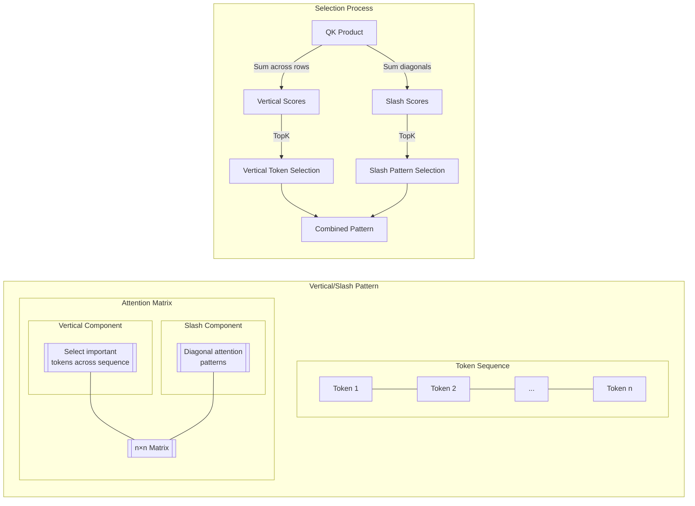

The implementation calculates importance scores for both components:
- For vertical patterns, it sums attention scores across rows
- For slash patterns, it sums attention scores along diagonals
- Both patterns are combined using a mask that prioritizes the most relevant tokens

Sources: [minference/modules/minference_forward.py:296-326](), [minference/ops/pit_sparse_flash_attention_v2.py]() (referenced in imports)

### 2. Block Sparse Pattern

Block sparse attention divides the attention matrix into blocks and only computes attention for the most important blocks:

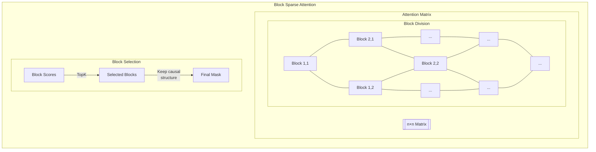

Key characteristics:
- Divides the attention matrix into fixed-size blocks (typically 32×32 or 64×64)
- Computes importance scores for each block based on query-key interactions
- Selects top-k most important blocks for computation
- Preserves the causal structure required for autoregressive generation

Sources: [minference/modules/minference_forward.py:342-361](), [minference/ops/block_sparse_flash_attention.py]() (referenced in imports)

### 3. A-Shape Attention

A-Shape attention provides a balance between global and local attention by forming a pattern resembling the letter "A":

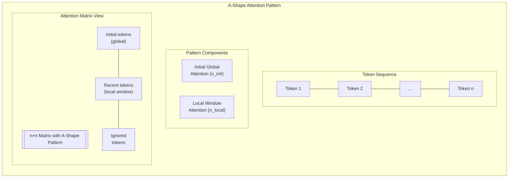

Key characteristics:
- Attends to an initial window of tokens (n_init) for global context
- Attends to the most recent tokens in a local sliding window (n_local)
- Ignores tokens in the middle, forming an "A" shape
- Very effective for long context processing with minimal performance degradation

Sources: [minference/ops/streaming_kernel.py:611-647](), [minference/modules/minference_forward.py:468-470]()

### 4. Tri-Shape Attention

Tri-Shape attention extends the A-Shape pattern by adding a dense attention window at the end:

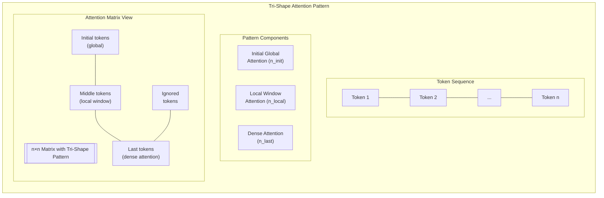

Key characteristics:
- Uses A-Shape attention for the majority of tokens
- Adds a dense attention computation for the final n_last tokens
- Provides better handling of recent context through full attention
- Especially useful for tasks requiring detailed comprehension of the most recent context

Sources: [minference/ops/streaming_kernel.py:797-834](), [minference/modules/minference_forward.py:442-454]()

### 5. FlexPrefill

FlexPrefill provides a flexible framework for implementing different sparse attention patterns:

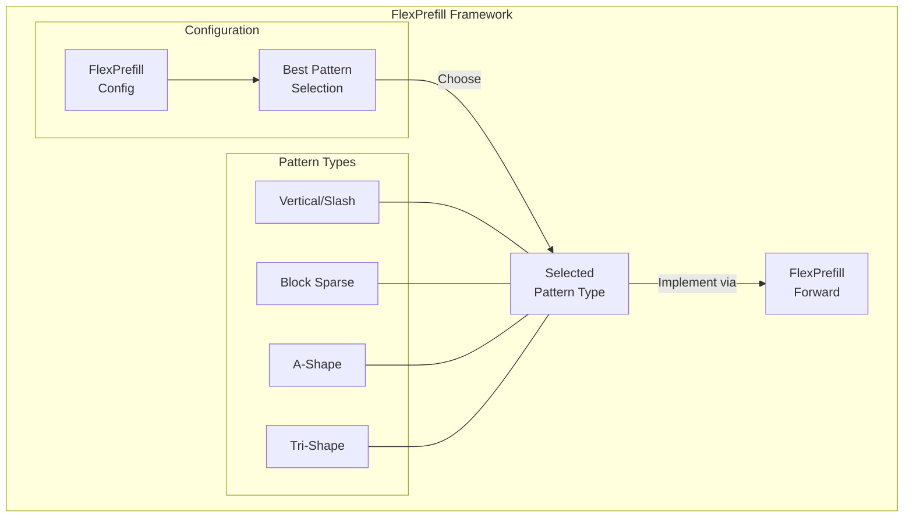

Key characteristics:
- Provides a unified interface for different pattern types
- Can be configured at runtime
- Supports prefill phase optimization for long contexts
- Allows for dynamic pattern selection based on sequence characteristics

Sources: [minference/modules/minference_forward.py:29](), [minference/modules/minference_forward.py:820-831]()

## Pattern Search and Selection

MInference can dynamically search for the optimal sparse pattern for each attention head:

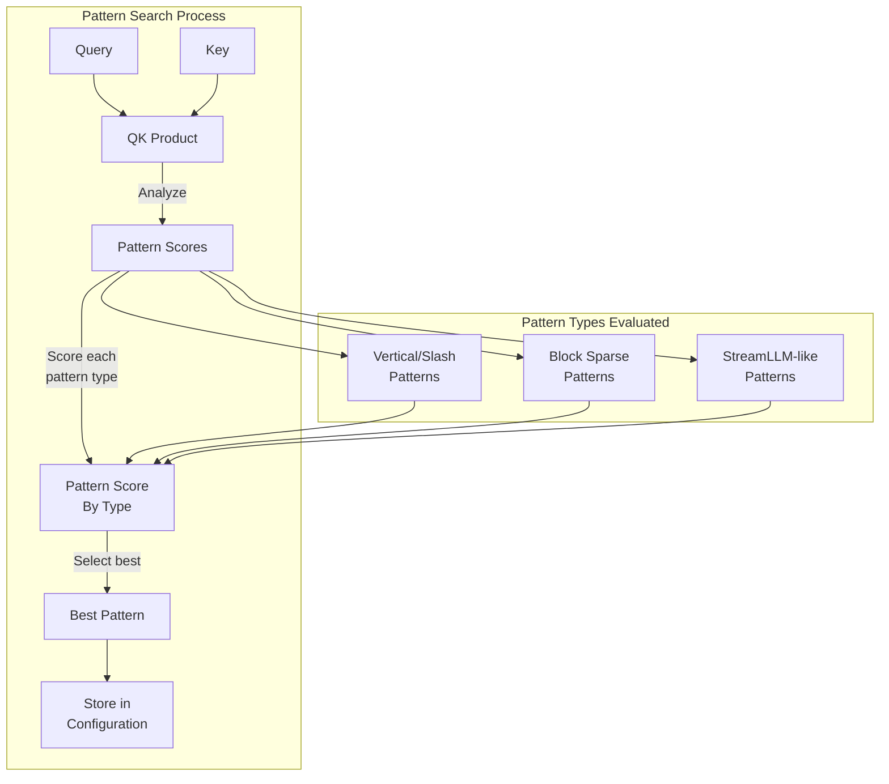

The pattern search algorithm:
1. Computes attention scores for a sample of tokens
2. Evaluates different pattern types and configurations
3. Selects the pattern with the highest score (lowest error compared to full attention)
4. Stores the configuration for future use

Sources: [minference/modules/minference_forward.py:127-225](), [minference/modules/minference_forward.py:552-580]()

## Implementation Architecture

The sparse attention mechanisms are implemented through a patching system that modifies the model's attention computation:

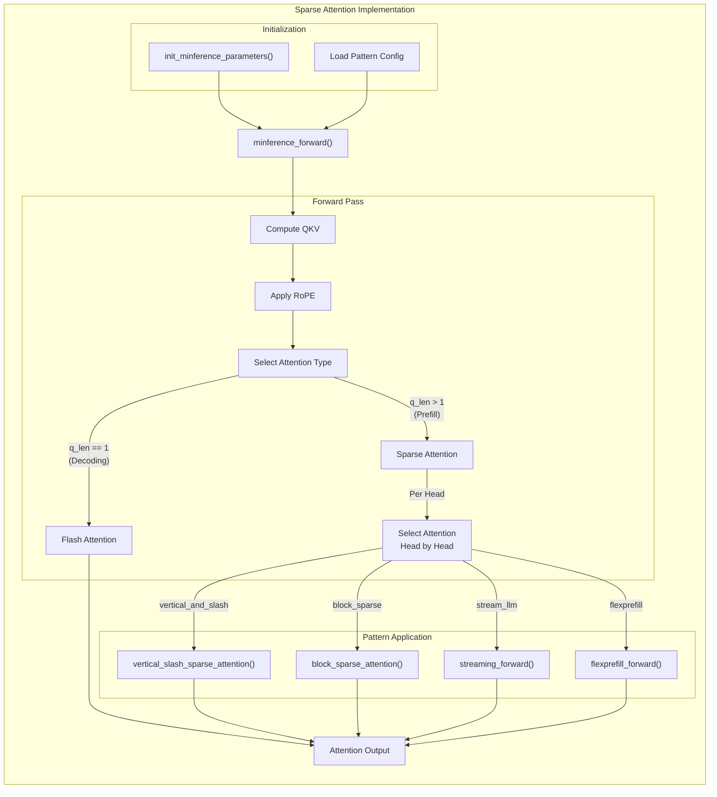

Key components:
- `minference_forward()` replaces the model's native attention forward pass
- Pattern selection is done per attention head
- The system can fall back to standard flash attention for decoding (q_len=1)
- A config file stores pre-computed optimal patterns for each attention head
- The implementation supports both HuggingFace models and vLLM

Sources: [minference/modules/minference_forward.py:496-589](), [minference/modules/minference_forward.py:833-987]()

## Detailed Pattern Implementation

### Vertical/Slash Implementation

The vertical/slash pattern identifies important tokens and diagonal patterns using the following process:

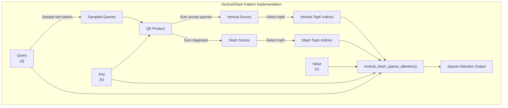

Key implementation details:
- Uses only the last `last_q` (typically 64) tokens from the query for pattern selection
- Computes vertical importance by summing attention scores across query tokens
- Computes slash importance by summing attention scores along diagonals
- Selects top-k tokens for vertical attention and top-k diagonals for slash attention
- Applies the combined pattern using a custom CUDA kernel

Sources: [minference/modules/minference_forward.py:379-394](), [minference/modules/minference_forward.py:773-788]()

### A-Shape/Tri-Shape Implementation

The streaming-based patterns (A-Shape and Tri-Shape) are implemented using a multi-stage attention approach:

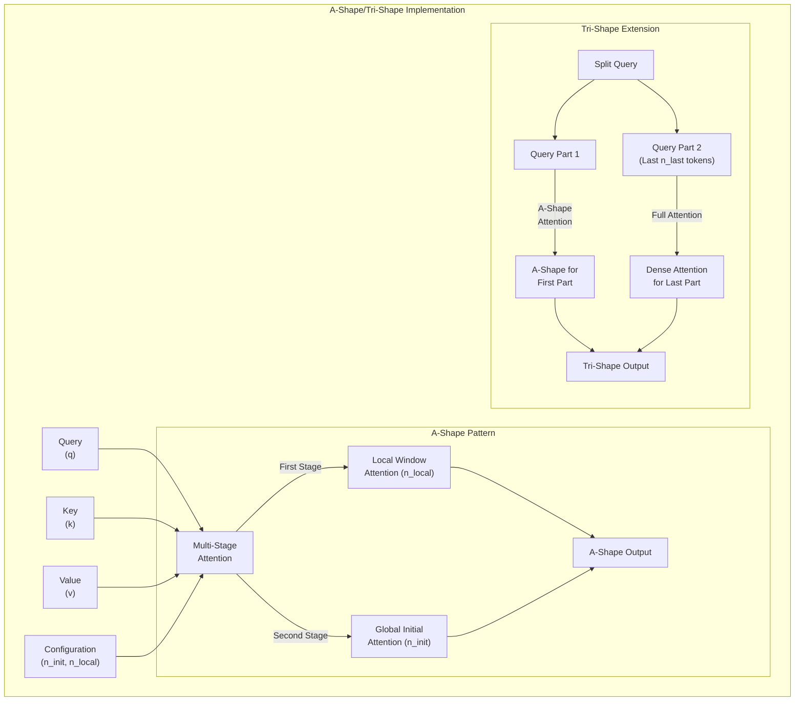

Key implementation details:
- Implemented using the `TritonMultiStageDotProductionAttention` class
- Uses efficient Triton kernels for attention computation
- For A-Shape: 
  - First applies a sliding window attention with window size `n_local`
  - Then adds global attention for the first `n_init` tokens
- For Tri-Shape:
  - Applies A-Shape attention for the first part of the sequence
  - Applies full attention for the last `n_last` tokens
  - Concatenates both outputs

Sources: [minference/ops/streaming_kernel.py:611-647](), [minference/ops/streaming_kernel.py:797-834]()

## Configuration and Usage

MInference sparse attention can be configured through a configuration file or dynamically at runtime:

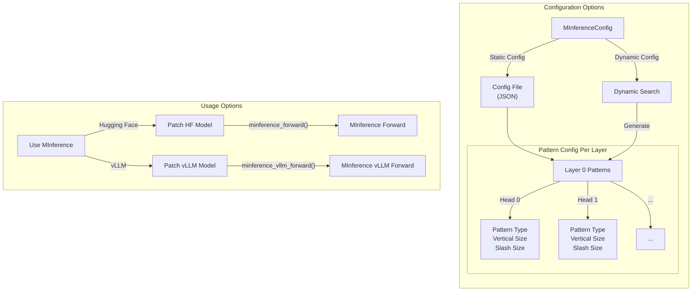

Key configuration parameters:
- `attn_type`: The attention mechanism to use (minference, a_shape, tri_shape, flexprefill)
- `starting_layer`: Layer from which to apply sparse attention
- `is_search`: Whether to dynamically search for optimal patterns
- `config_path`: Path to a JSON file with pre-computed patterns
- Per-pattern configurations:
  - `vertical_size`: Number of tokens for vertical attention
  - `slash_size`: Number of diagonals for slash attention
  - `n_init`: Number of initial tokens for global attention (A-Shape/Tri-Shape)
  - `n_local`: Local window size for A-Shape/Tri-Shape
  - `n_last`: Number of final tokens for dense attention in Tri-Shape

Sources: [minference/modules/minference_forward.py:84-98](), [minference/modules/minference_forward.py:552-580]()

## Performance Considerations

Different sparse attention patterns offer different trade-offs between speed, memory usage, and accuracy:

| Pattern | Speed | Memory | Accuracy | Use Case |
|---------|-------|--------|----------|----------|
| Vertical/Slash | High | Low | Good | General purpose, adapts to different attention patterns |
| Block Sparse | Medium | Medium | Very Good | Structured data with block-like patterns |
| A-Shape | Very High | Very Low | Good | Long context with important information at beginning |
| Tri-Shape | High | Low | Very Good | Long context with important recent information |
| FlexPrefill | Variable | Variable | Configurable | Flexible configuration for specific needs |

Key factors affecting performance:
- Sequence length: Sparse patterns show greater benefits with longer contexts
- Sparsity ratio: More aggressive sparsity leads to faster inference but potential accuracy loss
- Model architecture: Some models are more robust to sparsity than others
- Task requirements: Different tasks may benefit from different sparse patterns

Sources: [minference/modules/minference_forward.py:127-225](), [minference/ops/streaming_kernel.py:611-647]()

## Integration with Other MInference Components

Sparse attention mechanisms can be combined with KV cache optimizations for enhanced performance:

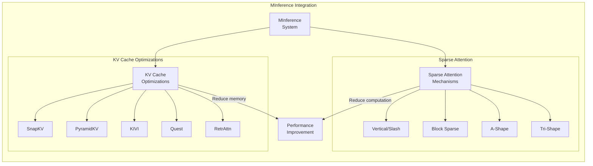

Key integration points:
- Sparse attention reduces computation complexity
- KV cache optimizations reduce memory requirements
- Both can be combined for optimal performance
- Pattern search can take into account KV cache compression

Sources: [minference/modules/minference_forward.py:749-767](), [minference/modules/minference_forward.py:631-649]()

## Conclusion

MInference's sparse attention mechanisms provide effective solutions for accelerating LLM inference, particularly for long contexts. By intelligently focusing computation on the most relevant token interactions, these mechanisms significantly reduce computational requirements while maintaining model quality. The modular design allows for flexible configuration and integration with other optimization techniques such as KV cache compression.

---

