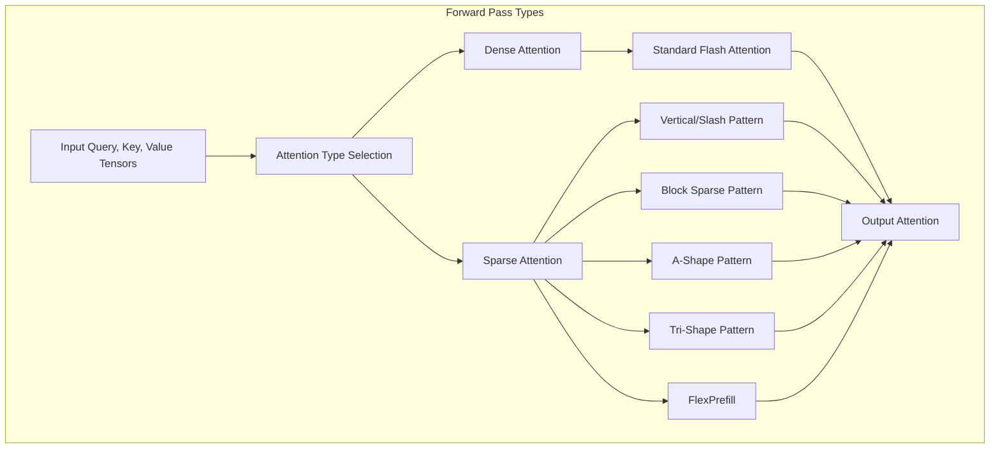
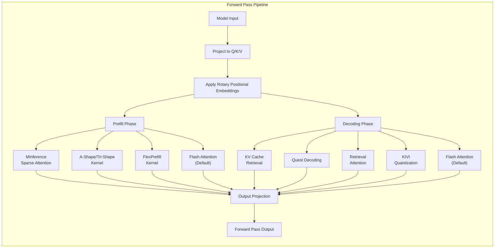
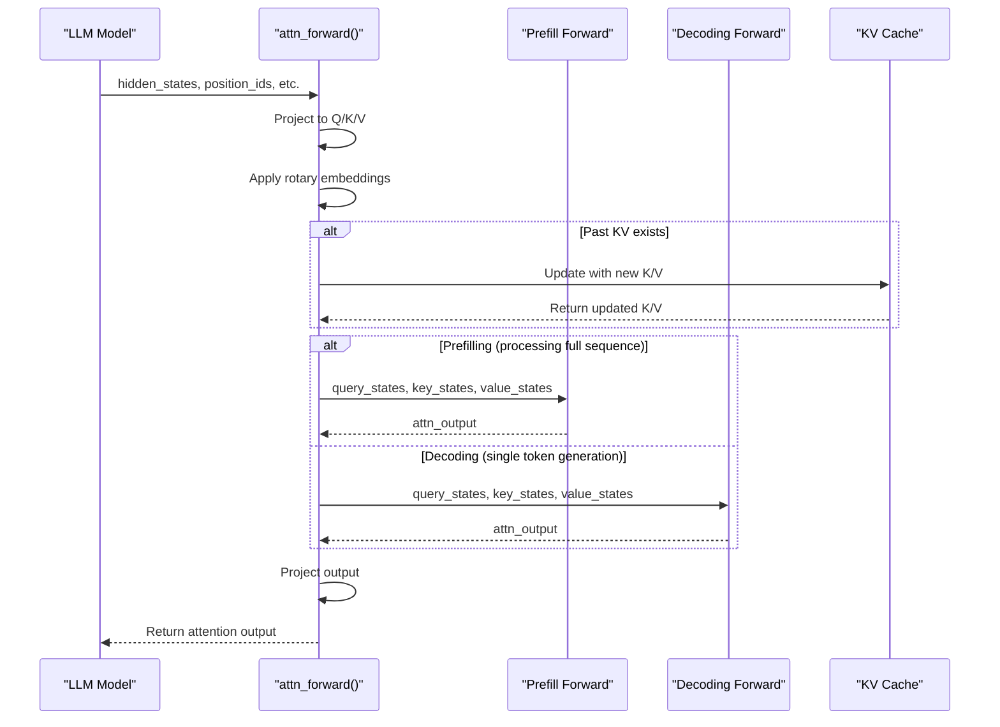
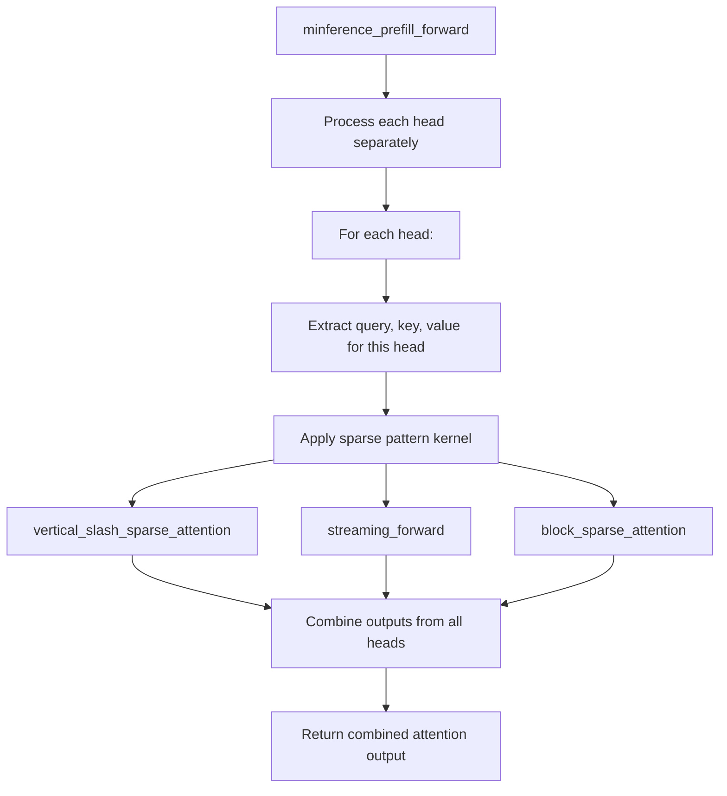
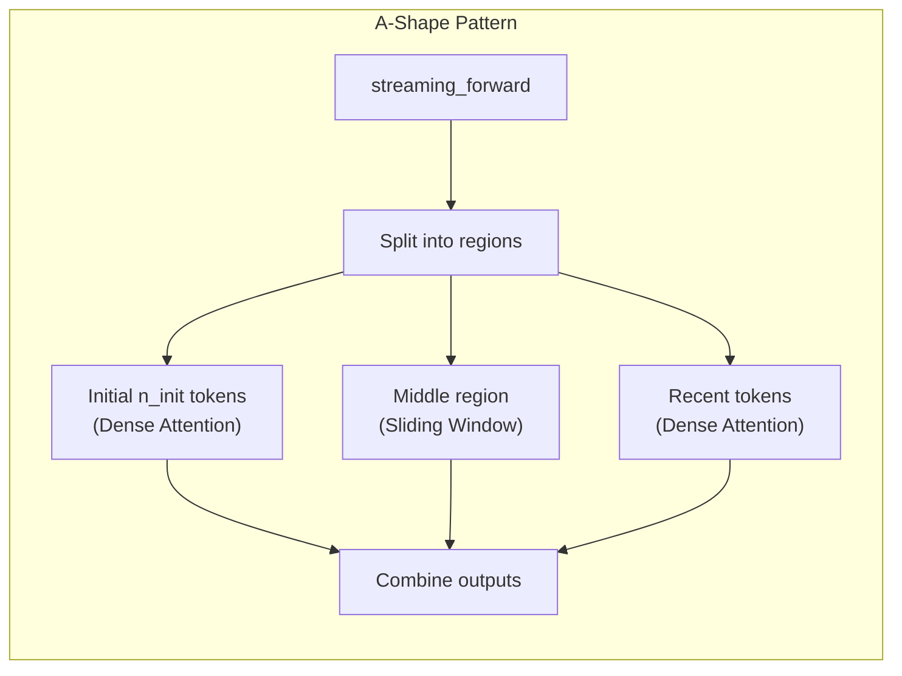
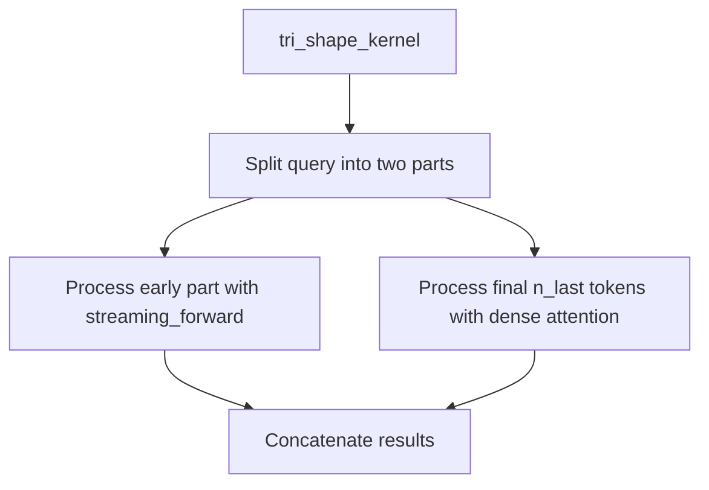
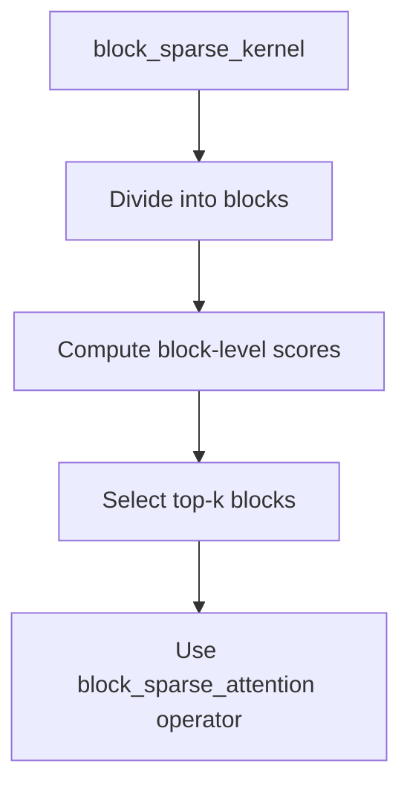
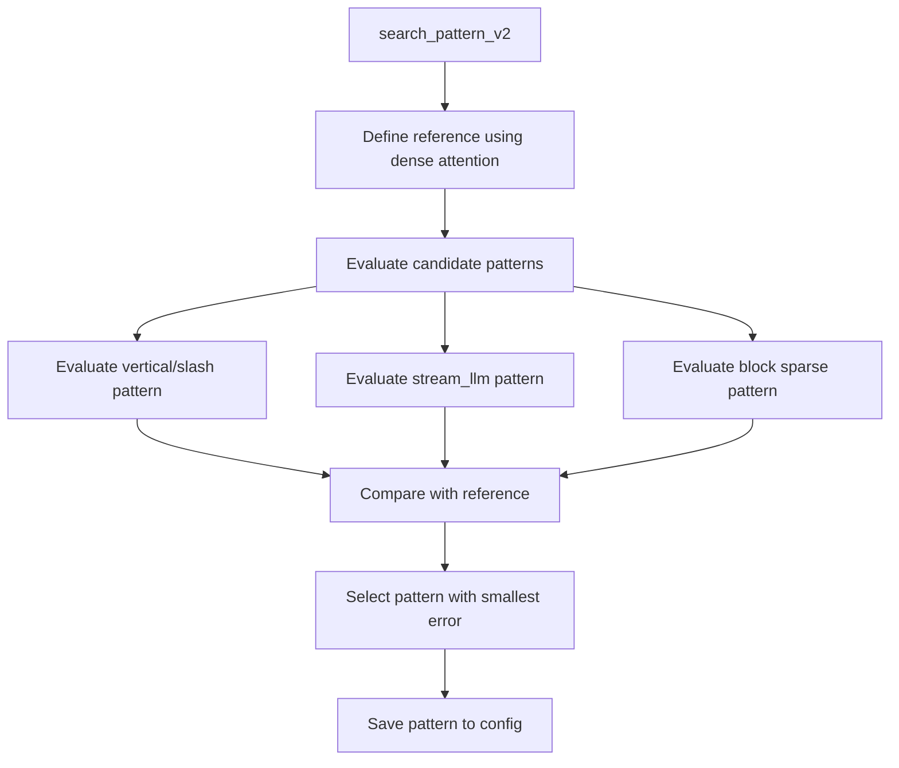
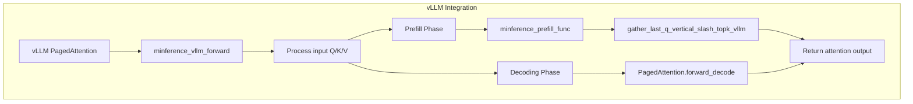
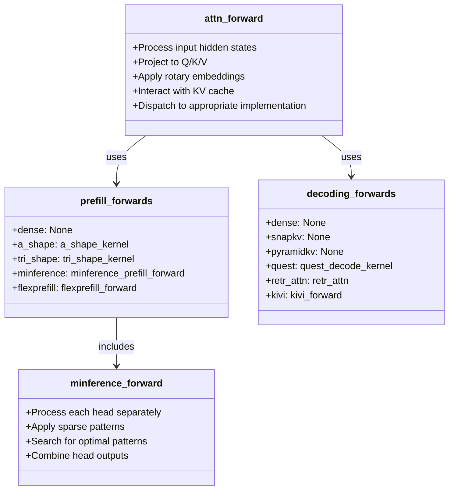

<!-- source: DeepWiki mcp.deepwiki.com · repo microsoft/MInference · page 2.3 Forward Pass Implementation · fetched 2026-10-26 -->

# Forward Pass Implementation

Relevant source files

The following files were used as context for generating this wiki page:

- [minference/modules/forward.py](minference/modules/forward.py)
- [minference/modules/minference_forward.py](minference/modules/minference_forward.py)

This page documents how the forward pass is implemented in MInference, focusing on the optimized attention mechanisms used to accelerate inference for large language models (LLMs). The forward pass is where the model processes input tokens and generates output representations, with attention being a significant computational bottleneck, especially for long sequences.

For information about model patching, see [Model Patching System](#2.1). For sparse attention mechanisms theory, see [Sparse Attention Mechanisms](#2.2).

## Overview of the Forward Pass

MInference provides several optimized implementations of the attention forward pass, designed to accelerate inference while maintaining accuracy. These implementations focus on reducing the computational complexity of attention calculations through sparse patterns, efficient prefilling strategies, and optimized decoding.

Sources: [minference/modules/forward.py:19-181](), [minference/modules/minference_forward.py:495-589]()

## Core Forward Pass Architecture

MInference distinguishes between two key phases of inference:

1. **Prefill Phase**: Processing the entire input sequence at once
2. **Decoding Phase**: Generating tokens one by one

Different attention strategies are employed for each phase, with the primary goal of reducing computational complexity while maintaining model quality.

Sources: [minference/modules/forward.py:19-181](), [minference/modules/minference_forward.py:45-81]()

## Main Attention Forward Function

The main `attn_forward` function serves as the central dispatcher for different attention implementations. It handles:

1. Projecting input hidden states to query, key, and value representations
2. Applying rotary positional embeddings
3. Interacting with the KV cache
4. Dispatching to appropriate prefill or decoding implementation
5. Processing the attention output

The function supports different configurations through the `prefill_forward` and `decoding_forward` parameters, which can be set to specific attention implementations.

Sources: [minference/modules/forward.py:19-181]()

## Prefill Forward Implementations

During prefill, MInference provides several specialized implementations to optimize attention computation:

| Implementation | Description | Function |
|----------------|-------------|----------|
| `dense` | Standard dense attention using Flash Attention | Default Flash Attention |
| `a_shape` | A-Shape pattern focusing on initial and recent tokens | `a_shape_kernel` |
| `tri_shape` | Tri-Shape pattern with three distinct regions | `tri_shape_kernel` |
| `minference` | Dynamic sparse attention with vertical/slash patterns | `minference_prefill_forward` |
| `flexprefill` | Flexible prefill with adaptable attention patterns | `flexprefill_forward` |

Sources: [minference/modules/forward.py:184-190]()

### MInference Prefill Forward

The MInference prefill implementation processes each attention head individually, applying the appropriate sparse pattern for each head. This implementation significantly reduces the computational cost of attention while maintaining model quality.

Sources: [minference/modules/minference_forward.py:631-649]()

## Sparse Attention Pattern Kernels

MInference implements several sparse attention pattern kernels that reduce the computational complexity of attention:

### Vertical/Slash Pattern

The vertical/slash pattern combines:
- **Vertical attention**: Focusing on specific important tokens throughout the sequence
- **Slash attention**: Attending to diagonal patterns that capture local context

This pattern is implemented in the `vertical_and_slash_kernel` function, which:
1. Identifies important tokens using the last few query tokens
2. Computes attention scores for these tokens
3. Selects the top-k most important vertical tokens
4. Identifies important diagonal (slash) patterns
5. Combines them into a sparse attention pattern

Sources: [minference/modules/minference_forward.py:597-612]()

### A-Shape Pattern

The A-Shape attention pattern creates an "A" shape in the attention matrix by:
- Attending to all tokens in an initial window (global attention)
- Attending to a sliding window around the current token (local attention)

Sources: [minference/modules/minference_forward.py:468-470]()

### Tri-Shape Pattern

The Tri-Shape pattern extends the A-Shape pattern with three distinct regions:
1. Initial tokens with full attention
2. Middle section with sliding window attention
3. Final tokens with full causal attention

Sources: [minference/modules/minference_forward.py:442-453](), [minference/modules/minference_forward.py:470-471]()

### Block Sparse Pattern

The block sparse pattern divides the attention matrix into blocks and only computes attention for the most important blocks:
1. Divides sequence into blocks (typically 32 tokens)
2. Computes block-level attention scores
3. Selects top-k most important blocks
4. Computes full attention only for selected blocks

Sources: [minference/modules/minference_forward.py:342-361](), [minference/modules/minference_forward.py:614-616]()

## Pattern Selection

MInference can select sparse attention patterns in two ways:

1. **Static Configuration**: Using patterns specified in a configuration file
2. **Dynamic Pattern Search**: Automatically finding the best pattern for each attention head

### Dynamic Pattern Search

The dynamic pattern search process:
1. Evaluates different sparse pattern candidates (vertical/slash, stream_llm, block_sparse)
2. Compares their results against dense attention
3. Selects the pattern with the best performance
4. Saves the optimal pattern configuration for future use

Sources: [minference/modules/minference_forward.py:227-274](), [minference/modules/minference_forward.py:568-580]()

## Decoding Forward Implementations

During decoding (generating tokens one by one), MInference supports several specialized implementations:

| Implementation | Description | Function |
|----------------|-------------|----------|
| `dense` | Standard dense attention | Default Flash Attention |
| `snapkv` | Uses SnapKV cache compression | Default with SnapKV cache |
| `pyramidkv` | Uses PyramidKV cache compression | Default with PyramidKV cache |
| `quest` | Query-Efficient STreaming | `quest_decode_kernel` |
| `retr_attn` | Retrieval-augmented attention | `retr_attn` |
| `kivi` | Quantized KV cache | `kivi_forward` |

Sources: [minference/modules/forward.py:192-200]()

## Integration with vLLM

MInference integrates with vLLM to provide accelerated inference in production environments. The integration replaces vLLM's attention mechanism with MInference's sparse attention patterns.

Sources: [minference/modules/minference_forward.py:833-1318]()

## Forward Pass Implementation Classes

The forward pass implementation is organized into several key functions and classes that work together:

Sources: [minference/modules/forward.py:19-200](), [minference/modules/minference_forward.py:495-589]()

## Summary

The forward pass implementation in MInference provides a range of optimized attention mechanisms that significantly accelerate inference for large language models, especially for long contexts. By selectively computing attention using sparse patterns tailored to each attention head, MInference reduces the computational complexity while maintaining model quality.

The implementation is flexible, supporting both:
1. Different sparse attention patterns (vertical/slash, block sparse, A-shape, tri-shape)
2. Different inference phases (prefill and decoding)
3. Integration with other frameworks like vLLM

This architecture allows MInference to deliver substantial performance improvements for long-context inference while maintaining compatibility with existing model architectures.

---

