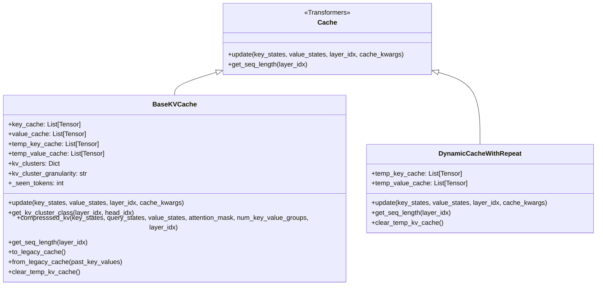
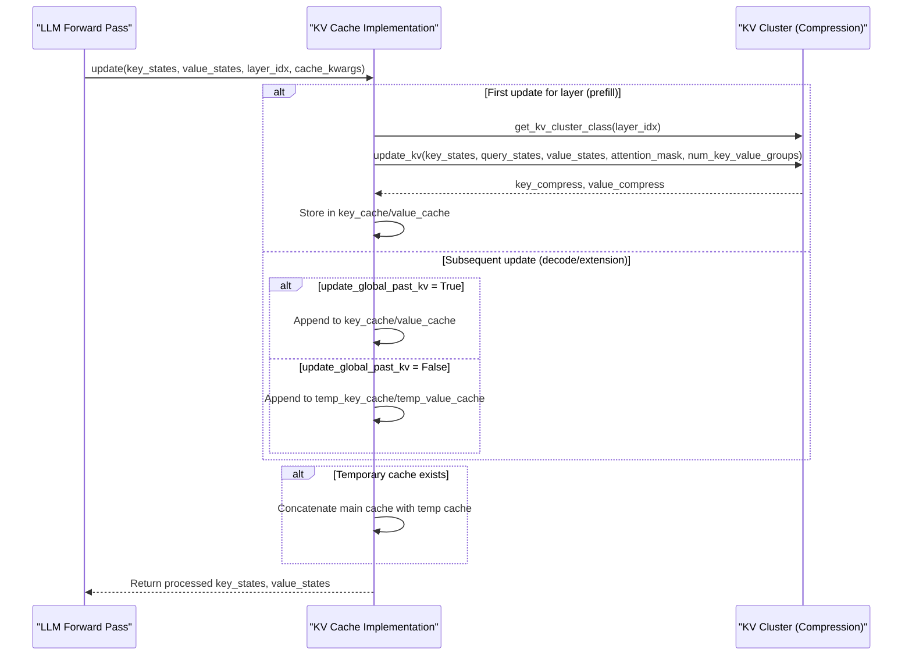
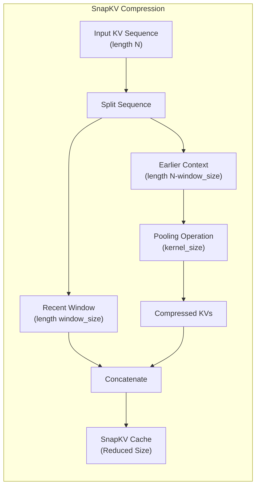
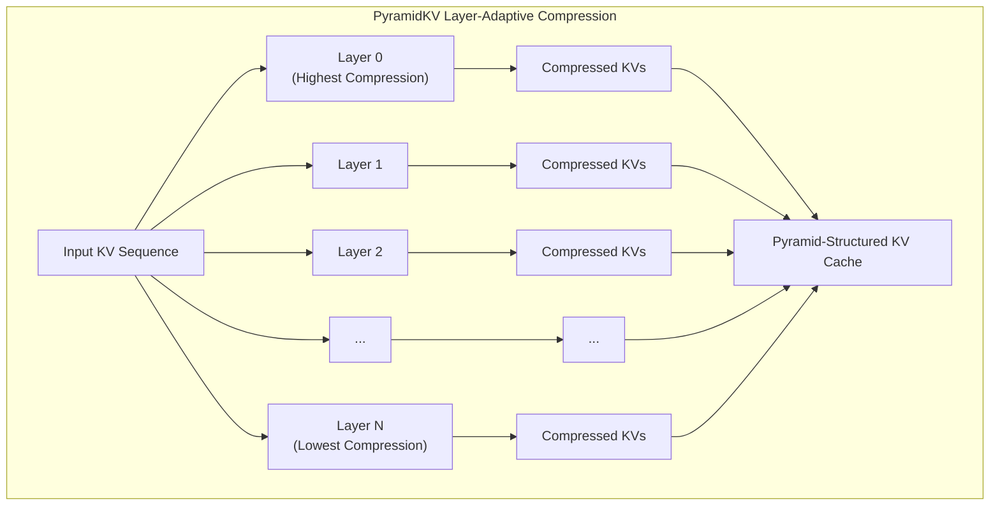
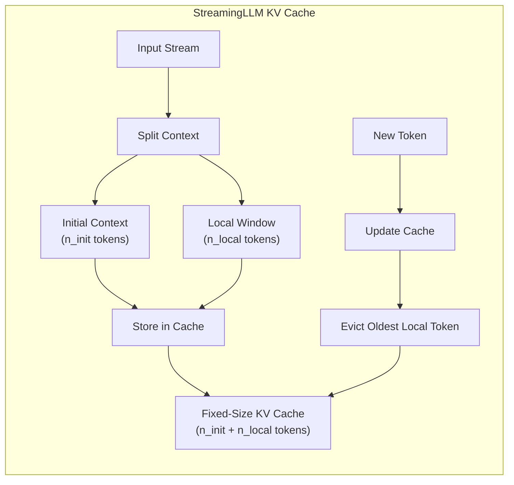
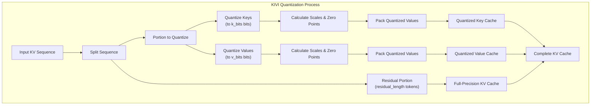
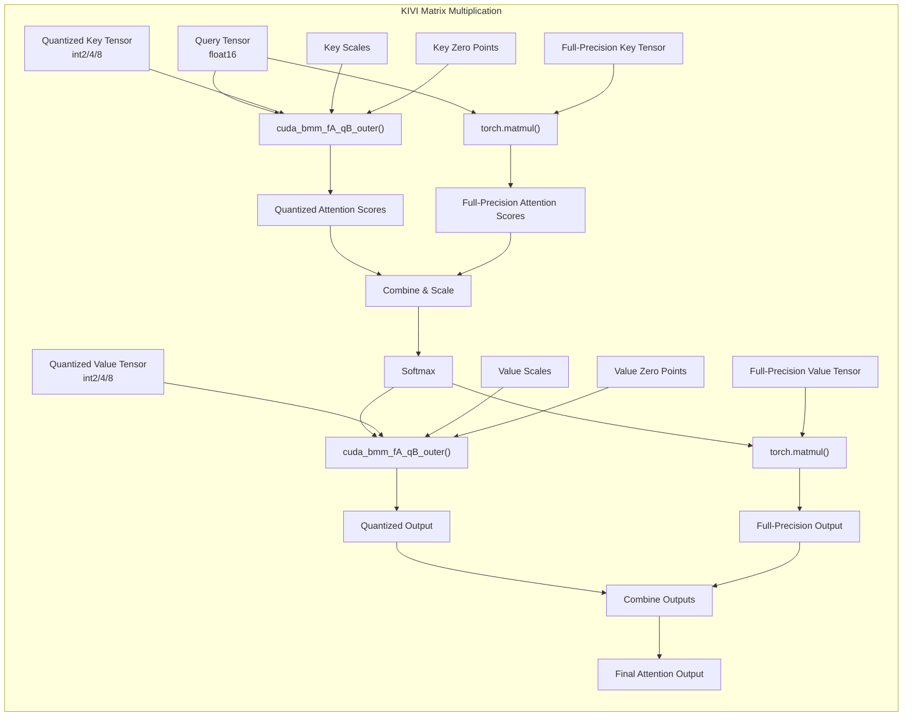
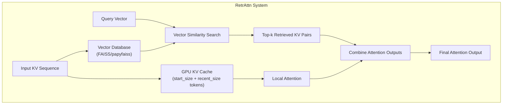
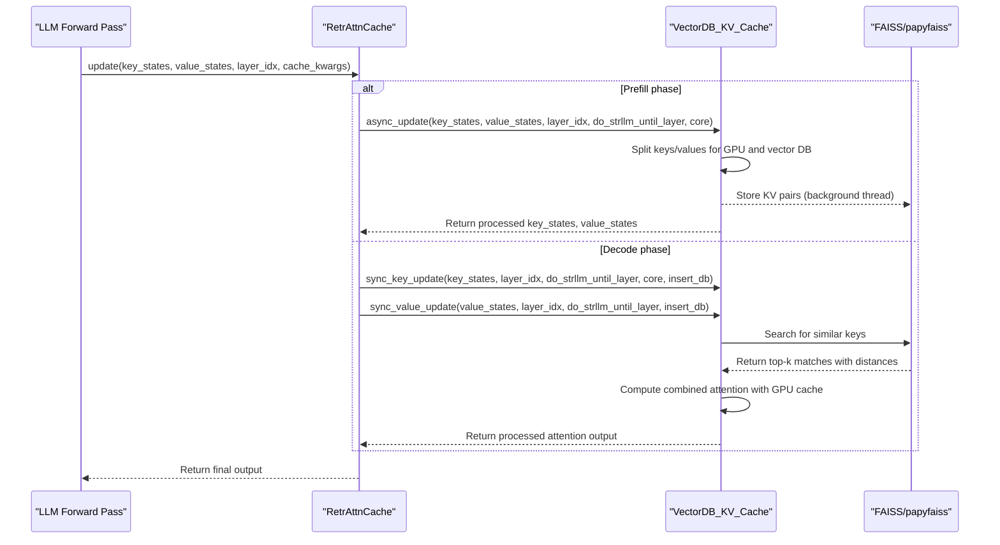
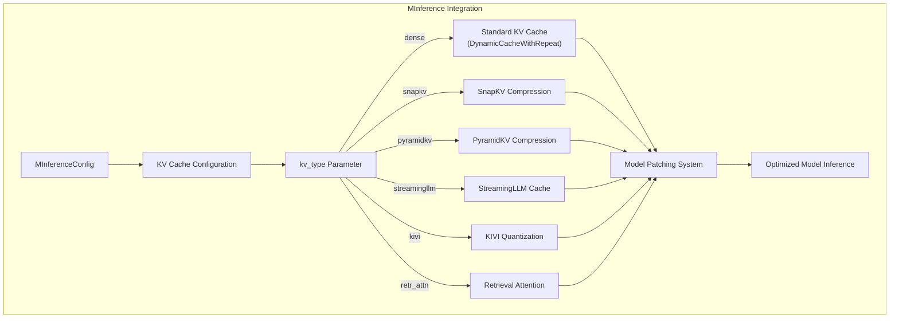

<!-- source: DeepWiki mcp.deepwiki.com · repo microsoft/MInference · page 3 KV Cache Optimizations · fetched 2026-10-26 -->

# KV Cache Optimizations

<details>
<summary>Relevant source files</summary>

The following files were used as context for generating this wiki page:

- [minference/modules/kivi.py](minference/modules/kivi.py)
- [minference/modules/kvcompression.py](minference/modules/kvcompression.py)
- [minference/modules/retr_attn.py](minference/modules/retr_attn.py)

</details>


This page provides a comprehensive overview of Key-Value (KV) cache optimization techniques implemented in MInference for accelerating LLM inference with long contexts. KV cache optimizations focus on reducing memory usage and improving computational efficiency during text generation while maintaining model performance.

For detailed information about sparse attention mechanisms that complement these KV cache optimizations, see [Sparse Attention Mechanisms](#2.2).

## Introduction

The KV cache stores previously computed key and value tensors in transformer attention layers, eliminating the need to recompute them for each new token during autoregressive generation. As context lengths increase, KV cache memory requirements grow linearly, becoming a major bottleneck. MInference implements several optimization techniques to address this challenge:

```mermaid
flowchart TD
    subgraph "KV Cache Optimizations in MInference"
        KVCache["Base KV Cache"] --> Compression["Compression Techniques"]
        KVCache --> Quantization["Quantization Techniques"]
        KVCache --> Retrieval["Retrieval-Augmented Techniques"]
        
        Compression --> SnapKV["SnapKV"]
        Compression --> PyramidKV["PyramidKV"]
        Compression --> StreamingLLM["StreamingLLM KV"]
        
        Quantization --> KIVI["KIVI (Kernel Injected Vector Instructions)"]
        
        Retrieval --> RetrAttn["Retrieval Attention (RetrAttn)"]
        
        SnapKV -- "Layer-uniform compression" --> |"Windowing + Pooling"|CompressedKV
        PyramidKV -- "Layer-adaptive compression" --> |"Hierarchical Compression"|CompressedKV
        StreamingLLM -- "Fixed memory streaming" --> |"Sliding Window"|CompressedKV
        
        KIVI -- "Low-bit representation" --> |"Group-wise Quantization"|QuantizedKV
        
        RetrAttn -- "Vector DB storage" --> |"Similarity Search"|RetrievedKV
    end
    
    CompressedKV["Compressed KV Cache"]
    QuantizedKV["Quantized KV Cache"]
    RetrievedKV["Retrieved KV Cache"]
    
    CompressedKV --> ReducedMemory["Reduced Memory Usage"]
    QuantizedKV --> ReducedMemory
    RetrievedKV --> ReducedMemory
    
    ReducedMemory --> LongerContext["Longer Context Processing"]
```

Sources: [minference/modules/kvcompression.py:1-462]()

## Base KV Cache Implementation

MInference's KV cache system is built on a flexible base class that handles storage and retrieval of key-value tensors during inference.

### BaseKVCache

The `BaseKVCache` class serves as the foundation for all KV cache implementations in MInference:



The `BaseKVCache` provides essential functionality:

- Storing key-value pairs for each transformer layer
- Tracking the total number of processed tokens
- Supporting both global caching and temporary caching (for multi-turn conversations)
- Handling compression through KV cluster classes
- Converting between different cache formats

Sources: [minference/modules/kvcompression.py:155-309](), [minference/modules/kvcompression.py:369-449]()

### KV Cache Update Flow

The KV cache update process is a critical part of the inference pipeline:



The system supports two operational modes:
1. **Global Update Mode**: Updates permanent KV cache (for context that should persist)
2. **Temporary Update Mode**: Updates temporary KV cache (for follow-up requests that shouldn't affect the main context)

Sources: [minference/modules/kvcompression.py:208-281]()

## KV Compression Techniques

MInference implements several KV cache compression techniques to reduce memory usage.

### SnapKV

SnapKV implements a window-based compression approach that maintains both recent context and compressed history:



Key parameters:
- `window_size`: Number of recent tokens to retain in full fidelity
- `max_capacity_prompt`: Maximum length of the prompt to handle
- `kernel_size`: Size of the pooling window for compression
- `pooling`: Type of pooling operation (e.g., "avgpool")

Sources: [minference/modules/kvcompression.py:311-328]()

### PyramidKV

PyramidKV extends SnapKV by implementing layer-specific compression rates, forming a pyramid structure:



PyramidKV applies higher compression rates to early layers and lower compression to later layers, based on the observation that later transformer layers often need more precise context information.

Sources: [minference/modules/kvcompression.py:330-347]()

### StreamingLLM

StreamingLLM KV cache optimization focuses on fixed-memory streaming for very long documents:



Key parameters:
- `n_local`: Size of the sliding window for recent tokens (default: 3968)
- `n_init`: Size of the initial context to preserve (default: 128)

This approach ensures constant memory usage regardless of the total sequence length.

Sources: [minference/modules/kvcompression.py:350-366]()

## Quantized KV Cache with KIVI

KIVI (Kernel Injected Vector Instructions) implements quantization techniques to reduce KV cache memory usage through low-bit representation.

### KiviCache Operation



The quantization process:
1. Divides the sequence into portions for quantization and full-precision preservation
2. Groups values for quantization (controlled by `group_size` parameter)
3. Computes scaling factors and zero points for each group
4. Packs multiple low-bit values into single integers
5. Stores both quantized and full-precision portions for efficient retrieval

Key parameters:
- `bits`: Quantization bit-width (typically 2 or 4)
- `group_size`: Number of values in each quantization group
- `residual_length`: Number of recent tokens to keep in full precision

Sources: [minference/modules/kivi.py:560-952]()

### Matrix Multiplication with Quantized Values

KIVI implements specialized CUDA kernels for efficient matrix multiplication with quantized values:



The specialized CUDA kernels:
- Efficiently unpack quantized values during computation
- Apply scaling and zero-point adjustments on-the-fly
- Enable computation with mixed precision (quantized and full-precision)
- Support batch operations for multiple attention heads simultaneously

Sources: [minference/modules/kivi.py:394-574](), [minference/modules/kivi.py:954-1075]()

## Retrieval-Augmented KV Cache

The Retrieval-Augmented KV cache (RetrAttn) leverages vector databases to store and retrieve KV pairs, enabling efficient processing of extremely long contexts.

### RetrAttn Architecture



The RetrAttn system:
1. Stores KV pairs in both GPU memory and a vector database
2. Uses vector similarity search to retrieve relevant KV pairs
3. Computes attention scores over both local and retrieved KV pairs
4. Combines the results weighted by their respective attention scores

Key components:
- `VectorDB_KV_Cache`: Manages storage and retrieval of KV pairs
- `RetrAttnCache`: Extends the Cache interface for retrieval-augmented operations
- `retr_attn()`: Core function that performs retrieval and attention computation

Sources: [minference/modules/retr_attn.py:24-264](), [minference/modules/retr_attn.py:267-348](), [minference/modules/retr_attn.py:350-442]()

### RetrAttn Operation Flow



Key parameters:
- `top_k`: Number of KV pairs to retrieve from the vector database
- `from_layer`: Layer from which to start using retrieval (earlier layers may use standard attention)
- `start_size`: Number of initial tokens to retain in GPU memory
- `recent_size`: Number of recent tokens to retain in GPU memory

Sources: [minference/modules/retr_attn.py:350-442](), [minference/modules/retr_attn.py:444-545]()

## Comparison and Usage Guidelines

The following table summarizes the key characteristics of each KV cache optimization technique:

| Technique | Memory Efficiency | Computational Overhead | Context Length | Implementation Complexity | Key Use Cases |
|-----------|-------------------|------------------------|----------------|--------------------------|--------------|
| SnapKV | Medium | Low | Long | Low | General-purpose, balanced approach |
| PyramidKV | High | Low | Very Long | Medium | When layer-specific compression is beneficial |
| StreamingLLM | High (Fixed) | Low | Unlimited | Low | Streaming documents, fixed memory budgets |
| KIVI | Very High | Medium | Very Long | High | Memory-constrained environments |
| RetrAttn | Extremely High | High | Extremely Long | Very High | Document retrieval, semantic search |

### Selection Guidance

1. **For general use cases**:
   - Start with SnapKV as it provides a good balance of memory efficiency and performance

2. **For very long contexts with limited memory**:
   - Consider PyramidKV to efficiently allocate memory across layers

3. **For unbounded streaming contexts**:
   - Use StreamingLLM to maintain fixed memory usage regardless of sequence length

4. **For extreme memory constraints**:
   - Apply KIVI with appropriate quantization bits (2-4) based on acceptable quality loss

5. **For document retrieval and semantic search applications**:
   - Implement RetrAttn to leverage vector similarity search for efficient retrieval

Sources: [minference/modules/kvcompression.py:452-461]()

## Integration with MInference

The KV cache optimizations are integrated with MInference through the patching system:



The `method_to_cache_obj` dictionary maps configuration parameters to the appropriate KV cache implementation, making it easy to switch between different optimization techniques.

Sources: [minference/modules/kvcompression.py:452-461](), [minference/modules/kvcompression.py:20-45]()

## Conclusion

KV cache optimization techniques in MInference provide a comprehensive set of tools for efficient LLM inference with long contexts. By selecting the appropriate technique based on your specific requirements, you can significantly reduce memory usage and improve inference performance while maintaining model quality.

---

