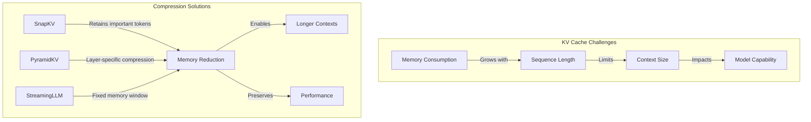
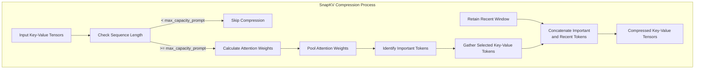
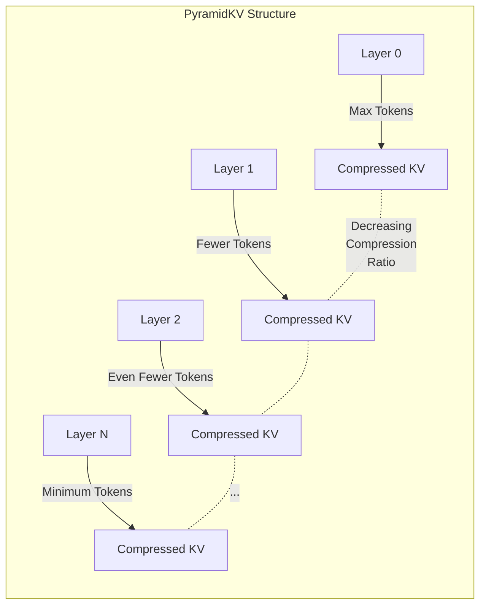
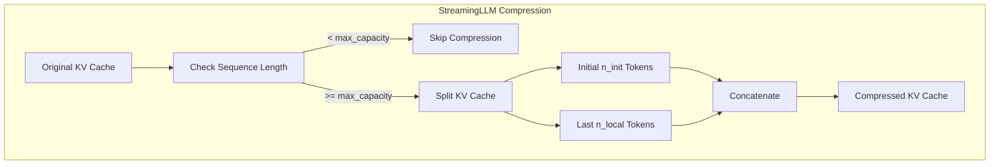
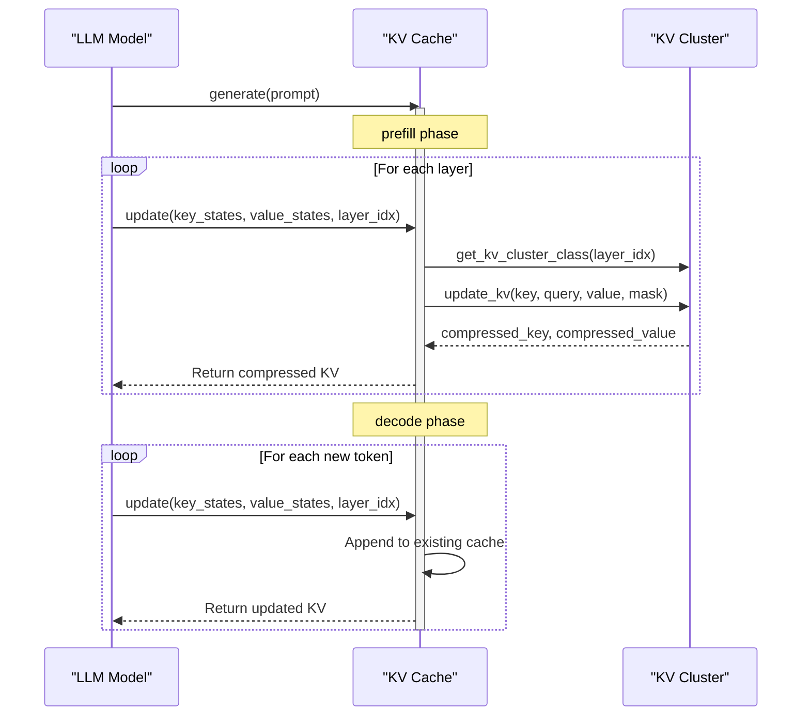

<!-- source: DeepWiki mcp.deepwiki.com · repo microsoft/MInference · page 3.1 KV Compression Techniques · fetched 2026-10-26 -->

# KV Compression Techniques

<details>
<summary>Relevant source files</summary>

The following files were used as context for generating this wiki page:

- [minference/modules/kvcompression.py](minference/modules/kvcompression.py)
- [minference/modules/pyramidkv.py](minference/modules/pyramidkv.py)
- [minference/modules/snapkv.py](minference/modules/snapkv.py)

</details>


## Purpose and Scope

This page documents the Key-Value (KV) cache compression techniques implemented in MInference. These techniques reduce memory usage and improve inference efficiency for large language models (LLMs) when processing long contexts. For information about quantized and retrieval-augmented attention methods, see [Quantized and Retrieval-Augmented Attention](#3.2). For details on Quest and other specialized KV cache implementations, see [Quest and Other KV Cache Types](#3.3).

## Overview of KV Cache in LLMs

KV caches store the key and value tensors computed during attention operations, enabling transformer models to avoid redundant computations when generating tokens sequentially. However, these caches grow linearly with sequence length, creating a memory bottleneck for long-context processing.

MInference implements several compression techniques that significantly reduce the memory requirements while preserving model performance.



Sources: [minference/modules/kvcompression.py:1-461]()

## KV Cache Architecture in MInference

MInference implements a flexible KV cache architecture based on a class hierarchy that enables various compression techniques to be easily integrated and configured.

```mermaid
classDiagram
    class "Cache" {
        update()
        get_seq_length()
    }
    
    class "BaseKVCache" {
        key_cache
        value_cache
        kv_clusters
        temp_key_cache
        temp_value_cache
        update()
        get_kv_cluster_class()
        compresssed_kv()
    }
    
    class "SnapKVCache" {
        window_size
        max_capacity_prompt
        kernel_size
        pooling
        get_kv_cluster_class_config()
    }
    
    class "PyramidKVCache" {
        num_layers
        get_kv_cluster_class_config()
    }
    
    class "StreamingLLMKVCache" {
        get_kv_cluster_class_config()
    }
    
    class "DynamicCacheWithRepeat" {
        update()
        get_seq_length()
        clear_temp_kv_cache()
    }
    
    Cache <|-- BaseKVCache
    BaseKVCache <|-- SnapKVCache
    SnapKVCache <|-- PyramidKVCache
    SnapKVCache <|-- StreamingLLMKVCache
    Cache <|-- DynamicCacheWithRepeat
```

Sources: [minference/modules/kvcompression.py:155-301](), [minference/modules/kvcompression.py:311-366]()

## BaseKVCache Implementation

The `BaseKVCache` class serves as the foundation for all compression techniques in MInference. It extends the `Cache` class from the Transformers library and manages both global and temporary KV caches.

Key functionalities include:

- Maintaining separate lists for key and value caches
- Managing KV cluster objects that implement the actual compression logic
- Handling temporary KV caches for scenarios requiring independent contexts
- Supporting both prefill and decode operations with the same interface

### Key Components:

| Component | Purpose |
|-----------|---------|
| `key_cache` | Stores compressed key tensors across layers |
| `value_cache` | Stores compressed value tensors across layers |
| `kv_clusters` | Dictionary of compression strategy objects |
| `temp_key_cache` | Temporary storage for key tensors (e.g., for multi-request scenarios) |
| `temp_value_cache` | Temporary storage for value tensors |
| `compresssed_kv()` | Core method that applies compression to KV tensors |
| `update()` | Interface method called during model forward pass |

Sources: [minference/modules/kvcompression.py:155-310]()

## SnapKV Compression Technique

SnapKV identifies and retains the most important KV tokens based on attention patterns, significantly reducing memory requirements while maintaining model performance.

### How SnapKV Works:



The `SnapKVCache` class in MInference uses the `SnapKVCluster` to implement this compression. Key parameters include:

- `window_size`: Number of most recent tokens to retain unchanged
- `max_capacity_prompt`: Maximum number of tokens to keep after compression
- `kernel_size`: Size of the pooling kernel for attention weights
- `pooling`: Method for pooling attention weights ("avgpool" or "maxpool")

### Implementation Details:

1. For sequences shorter than `max_capacity_prompt`, no compression is applied
2. For longer sequences:
   - Compute attention weights from recent queries to all keys
   - Apply causal mask to attention weights
   - Softmax and sum the attention weights across queries
   - Pool attention weights using averaging or max pooling
   - Select tokens with highest pooled attention weights
   - Gather corresponding key and value tensors
   - Concatenate with the most recent `window_size` tokens

Sources: [minference/modules/kvcompression.py:311-328](), [minference/modules/snapkv.py:13-107]()

## PyramidKV Compression Technique

PyramidKV extends the SnapKV approach by applying layer-specific compression rates, creating a "pyramid" structure where higher layers retain fewer tokens than lower layers.

### Layer-Specific Compression:



PyramidKV calculates the compression rate for each layer using:

```
min_num = (max_capacity_prompt - window_size) // beta
max_num = (max_capacity_prompt - window_size) * 2 - min_num
steps = (max_num - min_num) // (num_hidden_layers - 1)
max_capacity_prompt = max_num - layer_idx * steps
```

This creates a decreasing capacity from lower to higher layers, optimizing memory while preserving model capability.

Sources: [minference/modules/kvcompression.py:330-347](), [minference/modules/pyramidkv.py:12-183]()

## StreamingLLM Compression Technique

StreamingLLMKVCache implements StreamingLLM's approach to memory-efficient inference, which simply keeps a fixed number of initial tokens and recent tokens.

### Key Parameters:

- `n_local`: Size of the recent window (default: 3968)
- `n_init`: Number of initial tokens to preserve (default: 128)

Unlike SnapKV and PyramidKV, StreamingLLM doesn't compute attention weights to select important tokens, making it computationally more efficient but potentially less selective.



Sources: [minference/modules/kvcompression.py:350-366](), [minference/modules/snapkv.py:110-172]()

## Using KV Compression in MInference

To use KV compression techniques in MInference, the system provides a mapping between method names and cache implementations:

```python
method_to_cache_obj = {
    "": DynamicCacheWithRepeat,
    "dense": DynamicCacheWithRepeat,
    "snapkv": SnapKVCache,
    "pyramidkv": PyramidKVCache,
    "streamingllm": StreamingLLMKVCache,
    "quest": DynamicCacheWithRepeat,
    "retr_attn": RetrAttnCache,
    "kivi": KiviCache,
}
```

The `prepare_inputs_for_generation_kvcompression` function ensures that the appropriate cache object is created during generation.

### Integration with Forward Pass

KV compression integrates with the model's forward pass through patching mechanisms. The `snapkv_forward` function demonstrates how MInference patches attention modules to work with compressed KV caches.

Key integration points:
1. Model's prepare_inputs_for_generation method is patched to use the appropriate cache type
2. During the forward pass, the cache's update method is called to apply compression
3. The compressed KV cache is used for attention computation

Sources: [minference/modules/kvcompression.py:20-152](), [minference/modules/kvcompression.py:452-461]()

## Configuration Options

Each compression technique can be configured through MInferenceConfig's attn_kwargs. Common parameters include:

| Parameter | Description | Default |
|-----------|-------------|---------|
| `window_size` | Number of recent tokens to preserve | 32 (SnapKV), 64 (PyramidKV) |
| `max_capacity_prompt` | Maximum tokens to keep after compression | 4096 (SnapKV) |
| `kernel_size` | Size of pooling kernel for attention weights | 5 |
| `pooling` | Method for pooling attention weights | "avgpool" |
| `beta` | Pyramid ratio parameter (PyramidKV only) | 20 |
| `n_local` | Local window size (StreamingLLM only) | 3968 |
| `n_init` | Initial tokens to preserve (StreamingLLM only) | 128 |

Sources: [minference/modules/kvcompression.py:312-328](), [minference/modules/kvcompression.py:330-347](), [minference/modules/kvcompression.py:350-366]()

## KV Compression Lifecycle

The following diagram illustrates how KV compression fits into the overall inference process:



Sources: [minference/modules/kvcompression.py:208-281]()

---

