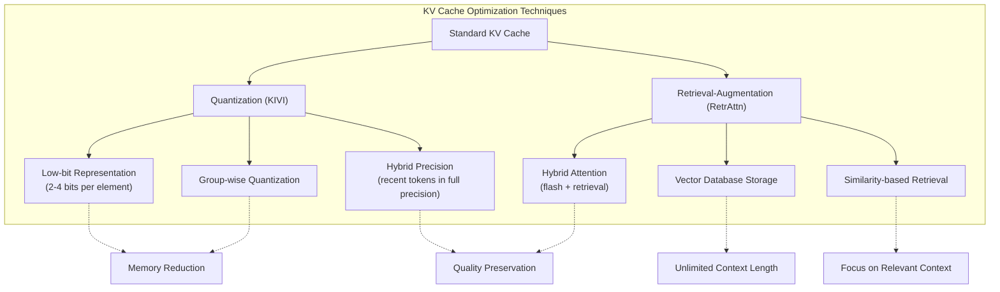
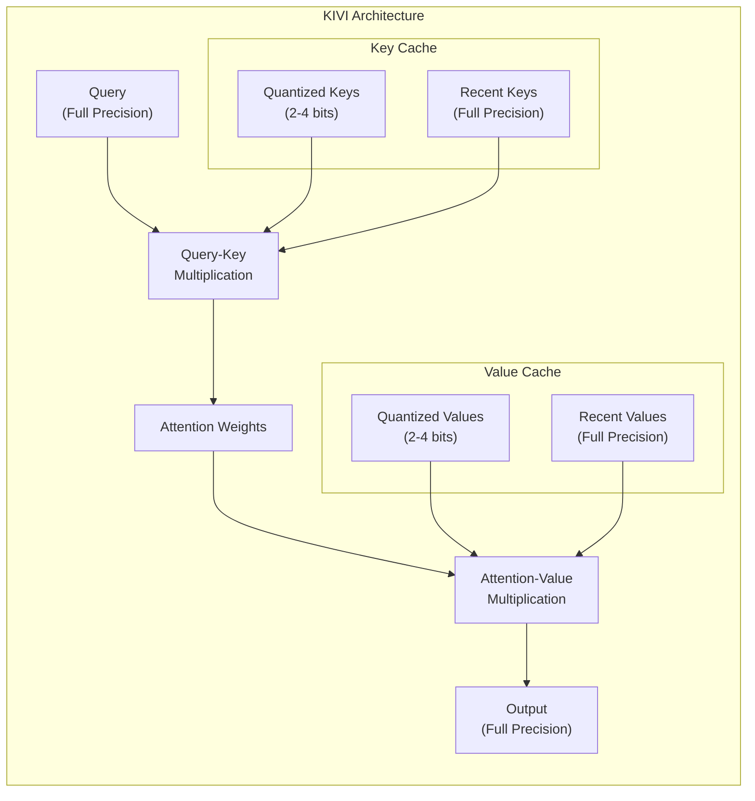
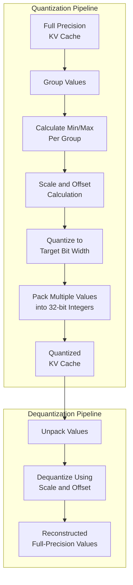
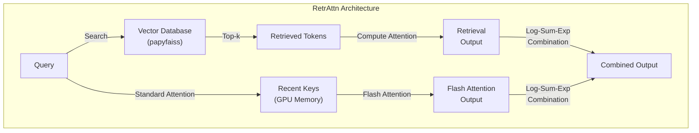
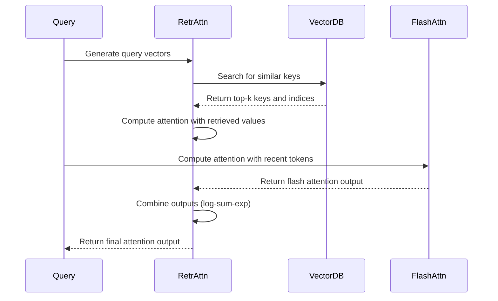
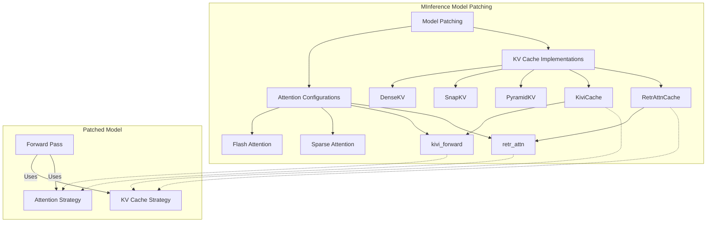

<!-- source: DeepWiki mcp.deepwiki.com · repo microsoft/MInference · page 3.2 Quantized and Retrieval-Augmented Attention · fetched 2026-10-26 -->

# Quantized and Retrieval-Augmented Attention

<details>
<summary>Relevant source files</summary>

The following files were used as context for generating this wiki page:

- [minference/modules/kivi.py](minference/modules/kivi.py)
- [minference/modules/retr_attn.py](minference/modules/retr_attn.py)

</details>


This document details two advanced KV cache optimization techniques in MInference: KIVI (Knowledge Infused Vector Integration) for quantization and RetrAttn for retrieval-augmented attention. Both methods are designed to overcome memory limitations when handling long contexts, but they use different approaches - quantization reduces the precision of stored values, while retrieval selectively accesses the most relevant context.

For information on other KV cache optimization techniques like SnapKV and PyramidKV, see [KV Compression Techniques](#3.1). For details on Quest and other specialized KV cache implementations, see [Quest and Other KV Cache Types](#3.3).

## 1. Overview

KV cache optimization is crucial for efficient long-context inference in LLMs. This page documents two specialized techniques:

1. **KIVI (Knowledge Infused Vector Integration)**: Implements memory-efficient quantized KV caches that reduce the precision of stored keys and values from 16 bits to as few as 2 bits per element.

2. **RetrAttn (Retrieval-Augmented Attention)**: Uses vector database technology to store and retrieve the most relevant tokens from long contexts, enabling efficient processing of very long sequences.



Sources: [minference/modules/kivi.py](), [minference/modules/retr_attn.py]()

## 2. KIVI: Quantized KV Cache

KIVI implements a memory-efficient quantized KV cache that dramatically reduces the memory footprint of the attention mechanism by quantizing the key and value tensors to low-bit representations.

### 2.1 Core Concepts

- **Low-bit Quantization**: Reduces precision from 16-bit floating point to as few as 2-4 bits per value
- **Group-wise Quantization**: Applies quantization to groups of tokens for better quality preservation
- **Hybrid Precision**: Keeps recent tokens in full precision while older tokens are quantized
- **Optimized Matrix Operations**: Performs matrix multiplications directly on quantized data



Sources: [minference/modules/kivi.py:560-576]()

### 2.2 Quantization Process

The quantization process consists of these key steps:

1. **Grouping**: Values are grouped into blocks (controlled by `group_size` parameter)
2. **Scale and Zero-point Calculation**: Per-group minimum and maximum values are computed
3. **Quantization**: Values are mapped to the target bit range (e.g., 0-3 for 2-bit quantization)
4. **Packing**: Multiple quantized values are packed into a single 32-bit integer



Sources: [minference/modules/kivi.py:19-61](), [minference/modules/kivi.py:214-275]()

### 2.3 KiviCache Implementation

The `KiviCache` class manages both quantized and full-precision versions of the key and value states:

| Component | Description |
|-----------|-------------|
| `group_size` | Number of elements in each quantization group |
| `bits` | Bit width for quantization (typically 2 or 4) |
| `residual_length` | Number of recent tokens to keep in full precision |
| `kv_cache` | List containing tuple of (quantized keys, full keys, key scales, key mins, quantized values, full values, value scales, value mins) |

Key operations:
- During **prefill**: Initial processing of prompt, quantizing all tokens except the last `residual_length` tokens
- During **decoding**: New tokens are accumulated in full precision, with periodic quantization of older tokens

Sources: [minference/modules/kivi.py:560-728]()

### 2.4 Matrix Operations on Quantized Data

The system performs matrix multiplications directly on quantized data using custom CUDA/Triton kernels:

1. **Query-Key Multiplication**: `cuda_bmm_fA_qB_outer` performs matrix multiplication between full-precision queries and quantized keys
2. **Attention-Value Multiplication**: Similar operation for the attention-value product

This direct operation on quantized data avoids the need to dequantize the entire KV cache for every token generated.

Sources: [minference/modules/kivi.py:411-557](), [minference/modules/kivi.py:954-1075]()

## 3. RetrAttn: Retrieval-Augmented Attention

RetrAttn uses vector database technology to store and retrieve the most relevant key-value pairs for attention computation, enabling efficient processing of very long sequences.

### 3.1 Core Concepts

- **Vector Database Storage**: Keys and values are stored in a vector database (using papyfaiss)
- **Top-k Retrieval**: Only the most relevant tokens are retrieved for attention computation
- **Hybrid Attention**: Combines retrieval-based attention with standard attention on recent tokens
- **Asynchronous Processing**: Updates to the vector database happen asynchronously for better throughput



Sources: [minference/modules/retr_attn.py:267-344](), [minference/modules/retr_attn.py:350-441]()

### 3.2 Vector Database KV Cache

The `VectorDB_KV_Cache` class manages both GPU memory and vector database storage:

| Component | Description |
|-----------|-------------|
| `key_cache` | List of vector indices for keys |
| `value_cache` | List of CPU tensors for values |
| `gpu_key_cache` | Recent keys kept in GPU memory |
| `gpu_value_cache` | Recent values kept in GPU memory |
| `start_size` | Number of tokens from beginning of context to keep |
| `recent_size` | Number of recent tokens to keep |

The vector database stores historical tokens and supports efficient similarity search to retrieve the most relevant tokens during inference.

Sources: [minference/modules/retr_attn.py:24-264]()

### 3.3 Retrieval-Augmented Attention Process

The retrieval-augmented attention process works as follows:

1. **Similarity Search**: Query vectors are used to search the vector database for similar keys
2. **Top-k Selection**: The k most similar keys and their corresponding values are retrieved
3. **Attention Computation**: Standard attention is computed on both retrieved tokens and recent tokens
4. **Output Combination**: The two attention outputs are combined using a log-sum-exp operation



Sources: [minference/modules/retr_attn.py:350-441]()

### 3.4 Asynchronous Operation

RetrAttn uses asynchronous updates to improve performance:

1. **Prefill Phase**: During initial processing, updates to the vector database happen asynchronously
2. **Decoding Phase**: Retrieval operations happen synchronously during token generation
3. **Threading**: Background threads handle vector database updates while the main thread continues processing

This asynchronous operation minimizes latency during inference.

Sources: [minference/modules/retr_attn.py:42-120]()

## 4. Integration with MInference

Both KIVI and RetrAttn integrate with the MInference framework through the model patching system.



Sources: [minference/modules/kivi.py:954-1075](), [minference/modules/retr_attn.py:350-441]()

### 4.1 Configuration Parameters

Key configuration parameters for both methods:

#### KIVI Configuration:
- `bits`: Bit width for quantization (typically 2 or 4)
- `group_size`: Number of elements in each quantization group
- `residual_length`: Number of recent tokens to keep in full precision

#### RetrAttn Configuration:
- `max_seq_length`: Maximum sequence length supported
- `max_new_tokens`: Maximum number of new tokens to generate
- `num_layers`: Number of layers in the model
- `top_k`: Number of tokens to retrieve from the vector database
- `from_layer`: Layer from which to start using retrieval-augmented attention

Sources: [minference/modules/kivi.py:560-576](), [minference/modules/retr_attn.py:267-282]()

## 5. Comparative Analysis

| Aspect | KIVI | RetrAttn |
|--------|------|----------|
| **Primary Focus** | Memory efficiency | Unlimited context |
| **Technique** | Quantization | Similarity-based retrieval |
| **Memory Reduction** | 4-8x | Variable (depends on top-k) |
| **Quality Impact** | Slight degradation | Potential improvement for retrieval tasks |
| **External Dependencies** | Optional CUDA kernel | papyfaiss |
| **Computational Overhead** | Low | Moderate (search overhead) |
| **Context Length** | Same as standard KV cache | Virtually unlimited |

Sources: [minference/modules/kivi.py](), [minference/modules/retr_attn.py]()

## 6. Usage Examples

### 6.1 Using KIVI Cache

To use KIVI in MInference, specify the appropriate KV cache type in your configuration:

```python
config = MInferenceConfig(
    attn_type="minference",
    kv_type="kivi",
    attn_kwargs={
        "bits": 2,           # Bit width for quantization
        "group_size": 32,    # Number of elements per quantization group
        "residual_length": 64  # Number of tokens to keep in full precision
    }
)
```

### 6.2 Using RetrAttn Cache

To use RetrAttn in MInference, specify the retrieval-augmented attention in your configuration:

```python
config = MInferenceConfig(
    attn_type="minference",
    kv_type="retr_attn",
    attn_kwargs={
        "max_seq_length": 100000,  # Maximum sequence length supported
        "max_new_tokens": 2000,    # Maximum new tokens to generate
        "num_layers": 32,          # Number of model layers
        "top_k": 2000              # Number of tokens to retrieve
    }
)
```

Sources: [minference/modules/kivi.py:560-576](), [minference/modules/retr_attn.py:267-282]()

---

