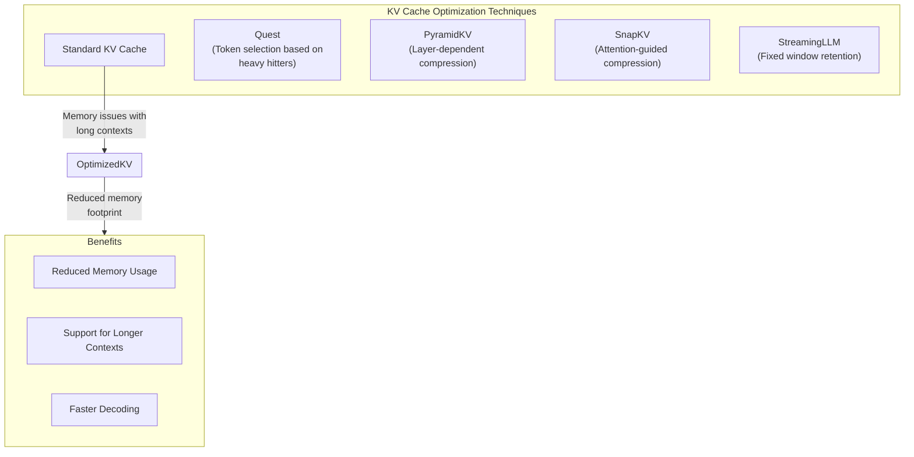
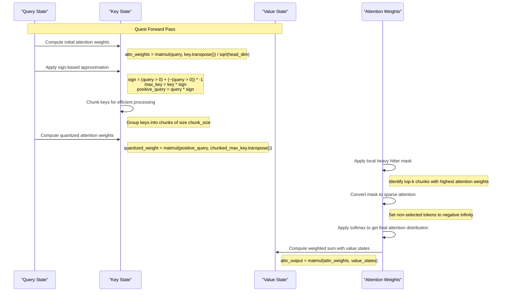
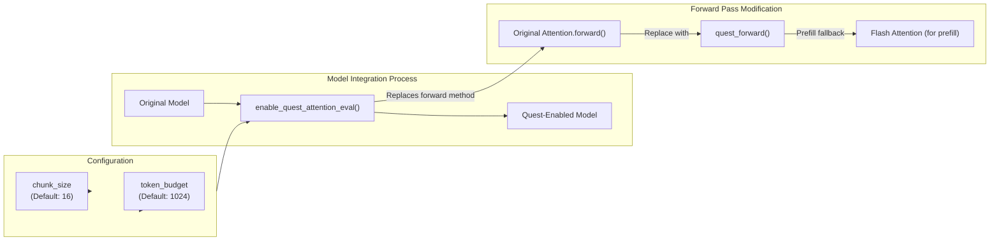
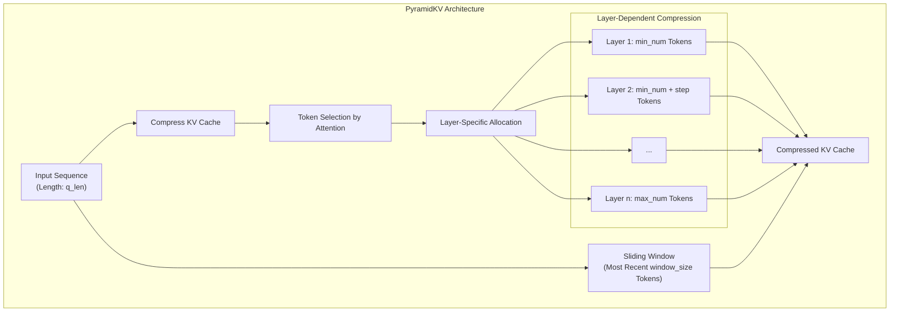
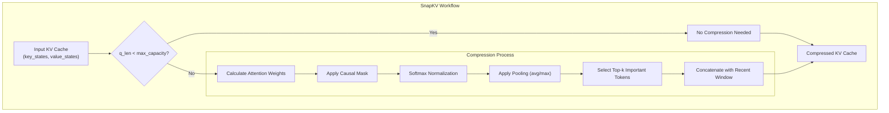
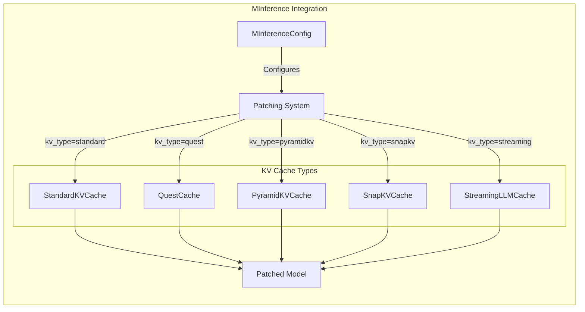

<!-- source: DeepWiki mcp.deepwiki.com · repo microsoft/MInference · page 3.3 Quest and Other KV Cache Types · fetched 2026-10-26 -->

# Quest and Other KV Cache Types

Relevant source files

The following files were used as context for generating this wiki page:

- [minference/modules/pyramidkv.py](minference/modules/pyramidkv.py)
- [minference/modules/quest.py](minference/modules/quest.py)
- [minference/modules/snapkv.py](minference/modules/snapkv.py)

## Purpose and Scope

This document provides technical details about Quest and other specialized KV cache implementations available in MInference. These implementations aim to optimize memory usage and computation during inference with long contexts by employing various techniques to manage the key-value (KV) cache efficiently. For information about general KV compression techniques like SnapKV and PyramidKV, see [KV Compression Techniques](#3.1).

## KV Cache Types Overview

The KV cache is a critical component in transformer-based language models that stores key and value tensors from previous tokens to avoid redundant computation. As context length increases, memory requirements grow significantly. MInference implements several specialized KV cache types to address this challenge.

Sources: [minference/modules/quest.py](), [minference/modules/pyramidkv.py](), [minference/modules/snapkv.py]()

## Quest Attention Mechanism

Quest (Query-Efficient Sparse Transformer) is an innovative approach that selectively attends to only the most important tokens from the KV cache during decoding, reducing computational overhead and memory usage.

### Key Concepts of Quest

- **Heavy Hitter Detection**: Identifies the most important tokens in each attention head
- **Chunked Processing**: Groups tokens into chunks for more efficient selection
- **Selective Attention**: Only computes full attention for the selected tokens

Sources: [minference/modules/quest.py:70-226](), [minference/modules/quest.py:229-323]()

### Implementation Details

Quest implements a custom forward pass that works in two modes:

1. **Prefill Mode**: Uses standard attention for the initial tokens (q_len > 1 or early layers)
2. **Decoding Mode**: Applies Quest's selective attention mechanism for subsequent tokens

In decoding mode, Quest:

1. Computes initial attention weights between the query and all key states
2. Approximates these weights using a sign-based approach (`sign = (query > 0) + (~(query > 0)) * -1`)
3. Chunks the key states for more efficient processing
4. Identifies the most important chunks using the `local_heavy_hitter_mask` function
5. Applies sparse attention by masking out less important tokens
6. Computes the final attention output only using the selected tokens

The `token_budget` parameter controls how many tokens are retained in the sparse attention calculation, effectively determining the memory-performance tradeoff.

Sources: [minference/modules/quest.py:21-67](), [minference/modules/quest.py:70-226]()

### Integration with Models

Quest can be integrated with existing transformer models through a patching mechanism:

Sources: [minference/modules/quest.py:559-589]()

## PyramidKV Compression

PyramidKV implements a layer-dependent compression strategy for KV caches, where different transformer layers retain different numbers of tokens in a pyramid-like structure.

### Key Features of PyramidKV

- **Layer-Dependent Retention**: Earlier layers retain fewer tokens while later layers retain more
- **Attention-Based Selection**: Uses attention patterns to select the most important tokens
- **Sliding Window**: Always retains the most recent tokens in a fixed-size window

Sources: [minference/modules/pyramidkv.py:12-183]()

### Implementation Details

PyramidKV uses the `PyramidKVCluster` class to manage KV cache compression. The key parameters are:

- `window_size`: Number of recent tokens to always retain
- `max_capacity_prompt`: Maximum total tokens to retain
- `kernel_size`: Size of the pooling kernel for token importance calculation
- `pooling`: Method for pooling attention weights ("avgpool" or "maxpool")
- `beta`: Controls the distribution of tokens across layers

The main algorithm:

1. Calculates a layer-specific token budget based on the layer index
2. Computes attention weights between the most recent tokens and all previous tokens
3. Applies a causal mask to ensure proper attention patterns
4. Uses pooling to compute token importance scores
5. Selects the top-k most important tokens based on the layer's budget
6. Concatenates these important tokens with the most recent window

Sources: [minference/modules/pyramidkv.py:49-183]()

## SnapKV Compression

SnapKV provides efficient KV cache compression by selecting important tokens based on attention patterns.

### Key Features of SnapKV

- **Attention-Based Selection**: Uses attention patterns to identify important tokens
- **Fixed Compression Rate**: Maintains a consistent number of tokens across all layers
- **Sliding Window**: Always retains the most recent tokens in a fixed window

Sources: [minference/modules/snapkv.py:13-107]()

### Implementation Details

SnapKV uses the `SnapKVCluster` class with these parameters:

- `window_size`: Number of recent tokens to always retain
- `max_capacity_prompt`: Maximum total tokens to retain
- `kernel_size`: Size of the pooling kernel for token importance calculation
- `pooling`: Method for pooling attention weights ("avgpool" or "maxpool")

The compression algorithm:

1. If the sequence length is less than the maximum capacity, no compression is performed
2. Otherwise, compute attention weights between the most recent tokens and all previous tokens
3. Apply a causal mask to ensure proper attention patterns
4. Use pooling to compute token importance scores
5. Select the top-k most important tokens based on the configured budget
6. Concatenate these important tokens with the most recent window

SnapKV also provides an alternative implementation, `StreamingLLMKVCluster`, which uses a simpler approach that just keeps the first `max_capacity_prompt - window_size` tokens plus the most recent `window_size` tokens, without sophisticated token selection.

Sources: [minference/modules/snapkv.py:40-107](), [minference/modules/snapkv.py:110-172]()

## Comparison of KV Cache Optimization Techniques

| Technique | Key Features | Best Use Case | Memory Efficiency | Computation Overhead |
|-----------|--------------|---------------|-------------------|----------------------|
| Quest | Selects important tokens using heavy hitters detection | Decoding with very long contexts | High | Medium |
| PyramidKV | Layer-dependent compression with attention-based selection | Models with varying layer importance | High | Low |
| SnapKV | Fixed compression rate with attention-based selection | General-purpose compression | Medium | Low |
| StreamingLLM | Simple window-based token retention | Streaming scenarios with recency bias | Medium | Very Low |

Sources: [minference/modules/quest.py](), [minference/modules/pyramidkv.py](), [minference/modules/snapkv.py]()

## Integration with MInference

These KV cache optimization techniques are integrated into the MInference framework and can be selected based on specific use cases and requirements.

Sources: [minference/modules/quest.py:559-589](), [minference/modules/pyramidkv.py](), [minference/modules/snapkv.py]()

## Conclusion

Quest and other specialized KV cache implementations in MInference provide powerful techniques for optimizing memory usage and computation during inference with long contexts. By selectively retaining important tokens and using efficient compression strategies, these techniques enable models to handle much longer contexts than would otherwise be possible within memory constraints.

For practical usage, the choice between these techniques depends on specific requirements regarding memory efficiency, computational overhead, and the nature of the task. The MInference framework allows for easy integration and configuration of these different KV cache types to best suit the needs of each application.

---

