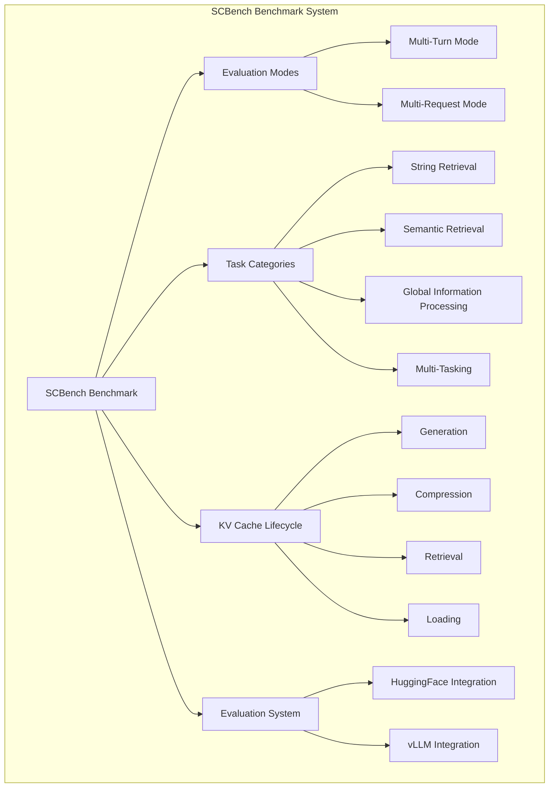
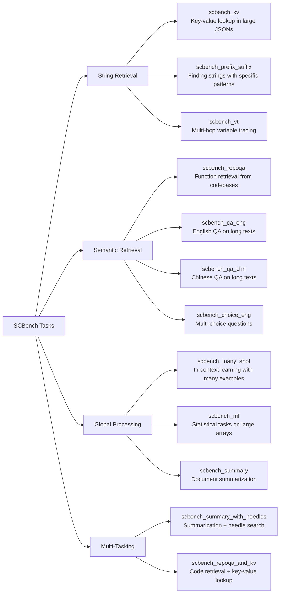
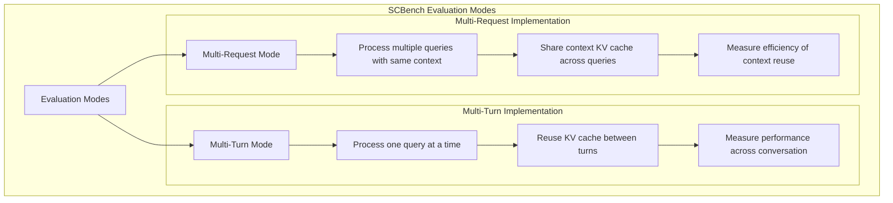
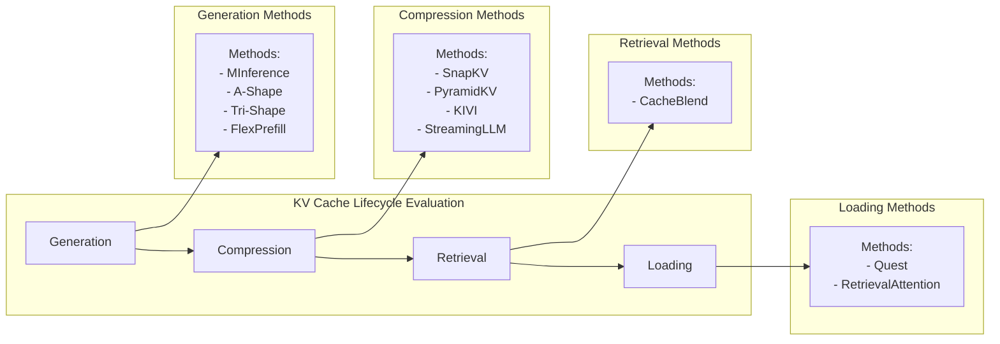
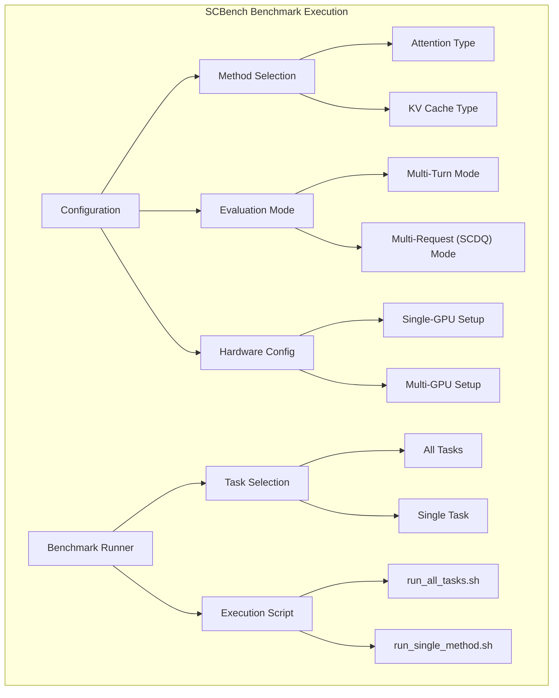

<!-- source: DeepWiki mcp.deepwiki.com · repo microsoft/MInference · page 4 SCBench Benchmark · fetched 2026-10-26 -->

# SCBench Benchmark

<details>
<summary>Relevant source files</summary>

The following files were used as context for generating this wiki page:

- [images/SCBench_onepage.png](images/SCBench_onepage.png)
- [scbench/readme.md](scbench/readme.md)

</details>


## Purpose and Scope

This document provides a comprehensive overview of SCBench (SharedContextBench), a benchmark suite specifically designed to evaluate long-context methods from a KV cache-centric perspective. SCBench focuses on analyzing performance across the full KV cache lifecycle including generation, compression, retrieval, and loading.

For information about MInference's core components, see [MInference Core](#2) and for KV cache optimization techniques, see [KV Cache Optimizations](#3).

## Overview

SCBench is a comprehensive benchmark suite that evaluates efficient long-context methods through both multi-turn and multi-request interactions. It is specifically designed to test how different methods handle shared context scenarios, which are common in real-world applications but often overlooked in existing benchmarks.



Sources: [scbench/readme.md:8-9](), [scbench/readme.md:120-123](), [scbench/readme.md:146-149]()

## Task Categories

SCBench includes 12 diverse tasks organized into four categories, each designed to test specific long-context capabilities:



Sources: [scbench/readme.md:120-143]()

### String Retrieval Tasks

These tasks test the model's ability to find and retrieve specific strings from long contexts:

- **scbench_kv**: Tests key-value lookup in large JSON objects with random, incompressible content
- **scbench_prefix_suffix**: Evaluates finding strings with specific prefix and suffix patterns
- **scbench_vt**: Assesses multi-hop variable tracing capabilities in long inputs

Sources: [scbench/readme.md:125-128]()

### Semantic Retrieval Tasks

These tasks require deeper understanding of content:

- **scbench_repoqa**: Function retrieval from large codebases based on natural language descriptions
- **scbench_qa_eng/scbench_qa_chn**: Question answering in English and Chinese on long documents
- **scbench_choice_eng**: Multi-choice questions requiring comprehension of long texts

Sources: [scbench/readme.md:130-133]()

### Global Information Processing Tasks

These tasks require processing information across the entire context:

- **scbench_many_shot**: Tests in-context learning with hundreds of examples
- **scbench_mf**: Statistical tasks on large arrays
- **scbench_summary**: Summarization of long documents

Sources: [scbench/readme.md:135-139]()

### Multi-Tasking Tasks

These tasks require handling multiple objectives simultaneously:

- **scbench_summary_with_needles**: Combines summarization with needle-in-haystack search
- **scbench_repoqa_and_kv**: Integrates code function retrieval with key-value lookup

Sources: [scbench/readme.md:141-143]()

## Evaluation Modes

SCBench supports two distinct evaluation modes that simulate different real-world scenarios:



Sources: [scbench/readme.md:146-149](), [scbench/readme.md:39-40]()

### Multi-Turn Mode

This is the default mode of SCBench. It simulates a conversation-like interaction where:
- Multiple queries are processed sequentially
- KV cache from previous turns is reused
- Performance is evaluated across the entire conversation

In code, this mode is implemented in the `GreedySearch` and `GreedySearch_vllm` classes in the evaluation utilities.

Sources: [scbench/readme.md:39-40](), [scbench/readme.md:147]()

### Multi-Request Mode

This mode is enabled with the `--same_context_different_query` flag. It simulates scenarios where:
- Multiple different queries share the same context
- The context KV cache is generated once and reused across queries
- Performance is evaluated on the efficiency of context reuse

This mode is particularly relevant for applications where multiple users might ask different questions about the same document or codebase.

Sources: [scbench/readme.md:39-40](), [scbench/readme.md:148]()

## KV Cache Lifecycle Evaluation

A unique aspect of SCBench is its focus on evaluating methods across the full KV cache lifecycle:



Sources: [scbench/readme.md:8-9]()

This comprehensive evaluation approach allows SCBench to assess how different methods perform across each stage of the KV cache lifecycle, providing insights into their strengths and weaknesses in different scenarios.

## Data Format and Loading

SCBench uses a standardized data format across all tasks:

```json
{
    "id": "Random id for each piece of data.",
    "context": "The long context required for the task, such as repo-code, long-document, and many-shot.",
    "multi_turns": [{"input": "multi-turn question.", "answer": "multi-turn reference answer."}],
}
```

The benchmark data can be loaded through the Hugging Face datasets library:

```python
from datasets import load_dataset

datasets = ["scbench_kv", "scbench_prefix_suffix", "scbench_vt", "scbench_repoqa", 
            "scbench_qa_eng", "scbench_qa_chn", "scbench_choice_eng", "scbench_many_shot", 
            "scbench_summary", "scbench_mf", "scbench_summary_with_needles", 
            "scbench_repoqa_and_kv"]

for dataset in datasets:
    data = load_dataset("microsoft/SCBench", dataset, split="test")
```

Sources: [scbench/readme.md:14-23](), [scbench/readme.md:25-35]()

## Running Benchmarks

SCBench supports running benchmarks with various configurations and methods:



Sources: [scbench/readme.md:38-63](), [scbench/readme.md:65-85]()

### Running All Methods

To run all methods on a specific model:

```bash
# Single-GPU, in Multi-Turn Mode
bash scripts/run_all_tasks.sh meta-llama/Llama-3.1-8B-Instruct 1 multi-turn

# Multi-GPU, in Multi-Turn Mode
bash scripts/run_all_tasks.sh meta-llama/Llama-3.1-8B-Instruct 2 multi-turn

# Multi-GPU, in Multi-Request Mode
bash scripts/run_all_tasks.sh meta-llama/Llama-3.1-8B-Instruct 2 scdq
```

Sources: [scbench/readme.md:42-50]()

### Running Single Method

To run a specific method on a model:

```bash
# Single-GPU, in Multi-Turn Mode, using attn_type: vllm, kv_type: dense
bash scripts/run_single_method.sh meta-llama/Llama-3.1-8B-Instruct 1 multi-turn vllm dense

# Multi-GPU, in Multi-Turn Mode, using attn_type: vllm, kv_type: dense
bash scripts/run_single_method.sh meta-llama/Llama-3.1-8B-Instruct 2 multi-turn vllm dense

# Multi-GPU, in Multi-Request Mode, using attn_type: vllm, kv_type: dense
bash scripts/run_single_method.sh meta-llama/Llama-3.1-8B-Instruct 2 scdq vllm dense
```

Sources: [scbench/readme.md:53-61]()

## Supported Methods

SCBench supports evaluation of various attention and KV cache types:

### Attention Types

| Attention Type | Description | Key Parameters |
|----------------|-------------|----------------|
| `dense` | Standard dense attention | N/A |
| `minference` | MInference sparse attention | `best_pattern` (loaded from config) |
| `a_shape` | A-Shape sparse attention | `n_local` (default: 3968), `n_init` (default: 128) |
| `tri_shape` | Tri-Shape sparse attention | `n_local` (default: 3968), `n_init` (default: 128), `n_last` (default: 100) |

Sources: [scbench/readme.md:100-106](), [scbench/readme.md:176-188]()

### KV Cache Types

| KV Cache Type | Description | Key Parameters |
|---------------|-------------|----------------|
| `dense` | Standard KV cache | N/A |
| `kivi` | KIVI quantization | `bits` (default: 2), `group_size` (default: 32), `residual_length` (default: 32) |
| `snapkv` | SnapKV compression | `window_size` (default: 32), `max_capacity_prompt` (default: 4096), `kernel_size` (default: 5), `pooling` (default: "avgpool") |
| `pyramidkv` | Pyramid compression | Same as SnapKV |
| `quest` | Quest attention | `chunk_size` (default: 16), `token_budget` (default: 1024) |
| `streamingllm` | StreamingLLM | `n_local` (default: 3968), `n_init` (default: 128) |

Sources: [scbench/readme.md:108-115](), [scbench/readme.md:191-209]()

## Environment Setup

Setting up the environment for SCBench involves installing basic dependencies and, optionally, additional packages for specific efficient long-context methods:

### Basic Dependencies

```bash
conda create -n scbench python=3.10 -y && conda activate scbench
pip install torch
pip install minference
pip install flash-attn --no-build-isolation
git clone https://github.com/microsoft/MInference.git && cd MInference/scbench
pip install -r requirements.txt
```

Sources: [scbench/readme.md:152-161]()

### Optional Dependencies for Specific Methods

For KIVI:

```bash
bash setup/setup_kivi.sh
```

Sources: [scbench/readme.md:163-171]()

## Comparison to Other Benchmarks

SCBench differentiates itself from existing long-context benchmarks by being the first to comprehensively cover:

1. Single-turn, multi-turn, and multi-request scenarios
2. The full KV cache lifecycle (generation, compression, retrieval, and loading)
3. A focus on KV cache reuse techniques

This holistic approach provides a more complete picture of how different methods perform in real-world shared context scenarios.

Sources: [scbench/readme.md:218-222]()

## Customizing Benchmark Parameters

SCBench allows customization of various parameters:

- `--max_seq_length`: Maximum sequence length for the test
- `--max_turns`: Maximum number of turns for the test
- `--num_eval_examples`: Number of test examples to use (default: all)
- `--hyper_param`: JSON string to override method-specific parameters

Example of overriding parameters:
```bash
python run_multiturnbench.py ... --hyper_param '{"n_local": 4096}'
```

Sources: [scbench/readme.md:81-85](), [scbench/readme.md:210-214]()

---

