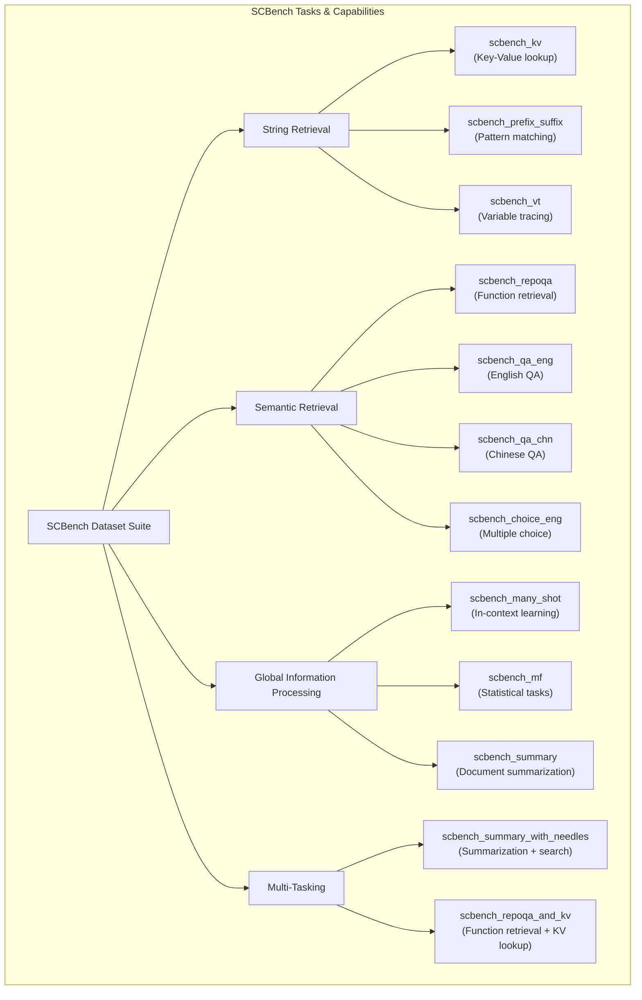
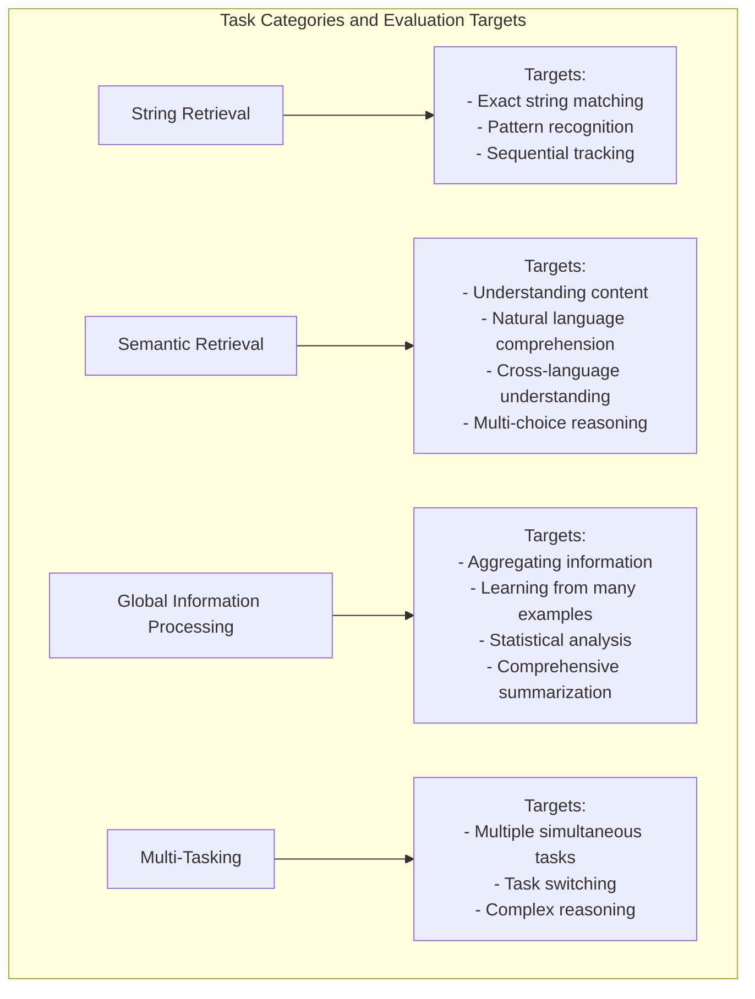
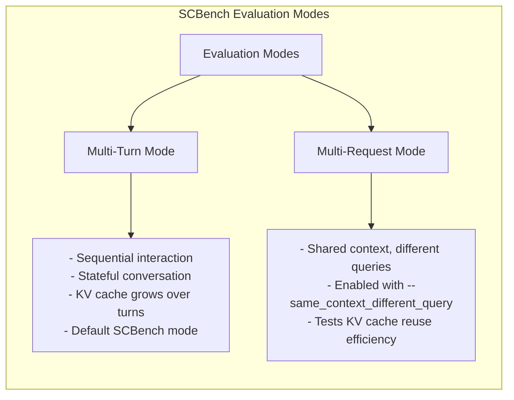
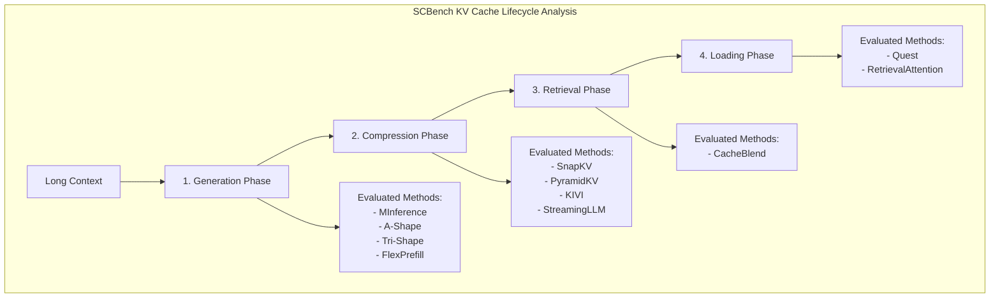

<!-- source: DeepWiki mcp.deepwiki.com · repo microsoft/MInference · page 4.1 Tasks and Datasets · fetched 2026-10-26 -->

# Tasks and Datasets

<details>
<summary>Relevant source files</summary>

The following files were used as context for generating this wiki page:

- [images/SCBench_onepage.png](images/SCBench_onepage.png)
- [scbench/readme.md](scbench/readme.md)

</details>


This page documents the tasks and datasets included in SCBench (SharedContextBench), focusing on how they are structured, categorized, and used for evaluating long-context methods. For information about how to run benchmarks with these tasks, see [Running Benchmarks](#4.3).

## 1. Overview

SCBench includes 12 diverse tasks specifically designed to evaluate different aspects of LLM long-context processing capabilities. These tasks are categorized into four fundamental capability areas, allowing for targeted assessment of how well models handle different types of information processing in long contexts.



Sources: [scbench/readme.md:118-143]()

## 2. Data Format

All datasets in SCBench follow a standardized format to ensure consistency across tasks and evaluation modes. The data is structured as JSON with the following schema:

```json
{
    "id": "Random id for each piece of data.",
    "context": "The long context required for the task, such as repo-code, long-document, and many-shot.",
    "multi_turns": [{"input": "multi-turn question.", "answer": "multi-turn reference answer."}],
}
```

This format enables both multi-turn and multi-request evaluation modes, with the `context` field containing the long-context information and the `multi_turns` field containing questions and reference answers for evaluation.

Sources: [scbench/readme.md:25-35]()

## 3. Loading Datasets

SCBench datasets are available through the Hugging Face datasets library. You can load them using the following code:

```python
from datasets import load_dataset

datasets = [
    "scbench_kv", "scbench_prefix_suffix", "scbench_vt", 
    "scbench_repoqa", "scbench_qa_eng", "scbench_qa_chn", "scbench_choice_eng", 
    "scbench_many_shot", "scbench_summary", "scbench_mf", 
    "scbench_summary_with_needles", "scbench_repoqa_and_kv"
]

for dataset in datasets:
    data = load_dataset("microsoft/SCBench", dataset, split="test")
```

Note that SCBench requires datasets library version 2.15.0 or higher.

Sources: [scbench/readme.md:14-23]()

## 4. Task Categories and Datasets

SCBench tasks are divided into four main categories based on the type of long-context capability they test. Each dataset is designed to evaluate specific aspects of these capabilities.



Sources: [scbench/readme.md:118-143]()

### 4.1 String Retrieval Tasks

String retrieval tasks test the model's ability to locate and extract specific strings or patterns within long contexts:

| Dataset | Description | Challenge |
|---------|-------------|-----------|
| `scbench_kv` | Key-value lookup in large JSON objects | Finding specific values in random, incompressible content |
| `scbench_prefix_suffix` | Finding strings with specific patterns | Identifying strings with particular prefix and suffix patterns |
| `scbench_vt` | Variable tracing across large codebases | Multi-hop tracking of variables in long inputs |

Sources: [scbench/readme.md:124-128]()

### 4.2 Semantic Retrieval Tasks

Semantic retrieval tasks evaluate the model's ability to understand and extract relevant information based on meaning:

| Dataset | Description | Challenge |
|---------|-------------|-----------|
| `scbench_repoqa` | Function retrieval from large codebases | Finding functions based on natural language descriptions |
| `scbench_qa_eng` | English question answering on long texts | Comprehending and answering queries about lengthy English content |
| `scbench_qa_chn` | Chinese question answering on long texts | Cross-lingual understanding of lengthy Chinese content |
| `scbench_choice_eng` | Multi-choice questions on long texts | Selecting correct answers based on lengthy context |

Sources: [scbench/readme.md:129-133]()

### 4.3 Global Information Processing Tasks

Global information processing tasks test the model's ability to process and synthesize information across the entire context:

| Dataset | Description | Challenge |
|---------|-------------|-----------|
| `scbench_many_shot` | In-context learning with hundreds of examples | Learning patterns from many examples |
| `scbench_mf` | Statistical tasks on large arrays | Performing calculations and analysis on extensive data |
| `scbench_summary` | Document summarization | Creating concise summaries of lengthy documents |

Sources: [scbench/readme.md:134-139]()

### 4.4 Multi-Tasking Tasks

Multi-tasking tasks evaluate the model's ability to handle multiple types of reasoning simultaneously:

| Dataset | Description | Challenge |
|---------|-------------|-----------|
| `scbench_summary_with_needles` | Summarization with needle-in-haystack search | Combining document summarization with precise information retrieval |
| `scbench_repoqa_and_kv` | Code function retrieval with key-value lookup | Integrating multiple types of information retrieval |

Sources: [scbench/readme.md:140-143]()

## 5. Evaluation Modes

SCBench implements two distinct evaluation modes to comprehensively assess the performance of long-context methods:



### 5.1 Multi-Turn Mode

In Multi-Turn Mode, the model maintains a conversation across multiple turns, with the context preserved throughout the interaction. This mode evaluates how well the model can maintain and utilize information from previous turns while processing new queries.

### 5.2 Multi-Request Mode

In Multi-Request Mode (activated with the `--same_context_different_query` flag), the model processes multiple different queries against the same shared context. This is particularly valuable for evaluating KV cache reuse techniques and testing how efficiently models can process different questions about the same long context.

Sources: [scbench/readme.md:145-149]()

## 6. KV Cache Lifecycle Evaluation

A unique aspect of SCBench is its focus on evaluating methods across the full KV cache lifecycle. This provides insights into how different long-context methods perform at various stages of handling large contexts.



This comprehensive approach makes SCBench particularly valuable for comparing different efficiency techniques for long-context processing.

Sources: [scbench/readme.md:9](), [scbench/readme.md:216-221]()

## 7. Comparison with Other Benchmarks

SCBench distinguishes itself from previous long-context benchmarks by covering a broader range of scenarios and focusing specifically on KV cache evaluation:

| Feature | SCBench | Previous Benchmarks |
|---------|---------|---------------------|
| Single-turn evaluation | ✓ | ✓ |
| Multi-turn evaluation | ✓ | Limited |
| Multi-request evaluation | ✓ | ✗ |
| KV cache reuse analysis | ✓ | ✗ |
| Full KV cache lifecycle | ✓ | ✗ |
| Diverse task categories | ✓ | Varies |

This makes SCBench particularly well-suited for evaluating and comparing long-context methods from a KV cache-centric perspective.

Sources: [scbench/readme.md:216-221]()

---

