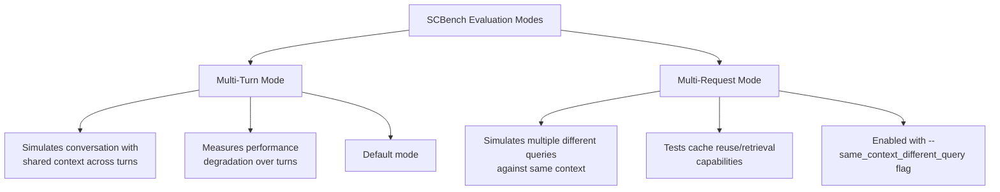
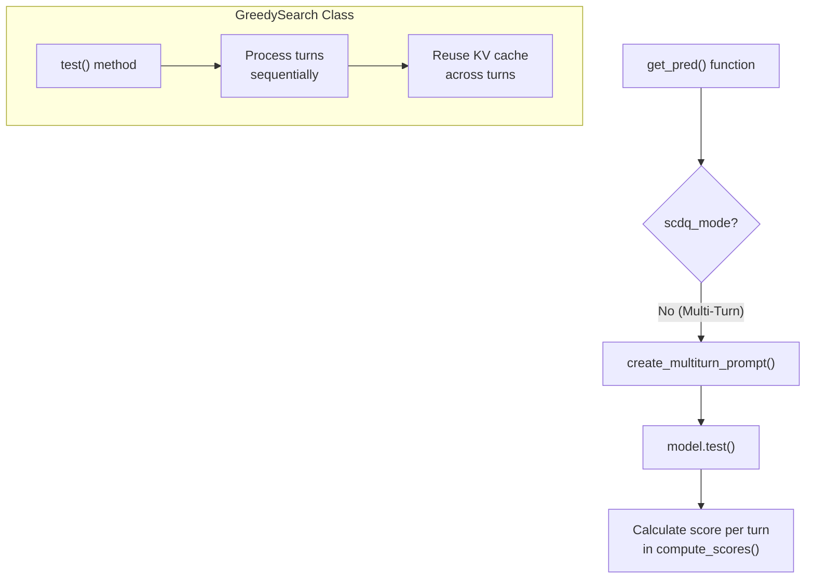
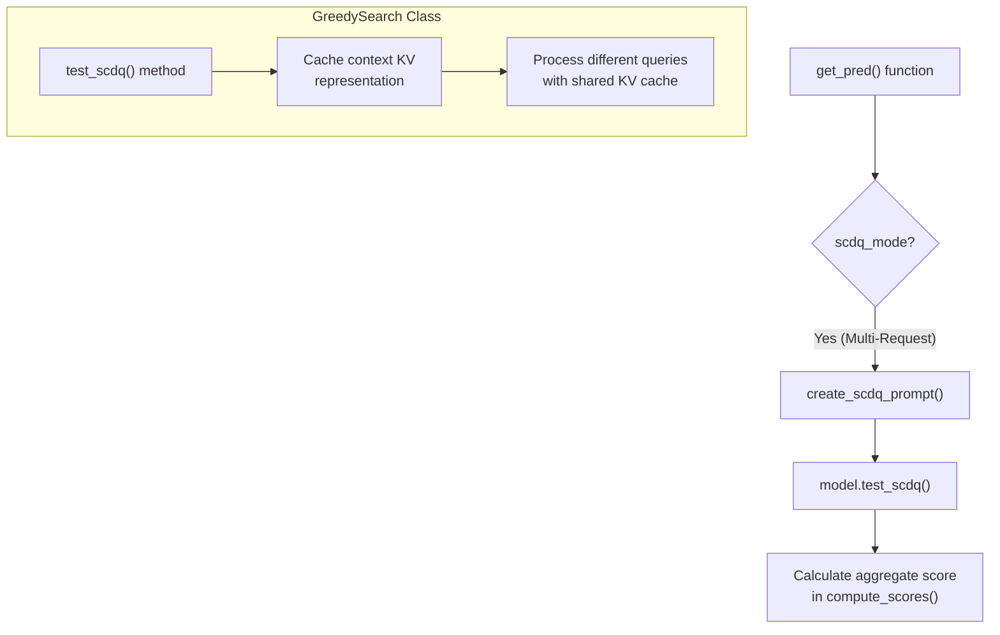
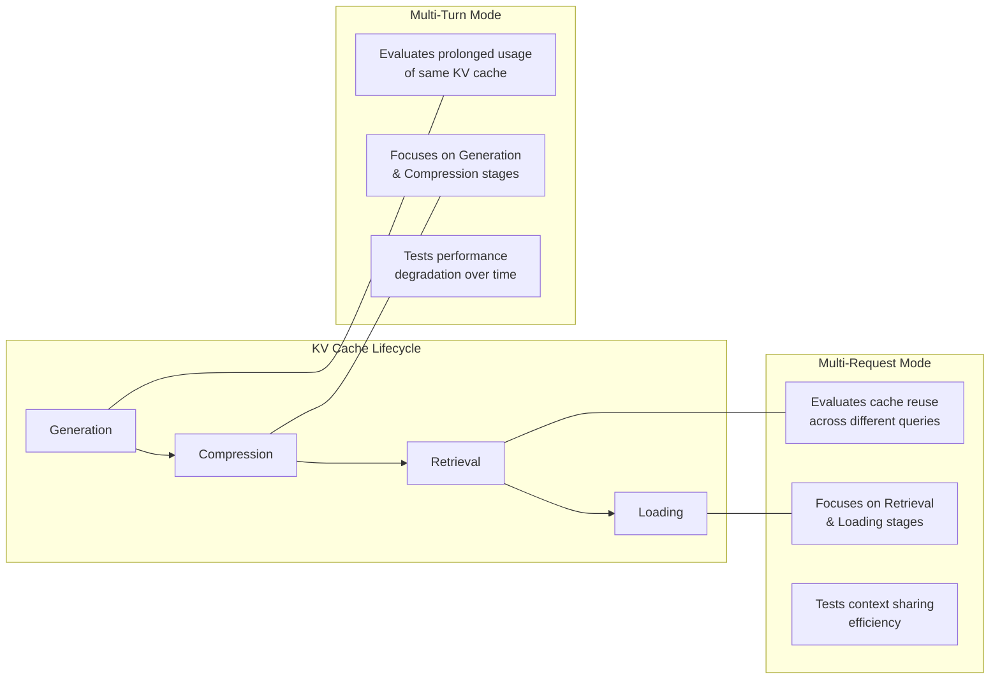
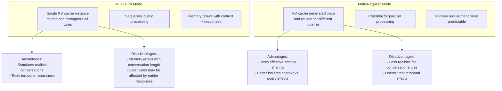

<!-- source: DeepWiki mcp.deepwiki.com · repo microsoft/MInference · page 4.2 Evaluation Modes · fetched 2026-10-26 -->

# Evaluation Modes

<details>
<summary>Relevant source files</summary>

The following files were used as context for generating this wiki page:

- [images/SCBench_onepage.png](images/SCBench_onepage.png)
- [scbench/compute_scores.py](scbench/compute_scores.py)
- [scbench/readme.md](scbench/readme.md)
- [scbench/run_scbench.py](scbench/run_scbench.py)

</details>


## Purpose and Scope

This document describes the evaluation modes in SCBench (SharedContextBench), focusing on how different modes test efficient long-context methods. We cover the design and implementation of the Multi-Turn Mode and Multi-Request Mode, explaining how they evaluate model performance across the KV cache lifecycle.

For information about specific tasks and datasets used in the benchmark, see [Tasks and Datasets](#4.1).

## Overview of Evaluation Modes

SCBench provides two distinct evaluation modes that simulate different real-world scenarios where models process long contexts:



Sources: [scbench/readme.md:146-148](), [scbench/run_scbench.py:98-129]()

## Multi-Turn Mode

The Multi-Turn Mode simulates a conversational scenario where a long context is shared across multiple interaction turns. This is the default evaluation mode in SCBench.

### Design and Purpose

In Multi-Turn Mode, SCBench evaluates how effectively a model:
- Retains information from a long context across multiple turns
- Maintains performance over successive queries about the same context
- Handles KV cache management over an extended interaction

```mermaid
sequenceDiagram
    participant User
    participant Model
    participant "KV Cache"
    
    Note over User,Model: "Long Context (e.g., document, code)"
    User->>Model: "Initial context + Query 1"
    Model->>+"KV Cache": "Store KV for context"
    Model->>-Model: "Process query"
    Model->>User: "Response 1"
    
    User->>Model: "Query 2 (no context repetition)"
    Model->>+"KV Cache": "Reuse existing KV cache"
    Model->>-Model: "Process query"
    Model->>User: "Response 2"
    
    User->>Model: "Query 3 (no context repetition)"
    Model->>+"KV Cache": "Reuse existing KV cache"
    Model->>-Model: "Process query"
    Model->>User: "Response 3"
    
    Note over User,Model: "Performance measured per turn"
```

Sources: [scbench/readme.md:39-40](), [scbench/compute_scores.py:546-663]()

### Implementation Details

The Multi-Turn Mode is implemented in SCBench through the following components:

1. **Prompt Creation**: Using `create_multiturn_prompt()` function, which formats the context and turns into appropriate prompts for the model
2. **Model Execution**: Through the `model.test()` method, which handles processing the multi-turn interaction
3. **Scoring**: Accuracy is calculated per turn, allowing analysis of performance degradation over successive turns

The code path for Multi-Turn evaluation:



Sources: [scbench/run_scbench.py:108-114](), [scbench/run_scbench.py:125-129](), [scbench/compute_scores.py:546-663]()

## Multi-Request Mode

The Multi-Request Mode (also called "same context, different query" or "scdq" mode) simulates a scenario where multiple different queries are executed against the same context, similar to how multiple users might query the same document or codebase.

### Design and Purpose

In Multi-Request Mode, SCBench evaluates:
- A model's ability to efficiently reuse a cached context across different queries
- KV cache retrieval and loading capabilities 
- Performance for disparate queries on the same context

```mermaid
sequenceDiagram
    participant System
    participant Model
    participant "KV Cache"
    
    Note over System,Model: "Long Context (e.g., document, code)"
    
    System->>Model: "Context + Query A"
    Model->>+"KV Cache": "Generate and store KV"
    Model->>-Model: "Process Query A"
    Model->>System: "Response for Query A"
    
    System->>Model: "Context + Query B"
    Model->>+"KV Cache": "Retrieve existing KV"
    Model->>-Model: "Process Query B"
    Model->>System: "Response for Query B"
    
    System->>Model: "Context + Query C" 
    Model->>+"KV Cache": "Retrieve existing KV"
    Model->>-Model: "Process Query C"
    Model->>System: "Response for Query C"
    
    Note over System,Model: "Performance measured across all queries"
```

Sources: [scbench/readme.md:146-148](), [scbench/run_scbench.py:98-103]()

### Implementation Details

The Multi-Request Mode is enabled via the `--same_context_different_query` flag and implemented through:

1. **Prompt Creation**: Using `create_scdq_prompt()` function, which formats the context differently for the SCDQ scenario
2. **Model Execution**: Through the `model.test_scdq()` method, specifically designed for handling same-context different-query interactions
3. **Scoring**: Accuracy is calculated across all queries rather than per turn

The code path for Multi-Request evaluation:



Sources: [scbench/run_scbench.py:98-103](), [scbench/run_scbench.py:120-123](), [scbench/compute_scores.py:455-544]()

## Running Evaluations in Different Modes

SCBench allows running evaluations in both modes using the following command-line options:

### Multi-Turn Mode (Default)
```bash
# Single-GPU, in Multi-Turn Mode
VLLM_ALLOW_LONG_MAX_MODEL_LEN=1 CUDA_VISIBLE_DEVICES=0 VLLM_WORKER_MULTIPROC_METHOD=spawn bash scripts/run_all_tasks.sh meta-llama/Llama-3.1-8B-Instruct 1 multi-turn

# For a specific method
VLLM_ALLOW_LONG_MAX_MODEL_LEN=1 CUDA_VISIBLE_DEVICES=0 VLLM_WORKER_MULTIPROC_METHOD=spawn bash scripts/run_single_method.sh meta-llama/Llama-3.1-8B-Instruct 1 multi-turn vllm dense
```

### Multi-Request Mode
```bash
# Multi-GPU, in Multi-Request Mode
VLLM_ALLOW_LONG_MAX_MODEL_LEN=1 CUDA_VISIBLE_DEVICES=0,1 VLLM_WORKER_MULTIPROC_METHOD=spawn bash scripts/run_all_tasks.sh meta-llama/Llama-3.1-8B-Instruct 2 scdq

# For a specific method
VLLM_ALLOW_LONG_MAX_MODEL_LEN=1 CUDA_VISIBLE_DEVICES=0,1 VLLM_WORKER_MULTIPROC_METHOD=spawn bash scripts/run_single_method.sh meta-llama/Llama-3.1-8B-Instruct 2 scdq vllm dense
```

Sources: [scbench/readme.md:44-49](), [scbench/readme.md:52-61]()

## Relationship to KV Cache Lifecycle

The evaluation modes interact with different stages of the KV cache lifecycle:



Together, these modes provide a comprehensive evaluation framework for analyzing how different long-context techniques perform across the full KV cache lifecycle.

Sources: [scbench/readme.md:9](), [scbench/readme.md:146-148]()

## Scoring Differences Between Modes

The scoring mechanisms differ between the two evaluation modes:

| Aspect | Multi-Turn Mode | Multi-Request Mode |
|--------|----------------|-------------------|
| Score Calculation | Computed per turn | Computed across all queries |
| Performance Analysis | Shows degradation over turns | Shows efficiency of context reuse |
| Result Format | Lists scores for each turn | Single aggregate score |
| Output Example | `turn1:95.3,turn2:92.1,turn3:88.7` | `90.2` |

For multi-task evaluations like `scbench_summary_with_needles` or `scbench_repoqa_and_kv`, the scoring system computes individual scores for each subtask under both modes.

Sources: [scbench/compute_scores.py:455-544](), [scbench/compute_scores.py:546-663]()

## Memory and Computational Efficiency Considerations

The choice between Multi-Turn and Multi-Request modes has significant implications for memory usage and computational efficiency:



Sources: [scbench/run_scbench.py:98-129](), [scbench/readme.md:146-148]()

## Integration with Efficient Long-Context Methods

Both evaluation modes can be used with any of the efficient long-context methods supported by MInference:

| Attention Type (`--attn_type`) | KV Cache Type (`--kv_type`) | Evaluation Modes |
|-------------------------------|----------------------------|-----------------|
| `dense`, `minference`, `a_shape`, `tri_shape` | `dense`, `kivi`, `snapkv`, `quest`, `pyramidkv`, `streamingllm` | Multi-Turn & Multi-Request |

This comprehensive evaluation approach allows researchers to understand how different methods perform in various practical scenarios.

Sources: [scbench/readme.md:96-115]()

---

