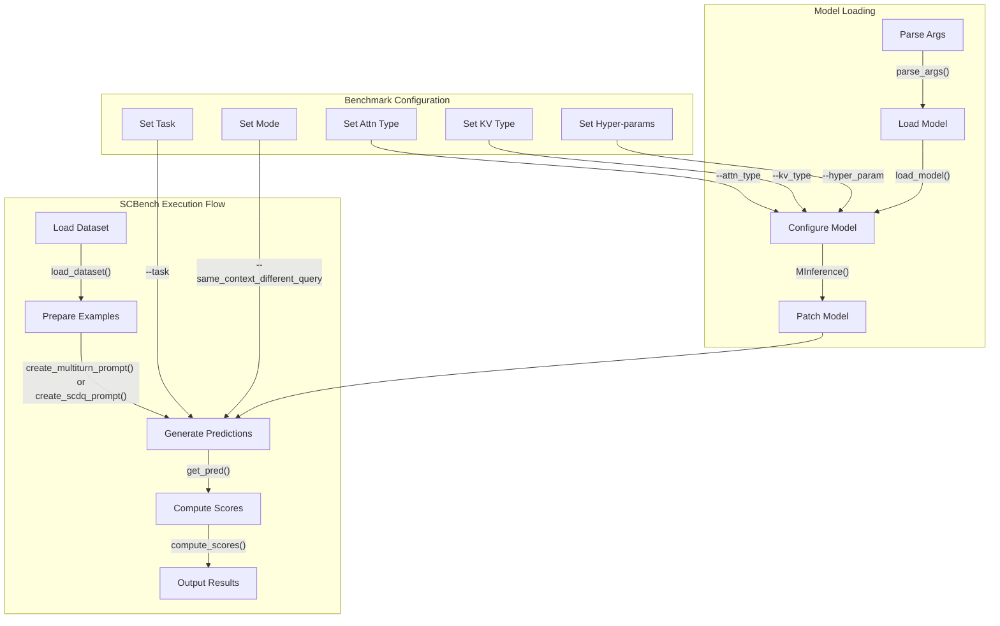
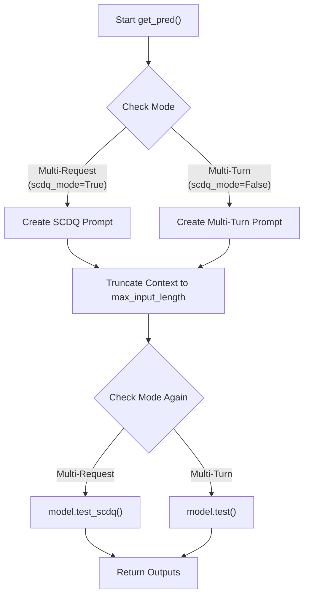

<!-- source: DeepWiki mcp.deepwiki.com · repo microsoft/MInference · page 4.3 Running Benchmarks · fetched 2026-10-26 -->

# Running Benchmarks

<details>
<summary>Relevant source files</summary>

The following files were used as context for generating this wiki page:

- [images/SCBench_onepage.png](images/SCBench_onepage.png)
- [scbench/compute_scores.py](scbench/compute_scores.py)
- [scbench/readme.md](scbench/readme.md)
- [scbench/run_scbench.py](scbench/run_scbench.py)

</details>


This document provides detailed instructions for running benchmarks using SCBench (SharedContextBench) to evaluate the performance of various efficient long-context methods. For more detailed information about SCBench itself, see [SCBench Introduction](#1.2). For specific experimental setup details, see [Experimental Setup](#5).

## Benchmark Overview

SCBench is designed to evaluate efficient long-context methods across the full KV cache lifecycle, from generation through compression, retrieval, and loading. The benchmark supports two key evaluation modes:

1. **Multi-Turn Mode**: Evaluates a conversation-like interaction where the context is reused across multiple turns
2. **Multi-Request Mode**: Tests serving different queries against the same context (enabled with `--same_context_different_query`)



Sources: [scbench/run_scbench.py:270-447]()

## Environment Setup

Before running benchmarks, you need to set up the required environment with the necessary dependencies.

### Basic Environment

```bash
conda create -n scbench python=3.10 -y && conda activate scbench
pip install torch
pip install minference
pip install flash-attn --no-build-isolation
git clone https://github.com/microsoft/MInference.git && cd MInference/scbench
pip install -r requirements.txt
```

### Optional Dependencies for Specific Methods

Some efficient long-context methods require additional setup. For example, to use KIVI:

```bash
bash setup/setup_kivi.sh
```

Sources: [scbench/readme.md:152-172]()

## Running Benchmarks

SCBench provides several scripts for running benchmarks with different configurations.

### Running All Tasks

To run all tasks with a specific model:

```bash
cd scbench
# Single-GPU, in Multi-Turn Mode
VLLM_ALLOW_LONG_MAX_MODEL_LEN=1 CUDA_VISIBLE_DEVICES=0 VLLM_WORKER_MULTIPROC_METHOD=spawn bash scripts/run_all_tasks.sh meta-llama/Llama-3.1-8B-Instruct 1 multi-turn

# Multi-GPU, in Multi-Turn Mode
VLLM_ALLOW_LONG_MAX_MODEL_LEN=1 CUDA_VISIBLE_DEVICES=0,1 VLLM_WORKER_MULTIPROC_METHOD=spawn bash scripts/run_all_tasks.sh meta-llama/Llama-3.1-8B-Instruct 2 multi-turn

# Multi-GPU, in Multi-Request Mode
VLLM_ALLOW_LONG_MAX_MODEL_LEN=1 CUDA_VISIBLE_DEVICES=0,1 VLLM_WORKER_MULTIPROC_METHOD=spawn bash scripts/run_all_tasks.sh meta-llama/Llama-3.1-8B-Instruct 2 scdq
```

### Running a Specific Method

To run a single method with specific configurations:

```bash
cd scbench
# Single-GPU, Multi-Turn Mode, using attn_type: vllm, kv_type: dense
VLLM_ALLOW_LONG_MAX_MODEL_LEN=1 CUDA_VISIBLE_DEVICES=0 VLLM_WORKER_MULTIPROC_METHOD=spawn bash scripts/run_single_method.sh meta-llama/Llama-3.1-8B-Instruct 1 multi-turn vllm dense

# Multi-GPU, Multi-Turn Mode, using attn_type: vllm, kv_type: dense
VLLM_ALLOW_LONG_MAX_MODEL_LEN=1 CUDA_VISIBLE_DEVICES=0,1 VLLM_WORKER_MULTIPROC_METHOD=spawn bash scripts/run_single_method.sh meta-llama/Llama-3.1-8B-Instruct 2 multi-turn vllm dense

# Multi-GPU, Multi-Request Mode, using attn_type: vllm, kv_type: dense
VLLM_ALLOW_LONG_MAX_MODEL_LEN=1 CUDA_VISIBLE_DEVICES=0,1 VLLM_WORKER_MULTIPROC_METHOD=spawn bash scripts/run_single_method.sh meta-llama/Llama-3.1-8B-Instruct 2 scdq vllm dense
```

Sources: [scbench/readme.md:38-63]()

### Using the Python API Directly

You can also run benchmarks directly using the Python API. The main script is `run_scbench.py`, which provides detailed command-line options:

```bash
python run_scbench.py \
    --model_name_or_path meta-llama/Llama-3.1-8B-Instruct \
    --task scbench_kv \
    --max_seq_length 32768 \
    --attn_type minference \
    --kv_type snapkv \
    --hyper_param '{"window_size": 64}'
```

Sources: [scbench/run_scbench.py:270-447]()

## Benchmark Configuration

```mermaid
graph TD
    subgraph "SCBench Benchmark Configuration"
        C["run_scbench.py"] --- T["Tasks"]
        C --- M["Modes"]
        C --- EM["Methods"]
    end
    
    subgraph "Tasks"
        T --> T1["String Retrieval"]
        T --> T2["Semantic Retrieval"]
        T --> T3["Global Processing"]
        T --> T4["Multi-Tasking"]
        
        T1 --> T1_1["--task scbench_kv"]
        T1 --> T1_2["--task scbench_prefix_suffix"]
        T1 --> T1_3["--task scbench_vt"]
        
        T2 --> T2_1["--task scbench_repoqa"]
        T2 --> T2_2["--task scbench_qa_eng"]
        T2 --> T2_3["--task scbench_qa_chn"]
        T2 --> T2_4["--task scbench_choice_eng"]
        
        T3 --> T3_1["--task scbench_many_shot"]
        T3 --> T3_2["--task scbench_mf"]
        T3 --> T3_3["--task scbench_summary"]
        
        T4 --> T4_1["--task scbench_summary_with_needles"]
        T4 --> T4_2["--task scbench_repoqa_and_kv"]
    end
    
    subgraph "Modes"
        M --> M1["Multi-Turn (default)"]
        M --> M2["--same_context_different_query"]
    end
    
    subgraph "Methods"
        EM --> EM1["--attn_type"]
        EM --> EM2["--kv_type"]
        
        EM1 --> EM1_1["dense"]
        EM1 --> EM1_2["minference"]
        EM1 --> EM1_3["a_shape"]
        EM1 --> EM1_4["tri_shape"]
        
        EM2 --> EM2_1["dense"]
        EM2 --> EM2_2["kivi"]
        EM2 --> EM2_3["snapkv"]
        EM2 --> EM2_4["quest"]
        EM2 --> EM2_5["pyramidkv"]
        EM2 --> EM2_6["streamingllm"]
    end
```



Sources: [scbench/readme.md:118-143]()

### Common Parameters

The following table lists the key command-line parameters for running benchmarks:

| Parameter | Description | Default | Example |
|-----------|-------------|---------|---------|
| `--model_name_or_path` | HuggingFace model name or local path | - | `meta-llama/Llama-3.1-8B-Instruct` |
| `--task` | Benchmark task to run | - | `scbench_kv` |
| `--max_seq_length` | Maximum sequence length | 160,000 | `32768` |
| `--max_turns` | Maximum number of turns | All | `3` |
| `--num_eval_examples` | Number of evaluation examples | All | `10` |
| `--attn_type` | Attention type | `dense` | `minference` |
| `--kv_type` | KV cache type | `dense` | `snapkv` |
| `--same_context_different_query` | Use multi-request mode | `False` | - |
| `--output_dir` | Output directory for results | - | `results` |
| `--hyper_param` | Hyperparameters as JSON | `{}` | `'{"n_local": 4096}'` |
| `--tensor_parallel_size` | Number of GPUs for tensor parallelism | `1` | `2` |

Sources: [scbench/run_scbench.py:272-318]()

### Hyperparameters for Efficient Methods

Different efficient long-context methods have specific hyperparameters that can be configured:

| Method | Parameter | Default | Description |
|--------|-----------|---------|-------------|
| **a_shape** | `n_local` | 3968 | Number of local tokens |
| **a_shape** | `n_init` | 128 | Number of initial tokens |
| **tri_shape** | `n_local` | 3968 | Number of local tokens |
| **tri_shape** | `n_init` | 128 | Number of initial tokens |
| **tri_shape** | `n_last` | 100 | Number of last tokens |
| **kivi** | `bits` | 2 | Quantization bits |
| **kivi** | `group_size` | 32 | Group size for quantization |
| **kivi** | `residual_length` | 32 | Residual length |
| **snapkv/pyramidkv** | `window_size` | 32 | Window size |
| **snapkv/pyramidkv** | `max_capacity_prompt` | 4096 | Maximum capacity for prompt |
| **snapkv/pyramidkv** | `kernel_size` | 5 | Kernel size |
| **snapkv/pyramidkv** | `pooling` | "avgpool" | Pooling type |
| **quest** | `chunk_size` | 16 | Chunk size |
| **quest** | `token_budget` | 1024 | Token budget |
| **streamingllm** | `n_local` | 3968 | Number of local tokens |
| **streamingllm** | `n_init` | 128 | Number of initial tokens |

These parameters can be specified using the `--hyper_param` argument as a JSON string:

```bash
python run_scbench.py ... --hyper_param '{"n_local": 4096, "n_init": 256}'
```

Sources: [scbench/readme.md:176-216]()

## Prediction Process

When running a benchmark, SCBench follows these steps:

1. **Load the dataset**: SCBench loads the specified dataset from the Hugging Face hub
2. **Load and configure the model**: The model is loaded with the specified attention and KV cache types
3. **Generate predictions**: For each example in the dataset, the model generates predictions
4. **Compute scores**: Scores are computed based on the task type

The prediction process is handled by the `get_pred()` function in `run_scbench.py`:



Sources: [scbench/run_scbench.py:83-132]()

## Interpreting Results

After running a benchmark, the results are saved to the specified output directory. Results include both predictions and computed scores.

### Output Structure

For each benchmark run, SCBench generates:

1. A JSONL file containing predictions for each example and turn: `prediction_{task}{mode}.jsonl`
2. A summary text file with computed scores: `{model_name}_summary.txt`

### Score Calculation

The `compute_scores()` function in `compute_scores.py` calculates scores based on the task type. Different tasks use different scoring metrics:

| Task Type | Scoring Method |
|-----------|----------------|
| String Retrieval (e.g., `scbench_kv`) | String match accuracy |
| Semantic Retrieval (e.g., `scbench_qa_eng`) | QA F1 score |
| Code-related tasks (e.g., `scbench_repoqa`) | Custom code evaluation metrics |
| Summarization tasks (e.g., `scbench_summary`) | ROUGE-L score |

For Multi-Turn mode, scores are reported for each turn separately. For Multi-Request mode, an overall score is reported.

Example output format:

```
{model_name},{task_name},{max_seq_length},{turn1_score},{turn2_score},...
```

Sources: [scbench/compute_scores.py:430-664]()

## Example Workflow

Here's a complete example of running a benchmark with SCBench:

1. **Set up environment**:
   ```bash
   conda create -n scbench python=3.10 -y && conda activate scbench
   pip install torch minference flash-attn --no-build-isolation
   git clone https://github.com/microsoft/MInference.git && cd MInference/scbench
   pip install -r requirements.txt
   ```

2. **Run a benchmark**:
   ```bash
   # Run with MInference and SnapKV in multi-turn mode
   CUDA_VISIBLE_DEVICES=0 python run_scbench.py \
       --model_name_or_path meta-llama/Llama-3.1-8B-Instruct \
       --task scbench_kv \
       --max_seq_length 32768 \
       --num_eval_examples 10 \
       --attn_type minference \
       --kv_type snapkv \
       --output_dir results
   ```

3. **Check results**:
   ```bash
   cat results/Llama-3.1-8B-Instruct_minference_snapkv/Llama-3.1-8B-Instruct_minference_multi_turn_snapkv_summary.txt
   ```

Sources: [scbench/readme.md:64-96](), [scbench/run_scbench.py:270-447]()

## Troubleshooting

Here are some common issues and their solutions:

1. **Memory errors**: Reduce `max_seq_length` or use more GPUs with `tensor_parallel_size`
2. **Missing datasets**: Ensure you have datasets >= 2.15.0 installed
3. **CUDA errors**: Set `VLLM_ALLOW_LONG_MAX_MODEL_LEN=1` for long sequences
4. **Missing predictions**: Use `--rewrite` to force regeneration of predictions

For more complex experimental setups, see [Running Experiments](#5.3).

Sources: [scbench/readme.md:11-13](), [scbench/run_scbench.py:369-376]()

---

