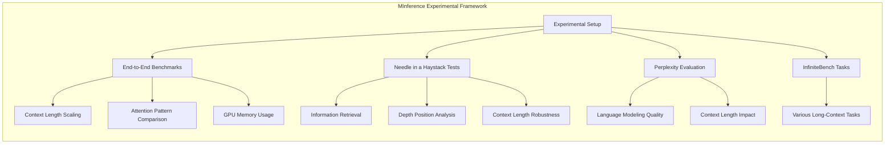
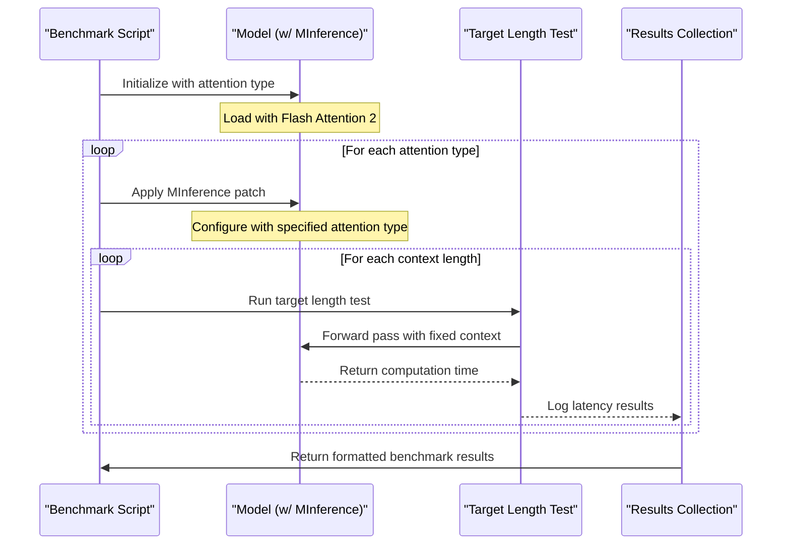
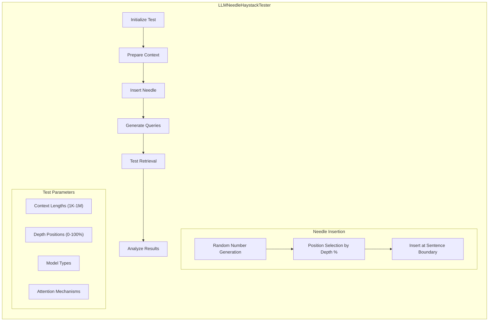
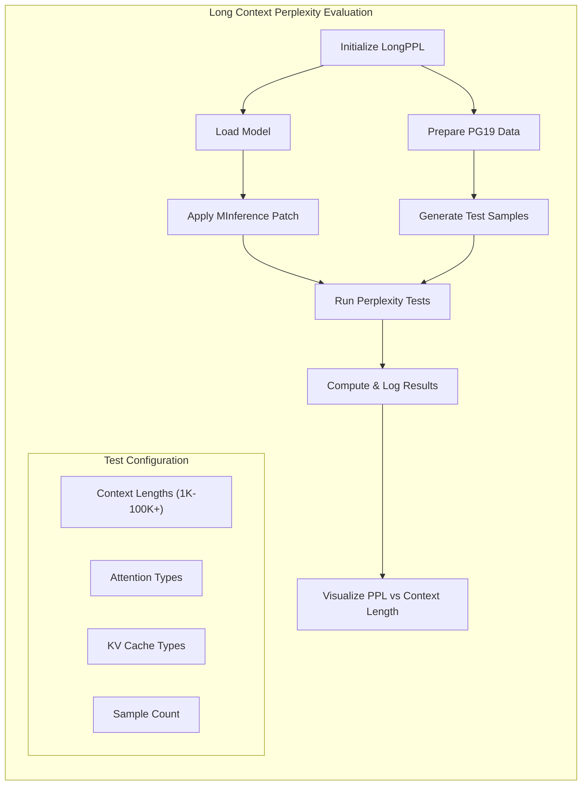
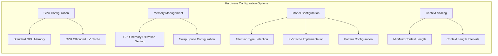

<!-- source: DeepWiki mcp.deepwiki.com · repo microsoft/MInference · page 5 Experimental Setup · fetched 2026-10-26 -->

# Experimental Setup

<details>
<summary>Relevant source files</summary>

The following files were used as context for generating this wiki page:

- [experiments/benchmarks/benchmark_e2e.py](experiments/benchmarks/benchmark_e2e.py)
- [experiments/infinite_bench/run_infinitebench.sh](experiments/infinite_bench/run_infinitebench.sh)
- [experiments/needle_in_a_haystack/needle_test.py](experiments/needle_in_a_haystack/needle_test.py)
- [experiments/needle_in_a_haystack/needle_tools.py](experiments/needle_in_a_haystack/needle_tools.py)
- [experiments/needle_in_a_haystack/run_needle.sh](experiments/needle_in_a_haystack/run_needle.sh)
- [experiments/ppl/run_ppl.py](experiments/ppl/run_ppl.py)
- [experiments/ppl/run_ppl.sh](experiments/ppl/run_ppl.sh)
- [experiments/ruler/requirements.txt](experiments/ruler/requirements.txt)
- [images/benchmarks/needle_viz_LLaMA-3-8B-1M_ours_1K_1000K.png](images/benchmarks/needle_viz_LLaMA-3-8B-1M_ours_1K_1000K.png)
- [images/benchmarks/ppl-LLaMA-3-262k.png](images/benchmarks/ppl-LLaMA-3-262k.png)

</details>


This page describes the experimental setup and evaluation methodologies used to assess MInference performance across various dimensions. It covers the tools, scripts, and configurations for testing different aspects of MInference, including end-to-end benchmarks, retrieval tests, and perplexity evaluations.

For specific benchmark tasks and datasets, see [SCBench Benchmark](#4). For detailed information about model configuration, see [Model Configuration](#5.2).

## Benchmark Architecture

MInference's experimental framework consists of several complementary evaluation methodologies designed to assess different aspects of model performance with long contexts. Each evaluation type targets specific capabilities of the system.



Sources: [experiments/benchmarks/benchmark_e2e.py:1-146](), [experiments/needle_in_a_haystack/needle_test.py:1-138](), [experiments/ppl/run_ppl.py:1-276](), [experiments/infinite_bench/run_infinitebench.sh:1-22]()

## End-to-End Benchmarking

The end-to-end benchmarking evaluates MInference's latency performance across different attention mechanisms and context lengths. This test focuses on real-world inference speed.



The benchmark measures inference time on a complex prompt replicated to reach target context lengths ranging from 10K to 1M tokens. It supports comparing multiple attention mechanisms:
- FlashAttention-2 (dense)
- A-Shape
- MInference
- InfLLM

Each test is run multiple times and averaged to ensure reliable measurement.

Sources: [experiments/benchmarks/benchmark_e2e.py:14-46](), [experiments/benchmarks/benchmark_e2e.py:49-93]()

## Needle in a Haystack Testing

This evaluation methodology tests a model's ability to retrieve specific information embedded deep within a long context. It simulates real-world scenarios where critical information might be located anywhere in a lengthy document.



The test works by:
1. Taking a large text corpus (typically PG19)
2. Inserting a unique random number at varying depths (positions) in the document
3. Asking the model to find and report this number
4. Measuring success rates across different context lengths and insertion positions

This methodology specifically evaluates a model's capability to:
- Process long contexts effectively
- Attend to information regardless of its position
- Maintain performance as context length increases

The test produces a retrieval accuracy matrix across context lengths and depths, providing insights into where MInference excels or struggles with information retrieval.

Sources: [experiments/needle_in_a_haystack/needle_tools.py:23-429](), [experiments/needle_in_a_haystack/needle_test.py:15-137](), [experiments/needle_in_a_haystack/run_needle.sh:1-38]()

## Perplexity Evaluation

The perplexity evaluation assesses the language modeling quality of MInference across varying context lengths. Lower perplexity scores indicate better prediction capability.



Key characteristics of this evaluation:
- Uses PG19 dataset for consistent language modeling evaluation
- Tests contexts from 1K to 100K+ tokens in configurable intervals
- Computes token-level perplexity with appropriate chunking for very long sequences
- Supports different attention mechanisms and KV cache implementations
- Produces visualizations showing how perplexity scales with context length

This test is crucial for determining whether MInference's optimizations preserve language modeling quality while extending context length.

Sources: [experiments/ppl/run_ppl.py:24-276](), [experiments/ppl/run_ppl.sh:1-13]()

## Hardware and Environment Configuration

The experimental setup is designed to evaluate performance across different hardware configurations and memory constraints.



Several common configuration parameters across experiments:
- `kv_cache_cpu`: Enables offloading KV cache to CPU for handling extremely long contexts
- `kv_cache_cpu_device`: Specifies device for CPU offloading ("cpu" by default)
- `attn_type`: Selects attention mechanism ("dense", "minference", "a_shape", etc.)
- `kv_type`: Selects KV cache implementation ("dense", "snapkv", "pyramidkv", etc.)
- `pattern_path`: Path to pre-computed attention pattern configuration
- Hardware utilization settings (GPU memory utilization, swap space)

Sources: [experiments/needle_in_a_haystack/needle_tools.py:205-216](), [experiments/ppl/run_ppl.py:58-84](), [experiments/needle_in_a_haystack/needle_test.py:74-78]()

## Running Experiments

This section outlines how to run the various experiments in the MInference repository.

### End-to-End Benchmarking

To run end-to-end latency benchmarks:

```bash
python experiments/benchmarks/benchmark_e2e.py \
    --model_name gradientai/Llama-3-8B-Instruct-Gradient-1048k \
    --attn_type minference \
    --context_window 100000 \
    --run_benchmark
```

Configuration options include:
- `model_name`: HuggingFace model ID
- `attn_type`: Attention mechanism to test
- `context_window`: Context length to evaluate
- `kv_cache_cpu`: Enable KV cache CPU offloading
- `run_benchmark`: Run full benchmark across multiple context lengths

Sources: [experiments/benchmarks/benchmark_e2e.py:96-146]()

### Needle in a Haystack Testing

To run the needle retrieval test:

```bash
python experiments/needle_in_a_haystack/needle_test.py \
    --model_name gradientai/Llama-3-8B-Instruct-Gradient-1048k \
    --max_length 1000000 \
    --min_length 1000 \
    --rounds 5 \
    --attn_type minference \
    --output_path ./needle \
    --run_name minference_test
```

A convenience script is also provided:

```bash
bash experiments/needle_in_a_haystack/run_needle.sh
```

Configuration options include:
- `model_name`: HuggingFace model ID
- `max_length`/`min_length`: Maximum/minimum context lengths to test
- `rounds`: Number of test iterations
- `attn_type`: Attention mechanism
- `kv_type`: KV cache implementation 
- `kv_cache_cpu`: Enable CPU offloading
- `pattern_path`: Path to predefined attention pattern configuration

Sources: [experiments/needle_in_a_haystack/needle_test.py:97-121](), [experiments/needle_in_a_haystack/run_needle.sh:1-38]()

### Perplexity Testing

To run perplexity evaluation:

```bash
python experiments/ppl/run_ppl.py \
    --model_name gradientai/Llama-3-8B-Instruct-262k \
    --attn_type minference \
    --intervals 19 \
    --num_eval_examples 500
```

Or use the convenience script:

```bash
bash experiments/ppl/run_ppl.sh
```

Configuration options include:
- `model_name`: HuggingFace model ID
- `attn_type`: Attention mechanism
- `kv_type`: KV cache implementation
- `intervals`: Number of context length intervals to test
- `min_seq_length`/`max_seq_length`: Min/max context lengths
- `num_eval_examples`: Number of examples to evaluate
- `do_plot`: Generate visualization of results

Sources: [experiments/ppl/run_ppl.py:229-271](), [experiments/ppl/run_ppl.sh:1-13]()

### InfiniteBench Evaluation

To run InfiniteBench tasks:

```bash
bash experiments/infinite_bench/run_infinitebench.sh MODEL_NAME MAX_SEQ_LENGTH NUM_EXAMPLES ATTN_TYPE
```

For example:
```bash
bash experiments/infinite_bench/run_infinitebench.sh \
    gradientai/Llama-3-8B-Instruct-262k 160000 -1 minference
```

This runs 10 long-context tasks including:
- KV retrieval
- Longbook choice/QA/summarization
- Math problems
- Long dialogue QA
- Code debugging
- Number string manipulation
- Passkey retrieval

Sources: [experiments/infinite_bench/run_infinitebench.sh:1-22]()

## Result Interpretation

Each experimental methodology produces different types of results that evaluate MInference from complementary perspectives.

| Experiment Type | Key Metrics | Results Format | What It Evaluates |
|----------------|-------------|----------------|-------------------|
| End-to-End Benchmarking | Latency (seconds) | CSV table of latency by context length | Raw computational efficiency |
| Needle in a Haystack | Retrieval accuracy (%) | JSON file + visualization with accuracy matrix | Information retrieval capability |
| Perplexity Evaluation | Perplexity (lower is better) | JSON file + visualization showing PPL vs context | Language modeling quality |
| InfiniteBench | Task-specific accuracy | Task-specific output files | Functional capabilities on specific tasks |

When interpreting results:

1. **End-to-End Benchmarks**: Compare latency between different attention mechanisms at each context length. Lower latency indicates better computational efficiency.

2. **Needle in a Haystack**: Examine the heatmap/matrix showing retrieval accuracy by context length and needle position. Better performance at greater depths and longer contexts indicates more robust attention.

3. **Perplexity**: Look for stable perplexity across increasing context lengths. Rapidly increasing perplexity at longer contexts indicates degrading language modeling quality.

4. **InfiniteBench**: Compare task-specific performance metrics against baselines to determine functional effectiveness on practical tasks.

Collectively, these experiments provide a comprehensive evaluation of MInference's performance trade-offs across efficiency, accuracy, and functionality dimensions.

Sources: [experiments/benchmarks/benchmark_e2e.py:83-92](), [experiments/needle_in_a_haystack/needle_tools.py:397-408](), [experiments/ppl/run_ppl.py:194-199]()

---

