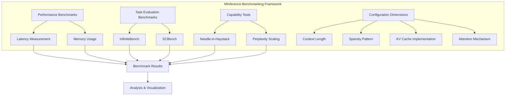
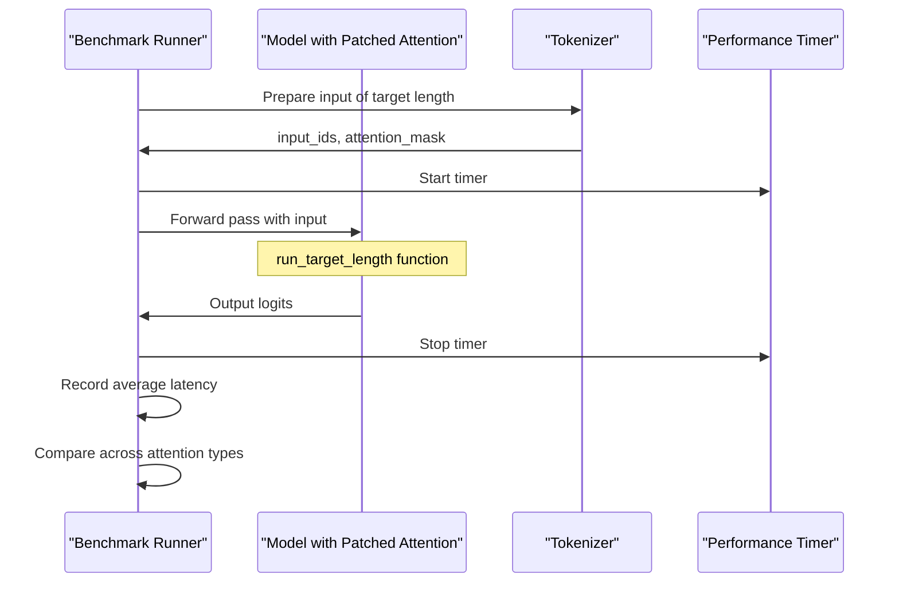
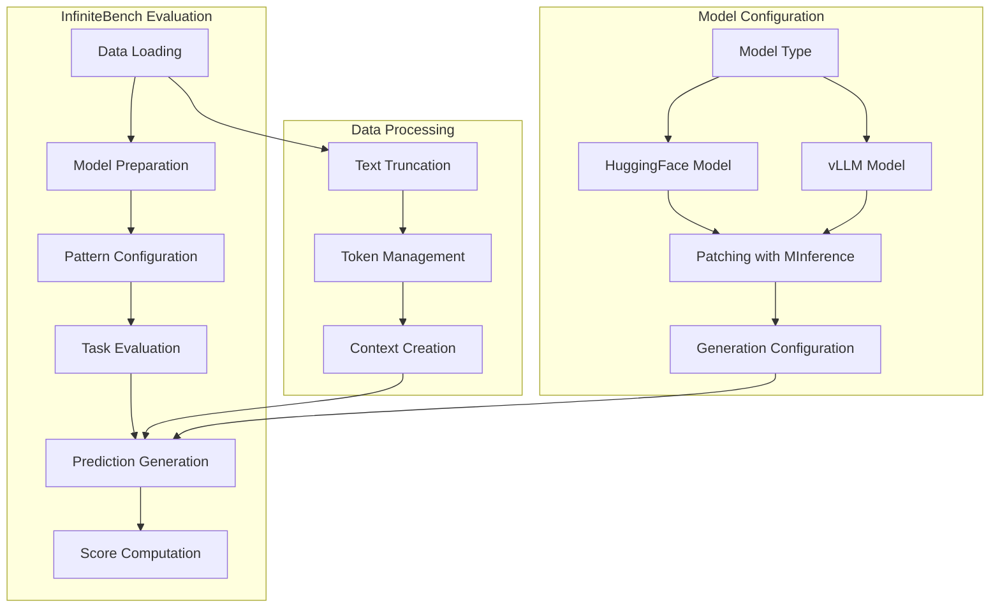
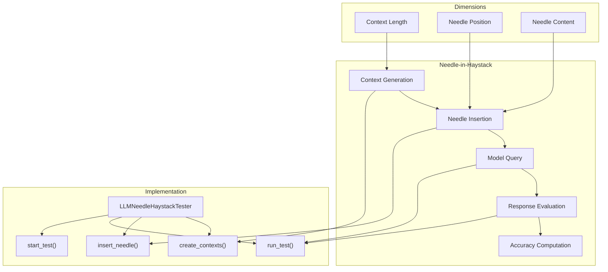
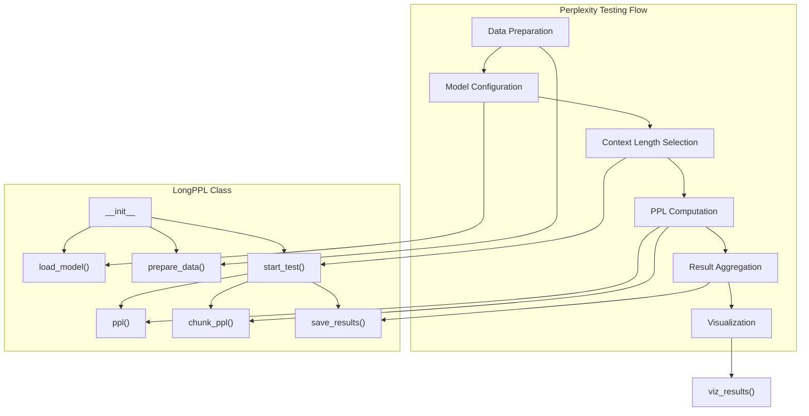
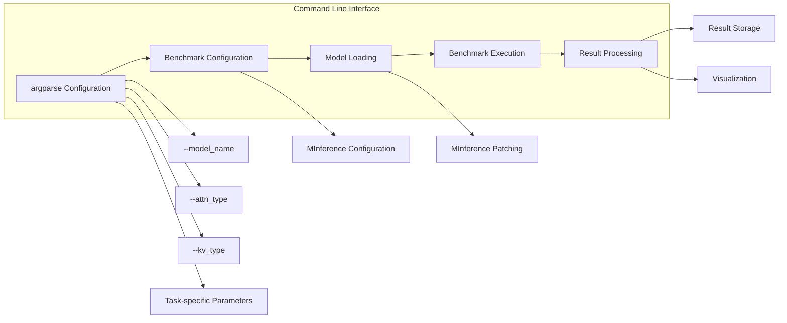

<!-- source: DeepWiki mcp.deepwiki.com · repo microsoft/MInference · page 5.1 Benchmarking Methods · fetched 2026-10-26 -->

# Benchmarking Methods

<details>
<summary>Relevant source files</summary>

The following files were used as context for generating this wiki page:

- [experiments/benchmarks/benchmark_e2e.py](experiments/benchmarks/benchmark_e2e.py)
- [experiments/infinite_bench/run_infinitebench.py](experiments/infinite_bench/run_infinitebench.py)
- [experiments/needle_in_a_haystack/needle_test.py](experiments/needle_in_a_haystack/needle_test.py)
- [experiments/needle_in_a_haystack/needle_tools.py](experiments/needle_in_a_haystack/needle_tools.py)
- [experiments/ppl/run_ppl.py](experiments/ppl/run_ppl.py)

</details>


## Purpose and Scope

This document outlines the benchmarking methodologies used to evaluate MInference's performance and capabilities across different configurations. It covers the various benchmarking tools, metrics, and procedures implemented in the codebase for assessing inference speed, memory usage, and accuracy in long-context scenarios. For information about running experiments with these benchmarks, see [Running Experiments](#5.3).

## Overview of Benchmarking Architecture

MInference employs multiple complementary benchmarking approaches to comprehensively evaluate different aspects of model performance with long contexts.



Sources: [experiments/benchmarks/benchmark_e2e.py:14-93](), [experiments/infinite_bench/run_infinitebench.py:39-296](), [experiments/needle_in_a_haystack/needle_tools.py:23-428](), [experiments/ppl/run_ppl.py:24-226]()

## Performance Benchmarking

Performance benchmarks evaluate the computational efficiency of MInference across different models, attention types, and context lengths.

### Latency Measurement

The primary performance benchmark measures forward pass latency for different attention mechanisms across various context lengths.



The benchmark evaluates multiple attention mechanisms:

- **Dense Attention**: Standard attention using FlashAttention-2
- **A-Shape Attention**: Attention focusing on both local context and global tokens
- **MInference**: Dynamic sparse attention with optimized patterns
- **Other mechanisms**: Various sparse attention implementations

Sources: [experiments/benchmarks/benchmark_e2e.py:14-46](), [experiments/benchmarks/benchmark_e2e.py:49-93]()

### End-to-End Performance Testing

The `benchmark_e2e.py` script provides a comprehensive framework for measuring performance across multiple dimensions:

| Parameter | Description |
|-----------|-------------|
| `model_name` | Model to benchmark |
| `attn_type` | Attention mechanism to evaluate |
| `context_window` | Size of context to test with |
| `run_benchmark` | Flag to run full benchmark across context lengths |
| `kv_cache_cpu` | Option to offload KV cache to CPU |

The script automatically tracks performance across a range of predefined context lengths (10K to 1000K tokens) to evaluate how each attention mechanism scales.

Sources: [experiments/benchmarks/benchmark_e2e.py:94-145]()

## Task-Based Evaluation: InfiniteBench

InfiniteBench is integrated as a benchmark to evaluate the model's ability to understand and process long contexts. The implementation allows testing across various tasks with different long-context requirements.

### InfiniteBench Workflow



Key components in the InfiniteBench implementation:

1. **Model Loading**: Configurable to use either HuggingFace models or vLLM backends
2. **Task Configuration**: Supports multiple data tasks with appropriate generation parameters
3. **Context Handling**: Includes utilities for handling very long contexts, including truncation
4. **Performance Tracking**: Measures generation speed and quality across tasks

Sources: [experiments/infinite_bench/run_infinitebench.py:39-62](), [experiments/infinite_bench/run_infinitebench.py:63-109](), [experiments/infinite_bench/run_infinitebench.py:111-182](), [experiments/infinite_bench/run_infinitebench.py:184-296]()

## Needle-in-Haystack Test

The Needle-in-Haystack test is a specialized benchmark designed to evaluate the model's ability to access and retrieve information embedded at different positions within a long context.

### Test Design



The test operates by:

1. Preparing a long context from a source document
2. Inserting a specific piece of information (the "needle") at a controlled position
3. Asking the model a question that requires retrieving the needle
4. Measuring whether the model accurately retrieves the information

The test systematically varies:
- Context length (from 30K to 100K+ tokens)
- Needle position (expressed as percentage depth in the document)
- Number of test rounds for statistical significance

Sources: [experiments/needle_in_a_haystack/needle_tools.py:23-243](), [experiments/needle_in_a_haystack/needle_tools.py:245-429](), [experiments/needle_in_a_haystack/needle_test.py:15-94]()

### Implementation Details

The `LLMNeedleHaystackTester` class implements this benchmark with configurable parameters:

| Parameter | Description |
|-----------|-------------|
| `context_lengths_min/max` | Range of context lengths to test |
| `n_context_length_intervals` | Number of different context lengths |
| `n_document_depth_intervals` | Number of different needle positions |
| `n_rounds` | Number of test iterations |
| `attn_type` | Attention mechanism to evaluate |
| `kv_type` | KV cache implementation to use |

Results are captured in a structured format that enables visualization of retrieval accuracy across different dimensions.

Sources: [experiments/needle_in_a_haystack/needle_tools.py:128-196](), [experiments/needle_in_a_haystack/needle_tools.py:335-409]()

## Perplexity Testing

Perplexity (PPL) is used as a metric to evaluate how well models maintain coherence as context length increases. The perplexity benchmark systematically tests models across a range of context lengths.



The perplexity benchmark:

1. Processes input texts from a dataset (typically pg19-4k)
2. Truncates them to different context lengths
3. Measures the perplexity for each length
4. Compares perplexity across attention mechanisms

For very long contexts, the implementation uses chunked perplexity computation to manage memory efficiently.

Sources: [experiments/ppl/run_ppl.py:24-106](), [experiments/ppl/run_ppl.py:132-164](), [experiments/ppl/run_ppl.py:165-226]()

### PPL Scaling Analysis

The benchmark provides tools to visualize how perplexity scales with context length across different model configurations:

```python
# Results are stored as:
# {
#   "1K": 3.45,
#   "10K": 3.52,
#   "50K": 3.78,
#   ...
# }
```

This enables analysis of:
- How different attention mechanisms affect perplexity at scale
- Whether sparse attention patterns maintain coherence compared to dense attention
- The effect of KV cache optimizations on model coherence

Sources: [experiments/ppl/run_ppl.py:202-226]()

## Running Benchmarks

The benchmarking system is designed to be easily configurable through command-line arguments. Each benchmark script shares a common pattern for configuration:



Common parameters across benchmarks:

| Parameter | Description | Used In |
|-----------|-------------|---------|
| `model_name` | Model to evaluate | All benchmarks |
| `attn_type` | Attention mechanism | All benchmarks |
| `kv_type` | KV cache implementation | All benchmarks |
| `max_seq_length` | Maximum context length | All benchmarks |
| `pattern_path` | Path to sparsity pattern config | Needle-in-Haystack, InfiniteBench |
| `output_file/output_path` | Where to save results | All benchmarks |

Sources: [experiments/benchmarks/benchmark_e2e.py:96-119](), [experiments/infinite_bench/run_infinitebench.py:186-293](), [experiments/needle_in_a_haystack/needle_test.py:97-121](), [experiments/ppl/run_ppl.py:230-271]()

## Results Analysis and Interpretation

The benchmarking methods produce structured results that enable comprehensive analysis of MInference's performance:

1. **Latency vs. Context Length**: Shows how different attention mechanisms scale with increasing context
2. **Retrieval Accuracy vs. Position**: Demonstrates how well the model accesses information at different positions
3. **Perplexity vs. Context Length**: Reveals how model coherence changes with context size
4. **Accuracy vs. Method**: Compares effectiveness of different sparse attention patterns

These results provide insights into:
- Optimal configurations for different use cases
- Trade-offs between performance and quality
- Scaling behaviors of different attention mechanisms

For detailed instructions on interpreting benchmark results, see [Running Experiments](#5.3).

---

