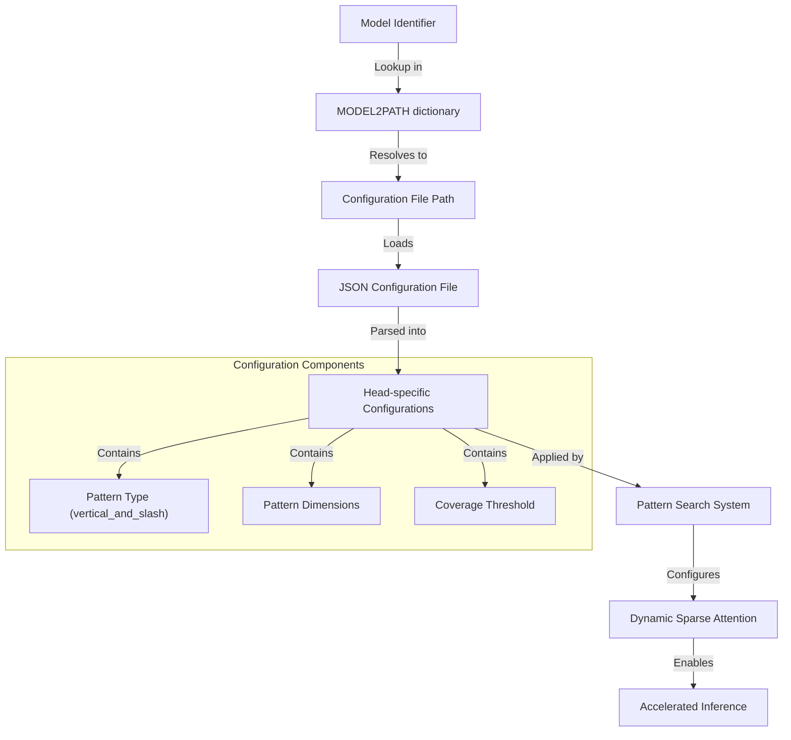
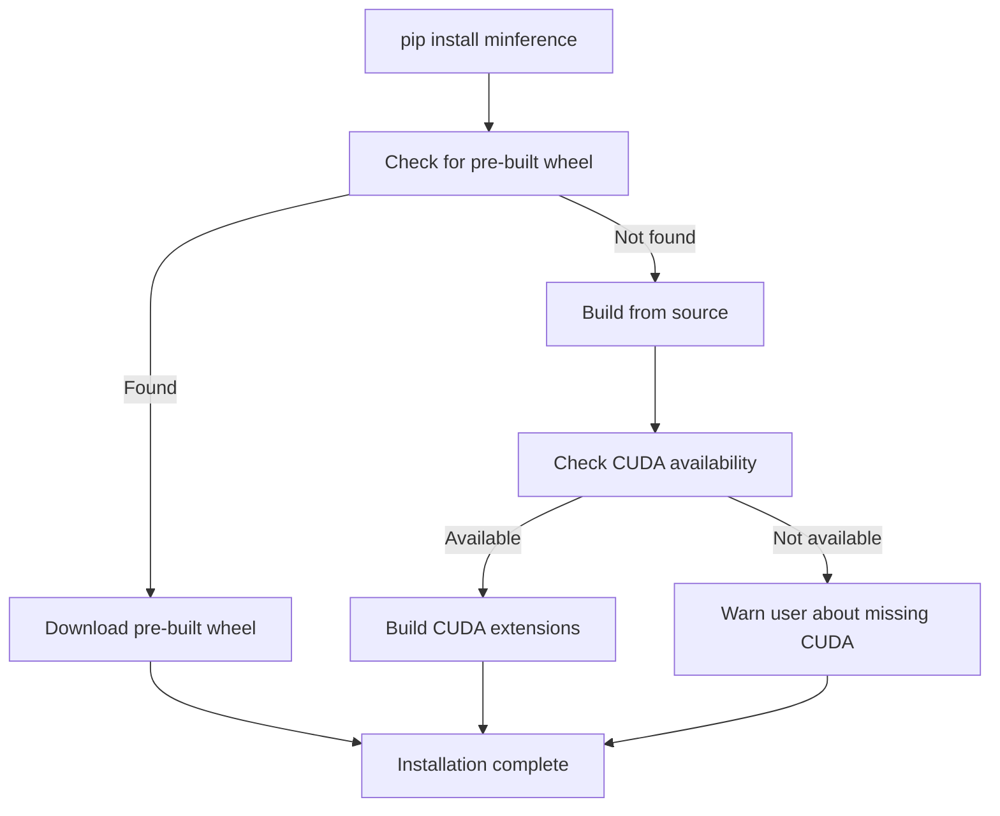
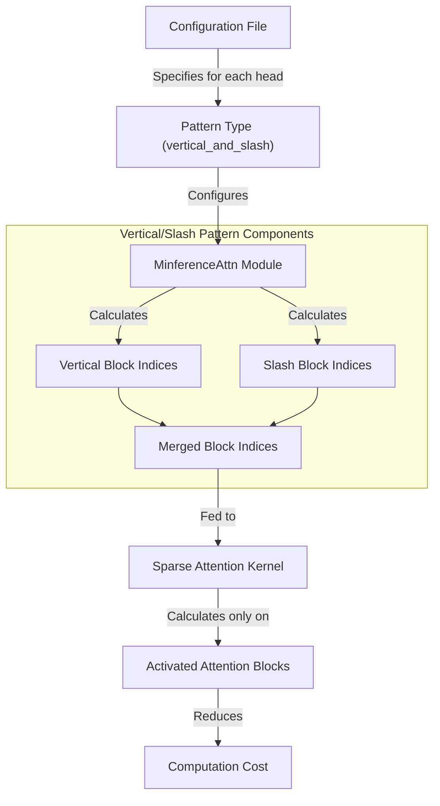

<!-- source: DeepWiki mcp.deepwiki.com · repo microsoft/MInference · page 5.2 Model Configuration · fetched 2026-10-26 -->

# Model Configuration

<details>
<summary>Relevant source files</summary>

The following files were used as context for generating this wiki page:

- [.pre-commit-config.yaml](.pre-commit-config.yaml)
- [minference/__init__.py](minference/__init__.py)
- [minference/configs/Qwen2.5_14B_Instruct_1M.json](minference/configs/Qwen2.5_14B_Instruct_1M.json)
- [minference/configs/Qwen2.5_7B_Instruct_128k_instruct_kv_out_v32_fit_o_best_pattern.json](minference/configs/Qwen2.5_7B_Instruct_128k_instruct_kv_out_v32_fit_o_best_pattern.json)
- [minference/configs/Qwen2.5_7B_Instruct_1M.json](minference/configs/Qwen2.5_7B_Instruct_1M.json)
- [minference/configs/model2path.py](minference/configs/model2path.py)
- [minference/modules/flexprefill.py](minference/modules/flexprefill.py)
- [setup.py](setup.py)

</details>


Model Configuration in MInference defines how sparse attention patterns and other optimizations are applied to supported language models. This documentation explains the configuration file structure, model-to-configuration mapping, installation process, and how to use model configurations effectively. For information about running experiments with these configurations, see [Running Experiments](#5.3).

## Configuration File Structure

MInference configuration files are JSON files containing arrays of objects that map attention head indices to specific sparse attention parameters. Each configuration specifies the optimal attention patterns for different model heads:

```json
[
  {
    "0": ["vertical_and_slash", 9192, 14288, 0.6920984983444214],
    "1": ["vertical_and_slash", 1000, 6096, 0.9862403869628906],
    // More head configurations
  },
  // More layer configurations
]
```

Each entry specifies:
1. The sparsity pattern type (e.g., "vertical_and_slash")
2. Two numeric parameters controlling the pattern's dimensions
3. A threshold value determining attention coverage

Sources: [minference/configs/Qwen2.5_7B_Instruct_1M.json](), [minference/configs/Qwen2.5_14B_Instruct_1M.json]()

## Model-to-Configuration Mapping

MInference maintains a dictionary mapping between model identifiers and their corresponding configuration files in the `MODEL2PATH` dictionary. This enables automatic selection of the appropriate configuration for each supported model.

```python
MODEL2PATH = {
    "gradientai/Llama-3-8B-Instruct-262k": os.path.join(
        BASE_DIR, "Llama_3_8B_Instruct_262k_kv_out_v32_fit_o_best_pattern.json"
    ),
    "microsoft/Phi-3-mini-128k-instruct": os.path.join(
        BASE_DIR, "Phi_3_mini_128k_instruct_kv_out_v32_fit_o_best_pattern.json"
    ),
    # More model mappings
}
```

The list of supported models can be obtained programmatically:

```python
from minference import get_support_models
supported_models = get_support_models()
```

Currently supported models include:
- Llama-3 and Llama-3.1 models (8B and 70B variants)
- Phi-3-mini-128k
- Qwen2, Qwen2.5 models (various sizes)
- Yi-9B-200K
- GLM-4-9B

Sources: [minference/configs/model2path.py:6-65](), [minference/configs/model2path.py:68-69]()

## Model Configuration Flow



Sources: [minference/configs/model2path.py](), [minference/configs/Qwen2.5_7B_Instruct_1M.json]()

## Installation Process

MInference can be installed using pip:

```bash
pip install minference
```

The package has the following dependencies:
- `transformers` (>=4.37.0)
- `accelerate`
- `torch`
- `triton`
- `einops`

The installation process includes a custom wheel installation mechanism (`CachedWheelsCommand`) that tries to download pre-built wheels for your environment before falling back to building from source:



Sources: [setup.py:36-52](), [setup.py:163-194](), [setup.py:221-268]()

## Using Model Configurations

MInference provides two main ways to apply model configurations:

1. Using the `MInference` class directly:
```python
from minference import MInference

# Initialize with model and model name
minference = MInference(model, model_name="meta-llama/Llama-3.1-8B-Instruct")
```

2. Using the patching functions:
```python
from minference import minference_patch

# Patch existing model with MInference optimizations
model = minference_patch(model, model_name="meta-llama/Llama-3.1-8B-Instruct")
```

When a model is specified, MInference automatically:
1. Looks up the model in the `MODEL2PATH` dictionary
2. Loads the corresponding configuration file
3. Applies the optimized sparse attention patterns to the model

```mermaid
flowchart LR
    UserCode["User Code"] --> MInference["MInference Class/Functions"]
    
    subgraph "MInference Configuration System"
        MInference -->|Provides model name| ModelLookup["Model Name Lookup"]
        ModelLookup -->|Maps to config in| MODEL2PATH["MODEL2PATH dictionary"]
        MODEL2PATH -->|Points to| ConfigFile["Configuration File"]
        ConfigFile -->|Loaded by| ConfigParser["Configuration Parser"]
        ConfigParser -->|Configures| PatchingSystem["Patching System"]
        PatchingSystem -->|Applies patterns to| ModelArch["Model Architecture"]
    end
    
    ModelArch -->|Results in| OptimizedModel["Optimized Model"]
    OptimizedModel -->|Enables| FastInference["Accelerated Inference"]
```



Sources: [minference/__init__.py:12-17](), [minference/__init__.py:20-31]()

## Vertical-Slash Pattern Configuration

The most commonly used pattern in MInference configurations is the "vertical_and_slash" pattern, which combines two attention patterns:

1. **Vertical attention**: Focuses on specific important tokens throughout the sequence
2. **Slash attention**: Captures diagonal patterns (local context around each token)

The parameters in the configuration files control:
- The number of activated blocks in the vertical dimension
- The number of activated blocks in the slash (diagonal) dimension
- The threshold determining how much of the attention coverage to maintain



Sources: [minference/modules/flexprefill.py:930-938](), [minference/modules/flexprefill.py:944-950]()

## Table of Supported Models and Configurations

Here's a summary of some key models supported by MInference:

| Model Family | Model Variants | Context Length | Configuration File |
|-------------|----------------|----------------|-------------------|
| Llama 3     | 8B, 70B        | 262K, 1048K, 4194K | Llama_3_*_Instruct_*_kv_out_v32_fit_o_best_pattern.json |
| Llama 3.1   | 8B, 70B        | 128K           | Llama_3.1_*_Instruct_128k_kv_out_v32_fit_o_best_pattern_v2.json |
| Phi-3       | mini           | 128K           | Phi_3_mini_128k_instruct_kv_out_v32_fit_o_best_pattern.json |
| Qwen2       | 7B             | 128K           | Qwen2_7B_Instruct_128k_instruct_kv_out_v32_fit_o_best_pattern.json |
| Qwen2.5     | 7B, 14B, 32B, 72B | 128K, 1M     | Qwen2.5_*_Instruct_*_kv_out_v32_fit_o_best_pattern.json |
| Yi          | 9B             | 200K           | Yi_9B_200k_kv_out_v32_fit_o_best_pattern.json |
| GLM-4       | 9B             | 1M             | GLM_4_9B_1M_instruct_kv_out_v32_fit_o_best_pattern.json |

Sources: [minference/configs/model2path.py:7-64]()

---

