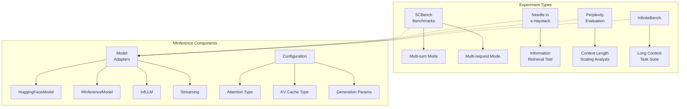
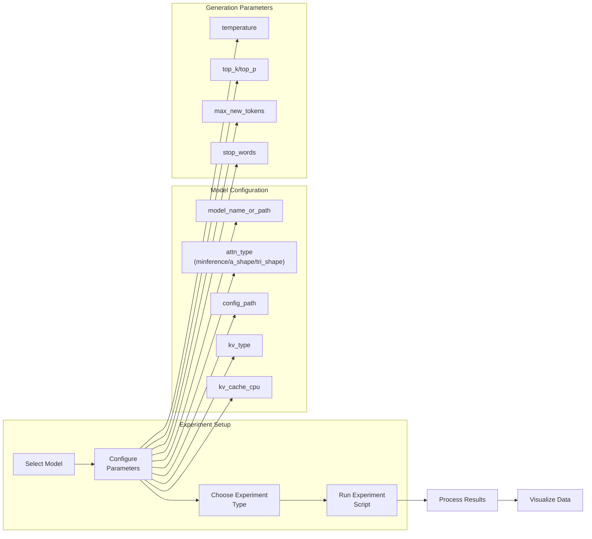
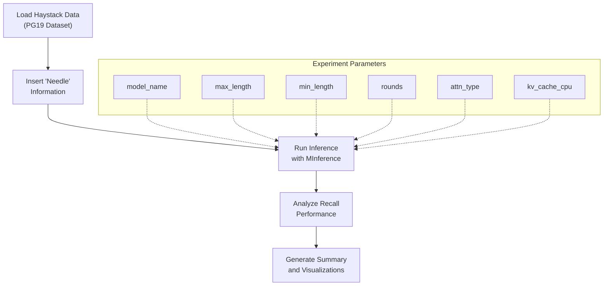
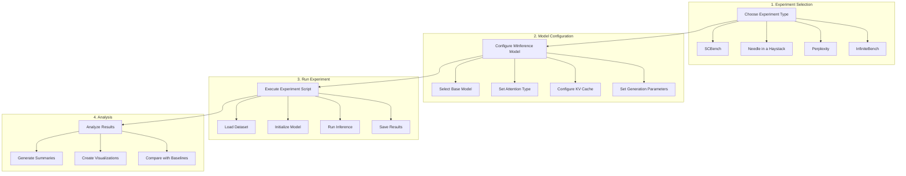

<!-- source: DeepWiki mcp.deepwiki.com · repo microsoft/MInference · page 5.3 Running Experiments · fetched 2026-10-26 -->

# Running Experiments

<details>
<summary>Relevant source files</summary>

The following files were used as context for generating this wiki page:

- [experiments/infinite_bench/run_infinitebench.sh](experiments/infinite_bench/run_infinitebench.sh)
- [experiments/needle_in_a_haystack/run_needle.sh](experiments/needle_in_a_haystack/run_needle.sh)
- [experiments/ppl/run_ppl.sh](experiments/ppl/run_ppl.sh)
- [experiments/ruler/pred/call_api.py](experiments/ruler/pred/call_api.py)
- [experiments/ruler/pred/model_wrappers.py](experiments/ruler/pred/model_wrappers.py)
- [experiments/ruler/requirements.txt](experiments/ruler/requirements.txt)
- [images/benchmarks/needle_viz_LLaMA-3-8B-1M_ours_1K_1000K.png](images/benchmarks/needle_viz_LLaMA-3-8B-1M_ours_1K_1000K.png)
- [images/benchmarks/ppl-LLaMA-3-262k.png](images/benchmarks/ppl-LLaMA-3-262k.png)

</details>


This page provides comprehensive instructions for setting up and running experiments with MInference and SCBench. It covers the process of configuring models, running various types of experiments, and analyzing experimental results. For information about model configuration options, see [Model Configuration](#5.2), and for benchmark-specific details, see [Running Benchmarks](#4.3).

## Experiment Types and Capabilities

MInference supports several types of experiments to evaluate different aspects of long-context language models:

1. **Benchmark Evaluations** - Using SCBench to evaluate models on various tasks
2. **Needle in a Haystack** - Testing information retrieval in very long contexts
3. **Perplexity Evaluations** - Measuring model perplexity across different context lengths
4. **InfiniteBench** - Running the InfiniteBench suite of long-context tasks



Sources: [experiments/ruler/pred/model_wrappers.py:12-272]()(experiments/ruler/pred/call_api.py:38-256)()

## Model Wrappers for Experiments

MInference provides several model wrapper classes that adapt different model types for experiments:

| Wrapper Class | Description | Attention Types | Use Case |
|---------------|-------------|----------------|----------|
| `HuggingFaceModel` | Standard HF model adapter | Flash Attention 2 | Baseline comparisons |
| `MInferenceModel` | MInference-optimized models | minference, a_shape, tri_shape | Main experimental model |
| `InfLLM` | Special optimization for Inf-LLM | inf_llm | Specialized inference |
| `Streaming` | Streaming inference with A-shape attention | a_shape | Efficient streaming |

```mermaid
classDiagram
    class "HuggingFaceModel" {
        +tokenizer
        +pipeline
        +model
        +generation_kwargs
        +__call__(prompt) Dict
    }
    
    class "MInferenceModel" {
        +tokenizer
        +model
        +generation_config
        +stop
        +__call__(prompt) Dict
    }
    
    class "InfLLM" {
        +tokenizer
        +model
        +generation_kwargs
        +stop
        +__call__(prompt) Dict
    }
    
    class "Streaming" {
        +tokenizer
        +model
        +generation_config
        +stop
    }
    
    MInferenceModel <|-- InfLLM
    MInferenceModel <|-- Streaming
```

Sources: [experiments/ruler/pred/model_wrappers.py:12-271]()

## Experiment Configuration Workflow

The experiment configuration process involves setting up the model, defining experiment parameters, and executing the experiment script:



Sources: [experiments/ruler/pred/call_api.py:126-257]()

## Running SCBench Experiments

SCBench experiments are run using the `call_api.py` script, which provides a standardized way to run models on benchmark tasks:

### Command Structure

```bash
python experiments/ruler/pred/call_api.py \
    --data_dir PATH_TO_DATASET \
    --save_dir PATH_TO_SAVE_RESULTS \
    --benchmark BENCHMARK_NAME \
    --task TASK_NAME \
    --server_type minference \
    --model_name_or_path MODEL_PATH \
    --config_path CONFIG_PATH \
    --temperature TEMPERATURE \
    --top_k TOP_K \
    --top_p TOP_P \
    --stop_words STOP_WORDS \
    --starting_layer STARTING_LAYER \
    --kv_type KV_TYPE
```

The `call_api.py` script handles:
1. Loading the task configuration
2. Processing the dataset
3. Initializing the appropriate model
4. Running inference and saving predictions

Sources: [experiments/ruler/pred/call_api.py:260-341]()

## Running Needle in a Haystack Experiments

The Needle in a Haystack experiment tests a model's ability to recall specific information in very long contexts:

### Experiment Flow



### Example Command

```bash
# Run experiment
python experiments/needle_in_a_haystack/needle_test.py \
    --model_name MODEL_NAME \
    --max_length 1000000 \
    --min_length 1000 \
    --rounds 5 \
    --attn_type minference \
    --output_path ./needle \
    --run_name EXPERIMENT_NAME \
    --jobs 0-4

# Generate summary
python experiments/needle_in_a_haystack/needle_summary.py \
    --output_path ./needle \
    --run_name EXPERIMENT_NAME

# Create visualization
python experiments/needle_in_a_haystack/needle_viz.py \
    --res_file ./needle/EXPERIMENT_NAME.json \
    --model_name MODEL_DISPLAY_NAME \
    --mode ours
```

Sources: [experiments/needle_in_a_haystack/run_needle.sh:1-38]()

## Running Perplexity Evaluations

Perplexity evaluations measure a model's performance across different context lengths:

### Example Command

```bash
python experiments/ppl/run_ppl.py \
    --model_name MODEL_NAME \
    --attn_type minference \
    --intervals 19 \
    --num_eval_examples 500 \
    --output_path results/long-ppl/
```

Sources: [experiments/ppl/run_ppl.sh:1-13]()

## Running InfiniteBench Experiments

InfiniteBench provides a suite of tasks designed to evaluate long-context understanding:

### Tasks Available

- kv_retrieval
- longbook_choice_eng
- math_find
- longbook_qa_chn
- longbook_qa_eng
- longdialogue_qa_eng
- code_debug
- longbook_sum_eng
- number_string
- passkey

### Example Command

```bash
# Run all InfiniteBench tasks
bash experiments/infinite_bench/run_infinitebench.sh \
    MODEL_NAME_OR_PATH \
    MAX_SEQ_LENGTH \
    NUM_EVAL_EXAMPLES \
    ATTENTION_TYPE

# Example
bash experiments/infinite_bench/run_infinitebench.sh \
    gradientai/Llama-3-8B-Instruct-262k \
    160000 \
    -1 \
    minference
```

Sources: [experiments/infinite_bench/run_infinitebench.sh:1-22]()

## Experiment Parameters Reference

The following table provides a reference for common parameters used across MInference experiments:

| Parameter | Description | Example Values |
|-----------|-------------|----------------|
| `model_name_or_path` | Path to model or model identifier | `gradientai/Llama-3-8B-Instruct-262k` |
| `attn_type` | Attention mechanism type | `minference`, `a_shape`, `tri_shape` |
| `config_path` | Path to MInference configuration | Path to config JSON file |
| `starting_layer` | First layer to apply optimization | `-1` (all), `0` (from start) |
| `kv_type` | KV cache implementation type | `dense`, `snapkv`, `pyramidkv`, `kivi`, `quest` |
| `kv_cache_cpu` | Whether to offload KV cache to CPU | `true`/`false` |
| `temperature` | Sampling temperature | `0.0` (deterministic) to `1.0` (more random) |
| `top_k` | Top-k sampling parameter | `32` (common default) |
| `top_p` | Top-p (nucleus) sampling parameter | `0.9` (common default) |
| `max_new_tokens` | Maximum tokens to generate | `100` to `1000+` |

Sources: [experiments/ruler/pred/call_api.py:96-110](), [experiments/ruler/pred/model_wrappers.py:74-91]()

## Experiment Workflow

This diagram illustrates the complete workflow for running experiments with MInference:



Sources: [experiments/ruler/pred/call_api.py:39-257](), [experiments/needle_in_a_haystack/run_needle.sh:1-38](), [experiments/ppl/run_ppl.sh:1-13](), [experiments/infinite_bench/run_infinitebench.sh:1-22]()

## Experiment Output and Data Processing

Experiment outputs are typically saved as JSON or JSONL files, which contain:
1. Model inputs and configurations
2. Generated outputs
3. Metrics and performance data

For most experiments, supplementary scripts are provided to:
1. Summarize results across experimental runs
2. Generate visualizations of model performance
3. Compare different model configurations

Refer to the specific experiment directory for detailed information on data processing scripts for each experiment type.

Sources: [experiments/ruler/pred/call_api.py:284-341](), [experiments/needle_in_a_haystack/run_needle.sh:32-38]()

---

