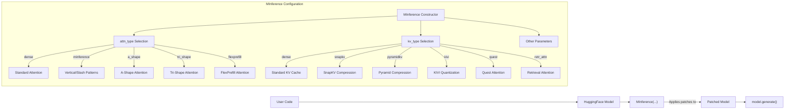
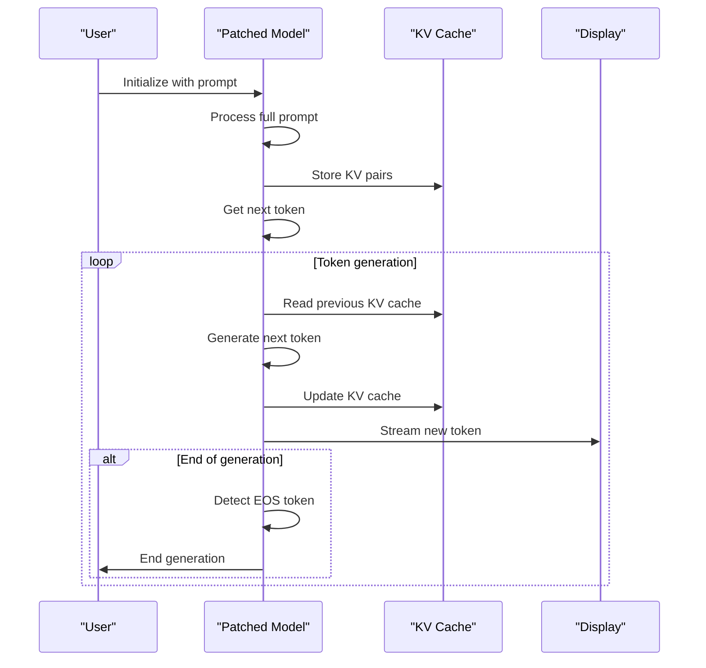
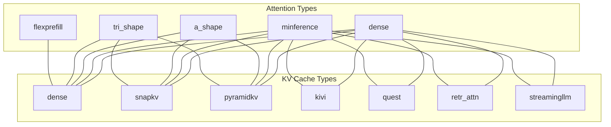
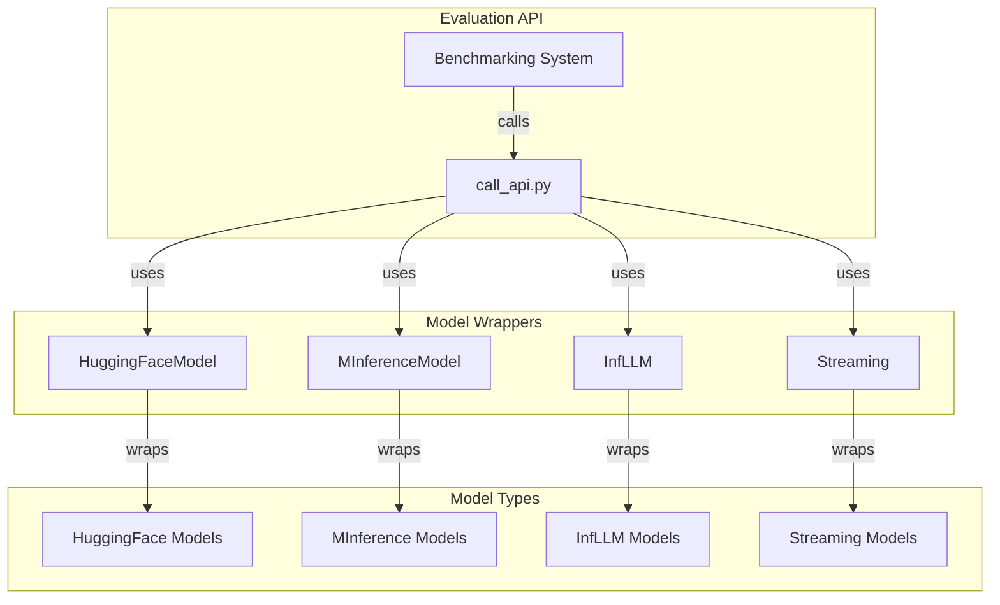

<!-- source: DeepWiki mcp.deepwiki.com · repo microsoft/MInference · page 6 Usage Examples · fetched 2026-10-26 -->

# Usage Examples

<details>
<summary>Relevant source files</summary>

The following files were used as context for generating this wiki page:

- [examples/run_hf.py](examples/run_hf.py)
- [examples/run_hf_streaming.py](examples/run_hf_streaming.py)
- [experiments/ruler/pred/call_api.py](experiments/ruler/pred/call_api.py)
- [experiments/ruler/pred/model_wrappers.py](experiments/ruler/pred/model_wrappers.py)
- [tests/test_e2e.py](tests/test_e2e.py)

</details>


This page provides practical examples of how to use MInference in various scenarios. MInference is a framework for accelerating inference for large language models (LLMs), particularly when processing long contexts, through dynamic sparse attention and KV cache optimization techniques. For a general overview of the system, see [Overview](#1).

## Basic Usage with HuggingFace Models

The simplest way to use MInference is to patch an existing HuggingFace model to use MInference's optimized attention mechanisms. Below is a basic example:

```python
from transformers import AutoModelForCausalLM, AutoTokenizer
from minference import MInference

# Load model and tokenizer
model_name = "gradientai/Llama-3-8B-Instruct-262k"
tokenizer = AutoTokenizer.from_pretrained(model_name)
model = AutoModelForCausalLM.from_pretrained(
    model_name,
    torch_dtype="auto",
    device_map="cuda",
    _attn_implementation="flash_attention_2",
)

# Patch MInference Module
minference_patch = MInference(
    attn_type="minference", model_name=model_name, kv_type="dense"
)
model = minference_patch(model)

# Generate text
prompt = "Hello, my name is"
batch_inputs = tokenizer(prompt, return_tensors="pt").to("cuda")
outputs = model.generate(**batch_inputs, max_length=10)
generated_text = tokenizer.decode(
    outputs[0][batch_inputs["input_ids"].shape[1]:], skip_special_tokens=True
)
print(f"Prompt: {prompt!r}, Generated text: {generated_text!r}")
```

The key components in this example:
1. Initialize an `MInference` object with the desired `attn_type` and `kv_type`
2. Call the `MInference` object with the model to patch it
3. Use the patched model for generation as you would with a regular HuggingFace model

Sources: [examples/run_hf.py:1-31]()

## MInference Patching Flow

The following diagram illustrates how MInference patches a model:



Sources: [examples/run_hf.py:18-23](), [tests/test_e2e.py:49-57]()

## Streaming Inference

MInference supports streaming inference, where tokens are generated one by one and displayed immediately, which is useful for interactive applications. Here's an example:

```python
from transformers import AutoModelForCausalLM, AutoTokenizer
from minference import MInference
import torch

# Load and patch model
model_name = "gradientai/Llama-3-8B-Instruct-Gradient-1048k"
tokenizer = AutoTokenizer.from_pretrained(model_name)
model = AutoModelForCausalLM.from_pretrained(
    model_name,
    torch_dtype="auto",
    device_map="cuda",
    _attn_implementation="flash_attention_2",
)

# Patch with MInference, using a_shape attention and CPU KV cache for long contexts
minference_patch = MInference(
    "a_shape",
    model_name,
    kv_cache_cpu=True,
)
model = minference_patch(model)

# Your streaming inference function
@torch.no_grad()
def greedy_generate(model, tokenizer, input_ids, past_key_values, max_gen_len):
    # Initial forward pass
    outputs = model(
        input_ids=input_ids,
        past_key_values=past_key_values,
        use_cache=True,
    )
    
    past_key_values = outputs.past_key_values
    pred_token_idx = outputs.logits[:, -1, :].argmax(dim=-1).unsqueeze(1)
    generated_ids = [pred_token_idx.item()]
    pos = 0
    
    # Generate tokens one by one
    for _ in range(max_gen_len - 1):
        outputs = model(
            input_ids=pred_token_idx,
            past_key_values=past_key_values,
            use_cache=True,
        )
        
        past_key_values = outputs.past_key_values
        pred_token_idx = outputs.logits[:, -1, :].argmax(dim=-1).unsqueeze(1)
        generated_ids.append(pred_token_idx.item())
        
        # Display tokens as they're generated
        generated_text = tokenizer.decode(
            generated_ids,
            skip_special_tokens=True,
        ).strip().split(" ")
        
        now = len(generated_text) - 1
        if now > pos:
            print(" ".join(generated_text[pos:now]), end=" ", flush=True)
            pos = now
            
        if pred_token_idx == tokenizer.eos_token_id:
            break
            
    print(" ".join(generated_text[pos:]), flush=True)
    return past_key_values
```

The streaming inference example demonstrates how to:
1. Generate tokens one at a time
2. Update the display incrementally as tokens are generated
3. Reuse past key/value caches for efficient generation

Sources: [examples/run_hf_streaming.py:17-66](), [examples/run_hf_streaming.py:109-114]()

## Streaming Inference Flow



Sources: [examples/run_hf_streaming.py:68-95]()

## Using Different Attention Types

MInference supports multiple attention types to optimize for different use cases:

| Attention Type | Description | Best For |
|----------------|-------------|----------|
| `dense` | Standard attention with no sparsity | Shorter contexts, high accuracy requirements |
| `minference` | Vertical/slash sparse attention patterns | Long contexts, general purpose |
| `a_shape` | A-Shape attention (combining local and global) | Streaming inference, document processing |
| `tri_shape` | Three-part attention pattern | Complex reasoning tasks |
| `flexprefill` | Flexible prefill attention | Very long context prefilling |

Example of using different attention types:

```python
# For general long context processing
minference_patch = MInference(
    attn_type="minference", 
    model_name=model_name, 
    kv_type="dense"
)

# For streaming inference
minference_patch = MInference(
    attn_type="a_shape", 
    model_name=model_name, 
    kv_type="dense"
)

# For very long context processing
minference_patch = MInference(
    attn_type="tri_shape", 
    model_name=model_name, 
    kv_type="snapkv"  # Combine with KV cache optimization
)
```

Sources: [tests/test_e2e.py:11](), [tests/test_e2e.py:105-110](), [examples/run_hf_streaming.py:143-154]()

## Using Different KV Cache Types

MInference provides various KV cache optimization techniques:

| KV Cache Type | Description | Best For |
|---------------|-------------|----------|
| `dense` | Standard KV cache with no optimization | Default option, medium-length contexts |
| `snapkv` | SnapKV compression technique | Memory optimization, long contexts |
| `pyramidkv` | Pyramid compression | Very long contexts, hierarchical processing |
| `kivi` | KIVI quantization | Memory efficiency, precision trade-off |
| `quest` | Query-specific attention | Efficient retrieval of information |
| `retr_attn` | Retrieval-augmented attention | Knowledge-intensive tasks |
| `streamingllm` | StreamingLLM compatible caching | Stream processing of long documents |

Example of combining attention types with KV cache optimizations:

```python
# Optimize for memory efficiency
minference_patch = MInference(
    attn_type="minference", 
    model_name=model_name, 
    kv_type="snapkv"
)

# Optimize for very long contexts
minference_patch = MInference(
    attn_type="tri_shape", 
    model_name=model_name, 
    kv_type="pyramidkv"
)

# Optimize for knowledge-intensive tasks
minference_patch = MInference(
    attn_type="minference", 
    model_name=model_name, 
    kv_type="retr_attn"
)
```

Sources: [tests/test_e2e.py:12-20](), [tests/test_e2e.py:95-103]()

## Attention Types and KV Cache Types Compatibility Matrix

The following diagram illustrates how different attention types can be combined with different KV cache types:



Sources: [tests/test_e2e.py:49-57](), [tests/test_e2e.py:93-103]()

## Advanced Configuration

MInference provides several advanced configuration options for fine-tuning performance:

```python
# CPU KV cache for handling very long contexts
minference_patch = MInference(
    attn_type="minference",
    model_name=model_name,
    kv_type="dense",
    kv_cache_cpu=True,           # Store KV cache on CPU
    kv_cache_cpu_device="cpu",   # Specify CPU device
)

# Starting from specific layers
minference_patch = MInference(
    attn_type="minference",
    model_name=model_name,
    kv_type="dense",
    starting_layer=20,           # Only apply MInference to layers >= 20
)

# Using custom configuration file
minference_patch = MInference(
    attn_type="minference",
    model_name=model_name,
    config_path="path/to/config.json",  # Custom configuration
)
```

Sources: [experiments/ruler/pred/model_wrappers.py:73-91](), [experiments/ruler/pred/call_api.py:105-109]()

## Integration with Evaluation Frameworks

MInference can be integrated with evaluation frameworks through wrapper classes:



The `MInferenceModel` class provides a wrapper for using MInference in evaluation contexts:

```python
from model_wrappers import MInferenceModel

# Create a MInferenceModel instance
model = MInferenceModel(
    name_or_path="gradientai/Llama-3-8B-Instruct-Gradient-1048k",
    config_path="configs/llama3_8b.json",
    do_sample=True,
    temperature=0.7,
    top_k=50,
    top_p=0.95,
    stop=["</s>", "\n\n"],
    max_new_tokens=100,
    attn_type="minference",
    kv_type="snapkv",
    kv_cache_cpu=True,
)

# Use the model for generation
response = model("Tell me a short story about a robot.")
generated_text = response["text"][0]
```

Sources: [experiments/ruler/pred/model_wrappers.py:73-158](), [experiments/ruler/pred/call_api.py:200-217]()

## Comprehensive Usage Example for Benchmarking

The following example demonstrates how to use MInference with different configurations for benchmarking purposes:

```python
def benchmark_inference(model_name, attn_types, kv_types, input_text, max_tokens=100):
    tokenizer = AutoTokenizer.from_pretrained(model_name)
    base_model = AutoModelForCausalLM.from_pretrained(
        model_name,
        torch_dtype="auto",
        device_map="cuda",
        _attn_implementation="flash_attention_2",
    )
    
    results = {}
    
    # Benchmark all combinations
    for attn_type in attn_types:
        for kv_type in kv_types:
            config_name = f"{attn_type}_{kv_type}"
            print(f"Testing configuration: {config_name}")
            
            # Create patched model
            minference_patch = MInference(
                attn_type=attn_type,
                model_name=model_name,
                kv_type=kv_type,
            )
            model = minference_patch(base_model.clone())
            
            # Measure performance
            start_time = time.time()
            inputs = tokenizer(input_text, return_tensors="pt").to(model.device)
            outputs = model.generate(
                **inputs, 
                max_new_tokens=max_tokens,
                do_sample=False
            )
            end_time = time.time()
            
            # Extract results
            generated_text = tokenizer.decode(
                outputs[0][inputs.input_ids.shape[1]:], 
                skip_special_tokens=True
            )
            
            results[config_name] = {
                "time": end_time - start_time,
                "text": generated_text
            }
            
            # Clean up
            del model
            torch.cuda.empty_cache()
    
    return results
```

This benchmarking function demonstrates how you can systematically test different combinations of attention types and KV cache types to find the optimal configuration for your specific use case.

Sources: [tests/test_e2e.py:49-88]()

## E2E Test Suite Usage

MInference provides an end-to-end test suite that demonstrates how to use different configuration combinations:

```python
# Test all attention types with dense KV cache
for attn_type in ["dense", "a_shape", "tri_shape", "minference", "flexprefill"]:
    minference_patch = MInference(
        attn_type=attn_type,
        model_name=model_name,
        kv_type="dense",
    )
    model = minference_patch(base_model)
    # Run inference tests...

# Test minference attention with all KV cache types
for kv_type in ["dense", "snapkv", "pyramidkv", "quest", "streamingllm", "retr_attn", "kivi"]:
    minference_patch = MInference(
        attn_type="minference",
        model_name=model_name,
        kv_type=kv_type,
    )
    model = minference_patch(base_model)
    # Run inference tests...
```

Sources: [tests/test_e2e.py:95-110]()

## Troubleshooting and Best Practices

Here are some best practices when using MInference:

1. **Memory Management**: Use `torch.cuda.empty_cache()` after inference to free up GPU memory, especially when working with large models or long contexts.

2. **Attention Type Selection**:
   - Use `minference` for general-purpose long context processing
   - Use `a_shape` for streaming inference applications
   - Use `tri_shape` for complex reasoning with long contexts
   - Use `flexprefill` when prefilling very long contexts

3. **KV Cache Optimization**:
   - Use `snapkv` or `pyramidkv` when memory is a constraint
   - Use `kivi` for quantization-based memory optimization
   - Use `retr_attn` for knowledge-intensive tasks requiring retrieval of information

4. **Performance Optimization**:
   - For very long contexts, enable CPU KV cache with `kv_cache_cpu=True`
   - When using CPU KV cache, specify the device with `kv_cache_cpu_device`
   - Use `starting_layer` to apply optimizations only to specific layers

Sources: [experiments/ruler/pred/model_wrappers.py:141-142](), [examples/run_hf_streaming.py:112-114]()

---

